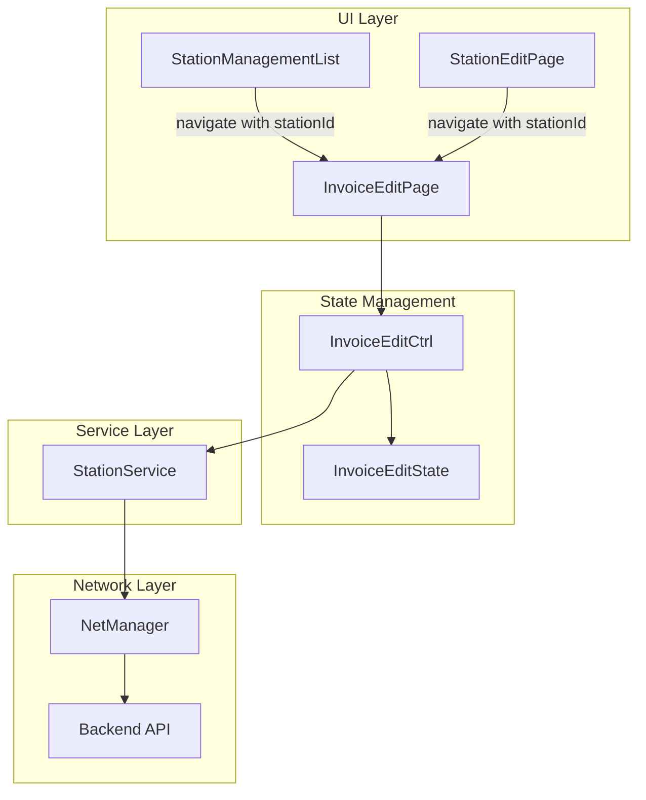

# Design Document: Invoice Edit Page

## Overview

本设计文档描述了加油站发票信息编辑页面的技术实现方案。该功能允许用户从加油站管理列表或加油站详情页进入发票编辑页面，补充或修改加油站的发票信息。

系统采用 Flutter + BLoC 架构模式，遵循项目现有的页面结构（page.dart, view.dart, controller.dart, state.dart），通过 Retrofit 调用后端 API 进行数据持久化。

## Architecture



## Components and Interfaces

### 1. InvoiceEditPage (page.dart)

页面入口组件，负责接收路由参数并初始化 BLoC。

```dart
class InvoiceEditPage extends BasePage {
  const InvoiceEditPage({Key? key}) : super(key: key);
}
```

路由参数：
- `stationId` (int, required): 加油站ID
- `invoice` (InvoiceInfo?, optional): 已有的发票信息，用于预填充表单

### 2. InvoiceEditCtrl (controller.dart)

业务逻辑控制器，继承自 Cubit<InvoiceEditState>。

```dart
class InvoiceEditCtrl extends Cubit<InvoiceEditState> {
  InvoiceEditCtrl({required int stationId, InvoiceInfo? invoice});
  
  void updateInvoiceTitle(String value);
  void updateTaxNumber(String value);
  void updateBankName(String value);
  void updateBankAccount(String value);
  void updateCompanyAddress(String value);
  void updateCompanyPhone(String value);
  void updateInvoiceType(String value);
  
  Future<bool> save(BuildContext context);
  bool validate();
}
```

### 3. InvoiceEditState (state.dart)

状态管理类，存储表单数据和UI状态。

```dart
class InvoiceEditState {
  final int stationId;
  final String invoiceTitle;
  final String taxNumber;
  final String bankName;
  final String bankAccount;
  final String companyAddress;
  final String companyPhone;
  final String invoiceType;
  final bool isLoading;
  final bool hasError;
  final String? errorMessage;
}
```

### 4. InvoiceEditForm (widgets/invoice_edit_form.dart)

表单UI组件，包含所有输入字段和保存按钮。新增以下UI组件：

- **StationRelationCard**: 显示关联加油站信息的卡片
- **InvoiceTypeSegmentedControl**: 发票类型分段控制器
- **ModernFormField**: 带有现代化样式的表单输入框

### 5. StationService 扩展

在现有 StationService 中添加发票相关接口：

```dart
/// 更新加油站发票信息
@PUT('/stations/{id}/invoice')
Future updateStationInvoice(
  @Path('id') int id,
  @Body() UpdateInvoiceRequest request,
);
```

### 6. 数据模型

```dart
// 发票信息模型
@JsonSerializable()
class InvoiceInfo {
  final String? invoiceTitle;
  final String? taxNumber;
  final String? bankName;
  final String? bankAccount;
  final String? companyAddress;
  final String? companyPhone;
  final String? invoiceType;
}

// 更新发票请求模型
@JsonSerializable()
class UpdateInvoiceRequest {
  final String invoiceTitle;
  final String taxNumber;
  final String bankName;
  final String bankAccount;
  final String companyAddress;
  final String companyPhone;
  final String invoiceType;
}
```

## Data Models

### InvoiceInfo

| 字段 | 类型 | 描述 | 验证规则 |
|------|------|------|----------|
| invoiceTitle | String | 发票抬头 | 非空 |
| taxNumber | String | 税号 | 非空，15-20位字母数字 |
| bankName | String | 开户银行 | 非空 |
| bankAccount | String | 银行账号 | 非空，纯数字 |
| companyAddress | String | 公司地址 | 非空 |
| companyPhone | String | 公司电话 | 非空，有效电话格式 |
| invoiceType | String | 发票类型 | 枚举值：special_vat, normal_vat |

### InvoiceType 枚举

| 值 | 显示名称 |
|----|----------|
| special_vat | 增值税专用发票 |
| normal_vat | 增值税普通发票 |

### StationInfo (用于关联卡片显示)

| 字段 | 类型 | 描述 |
|------|------|------|
| stationId | int | 加油站ID |
| stationName | String | 加油站名称 |

## UI Design Specifications

### 颜色规范

| 用途 | 颜色值 | 说明 |
|------|--------|------|
| 主色调 | #7165E3 | 紫色，用于按钮、链接、高亮 |
| 页面背景 | #F5F7FA | 浅灰色 |
| 卡片背景 | #FFFFFF | 白色 |
| 输入框背景 | #F9FAFB | 浅灰色 |
| 边框颜色 | #E5E7EB | 灰色 |
| 主文本 | #1F2937 | 深灰色 |
| 次要文本 | #6B7280 | 中灰色 |
| 关联卡片背景 | #EEECFC | 浅紫色 |
| 关联卡片边框 | rgba(113, 101, 227, 0.2) | 半透明紫色 |
| 焦点阴影 | rgba(113, 101, 227, 0.1) | 半透明紫色 |

### 字体规范

| 用途 | 字体 | 说明 |
|------|------|------|
| 普通文本 | -apple-system, PingFang SC | 系统默认字体 |
| 税号/账号 | DIN Alternate, monospace | 等宽字体，提高可读性 |

### 组件样式规范

#### 关联加油站卡片
- 背景色: #EEECFC
- 边框: 1px solid rgba(113, 101, 227, 0.2)
- 圆角: 8px
- 内边距: 12px 16px
- 图标: 链接图标，紫色
- 文字: 13px, 紫色, 加粗

#### 发票类型切换器
- 容器背景: #F3F4F6
- 容器圆角: 8px
- 容器内边距: 4px
- 按钮圆角: 6px
- 未选中: 透明背景，灰色文字(#6B7280)
- 选中: 白色背景，紫色文字(#7165E3)，阴影 0 1px 3px rgba(0,0,0,0.1)

#### 表单输入框
- 背景色: #F9FAFB
- 边框: 1px solid #E5E7EB
- 圆角: 8px
- 内边距: 12px
- 字体大小: 15px
- 焦点状态:
  - 边框色: #7165E3
  - 背景色: #FFFFFF
  - 阴影: 0 0 0 3px rgba(113, 101, 227, 0.1)

#### 分割线
- 高度: 1px
- 背景色: #F3F4F6
- 标签: 12px, 紫色, 加粗

#### 保存按钮
- 背景色: #7165E3
- 文字颜色: #FFFFFF
- 圆角: 28px
- 内边距: 14px
- 字体大小: 16px, 加粗
- 点击效果: opacity 0.9

## Correctness Properties

*A property is a characteristic or behavior that should hold true across all valid executions of a system-essentially, a formal statement about what the system should do. Properties serve as the bridge between human-readable specifications and machine-verifiable correctness guarantees.*

### Property 1: Station ID Parameter Initialization
*For any* valid station ID, when InvoiceEditPage is initialized with that station ID, the state SHALL contain the same station ID value.
**Validates: Requirements 1.2, 2.2**

### Property 2: Invoice Data Pre-population
*For any* existing invoice data, when InvoiceEditPage loads with that data, all form fields SHALL be populated with the corresponding values from the invoice data.
**Validates: Requirements 1.3**

### Property 3: Form Field Validation
*For any* form input values, the validation function SHALL return true only when all required fields are non-empty AND tax number matches the valid format AND bank account contains only digits AND phone number matches valid format.
**Validates: Requirements 3.2, 3.3, 3.4, 3.5**

### Property 4: API Request Data Integrity
*For any* valid form state, when save is called, the API request body SHALL contain all form field values exactly as stored in the state.
**Validates: Requirements 4.1**

### Property 5: Invoice Type Selection State
*For any* invoice type value (special_vat or normal_vat), when the user selects that type, the state SHALL be updated to reflect the selected type and the UI SHALL highlight only the selected option.
**Validates: Requirements 7.2**

## Error Handling

### 验证错误

| 错误场景 | 错误消息 |
|----------|----------|
| 发票抬头为空 | 请输入发票抬头 |
| 税号为空 | 请输入税号 |
| 税号格式无效 | 税号格式不正确 |
| 开户银行为空 | 请输入开户银行 |
| 银行账号为空 | 请输入银行账号 |
| 银行账号非数字 | 银行账号格式不正确 |
| 公司地址为空 | 请输入公司地址 |
| 公司电话为空 | 请输入公司电话 |
| 公司电话格式无效 | 电话号码格式不正确 |

### 网络错误

| 错误场景 | 处理方式 |
|----------|----------|
| 网络超时 | 显示"网络超时，请稍后重试"提示 |
| 服务器错误 | 显示"保存失败，请稍后重试"提示 |
| 未授权 | 跳转到登录页面 |

## Testing Strategy

### 单元测试

1. **验证器测试**
   - 测试 InvoiceValidator 各字段验证逻辑
   - 覆盖有效输入和无效输入场景

2. **Controller 测试**
   - 测试状态更新方法
   - 测试 validate() 方法
   - 测试 save() 方法（使用 mock service）

### 属性测试

使用 `dart_quickcheck` 或 `glados` 库进行属性测试：

1. **Property 1 测试**: 生成随机 station ID，验证初始化后状态正确
2. **Property 2 测试**: 生成随机 InvoiceInfo，验证表单预填充正确
3. **Property 3 测试**: 生成随机表单输入，验证验证逻辑一致性
4. **Property 4 测试**: 生成随机有效表单状态，验证 API 请求数据完整性

### 测试框架

- 单元测试: `flutter_test`
- 属性测试: `glados` (Dart property-based testing library)
- Mock: `mocktail`

### 测试配置

每个属性测试运行至少 100 次迭代以确保覆盖边界情况。
