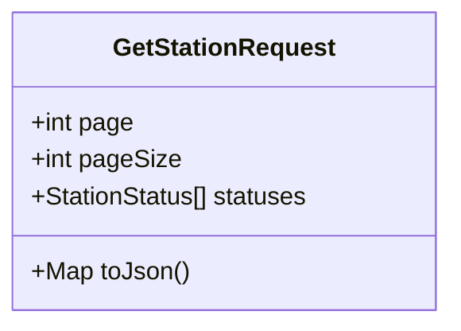
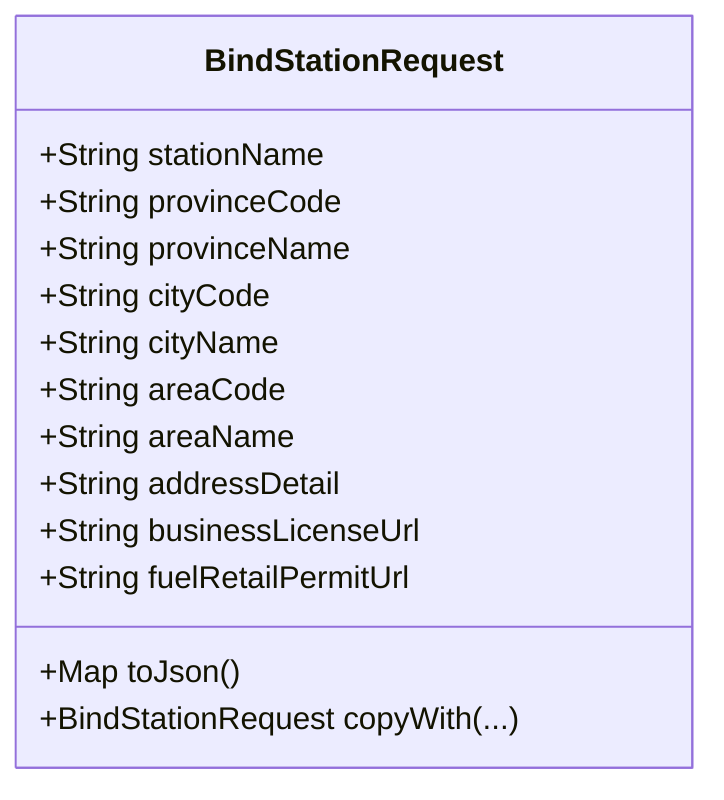
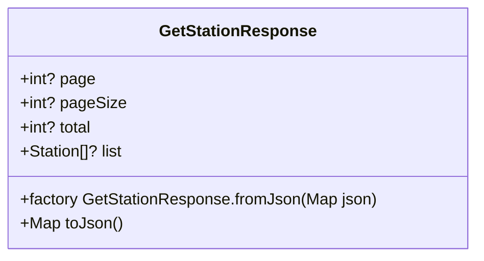
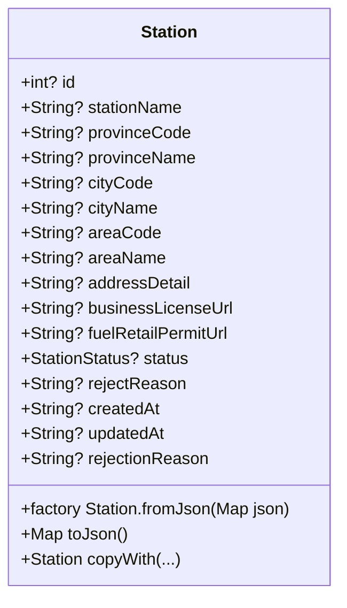
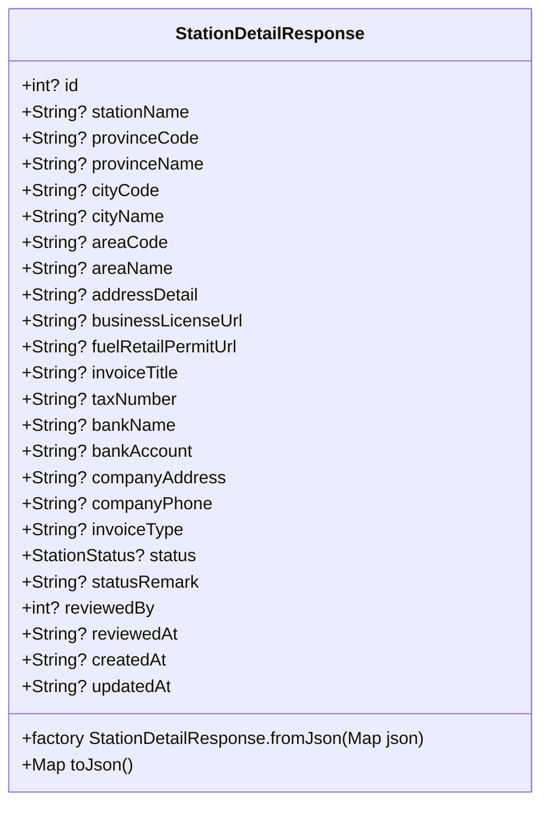
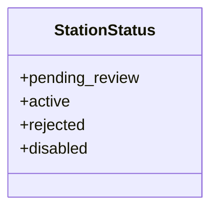
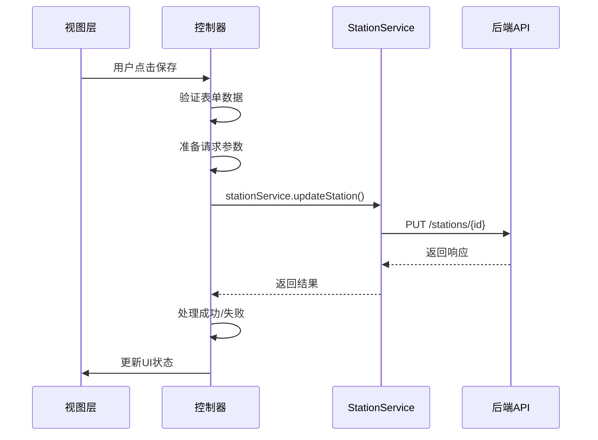
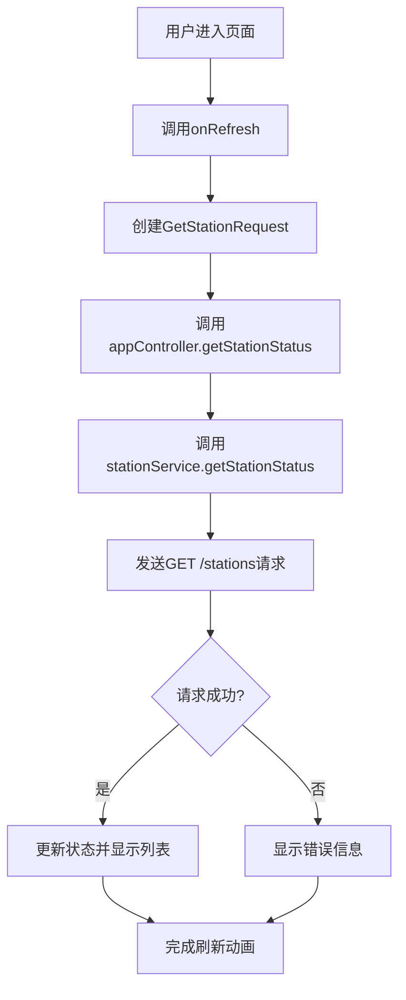
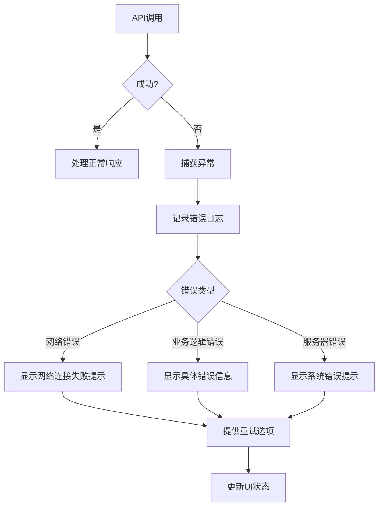
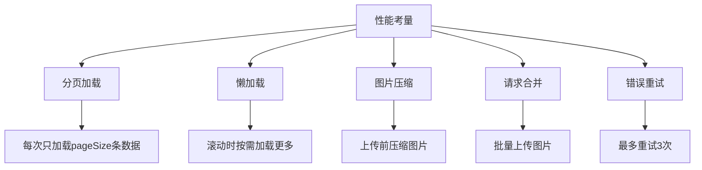

# 加油站管理API

<cite>
**本文档引用的文件**
- [station_req_type.dart](file://lib/global/model/station_req_type.dart)
- [station_res_type.dart](file://lib/global/model/station_res_type.dart)
- [station_service.dart](file://lib/global/service/station_service.dart)
- [station_list/controller.dart](file://lib/pages/station_list/controller.dart)
- [station_edit/controller.dart](file://lib/pages/station_edit/controller.dart)
- [bind_station/controller.dart](file://lib/pages/bind_station/controller.dart)
- [app_controller.dart](file://lib/global/app_controller.dart)
- [common.dart](file://lib/global/enum/common.dart)
</cite>

## 目录
1. [简介](#简介)
2. [API端点](#api端点)
3. [请求数据结构](#请求数据结构)
4. [响应数据结构](#响应数据结构)
5. [服务使用示例](#服务使用示例)
6. [错误处理](#错误处理)
7. [缓存策略与性能考量](#缓存策略与性能考量)

## 简介
加油站管理API提供了一套完整的加油站管理功能，包括加油站的增删改查、绑定、列表分页和详情获取等操作。该API通过RESTful接口实现，支持对加油站信息的全面管理。系统定义了多种加油站状态，包括待审核、审核通过、审核失败和禁用等，以满足不同业务场景的需求。

**Section sources**
- [station_res_type.dart](file://lib/global/model/station_res_type.dart#L12-L24)
- [common.dart](file://lib/global/enum/common.dart#L12-L24)

## API端点
加油站管理API提供了以下主要端点：

| HTTP方法 | 端点 | 描述 |
|---------|------|------|
| GET | /stations | 获取加油站列表（支持分页和状态过滤） |
| GET | /stations/{id} | 获取指定加油站的详细信息 |
| POST | /stations | 新增加油站（绑定操作） |
| PUT | /stations/{id} | 编辑加油站信息 |
| PUT | /stations/{id}/invoice | 更新加油站发票信息 |

```mermaid
flowchart TD
A[客户端] --> B{操作类型}
B --> C[获取列表]
B --> D[获取详情]
B --> E[新增加油站]
B --> F[编辑信息]
C --> G[GET /stations]
D --> H[GET /stations/{id}]
E --> I[POST /stations]
F --> J[PUT /stations/{id}]
```

**Diagram sources**
- [station_service.dart](file://lib/global/service/station_service.dart#L15-L35)

**Section sources**
- [station_service.dart](file://lib/global/service/station_service.dart#L15-L35)

## 请求数据结构
### 获取加油站列表请求
`GetStationRequest`类定义了获取加油站列表的请求参数：

- **page**: 当前页码（必需）
- **pageSize**: 每页大小（必需）
- **statuses**: 状态过滤列表（必需，支持多个状态）



**Diagram sources**
- [station_req_type.dart](file://lib/global/model/station_req_type.dart#L4-L16)

### 绑定/编辑加油站请求
`BindStationRequest`类定义了绑定或编辑加油站的请求参数：

- **stationName**: 加油站名称（必需）
- **provinceCode**: 省级行政区划代码（必需）
- **provinceName**: 省级行政区划名称（必需）
- **cityCode**: 市级行政区划代码（必需）
- **cityName**: 市级行政区划名称（必需）
- **areaCode**: 区级行政区划代码（必需）
- **areaName**: 区级行政区划名称（必需）
- **addressDetail**: 详细地址（不含省市区，必需）
- **businessLicenseUrl**: 营业执照图片URL（必需）
- **fuelRetailPermitUrl**: 成品油零售许可证图片URL（必需）



**Diagram sources**
- [station_req_type.dart](file://lib/global/model/station_req_type.dart#L20-L56)

## 响应数据结构
### 加油站列表响应
`GetStationResponse`类定义了获取加油站列表的响应结构：

- **page**: 当前页码
- **pageSize**: 每页大小
- **total**: 总记录数
- **list**: 加油站列表（`Station`对象数组）



**Diagram sources**
- [station_res_type.dart](file://lib/global/model/station_res_type.dart#L7-L23)

### 加油站实体
`Station`类定义了加油站的基本信息：

- **id**: 加油站ID
- **stationName**: 加油站名称
- **provinceCode**: 省级行政区划代码
- **provinceName**: 省级行政区划名称
- **cityCode**: 市级行政区划代码
- **cityName**: 市级行政区划名称
- **areaCode**: 区级行政区划代码
- **areaName**: 区级行政区划名称
- **addressDetail**: 详细地址
- **businessLicenseUrl**: 营业执照图片URL
- **fuelRetailPermitUrl**: 成品油零售许可证图片URL
- **status**: 状态（`StationStatus`枚举）
- **rejectReason**: 拒绝原因
- **createdAt**: 创建时间
- **updatedAt**: 更新时间



**Diagram sources**
- [station_res_type.dart](file://lib/global/model/station_res_type.dart#L27-L67)

### 加油站详情响应
`StationDetailResponse`类在`Station`基础上扩展了发票相关信息：

- **invoiceTitle**: 发票抬头
- **taxNumber**: 纳税人识别号
- **bankName**: 开户银行
- **bankAccount**: 银行账号
- **companyAddress**: 公司地址
- **companyPhone**: 公司电话
- **invoiceType**: 发票类型
- **statusRemark**: 状态备注
- **reviewedBy**: 审核人ID
- **reviewedAt**: 审核时间



**Diagram sources**
- [station_res_type.dart](file://lib/global/model/station_res_type.dart#L106-L163)

### 状态枚举
`StationStatus`枚举定义了加油站的四种状态：

- **pending_review**: 待审核
- **active**: 审核通过（启用）
- **rejected**: 审核失败
- **disabled**: 禁用



**Diagram sources**
- [common.dart](file://lib/global/enum/common.dart#L12-L24)

## 服务使用示例
### 在页面控制器中调用服务
以下是`StationEditCtrl`中调用`StationService`的示例：



**Diagram sources**
- [station_edit/controller.dart](file://lib/pages/station_edit/controller.dart#L126-L252)
- [station_service.dart](file://lib/global/service/station_service.dart#L31-L35)

### 获取加油站列表
在`StationListCtrl`中获取加油站列表的流程：



**Diagram sources**
- [station_list/controller.dart](file://lib/pages/station_list/controller.dart#L24-L82)
- [app_controller.dart](file://lib/global/app_controller.dart#L101-L108)

**Section sources**
- [station_list/controller.dart](file://lib/pages/station_list/controller.dart#L24-L82)
- [app_controller.dart](file://lib/global/app_controller.dart#L101-L108)

## 错误处理
### 常见错误场景
系统处理以下常见错误场景：

1. **重复绑定**: 当用户尝试绑定已存在的加油站时
2. **无效ID**: 当请求中包含不存在的加油站ID时
3. **参数验证失败**: 当请求参数不符合验证规则时
4. **网络连接问题**: 当无法连接到服务器时
5. **权限不足**: 当用户没有执行特定操作的权限时

### 错误处理流程


**Diagram sources**
- [station_edit/controller.dart](file://lib/pages/station_edit/controller.dart#L252-L260)
- [station_list/controller.dart](file://lib/pages/station_list/controller.dart#L68-L82)

**Section sources**
- [station_edit/controller.dart](file://lib/pages/station_edit/controller.dart#L252-L260)
- [station_list/controller.dart](file://lib/pages/station_list/controller.dart#L68-L82)

## 缓存策略与性能考量
### 缓存机制
系统采用多层缓存策略提升性能：

1. **内存缓存**: 使用`HydratedCubit`在内存中缓存用户和加油站信息
2. **持久化缓存**: 将重要数据持久化到本地存储，确保应用重启后数据不丢失
3. **请求缓存**: 对频繁访问的API响应进行短期缓存

### 性能优化措施


**Diagram sources**
- [net_manager.dart](file://lib/net/net_manager.dart#L15-L16)
- [station_list/controller.dart](file://lib/pages/station_list/controller.dart#L14-L18)

**Section sources**
- [net_manager.dart](file://lib/net/net_manager.dart#L15-L16)
- [station_list/controller.dart](file://lib/pages/station_list/controller.dart#L14-L18)