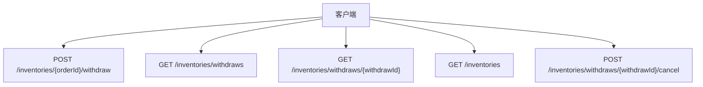
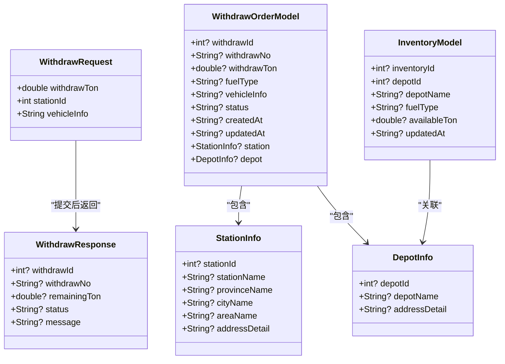
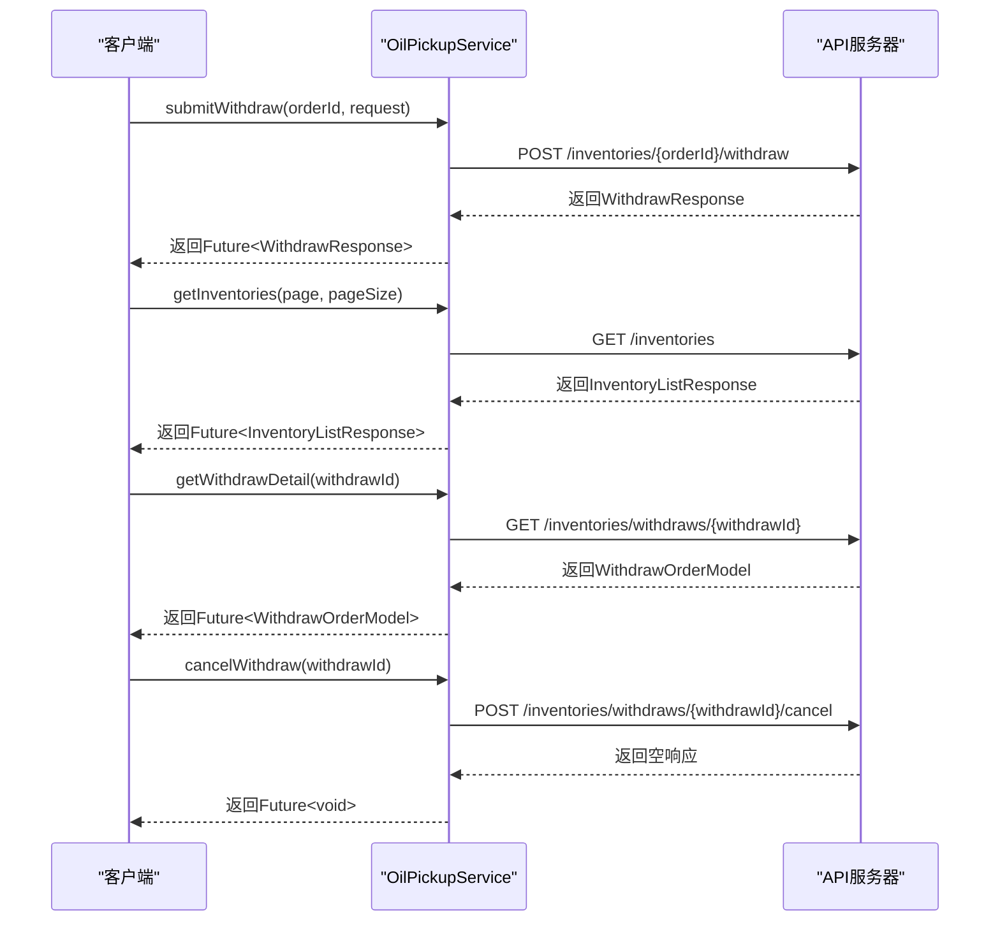
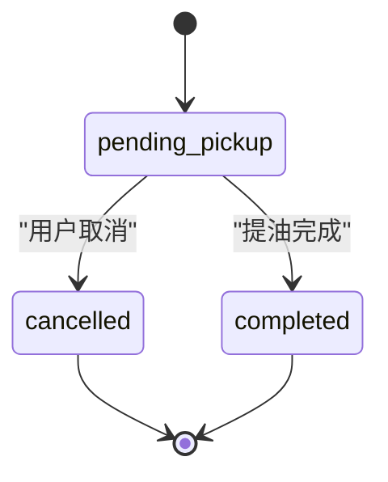

# 提油业务API

<cite>
**本文档引用的文件**
- [withdraw_data.dart](file://lib/pages/oil_pickup/model/withdraw_data.dart)
- [oil_pickup_service.dart](file://lib/pages/oil_pickup/service/oil_pickup_service.dart)
- [controller.dart](file://lib/pages/oil_pickup/controller.dart)
- [oil_pickup_detail\controller.dart](file://lib/pages/oil_pickup_detail/controller.dart)
- [pickup_order_detail\controller.dart](file://lib/pages/pickup_order_detail/controller.dart)
- [spec.md](file://openspec/specs/oil-pickup/spec.md)
- [oil-pickup-order-detail\spec.md](file://openspec/specs/oil-pickup-order-detail/spec.md)
- [api_exception.dart](file://lib/net/api_exception.dart)
- [response.dart](file://lib/net/response.dart)
</cite>

## 目录
1. [简介](#简介)
2. [API端点](#api端点)
3. [数据模型](#数据模型)
4. [服务使用示例](#服务使用示例)
5. [验证规则](#验证规则)
6. [状态流转机制](#状态流转机制)
7. [错误处理策略](#错误处理策略)
8. [性能优化方案](#性能优化方案)

## 简介
提油业务API为用户提供了一套完整的提油操作功能，包括提油申请、库存查询、提油详情获取和订单取消等核心功能。该API基于Dart语言和Flutter框架构建，采用Retrofit风格的HTTP客户端进行网络通信，通过清晰的接口定义和数据模型实现了前后端的高效协作。系统通过`OilPickupService`服务类封装了所有提油相关的API调用，并结合BLoC模式的状态管理，确保了业务逻辑的清晰分离和数据流的可预测性。整个提油流程从用户选择库存、填写提油信息到生成提油凭证，再到查看订单详情和取消订单，形成了一个完整的闭环。

**Section sources**
- [oil_pickup_service.dart](file://lib/pages/oil_pickup/service/oil_pickup_service.dart)
- [spec.md](file://openspec/specs/oil-pickup/spec.md)

## API端点
提油业务API提供了一系列RESTful端点，支持提油申请、库存查询、详情获取和订单取消等操作。所有端点均采用标准的HTTP方法和清晰的URL路径设计，便于客户端调用和维护。

| HTTP方法 | 完整URL路径 | 描述 |
|---------|------------|------|
| POST | /inventories/{orderId}/withdraw | 提交提油申请，创建新的提油订单 |
| GET | /inventories/withdraws | 获取提油订单列表，支持分页和状态筛选 |
| GET | /inventories/withdraws/{withdrawId} | 获取指定提油订单的详细信息 |
| GET | /inventories | 查询用户可用的库存油信息，支持分页 |
| POST | /inventories/withdraws/{withdrawId}/cancel | 取消指定的提油申请 |



**Diagram sources**
- [oil_pickup_service.dart](file://lib/pages/oil_pickup/service/oil_pickup_service.dart)

**Section sources**
- [oil_pickup_service.dart](file://lib/pages/oil_pickup/service/oil_pickup_service.dart)

## 数据模型
提油业务的核心数据模型定义在`withdraw_data.dart`文件中，涵盖了提油请求、响应、订单信息和库存信息等关键数据结构。这些模型通过`json_annotation`库实现了JSON序列化和反序列化，确保了与后端API的数据交互顺畅。

### 提油请求模型 (WithdrawRequest)
提油请求模型用于封装用户提交提油申请时所需的数据。

| 字段名 | 类型 | 必填 | 描述 |
|-------|------|-----|------|
| withdrawTon | double | 是 | 提油吨数，必须大于0 |
| stationId | int | 是 | 加油站ID，标识提油地点 |
| vehicleInfo | String | 是 | 车辆信息，包含原始文本和解析后的JSON数据，以`|||`分隔 |

### 提油响应模型 (WithdrawResponse)
提油响应模型用于返回提油申请的结果信息。

| 字段名 | 类型 | 描述 |
|-------|------|------|
| withdrawId | int | 提油订单ID |
| withdrawNo | String | 提油订单编号 |
| remainingTon | double | 剩余库存吨数 |
| status | String | 订单状态（如"pending_pickup"） |
| message | String | 响应消息，用于错误提示 |

### 提油订单模型 (WithdrawOrderModel)
提油订单模型用于表示一个完整的提油订单。

| 字段名 | 类型 | 描述 |
|-------|------|------|
| withdrawId | int | 提油订单ID |
| withdrawNo | String | 提油订单编号 |
| withdrawTon | double | 提油吨数 |
| fuelType | String | 油品类型（如"95#"） |
| vehicleInfo | String | 车辆信息（JSON字符串） |
| status | String | 订单状态 |
| createdAt | String | 创建时间 |
| updatedAt | String | 更新时间 |
| station | StationInfo | 加油站信息 |
| depot | DepotInfo | 油库信息 |

### 库存模型 (InventoryModel)
库存模型用于表示用户的可用库存信息。

| 字段名 | 类型 | 描述 |
|-------|------|------|
| inventoryId | int | 库存ID |
| depotId | int | 油库ID |
| depotName | String | 油库名称 |
| fuelType | String | 油品类型 |
| availableTon | double | 可用吨数 |
| updatedAt | String | 更新时间 |



**Diagram sources**
- [withdraw_data.dart](file://lib/pages/oil_pickup/model/withdraw_data.dart)

**Section sources**
- [withdraw_data.dart](file://lib/pages/oil_pickup/model/withdraw_data.dart)

## 服务使用示例
`OilPickupService`是提油业务的核心服务类，通过Dio和Retrofit库封装了所有API调用。以下是在控制器中调用服务方法的示例代码。

### 提交提油申请
```dart
// 在OilPickupDetailCtrl中调用
final request = WithdrawRequest(
  withdrawTon: oilAmountDouble,
  stationId: stationId,
  vehicleInfo: vehicleInfoJson,
);

final response = await oilPickupService.submitWithdraw(
  state.inventory!.inventoryId!,
  request,
);
```

### 查询库存信息
```dart
// 在OilPickupCtrl中调用
final response = await oilPickupService.getInventories(
  page: 1,
  pageSize: _pageSize,
);
```

### 获取提油订单详情
```dart
// 在PickupOrderDetailCtrl中调用
final detail = await oilPickupService.getWithdrawDetail(withdrawId);
```

### 取消提油订单
```dart
// 在PickupOrderDetailCtrl中调用
await oilPickupService.cancelWithdraw(withdrawId);
```



**Diagram sources**
- [oil_pickup_service.dart](file://lib/pages/oil_pickup/service/oil_pickup_service.dart)
- [oil_pickup_detail\controller.dart](file://lib/pages/oil_pickup_detail/controller.dart)
- [pickup_order_detail\controller.dart](file://lib/pages/pickup_order_detail/controller.dart)

**Section sources**
- [oil_pickup_service.dart](file://lib/pages/oil_pickup/service/oil_pickup_service.dart)
- [oil_pickup_detail\controller.dart](file://lib/pages/oil_pickup_detail/controller.dart)
- [pickup_order_detail\controller.dart](file://lib/pages/pickup_order_detail/controller.dart)

## 验证规则
提油业务API实施了严格的验证规则，确保数据的完整性和业务逻辑的正确性。这些规则在客户端和服务端均有体现，形成了多层次的防护机制。

### 输入验证
- **提油量验证**：必须为大于0的数字，且不能超过可用库存量
- **车辆信息验证**：必须包含车牌号、驾驶员姓名、身份证号等必填字段
- **加油站选择**：必须选择一个有效的加油站作为提油地点

### 业务规则验证
- **库存检查**：提交提油申请时，系统会检查可用库存是否足够
- **订单状态检查**：只有在"待提油"状态的订单才能被取消
- **唯一性检查**：同一买油订单只能对应一个待完成的提油订单

### 客户端验证实现
```dart
String? _validateOilAmount(String amount, {required bool forSubmit}) {
  final value = amount.trim();
  if (value.isEmpty) {
    return forSubmit ? '请输入提油量' : null;
  }

  final oilAmountDouble = double.tryParse(value);
  if (oilAmountDouble == null) {
    return '提油量必须为数字';
  }
  if (oilAmountDouble <= 0) {
    return '提油量必须大于0';
  }

  final availableTon = state.inventory?.availableTon ?? 0;
  if (oilAmountDouble > availableTon) {
    return '提油量不能超过可用库存${availableTon.toInt()} 吨';
  }

  return null;
}
```

**Section sources**
- [oil_pickup_detail\controller.dart](file://lib/pages/oil_pickup_detail/controller.dart)
- [spec.md](file://openspec/specs/oil-pickup/spec.md)

## 状态流转机制
提油订单的状态流转是整个业务流程的核心，系统通过明确的状态定义和转换规则，确保了订单生命周期的可追踪性和可管理性。

### 订单状态
- **待提油 (pending_pickup)**：提油申请已提交，等待提油
- **已完成 (completed)**：提油已完成
- **已取消 (cancelled)**：提油申请已被取消

### 状态流转图


### 状态管理
系统采用BLoC模式进行状态管理，通过`OilPickupState`和`OilPickupDetailState`等状态类来管理UI状态。当API调用成功或失败时，控制器会发出新的状态，UI组件根据状态变化进行相应的更新。

**Diagram sources**
- [oil-pickup-order-detail\spec.md](file://openspec/specs/oil-pickup-order-detail/spec.md)

**Section sources**
- [oil-pickup-order-detail\spec.md](file://openspec/specs/oil-pickup-order-detail/spec.md)
- [oil_pickup_detail\state.dart](file://lib/pages/oil_pickup_detail/state.dart)

## 错误处理策略
系统实施了全面的错误处理策略，确保在各种异常情况下都能提供良好的用户体验和系统的稳定性。

### 错误类型
- **网络错误**：包括连接超时、网络中断等
- **业务错误**：如库存不足、无效订单等
- **服务器错误**：如500内部服务器错误
- **客户端错误**：如400请求参数错误

### 错误处理实现
```dart
try {
  final response = await oilPickupService.submitWithdraw(
    state.inventory!.inventoryId!,
    request,
  );
  // 处理成功响应
} on DioException catch (e) {
  // 处理Dio异常
  switch (e.type) {
    case DioExceptionType.connectionTimeout:
      // 显示"网络连接超时"提示
      break;
    case DioExceptionType.badResponse:
      // 处理服务器返回的错误码
      break;
    default:
      // 其他网络错误
      break;
  }
} catch (e) {
  // 处理其他异常
  SportsToast.showWarning('提交失败，请重试');
}
```

### 错误码定义
| 错误码 | 描述 |
|-------|------|
| 401 | 登录失效或Token过期 |
| 400 | 请求参数错误 |
| 500 | 服务器内部错误 |
| -200 | 通用API异常 |

**Section sources**
- [api_exception.dart](file://lib/net/api_exception.dart)
- [response.dart](file://lib/net/response.dart)
- [oil_pickup_detail\controller.dart](file://lib/pages/oil_pickup_detail/controller.dart)

## 性能优化方案
为了确保提油业务的高效运行，系统实施了多项性能优化措施。

### 分页加载
所有列表接口均支持分页查询，避免一次性加载大量数据。默认每页大小为10条记录，支持滚动加载更多数据。

### 缓存机制
- **内存缓存**：使用`appController`中的状态管理来缓存选中的加油站等常用数据
- **本地缓存**：通过`preference`工具对用户偏好设置进行持久化存储

### 网络优化
- **连接复用**：使用Dio的连接池机制，复用HTTP连接
- **请求合并**：在可能的情况下，将多个相关请求合并为一个批量请求
- **数据压缩**：启用GZIP压缩，减少网络传输数据量

### UI优化
- **懒加载**：列表项采用懒加载方式，只渲染可视区域的项目
- **骨架屏**：在数据加载时显示骨架屏，提升用户体验
- **防抖处理**：对频繁触发的操作（如搜索）进行防抖处理

**Section sources**
- [oil_pickup_service.dart](file://lib/pages/oil_pickup/service/oil_pickup_service.dart)
- [controller.dart](file://lib/pages/oil_pickup/controller.dart)
- [oil_pickup_detail\controller.dart](file://lib/pages/oil_pickup_detail/controller.dart)