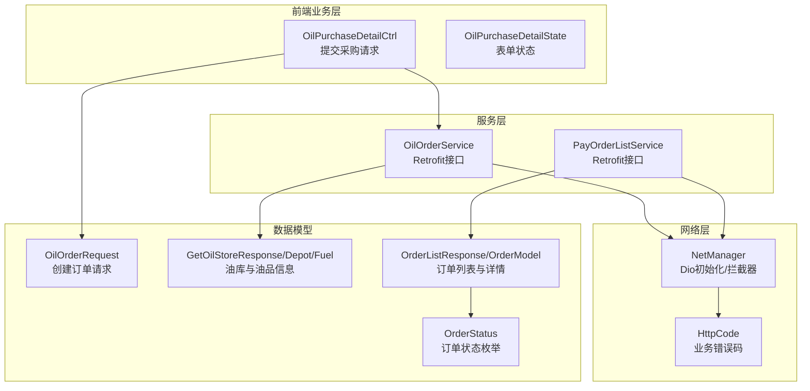
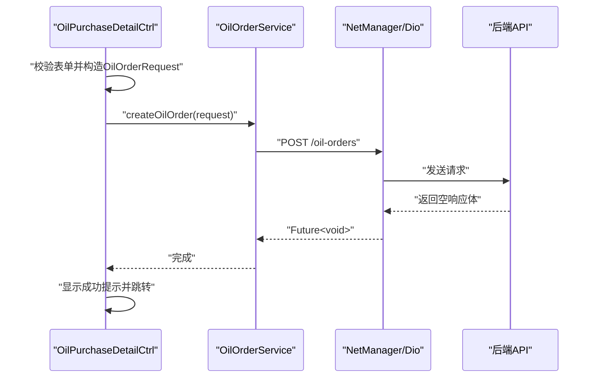
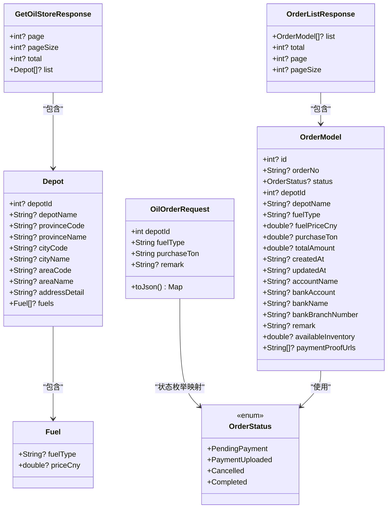
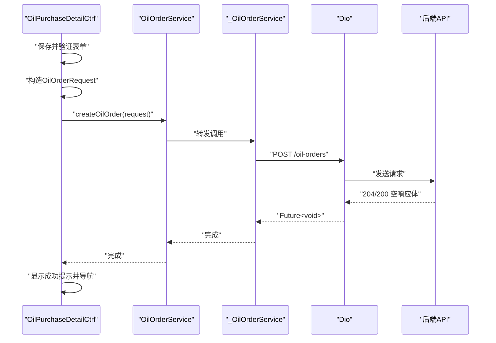
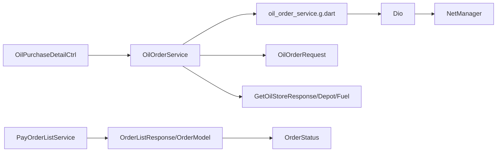

# 油品业务API

<cite>
**本文引用的文件**
- [oil_order_req_type.dart](file://lib/pages/main_oil_pay/model/oil_order_req_type.dart)
- [oil_order_res.type.dart](file://lib/pages/main_oil_pay/model/oil_order_res.type.dart)
- [oil_order_res.type.g.dart](file://lib/pages/main_oil_pay/model/oil_order_res.type.g.dart)
- [oil_order_service.dart](file://lib/pages/main_oil_pay/service/oil_order_service.dart)
- [oil_order_service.g.dart](file://lib/pages/main_oil_pay/service/oil_order_service.g.dart)
- [pay_order_list.dart](file://lib/pages/pay_order_list/service/pay_order_list.dart)
- [pay_order_list.g.dart](file://lib/pages/pay_order_list/service/pay_order_list.g.dart)
- [orders_data.dart](file://lib/pages/pay_order_list/model/orders_data.dart)
- [common.dart](file://lib/global/enum/common.dart)
- [net_manager.dart](file://lib/net/net_manager.dart)
- [code.dart](file://lib/net/code.dart)
- [routes.dart](file://lib/router/routes.dart)
- [controller.dart](file://lib/pages/main_oil_pay/oil_purchase_detail/controller.dart)
- [state.dart](file://lib/pages/main_oil_pay/oil_purchase_detail/state.dart)
</cite>

## 目录
1. [简介](#简介)
2. [项目结构](#项目结构)
3. [核心组件](#核心组件)
4. [架构总览](#架构总览)
5. [详细组件分析](#详细组件分析)
6. [依赖关系分析](#依赖关系分析)
7. [性能与分页机制](#性能与分页机制)
8. [错误码与异常处理](#错误码与异常处理)
9. [使用示例与最佳实践](#使用示例与最佳实践)
10. [故障排查指南](#故障排查指南)
11. [结论](#结论)

## 简介
本文件面向油品业务API的开发者与集成方，聚焦“油品采购订单”的创建、查询与状态更新能力。基于仓库中的数据模型与服务层实现，文档明确各端点的URL路径、HTTP方法、请求体结构、响应格式，并对字段语义、数据类型与业务规则进行说明。同时提供基于OilOrderService的类型安全调用示例路径，以及分页机制、错误码体系与性能优化建议（如批量查询策略）。

## 项目结构
围绕油品采购订单的关键模块分布如下：
- 数据模型：oil_order_req_type.dart（请求模型）、oil_order_res.type.dart（响应模型）
- 服务层：oil_order_service.dart（买油订单服务）、pay_order_list.dart（支付订单列表服务）
- 订单状态枚举：common.dart 中的 OrderStatus
- 网络与拦截器：net_manager.dart、code.dart
- 页面路由：routes.dart
- 业务控制器与状态：oil_purchase_detail/controller.dart、state.dart

图表来源
- [controller.dart](file://lib/pages/main_oil_pay/oil_purchase_detail/controller.dart#L1-L91)
- [oil_order_service.dart](file://lib/pages/main_oil_pay/service/oil_order_service.dart#L1-L26)
- [pay_order_list.dart](file://lib/pages/pay_order_list/service/pay_order_list.dart#L1-L31)
- [oil_order_req_type.dart](file://lib/pages/main_oil_pay/model/oil_order_req_type.dart#L1-L29)
- [oil_order_res.type.dart](file://lib/pages/main_oil_pay/model/oil_order_res.type.dart#L1-L82)
- [orders_data.dart](file://lib/pages/pay_order_list/model/orders_data.dart#L1-L63)
- [common.dart](file://lib/global/enum/common.dart#L45-L63)
- [net_manager.dart](file://lib/net/net_manager.dart#L1-L88)
- [code.dart](file://lib/net/code.dart#L1-L13)

章节来源
- [oil_order_req_type.dart](file://lib/pages/main_oil_pay/model/oil_order_req_type.dart#L1-L29)
- [oil_order_res.type.dart](file://lib/pages/main_oil_pay/model/oil_order_res.type.dart#L1-L82)
- [oil_order_service.dart](file://lib/pages/main_oil_pay/service/oil_order_service.dart#L1-L26)
- [pay_order_list.dart](file://lib/pages/pay_order_list/service/pay_order_list.dart#L1-L31)
- [orders_data.dart](file://lib/pages/pay_order_list/model/orders_data.dart#L1-L63)
- [common.dart](file://lib/global/enum/common.dart#L45-L63)
- [net_manager.dart](file://lib/net/net_manager.dart#L1-L88)
- [code.dart](file://lib/net/code.dart#L1-L13)
- [routes.dart](file://lib/router/routes.dart#L1-L260)
- [controller.dart](file://lib/pages/main_oil_pay/oil_purchase_detail/controller.dart#L1-L91)
- [state.dart](file://lib/pages/main_oil_pay/oil_purchase_detail/state.dart#L1-L34)

## 核心组件
- OilOrderRequest：用于创建买油订单的请求体，包含油库ID、油品类型、购买吨数与可选备注。
- OilOrderService：Retrofit声明式接口，提供“获取油库列表”和“创建买油订单”两个端点。
- PayOrderListService：Retrofit声明式接口，提供“获取买油订单列表”和“取消订单”端点。
- GetOilStoreResponse/Depot/Fuel：油库与油品信息的响应模型，支持分页字段。
- OrderListResponse/OrderModel：订单列表与订单详情模型，包含状态枚举映射。
- OrderStatus：订单状态枚举，含“待支付、已支付、已取消、已完成”。

章节来源
- [oil_order_req_type.dart](file://lib/pages/main_oil_pay/model/oil_order_req_type.dart#L1-L29)
- [oil_order_service.dart](file://lib/pages/main_oil_pay/service/oil_order_service.dart#L1-L26)
- [pay_order_list.dart](file://lib/pages/pay_order_list/service/pay_order_list.dart#L1-L31)
- [oil_order_res.type.dart](file://lib/pages/main_oil_pay/model/oil_order_res.type.dart#L1-L82)
- [orders_data.dart](file://lib/pages/pay_order_list/model/orders_data.dart#L1-L63)
- [common.dart](file://lib/global/enum/common.dart#L45-L63)

## 架构总览
下图展示了从页面控制器发起请求到服务层、再到网络层与后端API的整体流程。

图表来源
- [controller.dart](file://lib/pages/main_oil_pay/oil_purchase_detail/controller.dart#L40-L90)
- [oil_order_service.dart](file://lib/pages/main_oil_pay/service/oil_order_service.dart#L1-L26)
- [net_manager.dart](file://lib/net/net_manager.dart#L1-L88)

## 详细组件分析

### 接口定义与端点说明
- 获取油库列表
  - 方法：GET
  - 路径：/oil-depots
  - 查询参数：page（必填）、pageSize（必填）
  - 响应：GetOilStoreResponse，包含分页字段与油库列表
  - 生成实现：oil_order_service.g.dart
- 创建买油订单
  - 方法：POST
  - 路径：/oil-orders
  - 请求体：OilOrderRequest
  - 响应：无内容（Future<void>）
  - 生成实现：oil_order_service.g.dart
- 获取买油订单列表
  - 方法：GET
  - 路径：/oil-orders
  - 查询参数：status（可选）、page（必填）、pageSize（必填）
  - 响应：OrderListResponse，包含订单列表与分页字段
  - 生成实现：pay_order_list.g.dart
- 取消订单
  - 方法：POST
  - 路径：/oil-orders/{id}/cancel
  - 表单字段：reason（取消原因）
  - 响应：无内容（Future<void>）
  - 生成实现：pay_order_list.g.dart

章节来源
- [oil_order_service.dart](file://lib/pages/main_oil_pay/service/oil_order_service.dart#L1-L26)
- [oil_order_service.g.dart](file://lib/pages/main_oil_pay/service/oil_order_service.g.dart#L1-L48)
- [pay_order_list.dart](file://lib/pages/pay_order_list/service/pay_order_list.dart#L1-L31)
- [pay_order_list.g.dart](file://lib/pages/pay_order_list/service/pay_order_list.g.dart#L14-L54)

### 数据模型与字段说明

#### OilOrderRequest（创建订单请求）
- 字段
  - depotId：整型，油库ID
  - fuelType：字符串，油品类型
  - purchaseTon：字符串，购买吨数
  - remark：字符串（可选），备注
- 序列化
  - toJson() 输出包含上述字段；remark为空或空字符串时不输出
- 业务规则
  - 必填字段必须提供
  - purchaseTon以字符串形式传输，建议前端做数值合法性校验

章节来源
- [oil_order_req_type.dart](file://lib/pages/main_oil_pay/model/oil_order_req_type.dart#L1-L29)

#### GetOilStoreResponse/Depot/Fuel（油库与油品信息）
- GetOilStoreResponse
  - page：当前页码
  - pageSize：每页条数
  - total：总数
  - list：Depot数组
- Depot
  - depotId：油库ID
  - depotName：油库名称
  - provinceCode/provinceName：省份编码/名称
  - cityCode/cityName：城市编码/名称
  - areaCode/areaName：区县编码/名称
  - addressDetail：详细地址
  - fuels：Fuel数组
- Fuel
  - fuelType：油品类型
  - priceCny：价格（元）
- 业务规则
  - 分页字段用于前端渲染与翻页控制
  - fuels为油库可售油品清单

章节来源
- [oil_order_res.type.dart](file://lib/pages/main_oil_pay/model/oil_order_res.type.dart#L1-L82)
- [oil_order_res.type.g.dart](file://lib/pages/main_oil_pay/model/oil_order_res.type.g.dart#L1-L26)

#### OrderListResponse/OrderModel（订单列表与详情）
- OrderListResponse
  - list：订单数组
  - total/page/pageSize：分页字段
- OrderModel
  - id/orderNo：订单标识
  - status：订单状态（枚举映射）
  - depotId/depotName：油库信息
  - fuelType/fuelPriceCny：油品与单价
  - purchaseTon/totalAmount：购买量与金额
  - createdAt/updatedAt：创建与更新时间
  - accountName/bankAccount/bankName/bankBranchNumber：收款账户信息
  - remark：备注
  - availableInventory：可用库存
  - paymentProofUrls：付款凭证图片URL列表
- OrderStatus
  - PendingPayment（待支付）
  - PaymentUploaded（已支付）
  - Cancelled（已取消）
  - Completed（已完成）

章节来源
- [orders_data.dart](file://lib/pages/pay_order_list/model/orders_data.dart#L1-L63)
- [common.dart](file://lib/global/enum/common.dart#L45-L63)

### 类关系图（数据模型）

图表来源
- [oil_order_req_type.dart](file://lib/pages/main_oil_pay/model/oil_order_req_type.dart#L1-L29)
- [oil_order_res.type.dart](file://lib/pages/main_oil_pay/model/oil_order_res.type.dart#L1-L82)
- [orders_data.dart](file://lib/pages/pay_order_list/model/orders_data.dart#L1-L63)
- [common.dart](file://lib/global/enum/common.dart#L45-L63)

### 调用流程与示例（类型安全）
- 提交采购请求（Dart类型安全调用）
  - 步骤
    1) 在页面控制器中收集表单数据并构造 OilOrderRequest
    2) 调用 OilOrderService.createOilOrder(request)
    3) 成功后提示用户并跳转至订单详情或列表
  - 示例路径
    - 请求构造与提交：[controller.dart](file://lib/pages/main_oil_pay/oil_purchase_detail/controller.dart#L40-L90)
    - 服务接口定义：[oil_order_service.dart](file://lib/pages/main_oil_pay/service/oil_order_service.dart#L1-L26)
    - Retrofit生成实现：[oil_order_service.g.dart](file://lib/pages/main_oil_pay/service/oil_order_service.g.dart#L1-L48)
    - 网络初始化与拦截器：[net_manager.dart](file://lib/net/net_manager.dart#L1-L88)

图表来源
- [controller.dart](file://lib/pages/main_oil_pay/oil_purchase_detail/controller.dart#L40-L90)
- [oil_order_service.dart](file://lib/pages/main_oil_pay/service/oil_order_service.dart#L1-L26)
- [oil_order_service.g.dart](file://lib/pages/main_oil_pay/service/oil_order_service.g.dart#L1-L48)
- [net_manager.dart](file://lib/net/net_manager.dart#L1-L88)

## 依赖关系分析
- 模块耦合
  - 页面控制器依赖服务层接口与数据模型
  - 服务层依赖Retrofit生成类与Dio客户端
  - 数据模型依赖序列化生成文件
- 外部依赖
  - Retrofit：声明式HTTP接口
  - Dio：HTTP客户端与拦截器
  - json_annotation/freezed：模型序列化与不可变数据结构

图表来源
- [controller.dart](file://lib/pages/main_oil_pay/oil_purchase_detail/controller.dart#L1-L91)
- [oil_order_service.dart](file://lib/pages/main_oil_pay/service/oil_order_service.dart#L1-L26)
- [oil_order_service.g.dart](file://lib/pages/main_oil_pay/service/oil_order_service.g.dart#L1-L48)
- [pay_order_list.dart](file://lib/pages/pay_order_list/service/pay_order_list.dart#L1-L31)
- [orders_data.dart](file://lib/pages/pay_order_list/model/orders_data.dart#L1-L63)
- [common.dart](file://lib/global/enum/common.dart#L45-L63)
- [net_manager.dart](file://lib/net/net_manager.dart#L1-L88)

## 性能与分页机制
- 分页字段
  - 油库列表：page、pageSize、total
  - 订单列表：page、pageSize、total
- 分页建议
  - 使用较小的 pageSize（如10/20）提升首屏速度
  - 结合懒加载或虚拟列表减少渲染压力
  - 对高频查询使用本地缓存（如最近一次查询结果）
- 批量查询策略
  - 订单列表：按状态分组查询，避免一次性拉取全量
  - 油库列表：按地区筛选后再分页加载
- 网络优化
  - 合理设置超时与重试（NetManager已配置默认超时与重试）
  - 使用拦截器统一处理日志与头部

章节来源
- [oil_order_res.type.dart](file://lib/pages/main_oil_pay/model/oil_order_res.type.dart#L1-L82)
- [orders_data.dart](file://lib/pages/pay_order_list/model/orders_data.dart#L1-L63)
- [net_manager.dart](file://lib/net/net_manager.dart#L1-L88)

## 错误码与异常处理
- 业务错误码
  - success：1（请求成功）
  - logout/tokenExpired：401（登录失效/令牌过期）
- 异常处理
  - 建议在拦截器中捕获401并触发登出流程
  - 对于非2xx响应，统一解析错误消息并提示用户
- 网络层
  - NetManager 初始化时注入日志、头部与响应拦截器
  - 支持代理配置与连接检查

章节来源
- [code.dart](file://lib/net/code.dart#L1-L13)
- [net_manager.dart](file://lib/net/net_manager.dart#L1-L88)

## 使用示例与最佳实践
- 创建买油订单（类型安全）
  - 步骤
    1) 从油库列表页选择油库与油品
    2) 在表单中填写购买吨数与备注
    3) 调用 OilOrderService.createOilOrder(request)
    4) 成功后刷新订单列表，定位最新订单并跳转详情
  - 示例路径
    - 控制器提交逻辑：[controller.dart](file://lib/pages/main_oil_pay/oil_purchase_detail/controller.dart#L40-L90)
    - 服务接口：[oil_order_service.dart](file://lib/pages/main_oil_pay/service/oil_order_service.dart#L1-L26)
    - Retrofit生成实现：[oil_order_service.g.dart](file://lib/pages/main_oil_pay/service/oil_order_service.g.dart#L1-L48)
- 查询订单列表
  - 使用 PayOrderListService.getOrderList(status, page, pageSize)
  - 建议按状态分页查询，避免全量拉取
  - 示例路径
    - 接口定义：[pay_order_list.dart](file://lib/pages/pay_order_list/service/pay_order_list.dart#L1-L31)
    - Retrofit生成实现：[pay_order_list.g.dart](file://lib/pages/pay_order_list/service/pay_order_list.g.dart#L14-L54)
- 取消订单
  - 使用 PayOrderListService.cancelOrder(id, reason)
  - 示例路径
    - 接口定义：[pay_order_list.dart](file://lib/pages/pay_order_list/service/pay_order_list.dart#L1-L31)
    - Retrofit生成实现：[pay_order_list.g.dart](file://lib/pages/pay_order_list/service/pay_order_list.g.dart#L14-L54)

章节来源
- [controller.dart](file://lib/pages/main_oil_pay/oil_purchase_detail/controller.dart#L40-L90)
- [oil_order_service.dart](file://lib/pages/main_oil_pay/service/oil_order_service.dart#L1-L26)
- [oil_order_service.g.dart](file://lib/pages/main_oil_pay/service/oil_order_service.g.dart#L1-L48)
- [pay_order_list.dart](file://lib/pages/pay_order_list/service/pay_order_list.dart#L1-L31)
- [pay_order_list.g.dart](file://lib/pages/pay_order_list/service/pay_order_list.g.dart#L14-L54)

## 故障排查指南
- 无法创建订单
  - 检查请求体字段是否完整（depotId、fuelType、purchaseTon）
  - 确认网络拦截器未拦截请求
  - 查看后端返回状态码与错误消息
- 订单列表为空
  - 检查 page、pageSize 是否传入且合理
  - 若按状态筛选，请确认 status 参数值正确
- 登录失效
  - 401错误时触发登出流程，重新登录后重试
- 网络问题
  - 检查 NetManager 初始化是否成功
  - 如需代理，确认代理配置正确

章节来源
- [oil_order_req_type.dart](file://lib/pages/main_oil_pay/model/oil_order_req_type.dart#L1-L29)
- [oil_order_service.dart](file://lib/pages/main_oil_pay/service/oil_order_service.dart#L1-L26)
- [pay_order_list.dart](file://lib/pages/pay_order_list/service/pay_order_list.dart#L1-L31)
- [code.dart](file://lib/net/code.dart#L1-L13)
- [net_manager.dart](file://lib/net/net_manager.dart#L1-L88)

## 结论
本文基于仓库现有实现，梳理了油品采购订单相关的创建、查询与状态更新能力，明确了端点、请求体与响应模型，并提供了类型安全的调用示例路径与性能优化建议。实际部署时请结合后端接口文档完善契约与错误处理策略。