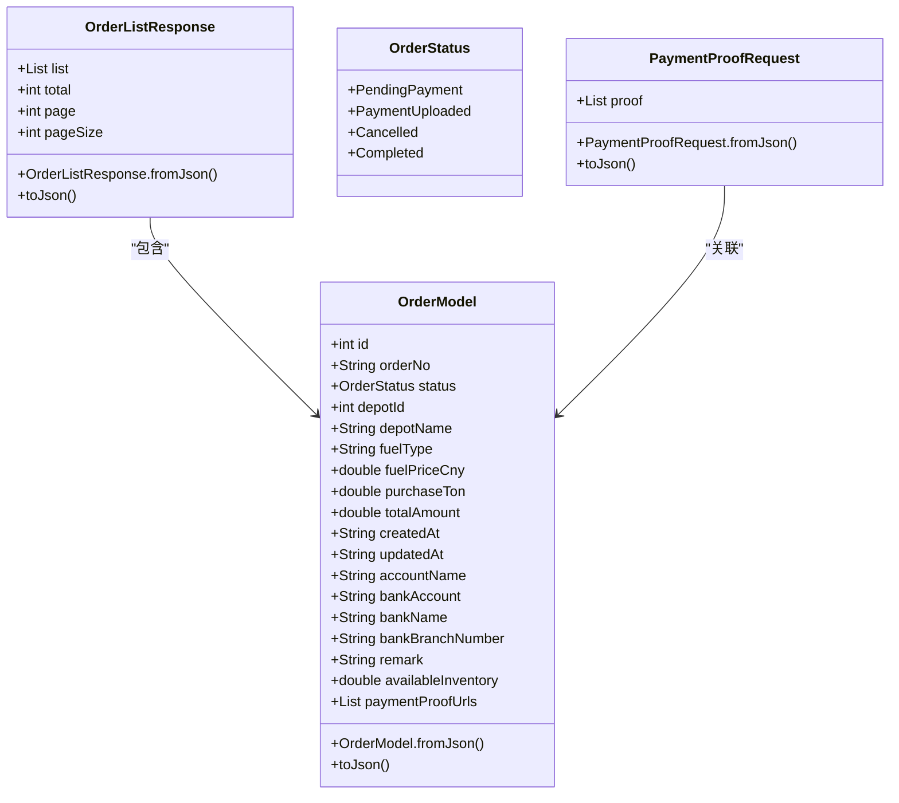
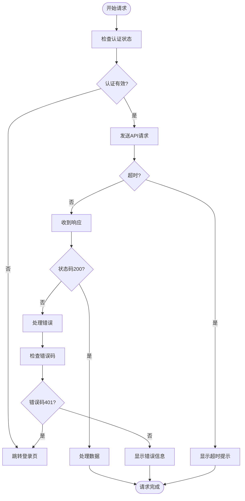

# 订单管理API

<cite>
**本文档引用的文件**  
- [orders_data.dart](file://lib/pages/pay_order_list/model/orders_data.dart)
- [payment_proof_request.dart](file://lib/pages/pay_order_detail/model/payment_proof_request.dart)
- [pay_order_service.dart](file://lib/pages/pay_order_detail/service/pay_order_service.dart)
- [pay_order_list.dart](file://lib/pages/pay_order_list/service/pay_order_list.dart)
- [common.dart](file://lib/global/enum/common.dart)
- [code.dart](file://lib/net/code.dart)
- [net_manager.dart](file://lib/net/net_manager.dart)
- [pay_order_list.dart](file://lib/pages/pay_order_list/controller.dart)
- [pay_order_detail.dart](file://lib/pages/pay_order_detail/controller.dart)
</cite>

## 目录
1. [简介](#简介)
2. [API端点概览](#api端点概览)
3. [数据模型](#数据模型)
4. [分页与查询参数](#分页与查询参数)
5. [文件上传要求](#文件上传要求)
6. [错误处理机制](#错误处理机制)
7. [调用示例](#调用示例)
8. [性能优化建议](#性能优化建议)

## 简介
本API文档为油品业务应用中的支付订单管理功能提供全面的技术参考。系统支持支付订单的列表查询、详情获取、支付凭证上传和状态更新等核心功能，旨在为用户提供完整的订单生命周期管理能力。API设计遵循RESTful规范，采用Dart语言结合Retrofit框架实现，集成在Flutter移动应用中。

**Section sources**
- [pay_order_service.dart](file://lib/pages/pay_order_detail/service/pay_order_service.dart#L1-L35)
- [pay_order_list.dart](file://lib/pages/pay_order_list/service/pay_order_list.dart#L1-L31)

## API端点概览
订单管理API提供以下核心端点，所有请求均需通过身份验证。

| HTTP方法 | URL路径 | 功能描述 | 认证要求 |
|---------|--------|---------|---------|
| GET | /oil-orders | 获取支付订单列表（支持分页和状态过滤） | 是 |
| GET | /oil-orders/{id} | 获取指定支付订单的详细信息 | 是 |
| POST | /oil-orders/{id}/payment-proof | 上传支付凭证（支持多张图片） | 是 |
| POST | /oil-orders/{id}/cancel | 取消指定订单 | 是 |

**Section sources**
- [pay_order_service.dart](file://lib/pages/pay_order_detail/service/pay_order_service.dart#L15-L25)
- [pay_order_list.dart](file://lib/pages/pay_order_list/service/pay_order_list.dart#L14-L26)

## 数据模型
### 订单列表响应模型
`OrderListResponse` 类定义了订单列表查询的响应结构：

- **list**: `List<OrderModel>` - 订单数据列表
- **total**: `int` - 总记录数
- **page**: `int` - 当前页码
- **pageSize**: `int` - 每页大小

### 订单详情模型
`OrderModel` 类包含订单的完整信息：

- **id**: `int` - 订单ID
- **orderNo**: `String` - 订单编号
- **status**: `OrderStatus` - 订单状态（枚举值）
- **depotId**: `int` - 油库ID
- **depotName**: `String` - 油库名称
- **fuelType**: `String` - 燃油类型
- **fuelPriceCny**: `double` - 燃油单价（人民币）
- **purchaseTon**: `double` - 采购吨数
- **totalAmount**: `double` - 总金额
- **createdAt**: `String` - 创建时间
- **updatedAt**: `String` - 更新时间
- **accountName**: `String` - 收款账户名称
- **bankAccount**: `String` - 银行账号
- **bankName**: `String` - 银行名称
- **bankBranchNumber**: `String` - 银行分行号
- **remark**: `String` - 备注信息
- **availableInventory**: `double` - 可用库存
- **paymentProofUrls**: `List<String>` - 支付凭证URL列表

### 订单状态枚举
订单状态定义在 `OrderStatus` 枚举中：

- **PendingPayment**: 待支付
- **PaymentUploaded**: 已上传支付凭证
- **Cancelled**: 已取消
- **Completed**: 已完成

### 支付凭证请求模型
`PaymentProofRequest` 类用于上传支付凭证：

- **proof**: `List<String>` - 凭证URL列表



**Diagram sources**
- [orders_data.dart](file://lib/pages/pay_order_list/model/orders_data.dart#L8-L52)
- [payment_proof_request.dart](file://lib/pages/pay_order_detail/model/payment_proof_request.dart#L7-L19)

**Section sources**
- [orders_data.dart](file://lib/pages/pay_order_list/model/orders_data.dart#L8-L52)
- [payment_proof_request.dart](file://lib/pages/pay_order_detail/model/payment_proof_request.dart#L7-L19)
- [common.dart](file://lib/global/enum/common.dart)

## 分页与查询参数
订单列表查询支持分页和状态过滤功能。

### 分页参数
- **page**: 当前页码（从1开始）
- **pageSize**: 每页记录数（建议值：10）

### 状态过滤参数
- **status**: 订单状态过滤（可选）
  - 0: 待支付
  - 1: 已上传支付凭证
  - 2: 已取消
  - 3: 已完成

### 示例请求
```
GET /oil-orders?page=1&pageSize=10&status=0
```

**Section sources**
- [pay_order_list.dart](file://lib/pages/pay_order_list/service/pay_order_list.dart#L16-L18)
- [pay_order_list.dart](file://lib/pages/pay_order_list/controller.dart#L68-L69)

## 文件上传要求
支付凭证上传需遵循以下规范：

### 文件格式
- 支持格式：JPEG、PNG
- 建议尺寸：最大1920x1080像素
- 图像质量：85%

### 数量限制
- 最少上传：1张图片
- 最多上传：5张图片

### 上传流程
1. 客户端选择图片（从相册）
2. 图片上传至文件服务器
3. 获取图片URL
4. 将URL列表提交至订单API

**Section sources**
- [pay_order_detail.dart](file://lib/pages/pay_order_detail/controller.dart#L96-L101)
- [pay_order_detail.dart](file://lib/pages/pay_order_detail/controller.dart#L107-L112)

## 错误处理机制
系统提供完善的错误处理机制，确保用户体验。

### HTTP状态码
- **200**: 请求成功
- **401**: 认证失败（需重新登录）
- **404**: 资源未找到（订单不存在）

### 业务错误码
- **1**: 请求成功
- **401**: 登录失效或Token过期

### 错误响应结构
```json
{
  "code": 404,
  "message": "订单不存在"
}
```

### 客户端错误处理
- 网络连接检查
- 超时处理（30秒）
- 重试机制（3次）
- 友好错误提示



**Diagram sources**
- [code.dart](file://lib/net/code.dart)
- [net_manager.dart](file://lib/net/net_manager.dart#L11-L15)
- [pay_order_detail.dart](file://lib/pages/pay_order_detail/controller.dart#L83-L87)

**Section sources**
- [code.dart](file://lib/net/code.dart)
- [net_manager.dart](file://lib/net/net_manager.dart)
- [pay_order_detail.dart](file://lib/pages/pay_order_detail/controller.dart)

## 调用示例
### 订单列表服务调用
```dart
// 获取订单列表
final response = await payOrderListService.getOrderList(
  page: 1,
  pageSize: 10,
  status: OrderStatus.PendingPayment.value,
);
```

### 支付凭证上传服务调用
```dart
// 上传支付凭证
final request = PaymentProofRequest(proof: ['url1.jpg', 'url2.jpg']);
await payOrderService.savePaymentProof('123', request);
```

### Flutter应用中的完整流程
```dart
// 1. 初始化服务
final orderService = payOrderService;
final listService = payOrderListService;

// 2. 查询订单列表
try {
  final response = await listService.getOrderList(page: 1, pageSize: 10);
  // 更新UI
} on Exception catch (e) {
  // 处理错误
}

// 3. 上传支付凭证
try {
  // 选择图片
  final image = await ImagePicker().pickImage(source: ImageSource.gallery);
  if (image != null) {
    // 上传图片获取URL
    final url = await uploadImage(image.path);
    // 保存凭证
    final request = PaymentProofRequest(proof: [url]);
    await orderService.savePaymentProof(orderId, request);
  }
} on Exception catch (e) {
  // 显示错误提示
}
```

**Section sources**
- [pay_order_service.dart](file://lib/pages/pay_order_detail/service/pay_order_service.dart)
- [pay_order_list.dart](file://lib/pages/pay_order_list/service/pay_order_list.dart)
- [pay_order_detail.dart](file://lib/pages/pay_order_detail/controller.dart)

## 性能优化建议
为确保API的高效运行，建议遵循以下优化策略：

### 网络请求优化
- 启用连接池复用
- 设置合理的超时时间（30秒）
- 实现请求缓存机制
- 使用GZIP压缩响应

### 客户端优化
- 实现分页加载
- 添加加载状态指示
- 使用图片缓存
- 防止重复请求

### 错误恢复
- 实现自动重试机制（3次）
- 提供离线缓存
- 记录错误日志
- 友好的用户提示

### 并发控制
- 限制并发上传数量
- 使用防抖机制处理快速操作
- 管理异步操作状态

**Section sources**
- [net_manager.dart](file://lib/net/net_manager.dart#L11-L15)
- [pay_order_list.dart](file://lib/pages/pay_order_list/controller.dart)
- [pay_order_detail.dart](file://lib/pages/pay_order_detail/controller.dart)