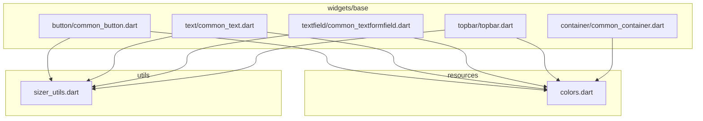
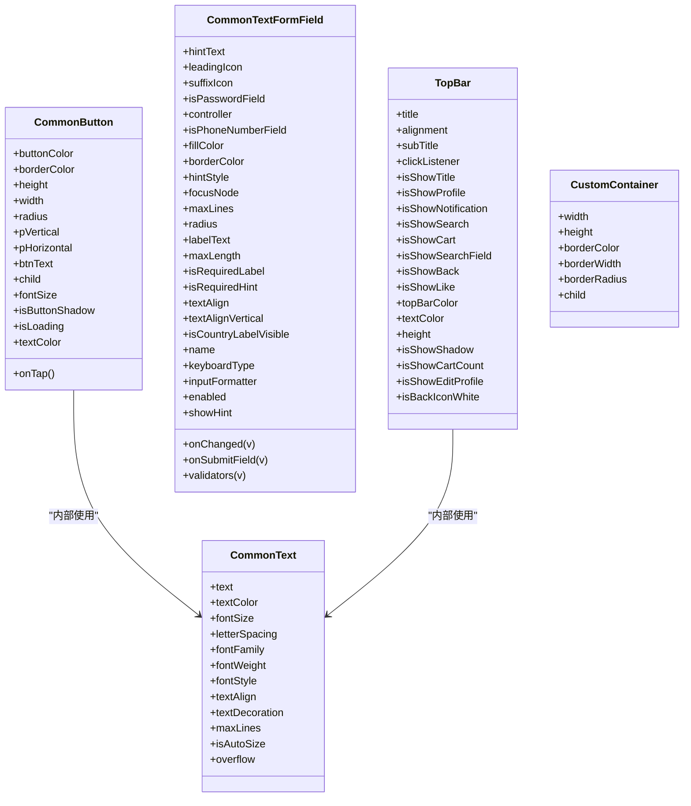
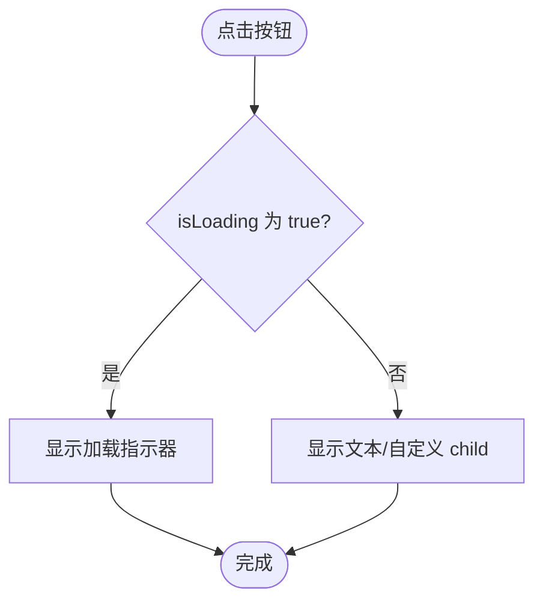
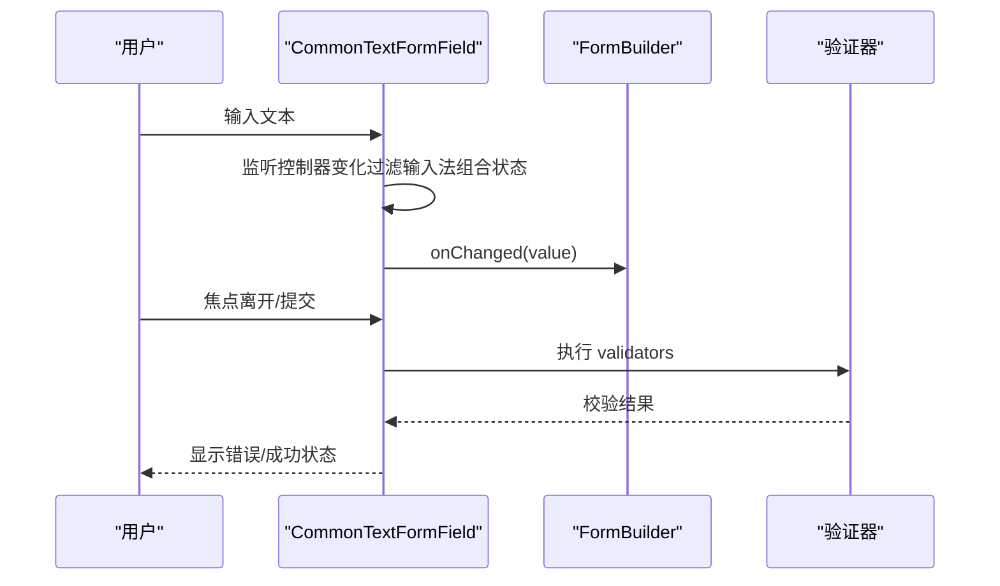
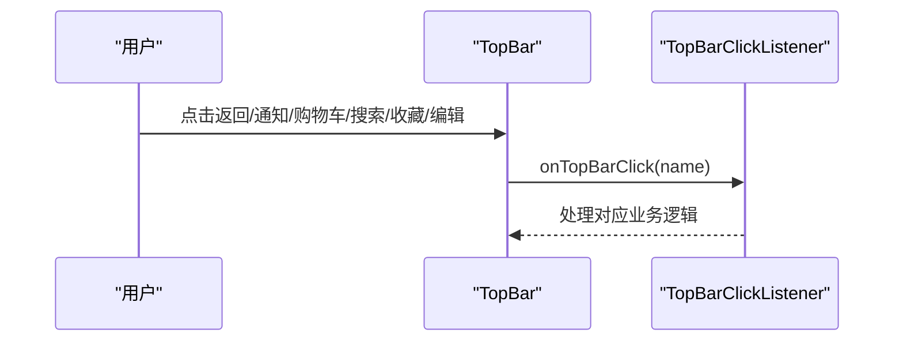
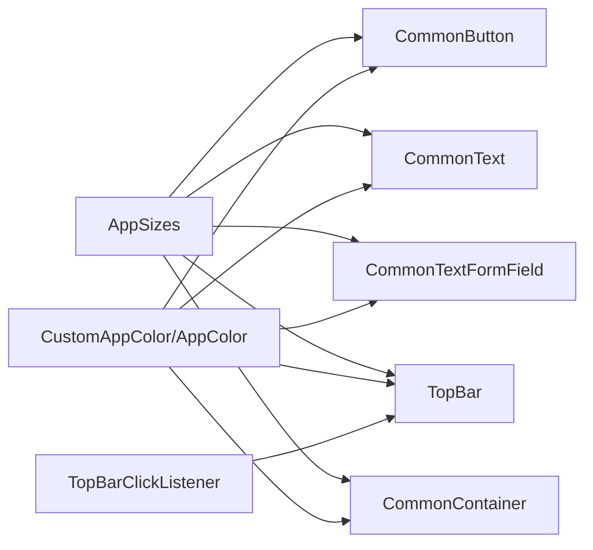

# 基础UI组件库

<cite>
**本文引用的文件**
- [common_button.dart](file://lib/widgets/base/button/common_button.dart)
- [common_text.dart](file://lib/widgets/base/text/common_text.dart)
- [common_textformfield.dart](file://lib/widgets/base/textfield/common_textformfield.dart)
- [topbar.dart](file://lib/widgets/base/topbar/topbar.dart)
- [common_container.dart](file://lib/widgets/base/container/common_container.dart)
- [colors.dart](file://lib/resources/colors.dart)
- [sizer_utils.dart](file://lib/utils/sizer_utils.dart)
- [top_bar_click_listener.dart](file://lib/interfaces/top_bar_click_listener.dart)
- [unified_login_screen.dart](file://lib/pages/login/widgets/unified_login_screen.dart)
- [UI规范.md](file://UI_SPECIFICATION.md)
- [项目规范.md](file://openspec/project.md)
</cite>

## 目录
1. [简介](#简介)
2. [项目结构](#项目结构)
3. [核心组件](#核心组件)
4. [架构总览](#架构总览)
5. [组件详解](#组件详解)
6. [依赖关系分析](#依赖关系分析)
7. [性能与可维护性建议](#性能与可维护性建议)
8. [故障排查指南](#故障排查指南)
9. [结论](#结论)
10. [附录](#附录)

## 简介
本文件系统化梳理 widgets/base 目录下的基础UI组件，覆盖以下目标：
- CommonButton 的属性、用法与状态（正常、禁用、加载中）视觉表现
- CommonText 的文本样式配置与响应式处理
- CommonTextFormField 的表单验证、焦点管理、密码框与手机号输入框的特殊处理
- TopBar 的导航结构与事件监听机制
- CommonContainer 的布局特性
- 统一的尺寸适配规范 AppSizes 与颜色规范 CustomAppColor.of(context)

## 项目结构
基础UI组件集中于 lib/widgets/base 下，按功能分层组织：
- button：统一按钮组件
- text：通用文本组件
- textfield：通用输入框组件
- topbar：顶部导航栏组件
- container：通用容器组件

图表来源
- [common_button.dart](file://lib/widgets/base/button/common_button.dart#L1-L93)
- [common_text.dart](file://lib/widgets/base/text/common_text.dart#L1-L56)
- [common_textformfield.dart](file://lib/widgets/base/textfield/common_textformfield.dart#L1-L361)
- [topbar.dart](file://lib/widgets/base/topbar/topbar.dart#L1-L253)
- [common_container.dart](file://lib/widgets/base/container/common_container.dart#L1-L41)
- [colors.dart](file://lib/resources/colors.dart#L1-L361)
- [sizer_utils.dart](file://lib/utils/sizer_utils.dart#L1-L105)

章节来源
- [common_button.dart](file://lib/widgets/base/button/common_button.dart#L1-L93)
- [common_text.dart](file://lib/widgets/base/text/common_text.dart#L1-L56)
- [common_textformfield.dart](file://lib/widgets/base/textfield/common_textformfield.dart#L1-L361)
- [topbar.dart](file://lib/widgets/base/topbar/topbar.dart#L1-L253)
- [common_container.dart](file://lib/widgets/base/container/common_container.dart#L1-L41)
- [colors.dart](file://lib/resources/colors.dart#L1-L361)
- [sizer_utils.dart](file://lib/utils/sizer_utils.dart#L1-L105)

## 核心组件
- CommonButton：统一按钮，支持文字、图标、阴影、加载态、禁用态等
- CommonText：统一文本，支持字号、字重、颜色、对齐、溢出等
- CommonTextFormField：统一输入框，支持表单验证、焦点管理、密码/手机号特殊处理
- TopBar：顶部导航栏，支持返回、头像、标题、通知、购物车等
- CommonContainer：通用容器，统一边框、圆角、背景

章节来源
- [common_button.dart](file://lib/widgets/base/button/common_button.dart#L1-L93)
- [common_text.dart](file://lib/widgets/base/text/common_text.dart#L1-L56)
- [common_textformfield.dart](file://lib/widgets/base/textfield/common_textformfield.dart#L1-L361)
- [topbar.dart](file://lib/widgets/base/topbar/topbar.dart#L1-L253)
- [common_container.dart](file://lib/widgets/base/container/common_container.dart#L1-L41)

## 架构总览
组件间依赖关系如下：
- 组件均通过 CustomAppColor.of(context) 获取颜色
- 组件均通过 AppSizes 进行尺寸适配
- TopBar 内部复用 CommonText
- CommonButton 内部复用 CommonText

图表来源
- [common_button.dart](file://lib/widgets/base/button/common_button.dart#L1-L93)
- [common_text.dart](file://lib/widgets/base/text/common_text.dart#L1-L56)
- [common_textformfield.dart](file://lib/widgets/base/textfield/common_textformfield.dart#L1-L361)
- [topbar.dart](file://lib/widgets/base/topbar/topbar.dart#L1-L253)
- [common_container.dart](file://lib/widgets/base/container/common_container.dart#L1-L41)

## 组件详解

### CommonButton 组件
- 属性要点
  - 文案与点击：btnText、onTap
  - 视觉与尺寸：buttonColor、borderColor、height、width、radius、pVertical、pHorizontal
  - 文本样式：fontSize、textColor
  - 视觉增强：isButtonShadow、child
  - 状态：isLoading
- 视觉与交互
  - 正常：默认背景色、边框、阴影（可选），文字颜色为白色
  - 禁用：通过外层包裹禁用指针实现不可点击（参考 UI 规范）
  - 加载中：显示活动指示器，同时显示文字或自定义 child
- 尺寸与颜色规范
  - 尺寸：优先使用 AppSizes.buttonHeight、AppSizes.setHeight、AppSizes.setWidth
  - 颜色：buttonColor、textColor 使用 CustomAppColor.of(context) 获取
- 用法示例
  - 主要按钮：背景色使用品牌紫色，文字白色，带阴影
  - 次要按钮：背景色使用浅色背景，带 1px 边框，无阴影
  - 小按钮：较小高度与圆角
  - 图标按钮：设置宽高相等，child 放置图标

图表来源
- [common_button.dart](file://lib/widgets/base/button/common_button.dart#L40-L91)

章节来源
- [common_button.dart](file://lib/widgets/base/button/common_button.dart#L1-L93)
- [UI规范.md](file://UI_SPECIFICATION.md#L302-L375)
- [项目规范.md](file://openspec/project.md#L230-L347)
- [unified_login_screen.dart](file://lib/pages/login/widgets/unified_login_screen.dart#L92-L120)

### CommonText 组件
- 属性要点
  - 文本内容与样式：text、fontSize、fontWeight、textColor、textAlign、fontFamily、letterSpacing、textDecoration、fontStyle、maxLines、overflow
  - 自动尺寸：isAutoSize（当前实现未直接使用）
- 响应式处理
  - 字号通过 AppSizes.setFontSize 动态适配
  - 默认行高 1.2，字体家族为 Urbanist
- 颜色规范
  - 文本颜色使用 CustomAppColor.of(context).txtBlack 或其他语义色

章节来源
- [common_text.dart](file://lib/widgets/base/text/common_text.dart#L1-L56)
- [UI规范.md](file://UI_SPECIFICATION.md#L251-L289)
- [项目规范.md](file://openspec/project.md#L202-L230)

### CommonTextFormField 组件
- 属性要点
  - 基础：hintText、labelText、controller、focusNode、keyboardType、inputFormatter、maxLength、maxLines、textAlign、textAlignVertical、enabled、showHint
  - 样式：fillColor、borderColor、radius、leadingIcon、suffixIcon
  - 验证：name、validators（支持 FormBuilder 验证器）
  - 特殊：isPasswordField、isPhoneNumberField、isCountryLabelVisible、isRequiredLabel、isRequiredHint、onSubmitField
- 表单验证机制
  - 默认必填校验，错误提示可由 hintText 或 labelText 拼接
  - 支持自定义 validators（compose 组合）
- 焦点管理
  - 内部持有 FocusNode，默认自动创建；监听焦点变化以更新样式
  - 支持外部传入 focusNode
- 密码框与手机号输入框
  - 密码框：右侧显示可见/隐藏切换图标，初始隐藏
  - 手机号框：使用 IntlPhoneField，支持国家代码、前缀图标、可选“Country”标签
- 状态样式
  - 默认：填充色、边框 1px、圆角 12、文字大小 14、字重 700
  - 聚焦：边框 2px 紫色、标签上浮显示
- 用法示例
  - 基本输入框：设置 hintText、leadingIcon、边框颜色
  - 手机号输入框：isPhoneNumberField=true，设置 name、validators

图表来源
- [common_textformfield.dart](file://lib/widgets/base/textfield/common_textformfield.dart#L74-L136)
- [common_textformfield.dart](file://lib/widgets/base/textfield/common_textformfield.dart#L137-L361)

章节来源
- [common_textformfield.dart](file://lib/widgets/base/textfield/common_textformfield.dart#L1-L361)
- [UI规范.md](file://UI_SPECIFICATION.md#L376-L421)
- [项目规范.md](file://openspec/project.md#L289-L347)

### TopBar 组件
- 导航结构
  - 从左到右：返回按钮（可选）、头像（可选）、标题（可选）、Spacer、操作图标（通知、购物车、搜索、收藏、编辑）
- 事件监听
  - 通过 TopBarClickListener.onTopBarClick(name) 分发点击事件
  - name 常见取值："back"、"notification"、"pay_order_list"、"search"、"wishlist"、"edit"
- 视觉与尺寸
  - 固定高度（包含 SafeArea），水平内边距 18
  - 阴影：黑色 1% 透明，模糊 3，扩散 2，偏移(0, 4)
  - 图标大小 24x24，头像 35x35
- 颜色与主题
  - 背景色与文本色可通过 topBarColor、textColor、isBackIconWhite 控制

图表来源
- [topbar.dart](file://lib/widgets/base/topbar/topbar.dart#L51-L251)
- [top_bar_click_listener.dart](file://lib/interfaces/top_bar_click_listener.dart#L1-L4)

章节来源
- [topbar.dart](file://lib/widgets/base/topbar/topbar.dart#L1-L253)
- [top_bar_click_listener.dart](file://lib/interfaces/top_bar_click_listener.dart#L1-L4)
- [UI规范.md](file://UI_SPECIFICATION.md#L446-L477)
- [项目规范.md](file://openspec/project.md#L325-L347)

### CommonContainer 组件
- 布局特性
  - 统一边框、圆角、背景色
  - 子组件居中显示
- 属性要点
  - width、height、borderColor、borderWidth、borderRadius、child
- 颜色与尺寸
  - 边框色默认使用 CustomAppColor.of(context).containerBorder
  - 圆角默认 15，边框默认 1

章节来源
- [common_container.dart](file://lib/widgets/base/container/common_container.dart#L1-L41)

## 依赖关系分析
- 颜色体系
  - 所有组件通过 CustomAppColor.of(context) 获取颜色，确保明暗主题一致
  - AppColor 提供品牌色与中性色常量，CustomAppColor 提供语义化 getter
- 尺寸体系
  - AppSizes 提供 setFontSize、setHeight、setWidth、buttonHeight、topBarHeight 等
  - 组件内部优先使用 AppSizes 进行尺寸计算
- 事件与交互
  - TopBar 通过 TopBarClickListener 抽象事件回调
  - CommonButton 通过 onTap 实现点击行为
  - CommonTextFormField 通过 onChanged/onSubmitField/onChanged 等回调暴露输入状态

图表来源
- [sizer_utils.dart](file://lib/utils/sizer_utils.dart#L1-L105)
- [colors.dart](file://lib/resources/colors.dart#L1-L361)
- [common_button.dart](file://lib/widgets/base/button/common_button.dart#L1-L93)
- [common_text.dart](file://lib/widgets/base/text/common_text.dart#L1-L56)
- [common_textformfield.dart](file://lib/widgets/base/textfield/common_textformfield.dart#L1-L361)
- [topbar.dart](file://lib/widgets/base/topbar/topbar.dart#L1-L253)
- [common_container.dart](file://lib/widgets/base/container/common_container.dart#L1-L41)
- [top_bar_click_listener.dart](file://lib/interfaces/top_bar_click_listener.dart#L1-L4)

章节来源
- [colors.dart](file://lib/resources/colors.dart#L1-L361)
- [sizer_utils.dart](file://lib/utils/sizer_utils.dart#L1-L105)
- [top_bar_click_listener.dart](file://lib/interfaces/top_bar_click_listener.dart#L1-L4)

## 性能与可维护性建议
- 减少不必要的重建
  - 使用 const 构造或 Key 管理子树重建
  - 将静态样式抽离至常量或 Theme
- 合理使用尺寸与颜色
  - 统一通过 AppSizes 与 CustomAppColor 计算，避免硬编码
- 表单与输入优化
  - 使用 FormBuilder 验证器减少重复校验逻辑
  - 密码框与手机号框仅在需要时启用，避免多余渲染
- 事件与回调
  - TopBar 事件通过接口抽象，便于替换实现
  - 按钮禁用态通过外层包裹禁用指针实现，避免重复判断

[本节为通用建议，不直接分析具体文件]

## 故障排查指南
- 按钮点击无效
  - 确认 isLoading=false 且未被外层禁用指针包裹
  - 检查 onTap 是否正确传递
- 文本颜色异常
  - 确认使用 CustomAppColor.of(context) 获取颜色
  - 检查明暗主题切换是否影响颜色映射
- 输入框焦点问题
  - 若使用外部 focusNode，请确保 dispose 生命周期管理
  - 检查 onChanged 是否被过滤输入法组合状态
- 手机号输入框不生效
  - 确认 isPhoneNumberField=true 且 IntlPhoneField 正常初始化
  - 检查 countryCode 回调是否正确处理
- 顶部导航点击无响应
  - 确认 TopBarClickListener.onTopBarClick(name) 的 name 值与业务逻辑匹配

章节来源
- [common_button.dart](file://lib/widgets/base/button/common_button.dart#L40-L91)
- [common_text.dart](file://lib/widgets/base/text/common_text.dart#L36-L56)
- [common_textformfield.dart](file://lib/widgets/base/textfield/common_textformfield.dart#L74-L136)
- [topbar.dart](file://lib/widgets/base/topbar/topbar.dart#L79-L251)
- [UI规范.md](file://UI_SPECIFICATION.md#L302-L421)

## 结论
本基础UI组件库通过统一的颜色与尺寸规范，提供了高内聚、低耦合的组件体系。各组件职责清晰，易于扩展与复用。遵循 AppSizes 与 CustomAppColor.of(context) 的约定，可确保跨设备与明暗主题的一致体验。

[本节为总结，不直接分析具体文件]

## 附录

### 组件属性与用法速查
- CommonButton
  - 关键属性：btnText、onTap、buttonColor、borderColor、height、width、radius、fontSize、textColor、isButtonShadow、isLoading、child
  - 状态：正常、禁用（外层禁用指针）、加载中
  - 示例参考：UI规范与登录页按钮
- CommonText
  - 关键属性：text、fontSize、fontWeight、textColor、textAlign、fontFamily、maxLines、overflow、letterSpacing、textDecoration、fontStyle
  - 示例参考：UI规范
- CommonTextFormField
  - 关键属性：hintText、labelText、controller、focusNode、keyboardType、inputFormatter、maxLength、maxLines、textAlign、textAlignVertical、enabled、showHint、fillColor、borderColor、radius、leadingIcon、suffixIcon、isPasswordField、isPhoneNumberField、isCountryLabelVisible、isRequiredLabel、isRequiredHint、name、validators、onSubmitField、onChanged
  - 验证：默认必填，支持自定义 validators
  - 焦点：内部持有 FocusNode，支持外部传入
  - 特殊：密码框切换、手机号框（IntlPhoneField）
  - 示例参考：UI规范与登录页手机号输入
- TopBar
  - 关键属性：title、alignment、subTitle、clickListener、isShowTitle、isShowProfile、isShowNotification、isShowSearch、isShowCart、isShowSearchField、isShowBack、isShowLike、topBarColor、textColor、height、isShowShadow、isShowCartCount、isShowEditProfile、isBackIconWhite
  - 事件：onTopBarClick(name)
  - 示例参考：UI规范
- CommonContainer
  - 关键属性：width、height、borderColor、borderWidth、borderRadius、child
  - 示例参考：项目规范

章节来源
- [common_button.dart](file://lib/widgets/base/button/common_button.dart#L1-L93)
- [common_text.dart](file://lib/widgets/base/text/common_text.dart#L1-L56)
- [common_textformfield.dart](file://lib/widgets/base/textfield/common_textformfield.dart#L1-L361)
- [topbar.dart](file://lib/widgets/base/topbar/topbar.dart#L1-L253)
- [common_container.dart](file://lib/widgets/base/container/common_container.dart#L1-L41)
- [UI规范.md](file://UI_SPECIFICATION.md#L251-L477)
- [项目规范.md](file://openspec/project.md#L202-L402)
- [unified_login_screen.dart](file://lib/pages/login/widgets/unified_login_screen.dart#L92-L120)