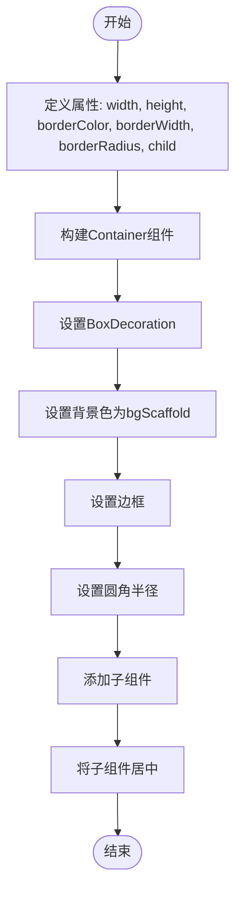
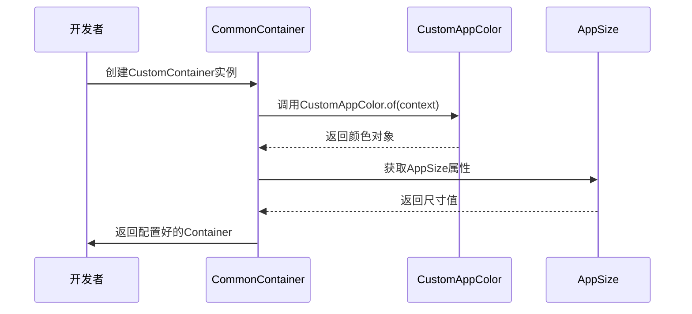
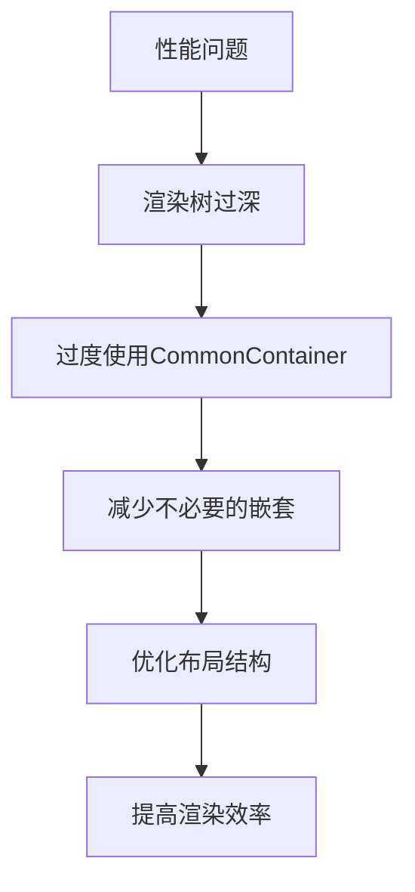
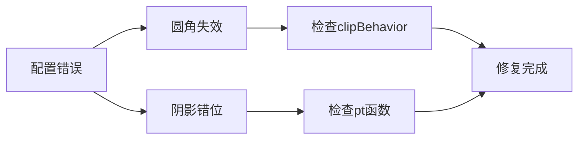

# 容器组件 (CommonContainer)

<cite>
**本文档引用的文件**
- [common_container.dart](file://lib/widgets/base/container/common_container.dart)
- [colors.dart](file://lib/resources/colors.dart)
- [size.dart](file://lib/resources/size.dart)
- [common_text.dart](file://lib/widgets/base/text/common_text.dart)
- [common_button.dart](file://lib/widgets/base/button/common_button.dart)
- [section_card.dart](file://lib/widgets/common/section_card.dart)
- [project.md](file://openspec/project.md)
- [UI_SPECIFICATION.md](file://UI_SPECIFICATION.md)
</cite>

## 目录
1. [简介](#简介)
2. [布局能力与样式配置](#布局能力与样式配置)
3. [基础布局单元作用](#基础布局单元作用)
4. [业务语义化配置](#业务语义化配置)
5. [使用场景模式](#使用场景模式)
6. [UI一致性规范](#ui一致性规范)
7. [嵌套使用示例](#嵌套使用示例)
8. [性能考量](#性能考量)
9. [配置错误与修复](#配置错误与修复)
10. [结论](#结论)

## 简介
CommonContainer组件是油商业务应用中的基础布局单元，用于构建卡片、表单项和内容区块等UI元素。该组件封装了Flutter的Container组件，并添加了业务语义化配置，确保UI一致性。通过使用AppSizes定义间距和CustomAppColor定义颜色，开发者可以创建符合设计规范的界面。

**Section sources**
- [common_container.dart](file://lib/widgets/base/container/common_container.dart#L1-L40)

## 布局能力与样式配置
CommonContainer组件支持设置背景色、圆角（radius）、边框（border）、内边距（padding）和外边距（margin）。这些属性使得开发者能够灵活地控制容器的外观和布局。

```mermaid
classDiagram
class CommonContainer {
+double width
+double height
+Color? borderColor
+double? borderWidth
+double? borderRadius
+Widget child
+CustomContainer({required double width, required double height, Color? borderColor, double? borderWidth, double? borderRadius, required Widget child})
}
```

**Diagram sources**
- [common_container.dart](file://lib/widgets/base/container/common_container.dart#L4-L20)

**Section sources**
- [common_container.dart](file://lib/widgets/base/container/common_container.dart#L1-L40)

## 基础布局单元作用
CommonContainer作为基础布局单元，主要用于封装其他UI组件，提供统一的样式和布局规则。它通过继承StatelessWidget，确保了组件的不可变性和高效性。



**Diagram sources**
- [common_container.dart](file://lib/widgets/base/container/common_container.dart#L24-L38)

**Section sources**
- [common_container.dart](file://lib/widgets/base/container/common_container.dart#L1-L40)

## 业务语义化配置
CommonContainer组件通过使用CustomAppColor.of(context)获取颜色，确保了在不同主题下的颜色一致性。同时，它利用AppSizes定义间距，保证了UI元素之间的统一间距。



**Diagram sources**
- [common_container.dart](file://lib/widgets/base/container/common_container.dart#L28-L33)
- [colors.dart](file://lib/resources/colors.dart#L3-L287)
- [size.dart](file://lib/resources/size.dart#L4-L16)

**Section sources**
- [common_container.dart](file://lib/widgets/base/container/common_container.dart#L1-L40)
- [colors.dart](file://lib/resources/colors.dart#L1-L361)
- [size.dart](file://lib/resources/size.dart#L1-L17)

## 使用场景模式
CommonContainer组件广泛应用于卡片、表单项和内容区块等场景。以下是几个典型的使用模式：

### 卡片模式
```dart
CustomContainer(
  width: AppSizes.setWidth(300),
  height: AppSizes.setHeight(200),
  borderColor: CustomAppColor.of(context).borderGrey,
  borderWidth: 1,
  borderRadius: 15,
  child: CommonText(
    text: '卡片内容',
    fontSize: AppSizes.setFontSize(16),
    textColor: CustomAppColor.of(context).txtBlack,
  ),
)
```

### 表单项模式
```dart
CustomContainer(
  width: AppSizes.fullWidth,
  height: AppSizes.setHeight(50),
  borderColor: CustomAppColor.of(context).textFieldBorder,
  borderWidth: 1,
  borderRadius: 12,
  child: CommonTextFormField(
    hintText: '请输入内容',
    borderColor: CustomAppColor.of(context).transparent,
  ),
)
```

### 内容区块模式
```dart
CustomContainer(
  width: AppSizes.fullWidth,
  height: AppSizes.setHeight(100),
  borderColor: CustomAppColor.of(context).containerBorder,
  borderWidth: 1,
  borderRadius: 8,
  child: Column(
    children: [
      CommonText(
        text: '标题',
        fontSize: AppSizes.setFontSize(18),
        textColor: CustomAppColor.of(context).txtBlack,
      ),
      CommonButton(
        btnText: '操作按钮',
        buttonColor: CustomAppColor.of(context).btnPurple,
        height: AppSizes.buttonHeight,
        radius: 8,
      ),
    ],
  ),
)
```

**Section sources**
- [common_container.dart](file://lib/widgets/base/container/common_container.dart#L1-L40)
- [common_text.dart](file://lib/widgets/base/text/common_text.dart#L1-L56)
- [common_button.dart](file://lib/widgets/base/button/common_button.dart#L1-L93)
- [section_card.dart](file://lib/widgets/common/section_card.dart#L1-L79)

## UI一致性规范
为了保证UI一致性，必须使用AppSizes定义间距，使用CustomAppColor定义颜色。这确保了在整个应用中，UI元素的尺寸和颜色保持一致。

```mermaid
erDiagram
CUSTOM_APP_COLOR {
Color bgScaffold
Color containerBorder
Color txtBlack
Color btnPurple
}
APP_SIZE {
EdgeInsets pagePadding
BorderRadius radius
List<BoxShadow> boxShadow
}
COMMON_CONTAINER {
double width
double height
Color? borderColor
double? borderWidth
double? borderRadius
Widget child
}
CUSTOM_APP_COLOR ||--o{ COMMON_CONTAINER : "使用"
APP_SIZE ||--o{ COMMON_CONTAINER : "使用"
```

**Diagram sources**
- [colors.dart](file://lib/resources/colors.dart#L3-L287)
- [size.dart](file://lib/resources/size.dart#L4-L16)
- [common_container.dart](file://lib/widgets/base/container/common_container.dart#L1-L40)

**Section sources**
- [colors.dart](file://lib/resources/colors.dart#L1-L361)
- [size.dart](file://lib/resources/size.dart#L1-L17)
- [common_container.dart](file://lib/widgets/base/container/common_container.dart#L1-L40)

## 嵌套使用示例
CommonContainer组件可以嵌套使用，内部包含CommonText和CommonButton等组件，构成完整功能模块。

```dart
CustomContainer(
  width: AppSizes.setWidth(350),
  height: AppSizes.setHeight(300),
  borderColor: CustomAppColor.of(context).borderPurple,
  borderWidth: 2,
  borderRadius: 20,
  child: Column(
    mainAxisAlignment: MainAxisAlignment.center,
    children: [
      CommonText(
        text: '欢迎使用',
        fontSize: AppSizes.setFontSize(20),
        textColor: CustomAppColor.of(context).txtPurple,
        fontWeight: FontWeight.w800,
      ),
      SizedBox(height: AppSizes.setHeight(20)),
      CommonButton(
        btnText: '立即体验',
        buttonColor: CustomAppColor.of(context).btnPurple,
        height: AppSizes.buttonHeight,
        radius: 10,
        onTap: () {
          // 处理点击事件
        },
      ),
    ],
  ),
)
```

**Section sources**
- [common_container.dart](file://lib/widgets/base/container/common_container.dart#L1-L40)
- [common_text.dart](file://lib/widgets/base/text/common_text.dart#L1-L56)
- [common_button.dart](file://lib/widgets/base/button/common_button.dart#L1-L93)

## 性能考量
尽管CommonContainer组件提供了丰富的布局和样式配置，但过度使用可能导致渲染树过深，影响性能。建议在必要时才使用该组件，并尽量减少嵌套层级。



**Diagram sources**
- [common_container.dart](file://lib/widgets/base/container/common_container.dart#L1-L40)

**Section sources**
- [common_container.dart](file://lib/widgets/base/container/common_container.dart#L1-L40)

## 配置错误与修复
配置错误可能导致UI异常，如圆角失效、阴影错位等。以下是一些常见问题及其修复方法：

### 圆角失效
**问题**: 设置了borderRadius但圆角未生效。
**原因**: 可能是由于父组件的clipBehavior设置不当。
**修复**: 确保父组件的clipBehavior设置为Clip.hardEdge。

### 阴影错位
**问题**: BoxShadow的偏移量不正确。
**原因**: 可能是由于AppSize的pt函数计算错误。
**修复**: 检查pt函数的实现，确保其正确转换像素值。



**Diagram sources**
- [common_container.dart](file://lib/widgets/base/container/common_container.dart#L33)
- [size.dart](file://lib/resources/size.dart#L12)

**Section sources**
- [common_container.dart](file://lib/widgets/base/container/common_container.dart#L1-L40)
- [size.dart](file://lib/resources/size.dart#L1-L17)

## 结论
CommonContainer组件作为油商业务应用的基础布局单元，提供了强大的布局能力和样式配置选项。通过遵循UI一致性规范，开发者可以创建出美观且一致的用户界面。同时，需要注意性能考量，避免过度使用导致渲染树过深。对于配置错误，应及时排查并修复，确保UI的正确显示。