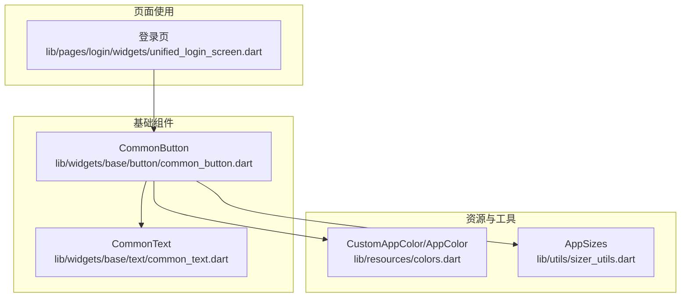
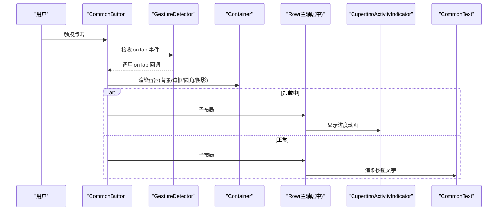
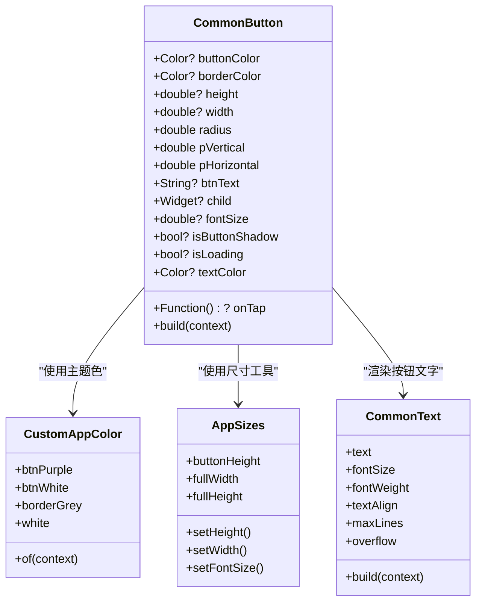

# 按钮组件 (CommonButton)

<cite>
**本文引用的文件**
- [common_button.dart](file://lib/widgets/base/button/common_button.dart)
- [colors.dart](file://lib/resources/colors.dart)
- [sizer_utils.dart](file://lib/utils/sizer_utils.dart)
- [common_text.dart](file://lib/widgets/base/text/common_text.dart)
- [unified_login_screen.dart](file://lib/pages/login/widgets/unified_login_screen.dart)
- [UI规范.md](file://UI_SPECIFICATION.md)
- [项目规范.md](file://openspec/project.md)
- [登录按钮加载状态测试.dart](file://test/pages/login/login_button_loading_state_test.dart)
</cite>

## 目录
1. [简介](#简介)
2. [项目结构](#项目结构)
3. [核心组件](#核心组件)
4. [架构总览](#架构总览)
5. [详细组件分析](#详细组件分析)
6. [依赖关系分析](#依赖关系分析)
7. [性能考量](#性能考量)
8. [故障排查指南](#故障排查指南)
9. [结论](#结论)
10. [附录](#附录)

## 简介
CommonButton 是业务应用中的统一按钮组件，提供一致的视觉风格、响应式尺寸与主题色集成。它支持多种状态与样式：正常、禁用（灰色遮罩/不可交互）、加载中（显示进度动画且禁用点击）。组件内部采用手势识别触发点击事件，并通过内置文本组件与 Flex 布局实现文字与图标的组合展示。本文档将全面说明其属性、状态表现、尺寸适配与主题集成方式，并给出在登录表单、提交操作等场景中的使用示例路径与最佳实践。

## 项目结构
CommonButton 位于基础组件层，作为可复用 UI 原子能力，供页面与业务组件直接使用。其依赖的颜色与尺寸工具分别来自资源与工具模块；文本样式由通用文本组件承载，确保一致性。

图表来源
- [common_button.dart](file://lib/widgets/base/button/common_button.dart#L1-L92)
- [common_text.dart](file://lib/widgets/base/text/common_text.dart#L1-L56)
- [colors.dart](file://lib/resources/colors.dart#L1-L361)
- [sizer_utils.dart](file://lib/utils/sizer_utils.dart#L1-L105)
- [unified_login_screen.dart](file://lib/pages/login/widgets/unified_login_screen.dart#L90-L174)

章节来源
- [common_button.dart](file://lib/widgets/base/button/common_button.dart#L1-L92)
- [colors.dart](file://lib/resources/colors.dart#L1-L361)
- [sizer_utils.dart](file://lib/utils/sizer_utils.dart#L1-L105)
- [common_text.dart](file://lib/widgets/base/text/common_text.dart#L1-L56)
- [unified_login_screen.dart](file://lib/pages/login/widgets/unified_login_screen.dart#L90-L174)

## 核心组件
- 组件名称：CommonButton
- 组件类型：无状态组件（StatelessWidget）
- 主要职责：
  - 统一按钮外观：背景色、边框、圆角、阴影
  - 统一交互反馈：点击事件、加载动画、禁用遮罩
  - 统一文本与尺寸：继承文本样式、响应式尺寸
  - 统一主题色：通过主题色获取器动态适配明暗主题

关键属性（按用途分类）
- 文案与内容
  - btnText：按钮文字
  - child：自定义子组件（优先于 btnText）
  - fontSize：文字字号
  - textColor：文字颜色
- 视觉与尺寸
  - buttonColor：背景色
  - borderColor：边框色
  - radius：圆角半径
  - height/width：高度与宽度（默认使用 AppSizes）
  - isButtonShadow：是否显示阴影
  - pVertical/pHorizontal：内边距
- 交互与状态
  - onTap：点击回调
  - isLoading：加载中状态（显示进度动画并禁用点击）

章节来源
- [common_button.dart](file://lib/widgets/base/button/common_button.dart#L6-L37)
- [UI规范.md](file://UI_SPECIFICATION.md#L274-L375)
- [项目规范.md](file://openspec/project.md#L230-L304)

## 架构总览
CommonButton 的渲染流程围绕“容器 + 子布局”的结构展开：外层容器负责背景、边框、圆角与阴影；内层 Row 布局根据 isLoading 决定显示加载动画或文本组件；文本组件进一步继承通用样式与主题色。

图表来源
- [common_button.dart](file://lib/widgets/base/button/common_button.dart#L39-L91)
- [common_text.dart](file://lib/widgets/base/text/common_text.dart#L1-L56)

章节来源
- [common_button.dart](file://lib/widgets/base/button/common_button.dart#L39-L91)

## 详细组件分析

### 属性与行为详解
- 文案与内容
  - btnText：当未传入 child 时，内部以 CommonText 渲染按钮文字，继承字号、字重、对齐与主题色。
  - child：若提供，则优先显示自定义子组件，不渲染默认文字。
- 视觉与尺寸
  - buttonColor/borderColor：背景色与边框色均支持主题色获取器；默认背景色取自主题色 getter。
  - radius：圆角半径，默认 8。
  - height/width：默认高度使用 AppSizes.buttonHeight，宽度使用 AppSizes.fullWidth；可通过参数覆盖。
  - isButtonShadow：控制是否显示阴影，默认开启。
  - pVertical/pHorizontal：内边距，用于微调按钮内容与边缘的距离。
- 交互与状态
  - onTap：点击回调；在加载中时仍会接收事件，但通常业务侧会通过状态控制禁用点击。
  - isLoading：true 时显示 CupertinoActivityIndicator，同时按钮内容区域被替换为加载动画；false 时显示文本。

章节来源
- [common_button.dart](file://lib/widgets/base/button/common_button.dart#L6-L37)
- [common_button.dart](file://lib/widgets/base/button/common_button.dart#L39-L91)
- [common_text.dart](file://lib/widgets/base/text/common_text.dart#L1-L56)
- [colors.dart](file://lib/resources/colors.dart#L197-L207)
- [sizer_utils.dart](file://lib/utils/sizer_utils.dart#L100-L104)

### 不同状态下的视觉表现
- 正常状态
  - 显示按钮背景与边框，文字颜色为白色（默认），可选阴影。
- 禁用状态
  - 通过业务层控制禁用：在登录页中，当协议未勾选或正在登录时，按钮被禁用（点击无效），并可能显示灰色遮罩或降低透明度。
  - 注意：当前组件本身未内置“灰色遮罩”包裹逻辑，禁用效果通常由业务层在外部包裹禁用指针或调整按钮颜色实现。
- 加载状态
  - isLoading 为 true 时，按钮内显示进度动画，文字被隐藏；点击事件通常被业务层阻止。

章节来源
- [unified_login_screen.dart](file://lib/pages/login/widgets/unified_login_screen.dart#L90-L174)
- [UI规范.md](file://UI_SPECIFICATION.md#L359-L363)
- [登录按钮加载状态测试.dart](file://test/pages/login/login_button_loading_state_test.dart#L1-L62)

### 尺寸适配逻辑（响应式设计）
- 统一尺寸入口：AppSizes
  - buttonHeight：标准按钮高度 52（已通过屏幕工具缩放）
  - fullWidth/fullHeight：全屏宽高
  - setHeight/setWidth/setFontSize：按设备与用户偏好进行缩放
- 圆角与间距：遵循设计规范中的圆角值与间距体系，保证跨设备一致性

章节来源
- [sizer_utils.dart](file://lib/utils/sizer_utils.dart#L1-L105)
- [UI规范.md](file://UI_SPECIFICATION.md#L181-L234)
- [项目规范.md](file://openspec/project.md#L462-L513)

### 颜色主题集成（CustomAppColor）
- 主题色获取器：CustomAppColor.of(context) 提供多组语义化颜色 getter，如 btnPurple、btnWhite、borderGrey、white 等。
- 默认色：按钮默认背景色取自主题色 getter；文字颜色默认为白色。
- 明暗主题：颜色 getter 会根据当前主题亮度返回对应颜色，确保在深色模式下仍具可读性。

章节来源
- [colors.dart](file://lib/resources/colors.dart#L1-L361)
- [common_button.dart](file://lib/widgets/base/button/common_button.dart#L56-L60)

### 内部实现机制
- 手势与点击反馈
  - 使用 GestureDetector 接收点击事件，将 onTap 传递给上层业务。
- 文本样式与继承
  - 当未提供 child 时，内部以 CommonText 渲染按钮文字，继承字号、字重、对齐与主题色。
- Flex 布局结构
  - 内部使用 Row 并设置主轴居中，保证文字与图标在水平方向居中对齐。
- 进度动画
  - isLoading 为 true 时，显示 CupertinoActivityIndicator，颜色取自主题色 white。

章节来源
- [common_button.dart](file://lib/widgets/base/button/common_button.dart#L41-L91)
- [common_text.dart](file://lib/widgets/base/text/common_text.dart#L1-L56)

### 在登录表单与提交操作中的使用示例
- 登录页按钮
  - 在登录页中，按钮根据登录状态与协议勾选情况动态禁用或启用；加载中时显示加载动画。
  - 示例路径：[登录页按钮使用](file://lib/pages/login/widgets/unified_login_screen.dart#L90-L174)
- 提交操作
  - 业务层在点击后进入加载状态，按钮 isLoading 置为 true；完成后恢复为正常状态。
  - 测试用例验证了加载状态的一致性与禁用逻辑：[登录按钮加载状态测试](file://test/pages/login/login_button_loading_state_test.dart#L1-L62)

章节来源
- [unified_login_screen.dart](file://lib/pages/login/widgets/unified_login_screen.dart#L90-L174)
- [登录按钮加载状态测试.dart](file://test/pages/login/login_button_loading_state_test.dart#L1-L62)

## 依赖关系分析
- 组件依赖
  - colors.dart：主题色获取器与语义化颜色定义
  - sizer_utils.dart：统一尺寸与字体缩放工具
  - common_text.dart：按钮文字渲染与样式继承
- 页面依赖
  - 登录页通过业务状态控制按钮的禁用与加载，体现组件与业务层的协作关系

图表来源
- [common_button.dart](file://lib/widgets/base/button/common_button.dart#L6-L37)
- [colors.dart](file://lib/resources/colors.dart#L197-L207)
- [sizer_utils.dart](file://lib/utils/sizer_utils.dart#L100-L104)
- [common_text.dart](file://lib/widgets/base/text/common_text.dart#L1-L56)

章节来源
- [common_button.dart](file://lib/widgets/base/button/common_button.dart#L6-L37)
- [colors.dart](file://lib/resources/colors.dart#L1-L361)
- [sizer_utils.dart](file://lib/utils/sizer_utils.dart#L1-L105)
- [common_text.dart](file://lib/widgets/base/text/common_text.dart#L1-L56)

## 性能考量
- 渲染开销
  - 按钮为轻量级无状态组件，仅包含容器、布局与文本/动画，渲染成本低。
- 动画与交互
  - 加载动画为轻量级原生控件，建议在高频点击场景中配合业务层禁用重复点击，避免频繁切换状态。
- 主题与尺寸
  - 通过主题色与尺寸工具统一管理，减少硬编码带来的维护成本与视觉不一致风险。

## 故障排查指南
- 点击无响应
  - 现象：按钮点击无效
  - 可能原因：未设置 onTap 或业务层在禁用状态下拦截了点击
  - 解决方案：确保传入 onTap；在禁用状态下使用业务层禁用指针或调整按钮颜色
  - 参考：[登录页按钮禁用逻辑](file://lib/pages/login/widgets/unified_login_screen.dart#L90-L174)
- 文字溢出
  - 现象：按钮文字被截断或换行异常
  - 可能原因：按钮宽度不足或未设置合适的 maxLines/overflow
  - 解决方案：增大按钮宽度或设置合适的 maxLines 与 overflow；必要时使用 child 自定义布局
  - 参考：[按钮属性规范](file://UI_SPECIFICATION.md#L286-L301)、[按钮类型与尺寸示例](file://openspec/project.md#L247-L288)
- 加载状态不一致
  - 现象：加载中按钮仍可点击或状态未恢复
  - 可能原因：业务层未正确同步 isLoading 状态
  - 解决方案：参考测试用例，确保加载状态与禁用逻辑一致
  - 参考：[登录按钮加载状态测试](file://test/pages/login/login_button_loading_state_test.dart#L1-L62)

章节来源
- [unified_login_screen.dart](file://lib/pages/login/widgets/unified_login_screen.dart#L90-L174)
- [UI规范.md](file://UI_SPECIFICATION.md#L286-L301)
- [项目规范.md](file://openspec/project.md#L247-L288)
- [登录按钮加载状态测试.dart](file://test/pages/login/login_button_loading_state_test.dart#L1-L62)

## 结论
CommonButton 通过统一的视觉与交互规范，结合主题色与响应式尺寸工具，实现了跨页面、跨场景的一致体验。其简洁的属性与清晰的状态控制，使得在登录、提交等关键流程中能够稳定地表达当前状态。建议在使用时：
- 明确区分“禁用”与“加载中”两种状态，避免混淆
- 通过业务层控制点击与禁用，确保用户体验与交互一致性
- 使用 AppSizes 与 CustomAppColor 统一尺寸与颜色，提升可维护性

## 附录
- 常用按钮类型与尺寸示例
  - 主要按钮：背景色为主题色，文字白色，带阴影，高度 52，圆角 8
  - 次要按钮：背景色为浅色，带边框，无阴影
  - 小按钮：高度 34，圆角 3
  - 图标按钮：正方形，圆角 3，自定义 child
- 参考路径
  - [按钮类型与示例](file://openspec/project.md#L247-L288)
  - [按钮属性与规范](file://UI_SPECIFICATION.md#L274-L358)