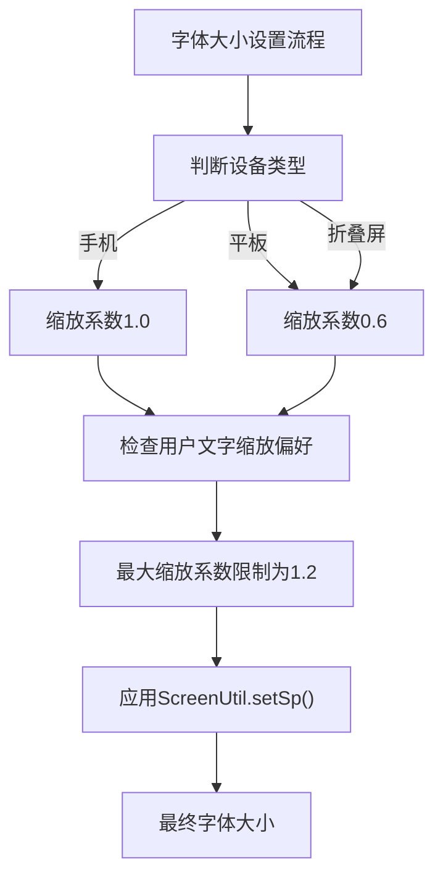
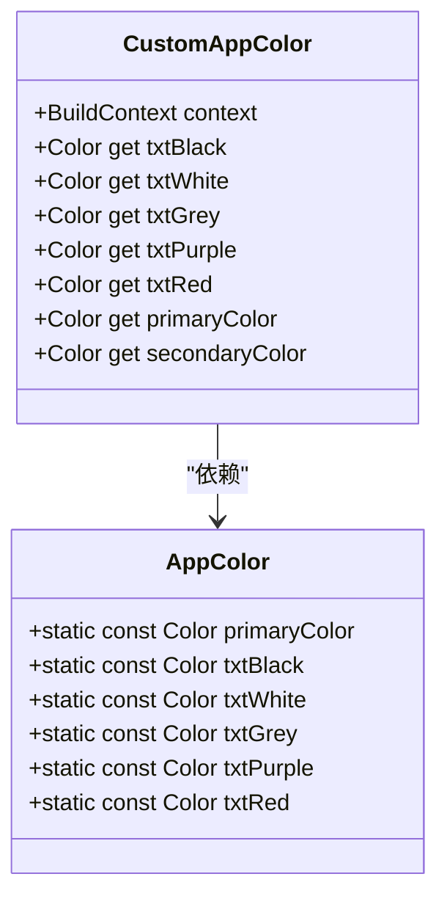
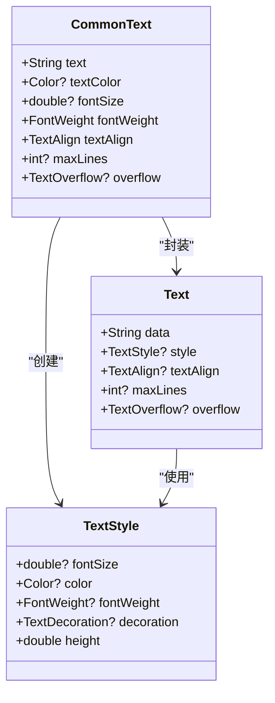

# 文本组件 (CommonText)

<cite>
**本文档引用的文件**
- [common_text.dart](file://lib/widgets/base/text/common_text.dart)
- [colors.dart](file://lib/resources/colors.dart)
- [size.dart](file://lib/resources/size.dart)
- [sizer_utils.dart](file://lib/utils/sizer_utils.dart)
- [constant.dart](file://lib/utils/constant.dart)
- [project.md](file://openspec/project.md)
- [UI_SPECIFICATION.md](file://UI_SPECIFICATION.md)
</cite>

## 目录
1. [简介](#简介)
2. [核心参数详解](#核心参数详解)
3. [使用示例](#使用示例)
4. [与Flutter原生组件集成](#与flutter原生组件集成)
5. [高级样式配置](#高级样式配置)
6. [典型问题与调试建议](#典型问题与调试建议)

## 简介
CommonText是本项目中统一的文本展示组件，旨在提供一致的文本样式和响应式布局支持。该组件封装了Flutter的Text组件，通过预设的样式规范确保应用内文本显示的一致性。组件设计遵循避免硬编码颜色和尺寸的原则，强制要求通过资源层进行引用，从而实现主题化和可维护性。

**Section sources**
- [common_text.dart](file://lib/widgets/base/text/common_text.dart#L6-L55)
- [project.md](file://openspec/project.md#L202-L247)

## 核心参数详解

### fontSize（字体大小）
字体大小参数必须结合AppSizes进行缩放，以确保在不同设备上的响应式适配。默认值为14，通过`AppSizes.setFontSize()`方法进行设置。



**Diagram sources**
- [sizer_utils.dart](file://lib/utils/sizer_utils.dart#L7-L44)

### fontWeight（字重）
支持normal、medium、bold等字重，对应Flutter的FontWeight枚举值。默认值为FontWeight.w400（normal），可通过w500、w600、w700等值实现不同粗细效果。

### textColor（文本颜色）
文本颜色推荐使用CustomAppColor语义化调用，避免直接使用颜色值。默认颜色为txtBlack，通过`CustomAppColor.of(context).txtBlack`获取。



**Diagram sources**
- [colors.dart](file://lib/resources/colors.dart#L3-L287)

### maxLines（最大行数）和textOverflow（溢出处理）
maxLines定义文本显示的最大行数，textOverflow定义溢出时的处理方式。当maxLines不为空且overflow未指定时，默认使用TextOverflow.ellipsis显示省略号。

**Section sources**
- [common_text.dart](file://lib/widgets/base/text/common_text.dart#L16-L18)
- [common_text.dart](file://lib/widgets/base/text/common_text.dart#L42)

## 使用示例

### 标题层级
用于页面主标题、TopBar标题等重要标题场景，字号20，字重600。

```dart
CommonText(
  text: '页面标题',
  fontSize: AppSizes.setFontSize(20),
  fontWeight: FontWeight.w600,
  textColor: CustomAppColor.of(context).txtBlack,
)
```

### 正文层级
用于普通文本、输入框文本等场景，字号14，字重400或600。

```dart
CommonText(
  text: '这是正文内容',
  fontSize: AppSizes.setFontSize(14),
  fontWeight: FontWeight.w400,
  textColor: CustomAppColor.of(context).txtBlack,
  maxLines: 2,
  overflow: TextOverflow.ellipsis,
)
```

### 提示信息层级
用于辅助信息、标签等场景，字号12，字重500。

```dart
CommonText(
  text: '请输入正确格式的手机号',
  fontSize: AppSizes.setFontSize(12),
  fontWeight: FontWeight.w500,
  textColor: CustomAppColor.of(context).txtGrey,
)
```

**Section sources**
- [UI_SPECIFICATION.md](file://UI_SPECIFICATION.md#L153-L164)
- [common_text.dart](file://lib/widgets/base/text/common_text.dart#L6-L55)

## 与Flutter原生组件集成
CommonText组件基于Flutter的Text组件构建，完全兼容TextStyle的所有属性。通过style参数传递TextStyle对象，实现了与原生组件的无缝集成。



**Diagram sources**
- [common_text.dart](file://lib/widgets/base/text/common_text.dart#L38-L53)

## 高级样式配置

### 文本对齐
通过textAlign参数配置文本对齐方式，默认为TextAlign.center。支持TextAlign.left、TextAlign.right、TextAlign.justify等值。

### 行高配置
所有文本统一行高为1.2，通过TextStyle的height属性设置，确保文本的可读性和美观性。

### 字符间距
通过letterSpacing参数配置字符间距，可用于特殊设计需求。

**Section sources**
- [UI_SPECIFICATION.md](file://UI_SPECIFICATION.md#L166-L167)
- [common_text.dart](file://lib/widgets/base/text/common_text.dart#L10)

## 典型问题与调试建议

### 文字截断不显示省略号
**问题原因**：当maxLines为空时，即使设置了overflow为TextOverflow.ellipsis，也不会显示省略号。

**解决方案**：确保同时设置maxLines和overflow参数。

```dart
// 错误示例
CommonText(
  text: '长文本内容...',
  maxLines: null,
  overflow: TextOverflow.ellipsis,
)

// 正确示例
CommonText(
  text: '长文本内容...',
  maxLines: 1,
  overflow: TextOverflow.ellipsis,
)
```

### 动态字体缩放失效
**问题原因**：未正确使用AppSizes.setFontSize()方法，或设备类型判断逻辑有问题。

**调试建议**：
1. 检查sizer_utils.dart中的isTablet和isFoldablePhone方法
2. 确认BaseConfig.navigatorKey.currentContext是否有效
3. 验证ScreenUtil初始化是否正确

**Section sources**
- [sizer_utils.dart](file://lib/utils/sizer_utils.dart#L70-L83)
- [common_text.dart](file://lib/widgets/base/text/common_text.dart#L44)