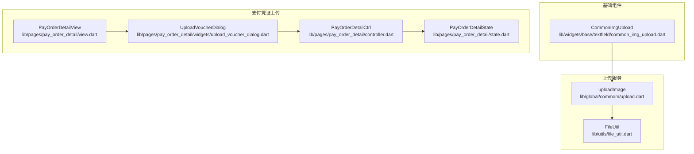
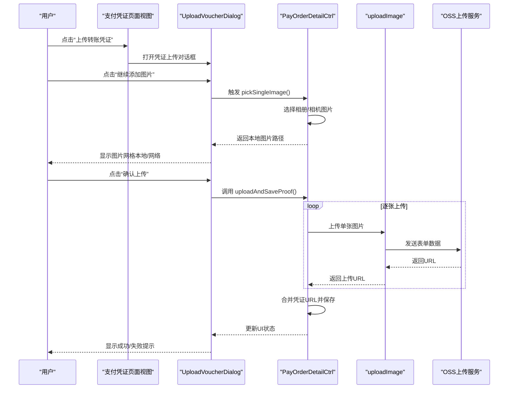
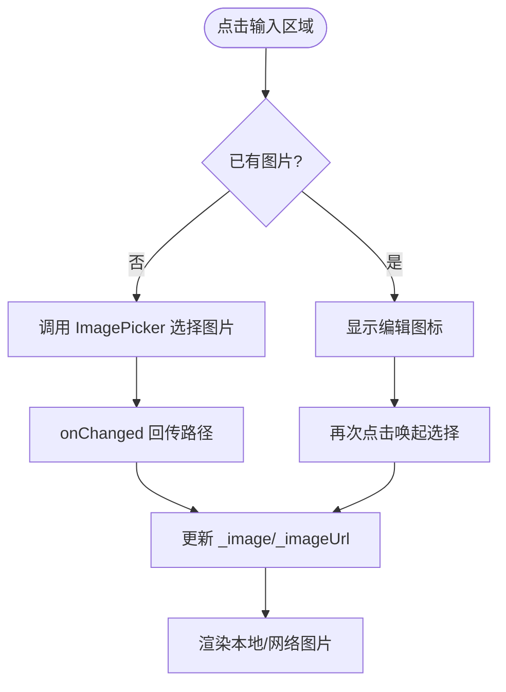
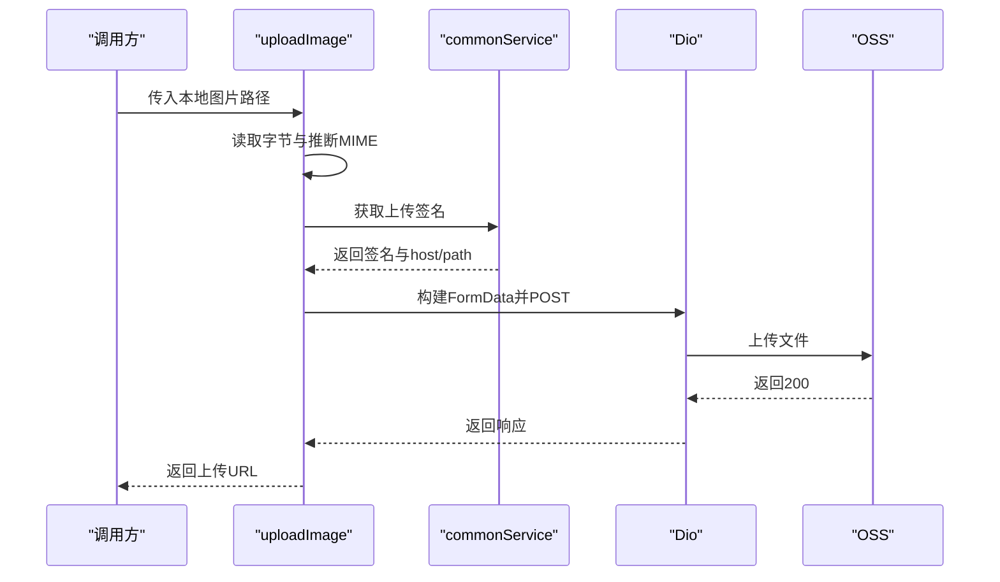
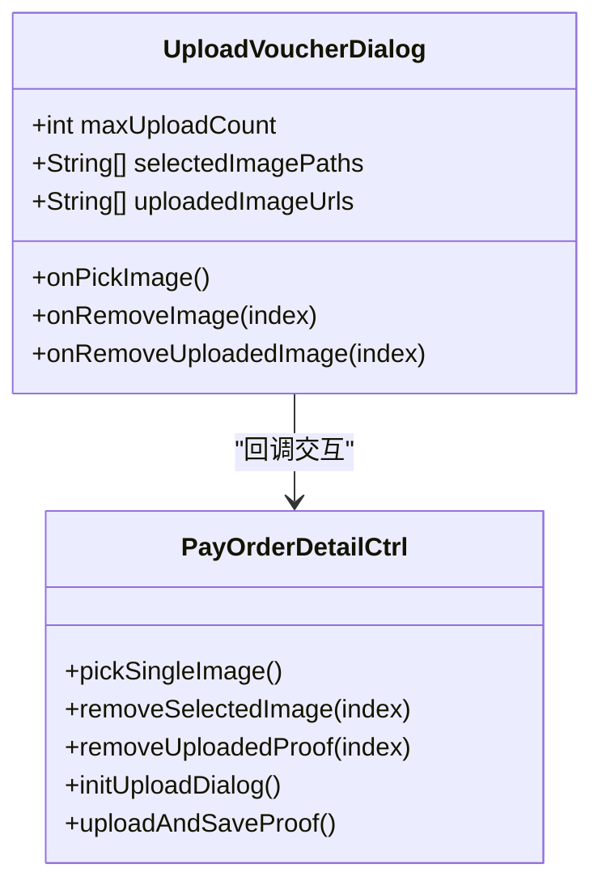
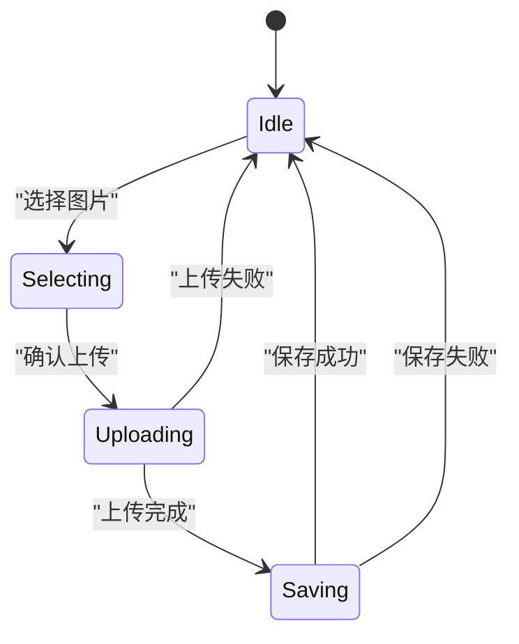
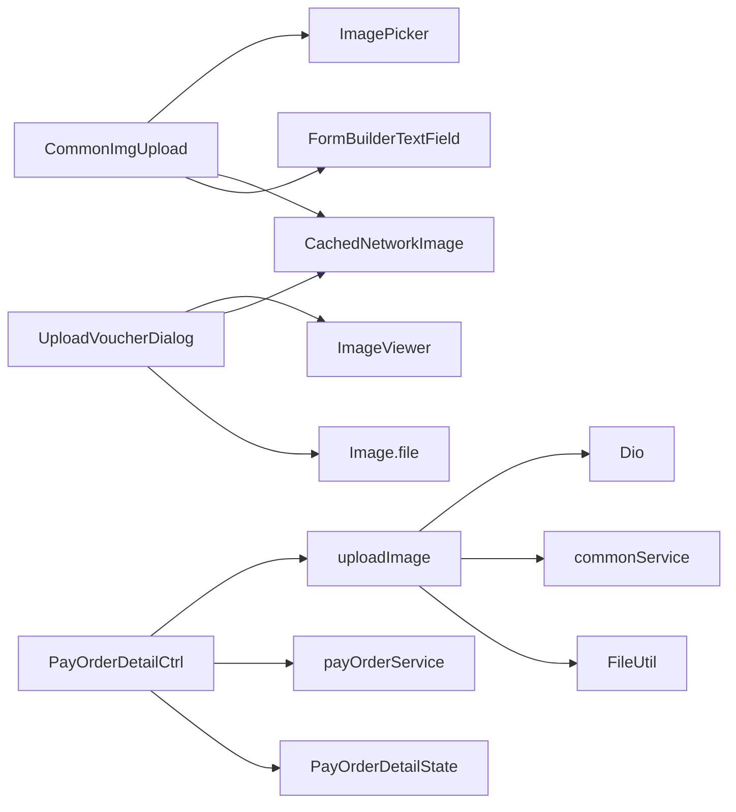

# 图片上传组件 (CommonImgUpload)

<cite>
**本文引用的文件**
- [common_img_upload.dart](file://lib/widgets/base/textfield/common_img_upload.dart)
- [upload.dart](file://lib/global/commom/upload.dart)
- [file_util.dart](file://lib/utils/file_util.dart)
- [upload_voucher_dialog.dart](file://lib/pages/pay_order_detail/widgets/upload_voucher_dialog.dart)
- [controller.dart](file://lib/pages/pay_order_detail/controller.dart)
- [state.dart](file://lib/pages/pay_order_detail/state.dart)
- [view.dart](file://lib/pages/pay_order_detail/view.dart)
- [img2base64.dart](file://lib/utils/img2base64.dart)
- [code.dart](file://lib/net/code.dart)
- [api_exception.dart](file://lib/net/api_exception.dart)
- [proposal.md](file://openspec/changes/archive/2025-11-28-save-payment-proof-on-close/proposal.md)
</cite>

## 目录
1. [简介](#简介)
2. [项目结构](#项目结构)
3. [核心组件](#核心组件)
4. [架构总览](#架构总览)
5. [详细组件分析](#详细组件分析)
6. [依赖关系分析](#依赖关系分析)
7. [性能考量](#性能考量)
8. [故障排查指南](#故障排查指南)
9. [结论](#结论)
10. [附录](#附录)

## 简介
本文件围绕 CommonImgUpload 可视化输入组件进行系统性解析，覆盖以下关键主题：
- 设计理念：以“点击即唤起系统相册/相机”的轻交互方式，结合本地图片预览与网络图片展示，形成统一的图片输入体验。
- 图片选择与预览：点击上传区域触发系统相册选择；本地图片通过 Image.file 渲染，网络图片通过 CachedNetworkImage 渲染，支持占位与错误占位。
- 上传状态管理：组件自身维护“待上传/已上传/编辑态”等 UI 状态；在支付凭证上传场景中，控制器通过状态机管理“上传中/保存中/错误”等状态。
- 与上传服务集成：通过全局上传工具调用签名接口与 OSS 上传，支持 MIME 类型推断与错误日志记录。
- 多图上传策略：在支付凭证上传对话框中实现多图队列管理、删除与查看器联动。
- 业务场景示例：支付凭证上传、资质证明提交等；配套错误处理与用户提示。

## 项目结构
CommonImgUpload 位于基础文本输入组件集合中，配合支付凭证上传对话框与控制器共同完成多图上传与保存流程。

图表来源
- [common_img_upload.dart](file://lib/widgets/base/textfield/common_img_upload.dart#L1-L304)
- [upload.dart](file://lib/global/commom/upload.dart#L1-L72)
- [file_util.dart](file://lib/utils/file_util.dart#L1-L44)
- [upload_voucher_dialog.dart](file://lib/pages/pay_order_detail/widgets/upload_voucher_dialog.dart#L1-L303)
- [controller.dart](file://lib/pages/pay_order_detail/controller.dart#L1-L395)
- [state.dart](file://lib/pages/pay_order_detail/state.dart#L1-L69)
- [view.dart](file://lib/pages/pay_order_detail/view.dart#L570-L703)

章节来源
- [common_img_upload.dart](file://lib/widgets/base/textfield/common_img_upload.dart#L1-L304)
- [upload_voucher_dialog.dart](file://lib/pages/pay_order_detail/widgets/upload_voucher_dialog.dart#L1-L303)
- [controller.dart](file://lib/pages/pay_order_detail/controller.dart#L1-L395)
- [state.dart](file://lib/pages/pay_order_detail/state.dart#L1-L69)
- [view.dart](file://lib/pages/pay_order_detail/view.dart#L570-L703)

## 核心组件
- CommonImgUpload：可视化图片输入组件，负责点击唤起相册、本地图片预览、网络图片预览与编辑态 UI。
- uploadImage：全局上传工具，封装签名获取、表单构建与 OSS 上传。
- UploadVoucherDialog：支付凭证上传对话框，支持多图网格、删除、查看器与上限控制。
- PayOrderDetailCtrl/State/View：控制器、状态与视图，协调多图上传、保存凭证与 UI 反馈。

章节来源
- [common_img_upload.dart](file://lib/widgets/base/textfield/common_img_upload.dart#L1-L304)
- [upload.dart](file://lib/global/commom/upload.dart#L1-L72)
- [upload_voucher_dialog.dart](file://lib/pages/pay_order_detail/widgets/upload_voucher_dialog.dart#L1-L303)
- [controller.dart](file://lib/pages/pay_order_detail/controller.dart#L1-L395)
- [state.dart](file://lib/pages/pay_order_detail/state.dart#L1-L69)
- [view.dart](file://lib/pages/pay_order_detail/view.dart#L570-L703)

## 架构总览
CommonImgUpload 作为输入组件，主要职责是“选择图片并预览”。在支付凭证上传场景中，它与 UploadVoucherDialog、控制器与上传服务协同工作，形成“选择 -> 预览 -> 上传 -> 保存 -> 刷新”的闭环。

图表来源
- [view.dart](file://lib/pages/pay_order_detail/view.dart#L601-L691)
- [upload_voucher_dialog.dart](file://lib/pages/pay_order_detail/widgets/upload_voucher_dialog.dart#L228-L303)
- [controller.dart](file://lib/pages/pay_order_detail/controller.dart#L91-L121)
- [controller.dart](file://lib/pages/pay_order_detail/controller.dart#L164-L254)
- [upload.dart](file://lib/global/commom/upload.dart#L11-L72)

## 详细组件分析

### CommonImgUpload 组件分析
- 设计理念
  - 采用“点击即唤起相册”的轻交互，避免复杂按钮层级。
  - 通过前置图标与 suffixIcon 区分“待上传/已上传/编辑态”，提升可读性。
- 图片选择与预览
  - 点击输入区域触发系统相册选择；选择成功后通过 onChanged 回传路径，组件内部更新状态并渲染本地图片或网络图片。
  - 本地图片使用 Image.file 渲染，网络图片使用 CachedNetworkImage 渲染，支持占位与错误占位。
- 状态与 UI
  - 通过 FocusNode 控制标签与边框颜色，提升交互反馈。
  - 当存在图片时隐藏 hint 文案，保持视觉整洁。
- 与系统相册/相机的集成
  - 使用 ImagePicker 选择图片，设置最大宽高与质量，减少体积与内存占用。

图表来源
- [common_img_upload.dart](file://lib/widgets/base/textfield/common_img_upload.dart#L126-L140)
- [common_img_upload.dart](file://lib/widgets/base/textfield/common_img_upload.dart#L142-L303)

章节来源
- [common_img_upload.dart](file://lib/widgets/base/textfield/common_img_upload.dart#L1-L304)

### 上传服务 uploadImage 分析
- 功能概述
  - 读取本地图片字节，推断 MIME 类型，向通用服务获取 OSS 上传签名，构建 FormData 并上传至 OSS。
  - 返回上传后的 URL 或空值，便于上层处理。
- 关键点
  - MIME 类型推断：优先使用 XFile 的 mimeType，否则按扩展名映射。
  - 错误处理：对 host/path 为空、状态码非 200、异常进行日志记录与空值返回。
  - 授权头：附加 Bearer Token，确保上传鉴权。

图表来源
- [upload.dart](file://lib/global/commom/upload.dart#L11-L72)
- [file_util.dart](file://lib/utils/file_util.dart#L1-L44)

章节来源
- [upload.dart](file://lib/global/commom/upload.dart#L1-L72)
- [file_util.dart](file://lib/utils/file_util.dart#L1-L44)

### 支付凭证上传对话框 UploadVoucherDialog 分析
- 多图网格
  - 支持已上传网络图片与新选择本地图片混合展示，使用 GridView.builder 实现。
  - 通过 CachedNetworkImage 渲染网络图片，Image.file 渲染本地图片。
- 交互能力
  - 继续添加图片按钮受上限控制；删除按钮支持移除本地图片与已上传图片。
  - 点击任意图片进入查看器，支持本地/网络图片自动识别。
- 与控制器协作
  - onPickImage/onRemoveImage/onRemoveUploadedImage 由控制器实现，对话框仅负责展示与交互。

图表来源
- [upload_voucher_dialog.dart](file://lib/pages/pay_order_detail/widgets/upload_voucher_dialog.dart#L1-L303)
- [controller.dart](file://lib/pages/pay_order_detail/controller.dart#L91-L121)
- [controller.dart](file://lib/pages/pay_order_detail/controller.dart#L123-L145)
- [controller.dart](file://lib/pages/pay_order_detail/controller.dart#L154-L162)
- [controller.dart](file://lib/pages/pay_order_detail/controller.dart#L164-L254)

章节来源
- [upload_voucher_dialog.dart](file://lib/pages/pay_order_detail/widgets/upload_voucher_dialog.dart#L1-L303)
- [controller.dart](file://lib/pages/pay_order_detail/controller.dart#L91-L121)
- [controller.dart](file://lib/pages/pay_order_detail/controller.dart#L123-L145)
- [controller.dart](file://lib/pages/pay_order_detail/controller.dart#L154-L162)
- [controller.dart](file://lib/pages/pay_order_detail/controller.dart#L164-L254)

### 控制器与状态管理
- 状态模型
  - 包含 isLoading/isUploading/isSavingProof/selectedImagePaths/uploadedImageUrls/currentProofUrls 等字段，支撑多图上传与保存流程。
- 上传与保存流程
  - pickSingleImage：限制最多 5 张，追加到 selectedImagePaths。
  - uploadAndSaveProof：顺序上传新图片，合并 URL，调用保存接口，刷新订单详情。
  - savePaymentProof：防重复保存，等待上次保存完成再执行新保存。
- UI 反馈
  - 通过 isUploading/isSavingProof 禁用确认按钮，避免并发操作。
  - 成功/失败提示通过 Toast 组件展示。

图表来源
- [state.dart](file://lib/pages/pay_order_detail/state.dart#L1-L69)
- [controller.dart](file://lib/pages/pay_order_detail/controller.dart#L91-L121)
- [controller.dart](file://lib/pages/pay_order_detail/controller.dart#L164-L254)
- [controller.dart](file://lib/pages/pay_order_detail/controller.dart#L256-L307)

章节来源
- [state.dart](file://lib/pages/pay_order_detail/state.dart#L1-L69)
- [controller.dart](file://lib/pages/pay_order_detail/controller.dart#L91-L121)
- [controller.dart](file://lib/pages/pay_order_detail/controller.dart#L164-L254)
- [controller.dart](file://lib/pages/pay_order_detail/controller.dart#L256-L307)

### 业务场景与应用示例
- 支付凭证上传
  - 页面入口：点击“上传转账凭证”打开对话框。
  - 交互：选择图片、查看网格、删除、确认上传。
  - 保存：上传完成后调用保存接口，刷新订单详情。
- 资质证明提交
  - 与支付凭证类似，使用相同对话框与控制器逻辑，支持多图上传与删除。

章节来源
- [view.dart](file://lib/pages/pay_order_detail/view.dart#L570-L703)
- [upload_voucher_dialog.dart](file://lib/pages/pay_order_detail/widgets/upload_voucher_dialog.dart#L1-L303)
- [controller.dart](file://lib/pages/pay_order_detail/controller.dart#L164-L254)
- [proposal.md](file://openspec/changes/archive/2025-11-28-save-payment-proof-on-close/proposal.md#L1-L14)

## 依赖关系分析
- 组件依赖
  - CommonImgUpload 依赖 ImagePicker、CachedNetworkImage、FormBuilderTextField 等第三方库。
  - 上传服务依赖 Dio、commonService、FileUtil。
  - 支付凭证上传对话框依赖 ImageViewer（在 view 中使用）、CachedNetworkImage、Image.file。
- 控制器依赖
  - 控制器依赖上传服务与订单服务，负责状态管理与 UI 反馈。
- 错误处理
  - 上传服务对 host/path 为空、状态码非 200、异常进行日志记录。
  - 控制器对保存接口异常进行捕获与提示。

图表来源
- [common_img_upload.dart](file://lib/widgets/base/textfield/common_img_upload.dart#L1-L304)
- [upload.dart](file://lib/global/commom/upload.dart#L1-L72)
- [upload_voucher_dialog.dart](file://lib/pages/pay_order_detail/widgets/upload_voucher_dialog.dart#L1-L303)
- [controller.dart](file://lib/pages/pay_order_detail/controller.dart#L1-L395)
- [state.dart](file://lib/pages/pay_order_detail/state.dart#L1-L69)

章节来源
- [common_img_upload.dart](file://lib/widgets/base/textfield/common_img_upload.dart#L1-L304)
- [upload.dart](file://lib/global/commom/upload.dart#L1-L72)
- [upload_voucher_dialog.dart](file://lib/pages/pay_order_detail/widgets/upload_voucher_dialog.dart#L1-L303)
- [controller.dart](file://lib/pages/pay_order_detail/controller.dart#L1-L395)
- [state.dart](file://lib/pages/pay_order_detail/state.dart#L1-L69)

## 性能考量
- 图片压缩与尺寸
  - 相册选择时设置最大宽高与质量，降低上传体积与内存占用。
- 上传策略
  - 顺序上传新图片，避免并发导致的资源竞争与网络拥塞。
- 渲染优化
  - 网络图片使用 CachedNetworkImage，支持占位与错误占位，提升首屏体验。
- 状态更新
  - 控制器通过状态机管理 isUploading/isSavingProof，避免重复提交与并发冲突。

章节来源
- [common_img_upload.dart](file://lib/widgets/base/textfield/common_img_upload.dart#L126-L140)
- [controller.dart](file://lib/pages/pay_order_detail/controller.dart#L164-L254)
- [upload_voucher_dialog.dart](file://lib/pages/pay_order_detail/widgets/upload_voucher_dialog.dart#L105-L169)

## 故障排查指南
- 网络中断
  - 上传服务对异常进行日志记录并返回空值；控制器捕获异常并提示“上传失败”。
- 文件过大
  - OSS 上传脚本示例中包含 413（请求实体过大）错误分支，可参考进行前端提示与限制。
- MIME 类型问题
  - 若 XFile 的 mimeType 为空，将按扩展名映射默认类型，建议在选择阶段限制格式（JPG/PNG）。
- 保存失败
  - 保存接口异常时，控制器会提示“保存支付凭证失败”，并重抛异常以便上层处理。

章节来源
- [upload.dart](file://lib/global/commom/upload.dart#L49-L71)
- [controller.dart](file://lib/pages/pay_order_detail/controller.dart#L246-L254)
- [controller.dart](file://lib/pages/pay_order_detail/controller.dart#L284-L307)
- [scripts/upload_oss.sh](file://scripts/upload_oss.sh#L195-L211)
- [file_util.dart](file://lib/utils/file_util.dart#L1-L44)

## 结论
CommonImgUpload 以简洁直观的方式实现了图片上传的可视化输入体验；在支付凭证上传场景中，通过 UploadVoucherDialog 与控制器的协作，形成了完善的多图上传、删除与保存闭环。上传服务封装了签名与 OSS 上传细节，配合 MIME 类型推断与错误日志，提升了整体稳定性与可维护性。建议在业务侧进一步完善格式校验与上传进度监听，以提升用户体验与可靠性。

## 附录
- Base64 编码与 ImageWidget 渲染
  - 工具函数提供网络图片转 Base64 的能力，可用于缓存或离线展示场景。
- 错误码与异常
  - 业务错误码与异常类型定义，便于统一错误处理与提示。

章节来源
- [img2base64.dart](file://lib/utils/img2base64.dart#L1-L25)
- [code.dart](file://lib/net/code.dart#L1-L12)
- [api_exception.dart](file://lib/net/api_exception.dart#L1-L11)