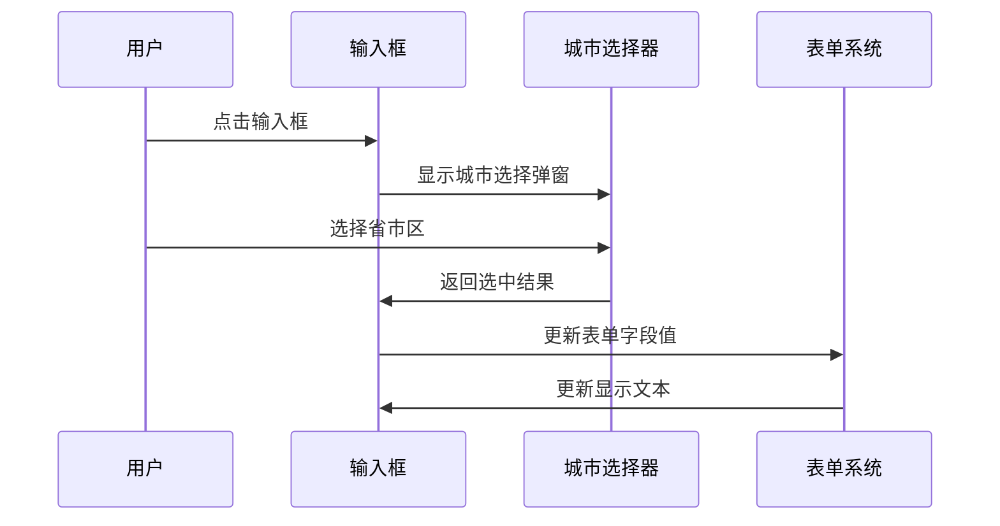
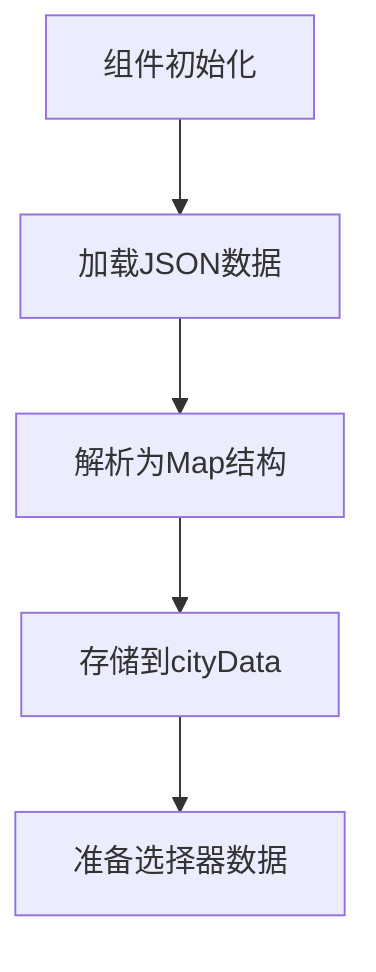
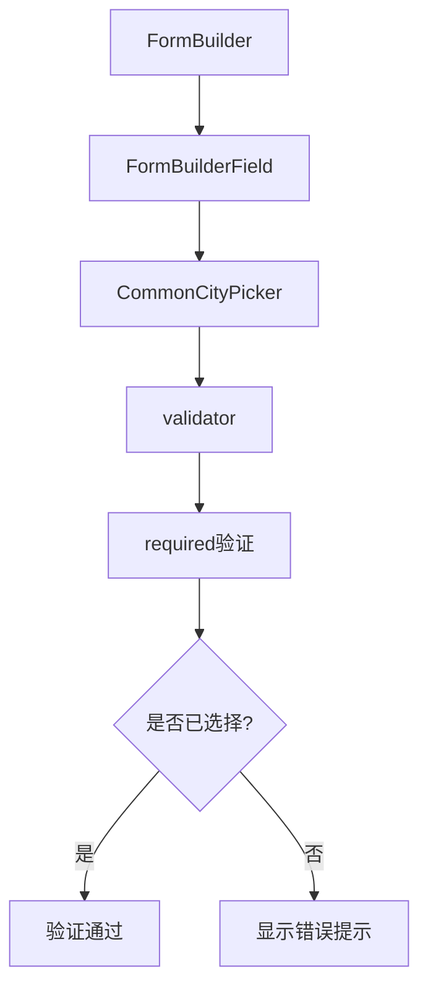

# 城市选择器 (CommonCityPicker)

<cite>
**本文档引用的文件**   
- [common_city_picker.dart](file://lib/widgets/base/textfield/common_city_picker.dart)
- [pca-code.json](file://assets/json/pca-code.json)
- [station_edit_form.dart](file://lib/pages/station_edit/widgets/station_edit_form.dart)
</cite>

## 目录
1. [简介](#简介)
2. [核心功能实现](#核心功能实现)
3. [交互流程](#交互流程)
4. [数据加载与缓存](#数据加载与缓存)
5. [选择结果回填](#选择结果回填)
6. [表单验证集成](#表单验证集成)
7. [无障碍访问支持](#无障碍访问支持)
8. [使用范例](#使用范例)
9. [总结](#总结)

## 简介
`CommonCityPicker` 是一个封装好的特殊输入框组件，用于实现省市区三级联动的城市选择功能。用户点击输入框后会弹出城市选择器，选择完成后将格式化的城市信息显示在输入框中。该组件与表单验证系统紧密集成，确保用户必须完成选择才能通过校验，并支持无障碍访问。

## 核心功能实现

`CommonCityPicker` 组件通过 `CommonCityPickerFormField` 类实现，该类继承自 `StatefulWidget`，提供了丰富的配置选项，包括提示文本、图标、控制器、验证器等。组件内部使用 `FormBuilderField` 来集成表单验证功能，并通过 `GestureDetector` 监听点击事件来触发城市选择弹窗。

**Section sources**
- [common_city_picker.dart](file://lib/widgets/base/textfield/common_city_picker.dart#L12-L385)

## 交互流程

当用户点击 `CommonCityPicker` 输入框时，会触发 `onTap` 事件，调用 `showPicker` 方法显示城市选择弹窗。选择完成后，选中的城市信息会被格式化为“省 市 区”的形式，并通过 `field.didChange(selected)` 更新表单字段值，同时更新 `TextEditingController` 的文本内容。



**Diagram sources **
- [common_city_picker.dart](file://lib/widgets/base/textfield/common_city_picker.dart#L189-L283)
- [common_city_picker.dart](file://lib/widgets/base/textfield/common_city_picker.dart#L303-L307)

## 数据加载与缓存

城市数据存储在 `assets/json/pca-code.json` 文件中，包含全国省市区的三级联动数据。组件在 `initState` 中通过 `loadJsonFromAssets` 方法异步加载 JSON 数据，并将其解析为 `List<dynamic>` 存储在 `cityData` 变量中。由于数据在组件初始化时加载并缓存在内存中，因此每次打开选择器时无需重新请求网络或读取文件，实现了高效的本地缓存。



**Diagram sources **
- [common_city_picker.dart](file://lib/widgets/base/textfield/common_city_picker.dart#L110-L123)
- [common_city_picker.dart](file://lib/widgets/base/textfield/common_city_picker.dart#L161-L170)
- [pca-code.json](file://assets/json/pca-code.json)

**Section sources**
- [common_city_picker.dart](file://lib/widgets/base/textfield/common_city_picker.dart#L110-L123)
- [pca-code.json](file://assets/json/pca-code.json)

## 选择结果回填

当用户在城市选择器中完成选择后，`onConfirm` 回调会获取选中的索引值，然后根据这些索引从 `cityData` 中提取对应的省份、城市和区县名称及代码。选中的三个名称会被拼接成“省 市 区”的格式，并通过 `widget.controller?.text = text` 更新输入框的显示文本。同时，通过 `widget.onChanged` 回调将完整的选中数据（包括名称和代码）传递给父组件。

**Section sources**
- [common_city_picker.dart](file://lib/widgets/base/textfield/common_city_picker.dart#L228-L254)

## 表单验证集成

`CommonCityPicker` 通过 `FormBuilderField` 与表单验证系统集成。在 `build` 方法中，它返回一个 `FormBuilderField<String>`，并设置了 `validator` 属性。如果外部未提供自定义验证器，则默认使用 `FormBuilderValidators.required` 确保字段必填。当表单提交时，如果用户未选择城市，会显示“{widget.name} is required”的错误提示。



**Diagram sources **
- [common_city_picker.dart](file://lib/widgets/base/textfield/common_city_picker.dart#L290-L297)
- [station_edit_form.dart](file://lib/pages/station_edit/widgets/station_edit_form.dart#L134-L159)

## 无障碍访问支持

`CommonCityPicker` 组件通过标准的 Flutter 可访问性机制支持屏幕阅读器。当用户选择城市后，输入框的文本内容会更新，屏幕阅读器会自动播报新的文本内容，例如“北京市 市辖区 东城区”。此外，组件的 `labelText` 和 `hintText` 也会被屏幕阅读器正确识别和播报，帮助视障用户理解输入框的用途。

## 使用范例

在加油站编辑页面 (`station_edit_form.dart`) 中，`CommonCityPicker` 被用于选择加油站所在区域。通过设置 `initialCityData` 属性，可以为已存在的加油站预填充初始的省市区数据。当用户选择新的城市时，`onChanged` 回调会更新控制器中的城市数据，并重新构建显示文本。

```dart
CommonCityPickerFormField(
  controller: _cityController,
  name: 'city',
  hintText: '选择省/市/区',
  initialCityData: widget.state.provinceCode.isNotEmpty
      ? [
          widget.state.provinceCode,
          widget.state.cityCode,
          widget.state.areaCode,
        ]
      : null,
  onChanged: (cityData) {
    widget.controller.updateCityData(cityData);
    setState(() {
      _cityController.text = _buildCityText();
    });
  },
)
```

**Section sources**
- [station_edit_form.dart](file://lib/pages/station_edit/widgets/station_edit_form.dart#L134-L159)

## 总结

`CommonCityPicker` 是一个功能完整、易于集成的城市选择组件。它通过封装复杂的三级联动逻辑，提供了简洁的 API 供开发者使用。组件不仅实现了基本的选择功能，还与表单验证、无障碍访问等系统良好集成，确保了良好的用户体验和可访问性。