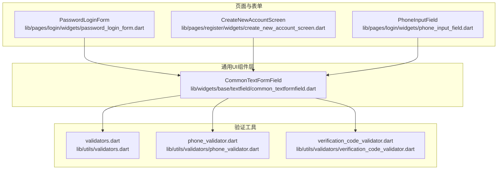
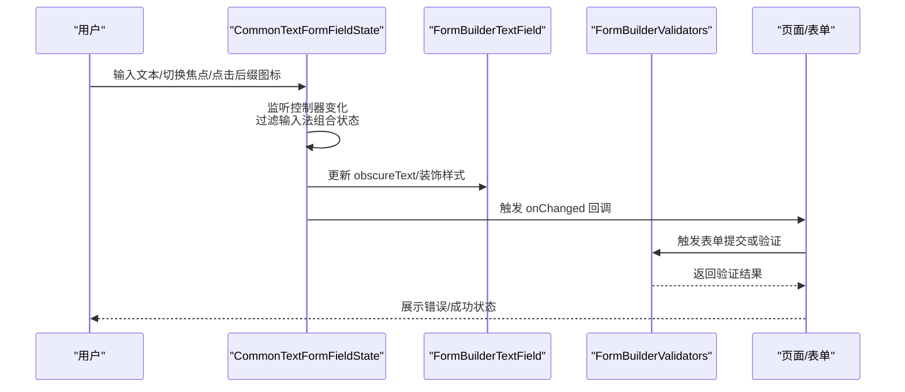
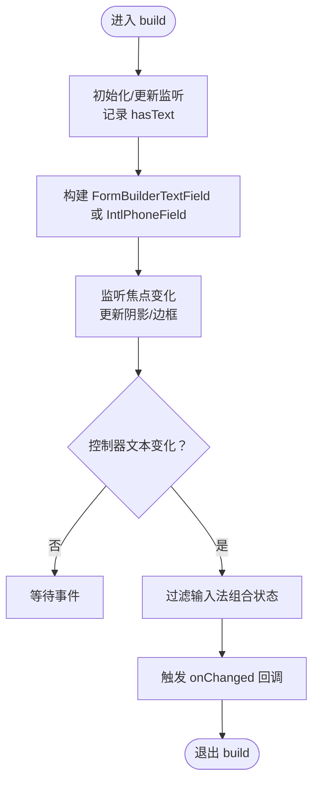
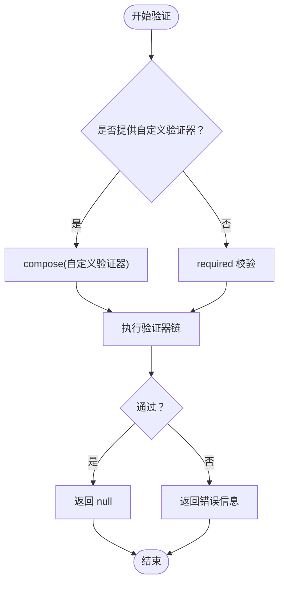
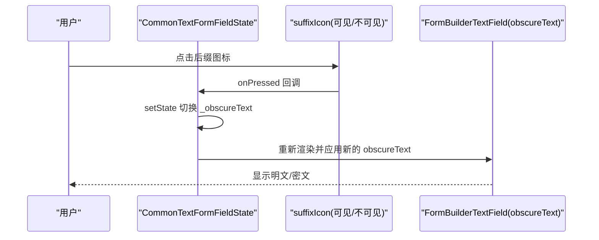
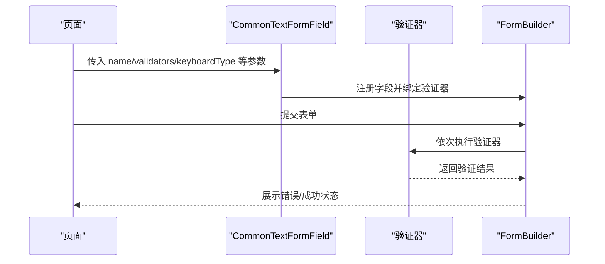
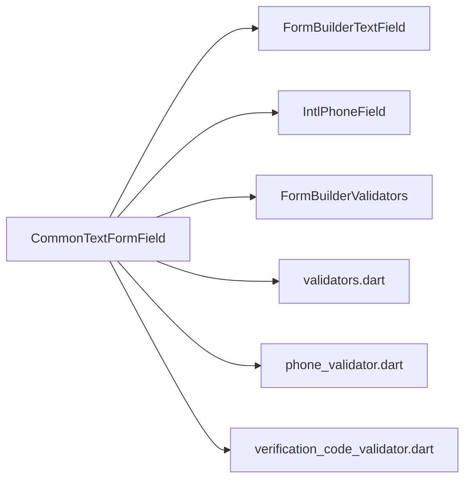

# 基础输入框 (CommonTextFormField)

<cite>
**本文引用的文件列表**
- [common_textformfield.dart](file://lib/widgets/base/textfield/common_textformfield.dart)
- [validators.dart](file://lib/utils/validators.dart)
- [phone_validator.dart](file://lib/utils/validators/phone_validator.dart)
- [verification_code_validator.dart](file://lib/utils/validators/verification_code_validator.dart)
- [password_login_form.dart](file://lib/pages/login/widgets/password_login_form.dart)
- [create_new_account_screen.dart](file://lib/pages/register/widgets/create_new_account_screen.dart)
- [phone_input_field.dart](file://lib/pages/login/widgets/phone_input_field.dart)
- [password_visibility_test.dart](file://test/pages/forgot_password/password_visibility_test.dart)
</cite>

## 目录
1. [简介](#简介)
2. [项目结构](#项目结构)
3. [核心组件](#核心组件)
4. [架构总览](#架构总览)
5. [组件详解](#组件详解)
6. [依赖关系分析](#依赖关系分析)
7. [性能考量](#性能考量)
8. [故障排查指南](#故障排查指南)
9. [结论](#结论)
10. [附录](#附录)

## 简介
本文件深入解析基础输入框组件 CommonTextFormField 的核心实现机制，围绕其对 TextFormField 的封装策略展开，重点覆盖以下方面：
- TextEditingController 生命周期管理与监听
- FocusNode 焦点控制与视觉反馈联动
- InputDecoration 样式定制与标签/占位符策略
- 表单验证体系：必填、格式（正则）、自定义验证器集成
- 输入类型适配：text、number、phone、password 的键盘与行为差异
- 密码可见性切换：suffixIcon 动态图标与 obscureText 联动
- 错误状态视觉反馈：边框颜色、错误提示与 helperText 动态更新
- 登录/注册等典型场景的使用示例与全局验证工具协作模式

## 项目结构
CommonTextFormField 位于通用 UI 组件层，作为基础文本输入控件，被多处页面与表单复用。其主要依赖于表单框架 FormBuilder 与第三方输入增强库（如国际电话输入），并通过全局验证工具进行格式校验。

图表来源
- [common_textformfield.dart](file://lib/widgets/base/textfield/common_textformfield.dart#L1-L360)
- [password_login_form.dart](file://lib/pages/login/widgets/password_login_form.dart#L1-L27)
- [create_new_account_screen.dart](file://lib/pages/register/widgets/create_new_account_screen.dart#L1-L250)
- [phone_input_field.dart](file://lib/pages/login/widgets/phone_input_field.dart#L1-L39)
- [validators.dart](file://lib/utils/validators.dart#L1-L82)
- [phone_validator.dart](file://lib/utils/validators/phone_validator.dart#L1-L35)
- [verification_code_validator.dart](file://lib/utils/validators/verification_code_validator.dart#L1-L34)

章节来源
- [common_textformfield.dart](file://lib/widgets/base/textfield/common_textformfield.dart#L1-L360)
- [password_login_form.dart](file://lib/pages/login/widgets/password_login_form.dart#L1-L27)
- [create_new_account_screen.dart](file://lib/pages/register/widgets/create_new_account_screen.dart#L1-L250)
- [phone_input_field.dart](file://lib/pages/login/widgets/phone_input_field.dart#L1-L39)
- [validators.dart](file://lib/utils/validators.dart#L1-L82)
- [phone_validator.dart](file://lib/utils/validators/phone_validator.dart#L1-L35)
- [verification_code_validator.dart](file://lib/utils/validators/verification_code_validator.dart#L1-L34)

## 核心组件
CommonTextFormField 是一个 StatefulWidget，内部维护 FocusNode、obscureText 状态与 hasText 标志，统一管理控制器监听、焦点变更与构建输入框。其核心职责包括：
- 封装 FormBuilderTextField 与 IntlPhoneField，按 isPhoneNumberField 条件切换
- 管理 TextEditingController 的监听与 onChanged 过滤（避免输入法组合状态误触发）
- 控制 FocusNode 并联动阴影与边框样式
- 提供 InputDecoration 的标签/占位符策略与 suffixIcon 动态切换
- 集成表单验证器（必填、格式、自定义）

章节来源
- [common_textformfield.dart](file://lib/widgets/base/textfield/common_textformfield.dart#L11-L68)
- [common_textformfield.dart](file://lib/widgets/base/textfield/common_textformfield.dart#L74-L136)
- [common_textformfield.dart](file://lib/widgets/base/textfield/common_textformfield.dart#L137-L360)

## 架构总览
CommonTextFormField 的运行时架构由“状态管理 + 表单构建 + 验证器集成 + 页面使用”四部分组成。下图展示关键交互流程。

图表来源
- [common_textformfield.dart](file://lib/widgets/base/textfield/common_textformfield.dart#L74-L136)
- [common_textformfield.dart](file://lib/widgets/base/textfield/common_textformfield.dart#L251-L358)

## 组件详解

### 1) 封装策略与输入类型适配
- 条件渲染：当 isPhoneNumberField 为真时，使用 IntlPhoneField；否则使用 FormBuilderTextField。
- 键盘类型与格式化：
  - text：默认文本键盘，可配合 inputFormatter 自定义
  - number：使用 TextInputType.number 与数字格式化器
  - phone：使用 TextInputType.phone 与 digitsOnly 限制
  - password：使用 obscureText 控制可见性，suffixIcon 动态切换
- 样式与标签：
  - floatingLabelBehavior 根据是否有 labelText 自动调整
  - hint 与 labelText 在聚焦/非聚焦状态下动态显示/隐藏
  - enabledBorder/focusedBorder 使用主题色区分状态

章节来源
- [common_textformfield.dart](file://lib/widgets/base/textfield/common_textformfield.dart#L142-L233)
- [common_textformfield.dart](file://lib/widgets/base/textfield/common_textformfield.dart#L234-L358)

### 2) TextEditingController 生命周期管理
- 初始化：在 initState 中创建/接管 FocusNode，记录初始 hasText，并为 controller 添加监听
- 更新：didUpdateWidget 中检测 controller 变更，替换监听器并同步 hasText
- 销毁：dispose 中移除监听器并释放 FocusNode
- 文本变化过滤：_handleTextChanged 仅在非输入法组合状态下触发 onChanged，避免拼音等输入过程中的误回调

图表来源
- [common_textformfield.dart](file://lib/widgets/base/textfield/common_textformfield.dart#L74-L136)
- [common_textformfield.dart](file://lib/widgets/base/textfield/common_textformfield.dart#L137-L233)

章节来源
- [common_textformfield.dart](file://lib/widgets/base/textfield/common_textformfield.dart#L74-L136)

### 3) FocusNode 焦点控制与视觉反馈
- 焦点监听：通过 _focusNode.addListener 触发 setState，驱动容器阴影与边框样式变化
- 焦点状态联动：isFocused 影响阴影、labelText/hintText 的显示策略与边框颜色
- 页面级焦点管理：PhoneInputField 等页面组件传入自定义 FocusNode，便于跨字段导航与自动聚焦

章节来源
- [common_textformfield.dart](file://lib/widgets/base/textfield/common_textformfield.dart#L137-L233)
- [phone_input_field.dart](file://lib/pages/login/widgets/phone_input_field.dart#L1-L39)

### 4) InputDecoration 样式定制
- 标签与占位符：根据 hasLabel 与 isFocused 动态决定是否显示 labelText 与 hintText
- 边框与阴影：enabledBorder/focusedBorder 区分普通与聚焦态；聚焦时添加阴影
- 前缀/后缀图标：leadingIcon 支持任意 Widget；suffixIcon 在 isPasswordField 下动态切换为可见/不可见图标
- 填充与圆角：fillColor 与 radius 控制背景与圆角

章节来源
- [common_textformfield.dart](file://lib/widgets/base/textfield/common_textformfield.dart#L234-L358)

### 5) 表单验证体系
- 必填校验：当未提供自定义 validators 时，默认使用 FormBuilderValidators.required
- 格式校验：通过正则表达式实现（如手机号、验证码）
- 自定义验证器：支持传入自定义函数，与 FormBuilderValidators.compose 组合使用
- 全局验证工具协作：
  - PhoneValidator.validatePhone：用于手机号输入
  - VerificationCodeValidator.validateCode：用于验证码输入
  - PasswordValidator.validatePassword：用于密码复杂度校验

图表来源
- [common_textformfield.dart](file://lib/widgets/base/textfield/common_textformfield.dart#L351-L356)
- [validators.dart](file://lib/utils/validators.dart#L1-L82)
- [phone_validator.dart](file://lib/utils/validators/phone_validator.dart#L1-L35)
- [verification_code_validator.dart](file://lib/utils/validators/verification_code_validator.dart#L1-L34)

章节来源
- [common_textformfield.dart](file://lib/widgets/base/textfield/common_textformfield.dart#L351-L356)
- [validators.dart](file://lib/utils/validators.dart#L1-L82)
- [phone_validator.dart](file://lib/utils/validators/phone_validator.dart#L1-L35)
- [verification_code_validator.dart](file://lib/utils/validators/verification_code_validator.dart#L1-L34)

### 6) 输入类型与行为差异
- text：默认文本输入，可配置 maxLength、textAlign、textAlignVertical
- number：限制数字输入，适合金额/编号类场景
- phone：限制 11 位数字，自动聚焦到下一个输入框（在 OTP 场景常见）
- password：obscureText 控制隐藏/显示，suffixIcon 动态切换

章节来源
- [create_new_account_screen.dart](file://lib/pages/register/widgets/create_new_account_screen.dart#L89-L114)
- [phone_input_field.dart](file://lib/pages/login/widgets/phone_input_field.dart#L1-L39)

### 7) 密码可见性切换机制
- 状态：_obscureText 初始值来自 isPasswordField
- 后缀图标：isPasswordField 时，suffixIcon 根据 _obscureText 动态选择隐藏/可见图标
- 切换逻辑：点击后缀图标切换 _obscureText，并触发 setState 重绘
- 测试验证：测试用例覆盖了多次切换往返的一致性与独立切换行为

图表来源
- [common_textformfield.dart](file://lib/widgets/base/textfield/common_textformfield.dart#L297-L324)
- [password_visibility_test.dart](file://test/pages/forgot_password/password_visibility_test.dart#L1-L90)

章节来源
- [common_textformfield.dart](file://lib/widgets/base/textfield/common_textformfield.dart#L297-L324)
- [password_visibility_test.dart](file://test/pages/forgot_password/password_visibility_test.dart#L1-L90)

### 8) 错误状态视觉反馈
- 边框颜色：focusedBorder 使用主题紫色，enabledBorder 使用灰色，聚焦时区分明显
- 错误提示：通过表单框架的验证结果驱动错误文案显示（在外部页面中结合 InputDecoration.errorText 使用）
- helperText 动态更新：hintText 与 labelText 在聚焦/非聚焦状态间切换，辅助提示信息随焦点变化

章节来源
- [common_textformfield.dart](file://lib/widgets/base/textfield/common_textformfield.dart#L332-L349)
- [common_textformfield.dart](file://lib/widgets/base/textfield/common_textformfield.dart#L269-L305)

### 9) 典型场景使用示例与协作模式
- 登录表单（密码登录）：PasswordLoginForm 直接使用 CommonTextFormField，设置 isPasswordField、leadingIcon、hintText 等
- 注册表单：CreateNewAccountScreen 中多处使用 CommonTextFormField，分别配置 name、validators、keyboardType、inputFormatter 等
- 手机号输入：PhoneInputField 封装公共手机号输入，统一使用 PhoneValidator.validatePhone

图表来源
- [password_login_form.dart](file://lib/pages/login/widgets/password_login_form.dart#L1-L27)
- [create_new_account_screen.dart](file://lib/pages/register/widgets/create_new_account_screen.dart#L68-L156)
- [phone_input_field.dart](file://lib/pages/login/widgets/phone_input_field.dart#L1-L39)

章节来源
- [password_login_form.dart](file://lib/pages/login/widgets/password_login_form.dart#L1-L27)
- [create_new_account_screen.dart](file://lib/pages/register/widgets/create_new_account_screen.dart#L68-L156)
- [phone_input_field.dart](file://lib/pages/login/widgets/phone_input_field.dart#L1-L39)

## 依赖关系分析
- 组件依赖：FormBuilderTextField、IntlPhoneField、FormBuilderValidators
- 样式依赖：主题色、尺寸工具、图标资源
- 验证依赖：全局验证工具（validators.dart、phone_validator.dart、verification_code_validator.dart）
- 页面依赖：登录/注册/忘记密码等页面通过 CommonTextFormField 统一风格与行为

图表来源
- [common_textformfield.dart](file://lib/widgets/base/textfield/common_textformfield.dart#L1-L360)
- [validators.dart](file://lib/utils/validators.dart#L1-L82)
- [phone_validator.dart](file://lib/utils/validators/phone_validator.dart#L1-L35)
- [verification_code_validator.dart](file://lib/utils/validators/verification_code_validator.dart#L1-L34)

章节来源
- [common_textformfield.dart](file://lib/widgets/base/textfield/common_textformfield.dart#L1-L360)
- [validators.dart](file://lib/utils/validators.dart#L1-L82)
- [phone_validator.dart](file://lib/utils/validators/phone_validator.dart#L1-L35)
- [verification_code_validator.dart](file://lib/utils/validators/verification_code_validator.dart#L1-L34)

## 性能考量
- 控制器监听：仅在必要时添加/移除监听，避免重复监听导致的额外重建
- 焦点监听：FocusNode 监听仅触发局部刷新，减少不必要的全局重建
- 输入过滤：在输入法组合状态时跳过 onChanged，降低无效回调次数
- 渲染优化：根据 isPhoneNumberField 条件渲染，避免不必要的子树

[本节为通用建议，无需特定文件来源]

## 故障排查指南
- 密码可见性异常
  - 症状：点击后缀图标无反应
  - 排查：确认 isPasswordField 为 true，且 suffixIcon 为 IconButton；检查 onPressed 是否被覆盖
  - 参考：[common_textformfield.dart](file://lib/widgets/base/textfield/common_textformfield.dart#L297-L324)
- 焦点边框不生效
  - 症状：聚焦后边框颜色未变化
  - 排查：确认 _focusNode 已添加监听；检查 enabledBorder/focusedBorder 颜色配置
  - 参考：[common_textformfield.dart](file://lib/widgets/base/textfield/common_textformfield.dart#L332-L349)
- 验证不触发
  - 症状：输入后无错误提示
  - 排查：确认表单已提交或启用了 Autovalidate；检查 validators 参数是否正确传入
  - 参考：[common_textformfield.dart](file://lib/widgets/base/textfield/common_textformfield.dart#L351-L356)
- 手机号格式错误
  - 症状：提示“请输入有效的手机号”
  - 排查：检查输入长度、是否全为数字、是否以 1 开头
  - 参考：[phone_validator.dart](file://lib/utils/validators/phone_validator.dart#L1-L35)

章节来源
- [common_textformfield.dart](file://lib/widgets/base/textfield/common_textformfield.dart#L297-L356)
- [phone_validator.dart](file://lib/utils/validators/phone_validator.dart#L1-L35)

## 结论
CommonTextFormField 通过统一的状态管理、灵活的输入类型适配与完善的验证集成，提供了稳定可靠的输入体验。其对 TextEditingController/FocusNode 的生命周期管理、对 InputDecoration 的精细化定制以及对密码可见性的直观交互，使其成为登录、注册等典型场景的理想选择。配合全局验证工具，可快速构建一致、可维护的表单体系。

[本节为总结，无需特定文件来源]

## 附录
- 关键参数速览
  - name：表单字段标识
  - hintText/labelText：占位符与标签
  - isPasswordField/isPhoneNumberField：输入类型开关
  - controller/focusNode：控制器与焦点节点
  - validators：验证器（必填/格式/自定义）
  - keyboardType/inputFormatter：键盘类型与输入格式化
  - fillColor/borderColor/radius：样式定制
  - showHint/maxLength/required 标记：行为与约束

[本节为概览，无需特定文件来源]