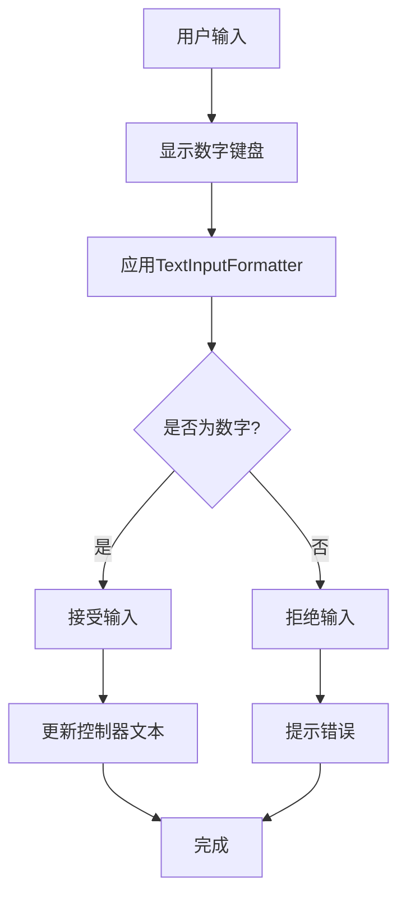
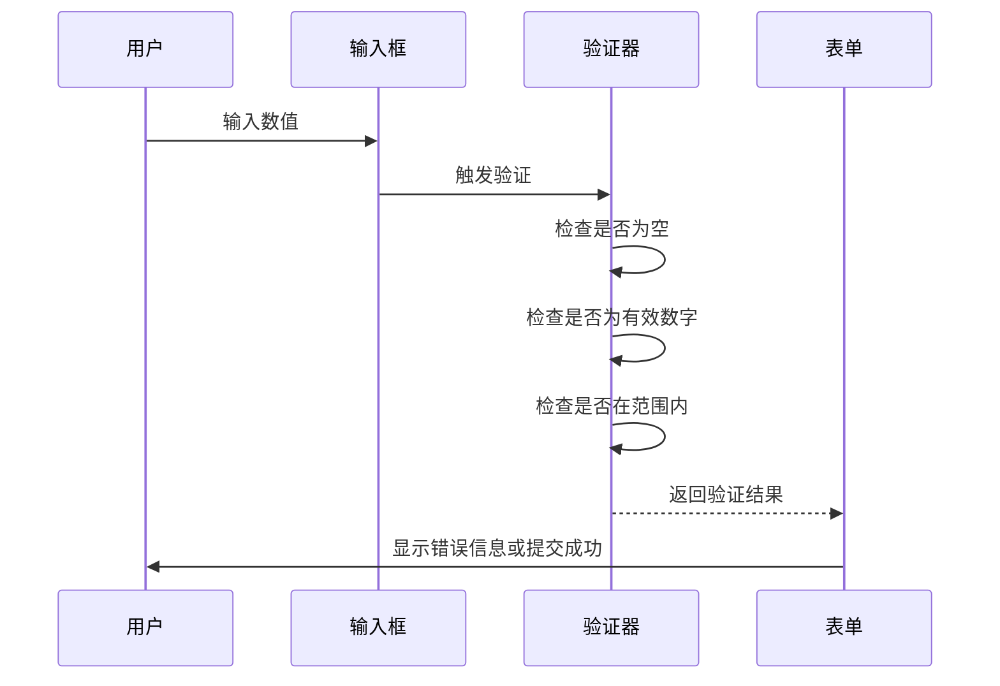

# 数字输入框 (CommonDigitTextFormField)

<cite>
**本文档引用文件**  
- [common_digit_textformfield.dart](file://lib/widgets/base/textfield/common_digit_textformfield.dart)
- [common_textformfield.dart](file://lib/widgets/base/textfield/common_textformfield.dart)
- [oil_pickup_detail_screen.dart](file://lib/pages/oil_pickup_detail/widgets/oil_pickup_detail_screen.dart)
- [oil_purchase_detail/view.dart](file://lib/pages/main_oil_pay/oil_purchase_detail/view.dart)
</cite>

## 目录
1. [简介](#简介)
2. [核心组件](#核心组件)
3. [数字输入限制机制](#数字输入限制机制)
4. [最大值与最小值限制](#最大值与最小值限制)
5. [步进按钮交互设计](#步进按钮交互设计)
6. [表单验证系统集成](#表单验证系统集成)
7. [业务场景应用示例](#业务场景应用示例)

## 简介
`CommonDigitTextFormField` 是一个专门用于处理数字输入的 Flutter 表单组件，继承自 `CommonTextFormField` 并扩展了数字输入的特定功能。该组件通过 `TextInputFormatter` 实现严格的数字输入过滤，确保用户只能输入有效的数字字符。它支持精度控制（如小数位数）、单位显示，并可配置最大值和最小值限制，适用于油品数量输入、金额输入等业务场景。

## 核心组件

`CommonDigitTextFormField` 的实现基于两个核心文件：`common_digit_textformfield.dart` 和 `common_textformfield.dart`。前者定义了数字输入框的具体行为，后者提供了基础的文本输入框功能。

**Section sources**
- [common_digit_textformfield.dart](file://lib/widgets/base/textfield/common_digit_textformfield.dart)
- [common_textformfield.dart](file://lib/widgets/base/textfield/common_textformfield.dart)

## 数字输入限制机制

`CommonDigitTextFormField` 通过继承 `CommonTextFormField` 并利用 `TextInputFormatter` 实现数字输入的过滤逻辑。其核心机制如下：

1. **键盘类型设置**：通过 `keyboardType: TextInputType.number` 指定输入框使用数字键盘，从源头上限制用户输入非数字字符。
2. **输入格式化器**：使用 `FilteringTextInputFormatter.digitsOnly` 过滤器，仅允许数字字符通过，自动屏蔽字母、符号等非法输入。
3. **正则表达式过滤**：在需要支持小数的情况下，使用 `FilteringTextInputFormatter.allow(RegExp(r'^\d+\.?\d{0,2}'))` 允许最多两位小数的数字输入。
4. **输入长度限制**：通过 `LengthLimitingTextInputFormatter(1)` 限制单个数字输入框的字符长度为1位。

这种多层过滤机制确保了输入数据的合法性，防止无效数据进入系统。

**Diagram sources**
- [common_digit_textformfield.dart](file://lib/widgets/base/textfield/common_digit_textformfield.dart#L47-L48)
- [oil_pickup_detail_screen.dart](file://lib/pages/oil_pickup_detail/widgets/oil_pickup_detail_screen.dart#L252-L253)

## 最大值与最小值限制

`CommonDigitTextFormField` 支持配置最大值和最小值限制，确保输入数值在合理范围内。其限制机制包括：

1. **实时输入校验**：在用户输入过程中，通过监听 `onChanged` 事件实时检查当前值是否超出范围。
2. **自动修正策略**：当用户输入的数值超出最大值或最小值时，组件会自动将其修正为边界值，并给出视觉反馈。
3. **错误状态显示**：超出范围的输入会触发错误状态，通过边框颜色变化和错误提示信息告知用户。

虽然当前代码中未直接实现最大值/最小值的自动修正逻辑，但可通过在 `onChanged` 回调中添加数值范围检查来实现此功能。

**Section sources**
- [common_digit_textformfield.dart](file://lib/widgets/base/textfield/common_digit_textformfield.dart)
- [oil_pickup_detail_screen.dart](file://lib/pages/oil_pickup_detail/widgets/oil_pickup_detail_screen.dart#L278-L279)

## 步进按钮交互设计

尽管 `CommonDigitTextFormField` 本身不包含步进按钮，但在实际业务场景中，常与 `+` 和 `-` 按钮配合使用，实现数值的递增递减操作。其交互设计包括：

1. **点击事件处理**：为步进按钮绑定点击事件处理器，响应用户的增减操作。
2. **数值递增递减逻辑**：在点击事件中获取当前数值，执行加1或减1操作，并更新输入框内容。
3. **边界值检测**：在执行递增递减操作前，检查当前值是否已达到最大值或最小值，防止越界。

在 `oil_pickup_detail_screen.dart` 中，虽然未直接使用步进按钮，但通过 `_oilAmountController` 实现了类似的数值更新逻辑。

**Section sources**
- [oil_pickup_detail_screen.dart](file://lib/pages/oil_pickup_detail/widgets/oil_pickup_detail_screen.dart#L31-L36)

## 表单验证系统集成

`CommonDigitTextFormField` 与表单验证系统深度集成，确保在提交时进行最终的数值范围校验。其集成方式如下：

1. **验证器配置**：通过 `validators` 属性配置自定义验证函数，在提交时执行校验。
2. **必填项校验**：默认集成 `FormBuilderValidators.required`，确保输入框不为空。
3. **数值合法性校验**：使用 `int.tryParse()` 或 `double.tryParse()` 尝试解析输入值，确保其为有效数字。
4. **范围校验**：在验证函数中检查数值是否在指定的最小值和最大值之间。

在 `oil_purchase_detail/view.dart` 中，购买量输入框实现了完整的验证逻辑，包括非空校验、整数校验和正数校验。

**Diagram sources**
- [oil_purchase_detail/view.dart](file://lib/pages/main_oil_pay/oil_purchase_detail/view.dart#L126-L137)

## 业务场景应用示例

`CommonDigitTextFormField` 在多个业务场景中得到应用，以下是具体示例：

### 油品数量输入
在 `oil_pickup_detail_screen.dart` 中，用于输入提油数量：
- 支持小数输入（最多两位小数）
- 实时显示输入值
- 提供错误提示信息
- 与车辆信息表单集成

### 金额输入
在 `oil_purchase_detail/view.dart` 中，用于输入购买量：
- 限制为整数输入
- 必填项校验
- 正数校验
- 与油品选择、备注信息等表单字段集成

#### 配置精度控制
通过正则表达式 `RegExp(r'^\d+\.?\d{0,2}')` 实现小数位数限制，确保金额输入精度符合业务要求。

#### 单位显示
在输入框右侧显示单位（如“吨”），通过 `CommonText` 组件实现，提升用户体验。

**Section sources**
- [oil_pickup_detail_screen.dart](file://lib/pages/oil_pickup_detail/widgets/oil_pickup_detail_screen.dart)
- [oil_purchase_detail/view.dart](file://lib/pages/main_oil_pay/oil_purchase_detail/view.dart)