# 输入框组件 (CommonTextFormField)

<cite>
**本文档引用文件**  
- [common_textformfield.dart](file://lib/widgets/base/textfield/common_textformfield.dart)
- [common_digit_textformfield.dart](file://lib/widgets/base/textfield/common_digit_textformfield.dart)
- [common_city_picker.dart](file://lib/widgets/base/textfield/common_city_picker.dart)
- [common_img_upload.dart](file://lib/widgets/base/textfield/common_img_upload.dart)
- [validators.dart](file://lib/utils/validators.dart)
- [UI_SPECIFICATION.md](file://UI_SPECIFICATION.md)
</cite>

## 目录
1. [简介](#简介)
2. [项目结构](#项目结构)
3. [核心组件](#核心组件)
4. [架构概述](#架构概述)
5. [详细组件分析](#详细组件分析)
6. [依赖分析](#依赖分析)
7. [性能考虑](#性能考虑)
8. [故障排除指南](#故障排除指南)
9. [结论](#结论)

## 简介
本文档全面解析CommonTextFormField及其衍生组件的实现与应用。重点描述基础输入框的表单验证机制、焦点管理、输入类型差异化处理，以及密码框可见性切换功能和手机号输入格式化逻辑。详细说明CommonDigitTextFormField的数字限制特性，CommonCityPicker的城市选择集成，以及CommonImgUpload的图片上传交互流程。

## 项目结构
输入框相关组件位于`lib/widgets/base/textfield/`目录下，形成一个完整的输入控件体系。

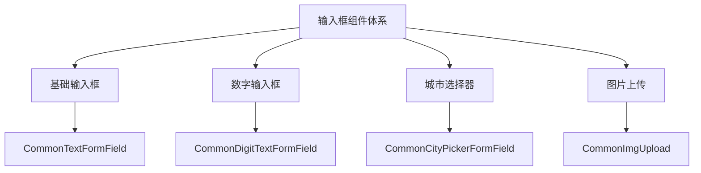

**Diagram sources**
- [common_textformfield.dart](file://lib/widgets/base/textfield/common_textformfield.dart)
- [common_digit_textformfield.dart](file://lib/widgets/base/textfield/common_digit_textformfield.dart)
- [common_city_picker.dart](file://lib/widgets/base/textfield/common_city_picker.dart)
- [common_img_upload.dart](file://lib/widgets/base/textfield/common_img_upload.dart)

**Section sources**
- [common_textformfield.dart](file://lib/widgets/base/textfield/common_textformfield.dart)
- [common_digit_textformfield.dart](file://lib/widgets/base/textfield/common_digit_textformfield.dart)
- [common_city_picker.dart](file://lib/widgets/base/textfield/common_city_picker.dart)
- [common_img_upload.dart](file://lib/widgets/base/textfield/common_img_upload.dart)

## 核心组件
CommonTextFormField是基础输入框组件，提供表单验证、焦点管理、输入类型处理等核心功能。其衍生组件包括数字输入框、城市选择器和图片上传组件，满足不同场景的输入需求。

**Section sources**
- [common_textformfield.dart](file://lib/widgets/base/textfield/common_textformfield.dart)
- [common_digit_textformfield.dart](file://lib/widgets/base/textfield/common_digit_textformfield.dart)
- [common_city_picker.dart](file://lib/widgets/base/textfield/common_city_picker.dart)
- [common_img_upload.dart](file://lib/widgets/base/textfield/common_img_upload.dart)

## 架构概述
输入框组件采用分层架构设计，基础组件提供通用功能，衍生组件在基础组件之上扩展特定功能。

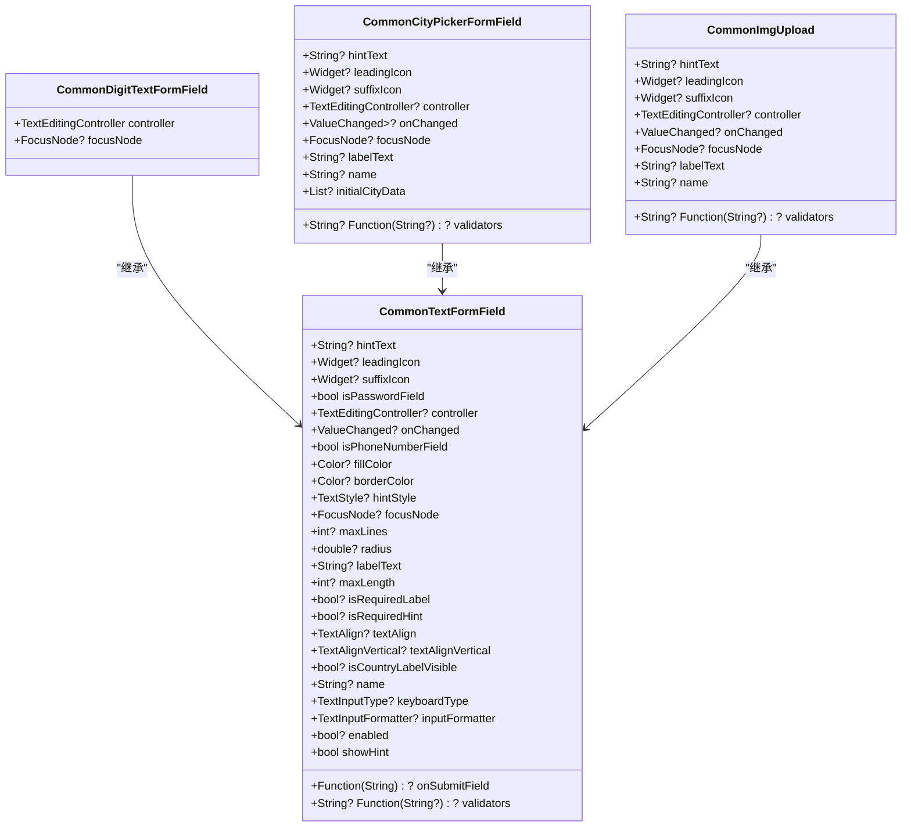

**Diagram sources**
- [common_textformfield.dart](file://lib/widgets/base/textfield/common_textformfield.dart)
- [common_digit_textformfield.dart](file://lib/widgets/base/textfield/common_digit_textformfield.dart)
- [common_city_picker.dart](file://lib/widgets/base/textfield/common_city_picker.dart)
- [common_img_upload.dart](file://lib/widgets/base/textfield/common_img_upload.dart)

## 详细组件分析

### 基础输入框分析
CommonTextFormField是基础输入框组件，支持多种输入类型和验证机制。

#### 表单验证机制
基础输入框集成了TextEditingController与Validator，实现完整的表单验证功能。

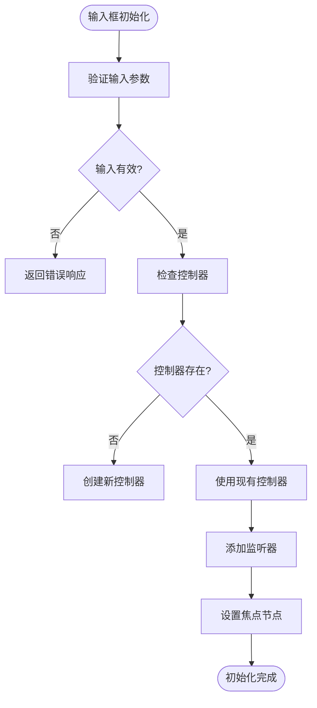

**Diagram sources**
- [common_textformfield.dart](file://lib/widgets/base/textfield/common_textformfield.dart#L108-L118)

#### 焦点管理
通过FocusNode控制输入框的焦点状态，实现聚焦时的样式变化。

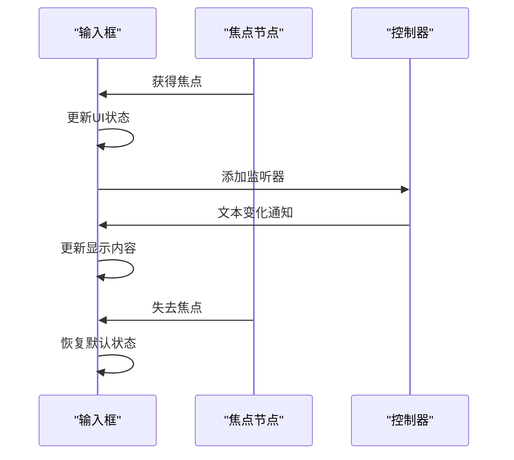

**Diagram sources**
- [common_textformfield.dart](file://lib/widgets/base/textfield/common_textformfield.dart#L115-L117)

#### 输入类型处理
支持text、number、phone、password等多种输入类型，通过isPasswordField和isPhoneNumberField属性区分。

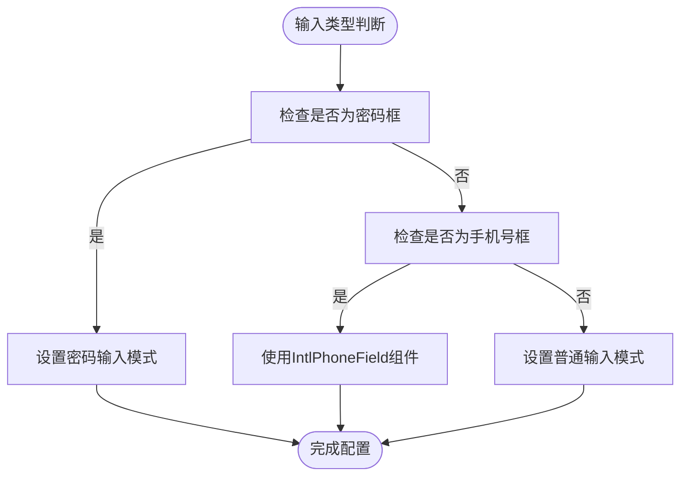

**Diagram sources**
- [common_textformfield.dart](file://lib/widgets/base/textfield/common_textformfield.dart#L142-L233)

**Section sources**
- [common_textformfield.dart](file://lib/widgets/base/textfield/common_textformfield.dart#L11-L361)

### 密码框可见性切换
密码框通过suffixIcon实现可见性切换功能，提供更好的用户体验。

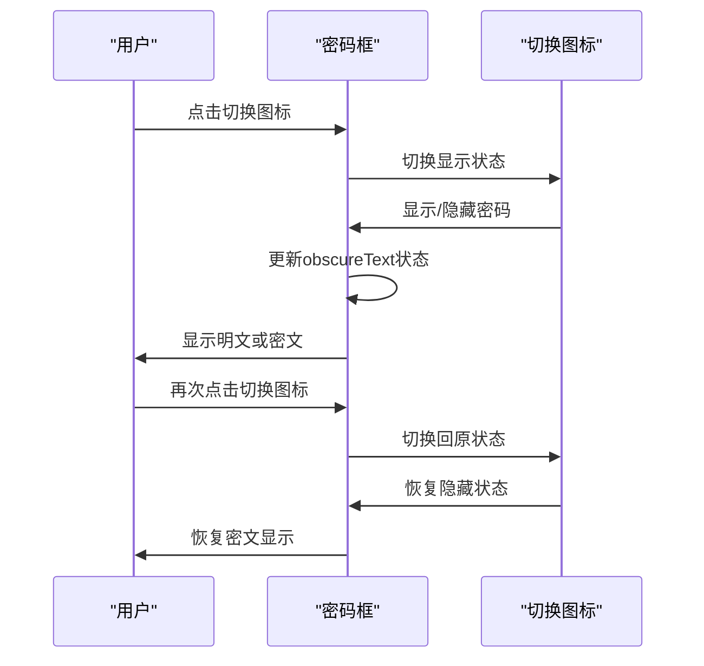

**Diagram sources**
- [common_textformfield.dart](file://lib/widgets/base/textfield/common_textformfield.dart#L297-L324)

### 手机号输入格式化
手机号输入框使用IntlPhoneField组件，实现国家代码选择和格式化输入。

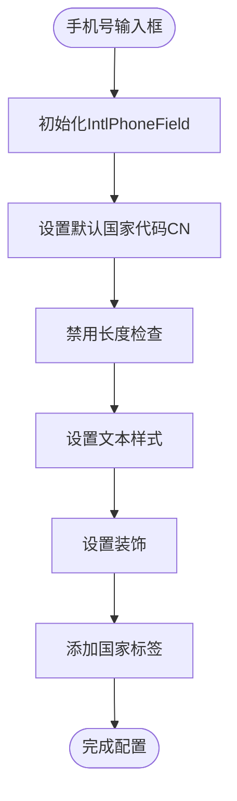

**Diagram sources**
- [common_textformfield.dart](file://lib/widgets/base/textfield/common_textformfield.dart#L146-L233)

### 数字输入框分析
CommonDigitTextFormField提供数字限制特性，用于验证码等场景。

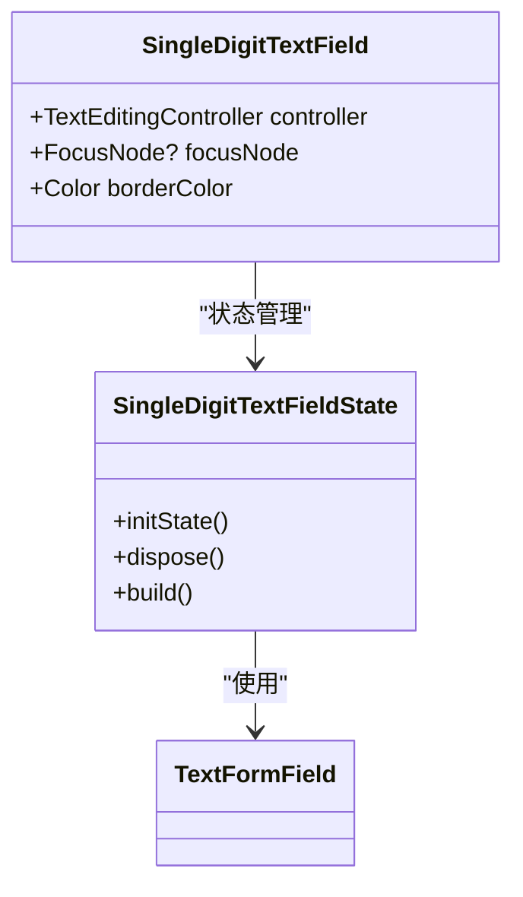

**Diagram sources**
- [common_digit_textformfield.dart](file://lib/widgets/base/textfield/common_digit_textformfield.dart#L8-L84)

**Section sources**
- [common_digit_textformfield.dart](file://lib/widgets/base/textfield/common_digit_textformfield.dart#L8-L84)

### 城市选择器分析
CommonCityPickerFormField集成城市选择功能，支持省市区三级联动。

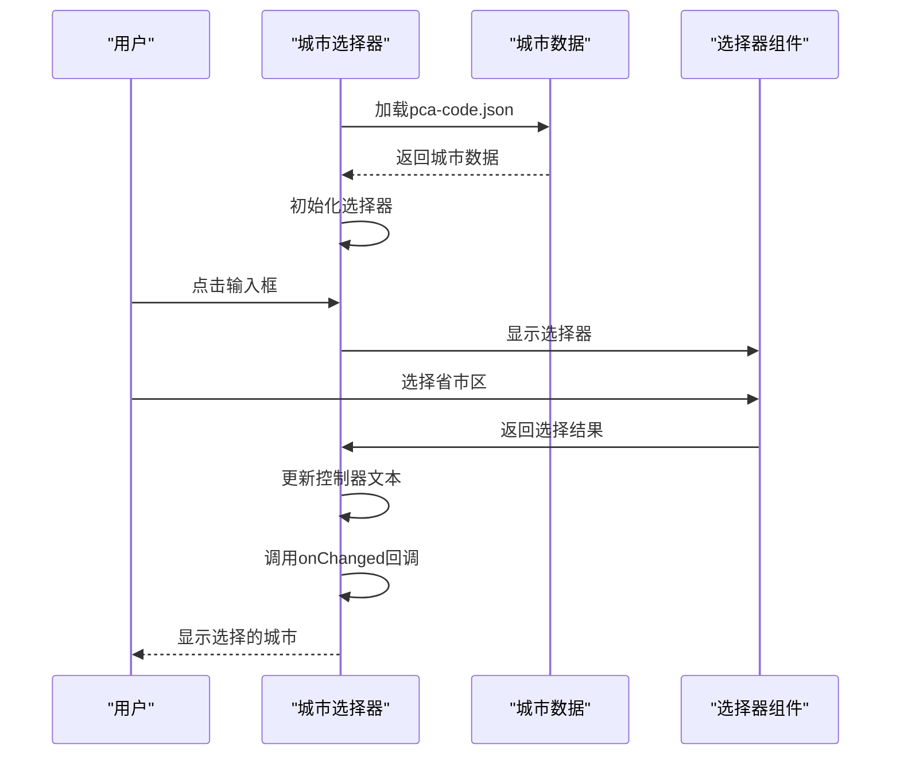

**Diagram sources**
- [common_city_picker.dart](file://lib/widgets/base/textfield/common_city_picker.dart#L161-L170)

### 图片上传分析
CommonImgUpload组件提供图片上传交互流程，支持本地图片和网络图片。

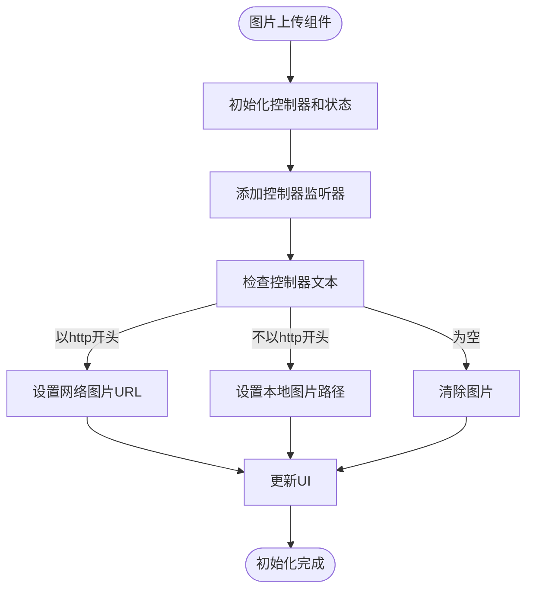

**Diagram sources**
- [common_img_upload.dart](file://lib/widgets/base/textfield/common_img_upload.dart#L74-L88)

**Section sources**
- [common_img_upload.dart](file://lib/widgets/base/textfield/common_img_upload.dart#L12-L304)

## 依赖分析
输入框组件依赖多个外部库和内部模块，形成完整的功能体系。

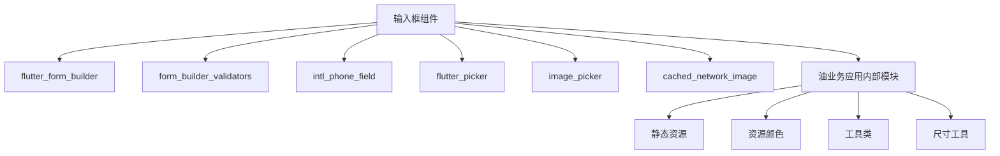

**Diagram sources**
- [common_textformfield.dart](file://lib/widgets/base/textfield/common_textformfield.dart#L1-L6)
- [common_city_picker.dart](file://lib/widgets/base/textfield/common_city_picker.dart#L1-L10)
- [common_img_upload.dart](file://lib/widgets/base/textfield/common_img_upload.dart#L1-L10)

**Section sources**
- [common_textformfield.dart](file://lib/widgets/base/textfield/common_textformfield.dart)
- [common_digit_textformfield.dart](file://lib/widgets/base/textfield/common_digit_textformfield.dart)
- [common_city_picker.dart](file://lib/widgets/base/textfield/common_city_picker.dart)
- [common_img_upload.dart](file://lib/widgets/base/textfield/common_img_upload.dart)

## 性能考虑
输入框组件在设计时考虑了性能优化，通过合理的状态管理和事件处理机制，确保流畅的用户体验。

- 使用TextEditingController监听器进行状态同步
- 采用FocusNode监听器管理焦点状态
- 在初始化时加载城市数据，避免重复加载
- 使用ImagePicker的压缩选项优化图片上传性能

## 故障排除指南
### 常见问题
1. **密码切换功能不工作**：检查isPasswordField属性是否正确设置
2. **城市选择器数据加载失败**：确认assets/json/pca-code.json文件存在
3. **图片上传无法显示**：检查网络权限和图片路径格式
4. **输入验证不生效**：确保validators属性正确配置

### 调试建议
- 使用onChanged回调监控输入变化
- 检查控制器和焦点节点的生命周期管理
- 验证外部依赖库的版本兼容性
- 检查主题颜色配置是否正确

**Section sources**
- [common_textformfield.dart](file://lib/widgets/base/textfield/common_textformfield.dart)
- [common_city_picker.dart](file://lib/widgets/base/textfield/common_city_picker.dart)
- [common_img_upload.dart](file://lib/widgets/base/textfield/common_img_upload.dart)

## 结论
CommonTextFormField及其衍生组件构成了一个完整的输入控件体系，满足了油业务应用中各种输入场景的需求。通过合理的架构设计和功能划分，这些组件提供了良好的可维护性和扩展性，为应用的表单交互提供了坚实的基础。