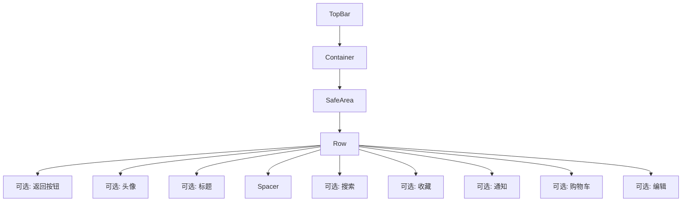
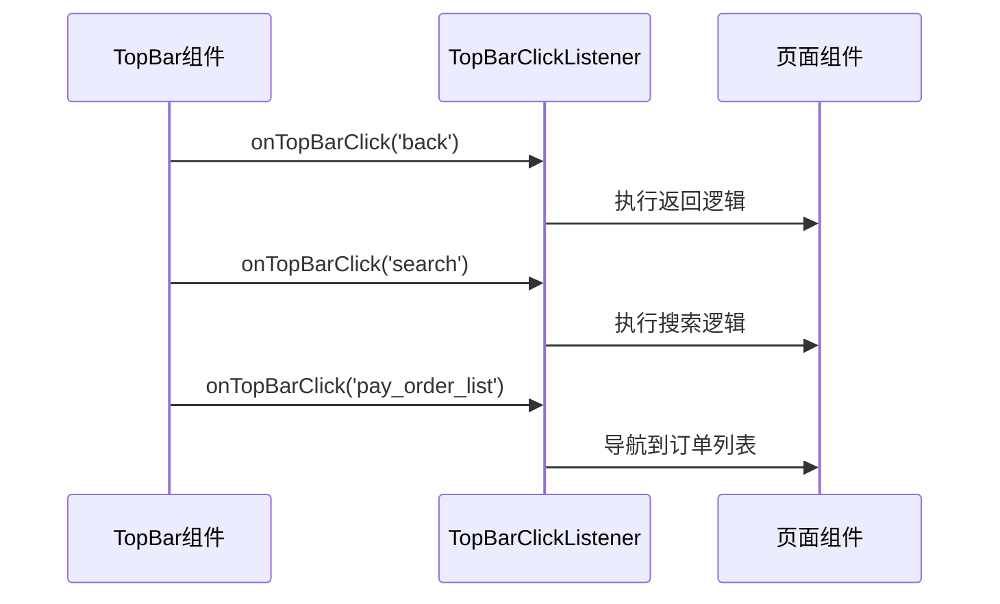

# 顶部导航栏 (TopBar)

<cite>
**本文档引用的文件**  
- [topbar.dart](file://lib/widgets/base/topbar/topbar.dart)
- [top_bar_click_listener.dart](file://lib/interfaces/top_bar_click_listener.dart)
- [theme.dart](file://lib/resources/theme.dart)
- [icon.dart](file://lib/static/icon.dart)
- [sizer_utils.dart](file://lib/utils/sizer_utils.dart)
- [UI_SPECIFICATION.md](file://UI_SPECIFICATION.md)
</cite>

## 目录
1. [简介](#简介)
2. [标准布局与结构](#标准布局与结构)
3. [核心属性与配置](#核心属性与配置)
4. [路由系统集成](#路由系统集成)
5. [跨组件通信机制](#跨组件通信机制)
6. [页面配置示例](#页面配置示例)
7. [主题适配能力](#主题适配能力)
8. [常见问题与解决方案](#常见问题与解决方案)
9. [结论](#结论)

## 简介
顶部导航栏 (TopBar) 是本应用中用于提供一致导航体验的核心UI组件。它为用户提供返回功能、页面标题展示以及右侧操作入口，贯穿于应用的各个页面。该组件设计灵活，支持高度定制化，能够根据不同页面需求调整其显示内容和行为。通过统一的接口和配置，TopBar实现了与路由系统的无缝集成，并支持主题动态适配，确保了应用整体视觉风格的一致性。

## 标准布局与结构
TopBar组件采用水平布局，从左至右依次包含可选的返回按钮、可选的用户头像、居中的标题文本，以及通过`Spacer`分隔的右侧操作区域。右侧操作区域支持多个`IconButton`，如搜索、通知、购物车等。整个组件被包裹在`SafeArea`内，以避免与状态栏重叠。

组件的布局遵循严格的规范：
- **固定高度**：100（包含SafeArea）
- **水平内边距**：18
- **阴影**：黑色1%透明度，模糊半径3，扩散半径2，偏移量(0, 4)
- **图标大小**：24x24
- **头像大小**：35x35



**Diagram sources**
- [topbar.dart](file://lib/widgets/base/topbar/topbar.dart#L53-L248)

**Section sources**
- [topbar.dart](file://lib/widgets/base/topbar/topbar.dart#L9-L252)
- [UI_SPECIFICATION.md](file://UI_SPECIFICATION.md#L466-L477)

## 核心属性与配置
TopBar通过一系列布尔值和可选参数来控制其显示内容和外观。其核心属性如下表所示：

| 属性 | 类型 | 默认值 | 说明 |
| :--- | :--- | :--- | :--- |
| `clickListener` | TopBarClickListener | 必填 | 点击事件监听器 |
| `title` | String? | null | 标题文字 |
| `isShowTitle` | bool | true | 是否显示标题 |
| `isShowBack` | bool | false | 是否显示返回按钮 |
| `isShowProfile` | bool | false | 是否显示头像 |
| `isShowNotification` | bool | false | 是否显示通知图标 |
| `isShowSearch` | bool | false | 是否显示搜索图标 |
| `isShowSearchField` | bool | false | 是否显示搜索框 |
| `isShowCart` | bool | false | 是否显示购物车 |
| `isShowCartCount` | bool? | null | 是否显示购物车数量 |
| `isShowLike` | bool | false | 是否显示收藏图标 |
| `isShowEditProfile` | bool? | false | 是否显示编辑图标 |
| `isShowShadow` | bool | true | 是否显示阴影 |
| `isBackIconWhite` | bool? | false | 返回图标是否白色 |
| `topBarColor` | Color? | white | 背景颜色 |
| `textColor` | Color | txtSecondary | 文字颜色 |
| `height` | double | 100 | 高度 |
| `alignment` | AlignmentGeometry | centerLeft | 对齐方式 |
| `subTitle` | String | '' | 副标题 |

这些属性使得TopBar能够适应各种页面需求，例如在登录页隐藏返回按钮，在详情页显示多个操作图标。

**Section sources**
- [topbar.dart](file://lib/widgets/base/topbar/topbar.dart#L10-L49)
- [UI_SPECIFICATION.md](file://UI_SPECIFICATION.md#L446-L464)

## 路由系统集成
TopBar与应用的路由系统紧密集成，自动处理返回逻辑。当用户点击左侧的返回按钮时，`clickListener.onTopBarClick('back')`方法被调用。此事件最终会触发路由栈的出栈操作，导航到上一个页面。

这种集成是通过`TopBarClickListener`接口实现的。每个使用TopBar的页面都需要提供一个实现了该接口的监听器。在监听器的`onTopBarClick`方法中，根据传入的`name`参数（如'back'）执行相应的路由操作，例如调用`Navigator.pop(context)`。

**Section sources**
- [topbar.dart](file://lib/widgets/base/topbar/topbar.dart#L80-L83)
- [top_bar_click_listener.dart](file://lib/interfaces/top_bar_click_listener.dart#L1-L3)

## 跨组件通信机制
TopBar通过`TopBarClickListener`接口实现跨组件通信。该接口定义了一个`onTopBarClick`方法，当TopBar上的任何可点击元素（如返回、搜索、购物车等）被点击时，都会调用此方法，并传入一个代表点击元素的`name`字符串。



**Diagram sources**
- [topbar.dart](file://lib/widgets/base/topbar/topbar.dart#L80-L83)
- [top_bar_click_listener.dart](file://lib/interfaces/top_bar_click_listener.dart#L1-L3)

**Section sources**
- [topbar.dart](file://lib/widgets/base/topbar/topbar.dart#L34)
- [top_bar_click_listener.dart](file://lib/interfaces/top_bar_click_listener.dart#L1-L3)

## 页面配置示例
TopBar的灵活性使其能够适应不同页面的特定需求。

### 登录页配置
在登录页，通常不需要返回按钮，且可能需要一个简洁的标题。配置如下：
```dart
TopBar(
  clickListener,
  title: "登录",
  isShowBack: false,
  isShowTitle: true,
  isShowSearch: false,
  isShowNotification: false,
  isShowCart: false,
)
```

### 详情页配置
在商品或订单详情页，可能需要显示多个操作图标，如收藏和购物车。
```dart
TopBar(
  clickListener,
  title: "商品详情",
  isShowBack: true,
  isShowLike: true,
  isShowCart: true,
  isShowCartCount: true,
)
```

### 表单页配置
在编辑表单页，可能需要一个“编辑”图标来触发编辑模式。
```dart
TopBar(
  clickListener,
  title: "个人信息",
  isShowBack: true,
  isShowEditProfile: true,
)
```

**Section sources**
- [topbar.dart](file://lib/widgets/base/topbar/topbar.dart#L10-L49)

## 主题适配能力
TopBar组件具备主题适配能力，能够根据`AppTheme`动态调整其背景色和图标颜色。这主要通过`CustomAppColor.of(context)`来实现。

在`topbar.dart`中，背景色由`topBarColor`属性控制，如果未指定，则使用`CustomAppColor(context).txtWhite`。图标颜色则根据`CustomAppColor.of(context)`获取，例如通知图标使用`CustomAppColor.of(context).icBlack`。

`CustomAppColor`类会根据当前的`BuildContext`解析出正确的主题颜色，确保TopBar能够与应用的整体主题保持一致。例如，在深色主题下，背景色可能变为深灰色，而图标颜色变为浅色。

**Section sources**
- [topbar.dart](file://lib/widgets/base/topbar/topbar.dart#L59-L64)
- [theme.dart](file://lib/resources/theme.dart#L1-L316)

## 常见问题与解决方案
### 状态栏重叠
**问题**：在某些设备上，TopBar可能会与状态栏重叠。
**解决方案**：TopBar组件已内置`SafeArea`，并设置`bottom: false`，这能有效防止与状态栏重叠。确保在使用时，TopBar是直接放置在`Scaffold`的`body`中。

### 点击区域过小
**问题**：图标点击区域过小，影响用户体验。
**解决方案**：TopBar通过`InkWell`包裹图标，并添加了适当的`padding`（如`EdgeInsets.symmetric(horizontal: AppSizes.setWidth(12))`）来扩大点击区域，确保符合移动端的触摸目标大小标准。

**Section sources**
- [topbar.dart](file://lib/widgets/base/topbar/topbar.dart#L74-L75)
- [topbar.dart](file://lib/widgets/base/topbar/topbar.dart#L119-L133)

## 结论
顶部导航栏 (TopBar) 是一个功能强大且高度可配置的UI组件，它为应用提供了统一的导航和操作入口。通过清晰的属性定义、与路由系统的无缝集成、基于接口的跨组件通信以及对主题的动态适配，TopBar确保了应用在不同场景下的一致性和灵活性。开发者可以轻松地根据具体页面需求对其进行定制，同时避免了重复代码，提高了开发效率和维护性。