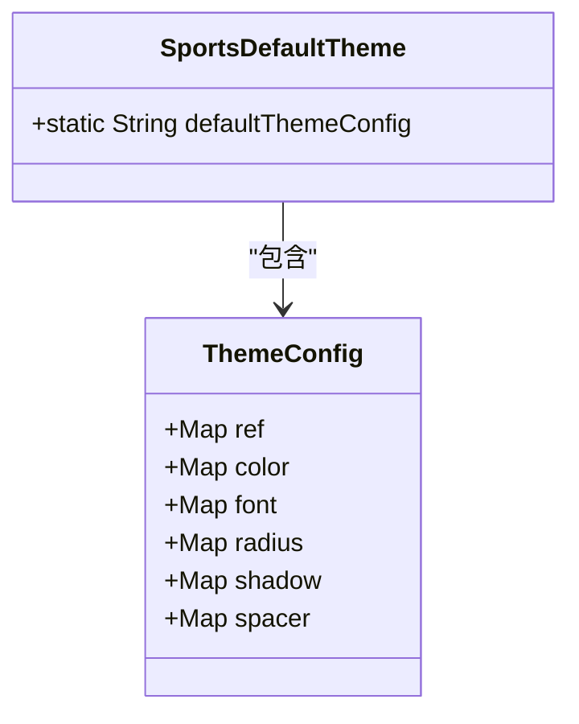
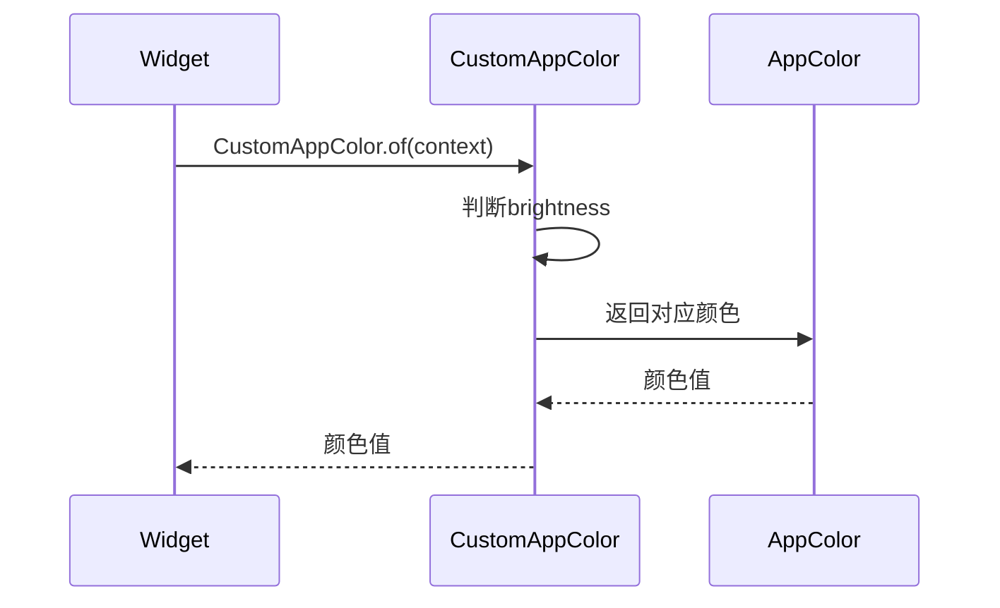
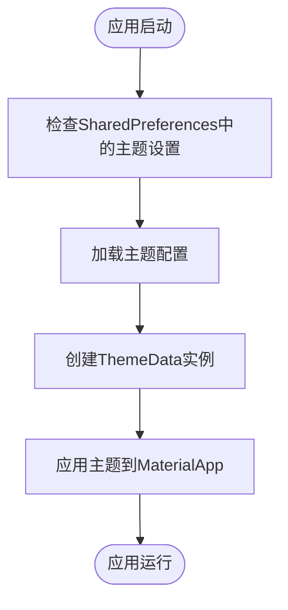

# 主题切换机制

<cite>
**本文档引用文件**  
- [theme.dart](file://lib/resources/theme.dart)
- [colors.dart](file://lib/resources/colors.dart)
- [size.dart](file://lib/resources/size.dart)
- [style.dart](file://lib/resources/style.dart)
- [constant.dart](file://lib/utils/constant.dart)
- [preference.dart](file://lib/utils/preference.dart)
- [config.dart](file://lib/config/config.dart)
- [project.md](file://openspec/project.md)
</cite>

## 目录
1. [简介](#简介)
2. [主题配置结构](#主题配置结构)
3. [核心配置项详解](#核心配置项详解)
4. [主题系统集成](#主题系统集成)
5. [运行时主题加载与应用](#运行时主题加载与应用)
6. [自定义主题实现](#自定义主题实现)
7. [最佳实践](#最佳实践)
8. [结论](#结论)

## 简介
本项目实现了一套完整的主题切换机制，通过JSON配置文件定义设计系统，支持颜色、字体、圆角、阴影和间距等设计属性的动态化管理。主题系统采用分层架构，将设计令牌（Design Tokens）与UI组件解耦，实现了设计与代码的分离。系统支持浅色/深色模式切换，并通过全局状态管理确保主题一致性。

**Section sources**
- [project.md](file://openspec/project.md#L712-L757)

## 主题配置结构
主题配置以JSON格式定义在`SportsDefaultTheme`类中，采用分层结构组织设计属性。配置包含引用映射（ref）、颜色（color）、字体（font）、圆角（radius）、阴影（shadow）和间距（spacer）等核心模块。



**Diagram sources**
- [theme.dart](file://lib/resources/theme.dart#L2-L316)

**Section sources**
- [theme.dart](file://lib/resources/theme.dart#L2-L316)

## 核心配置项详解

### 颜色配置（color）
颜色系统采用语义化命名和具体值分离的设计。`color`节点定义了所有颜色的具体值（HEX格式），而`ref`节点通过引用映射将语义化名称（如`brandLightColor`）关联到具体颜色值。

```json
"color": {
    "brandColor1": "#F2F3FF",
    "brandColor2": "#D9E1FF",
    "errorColor1": "#FFF0ED"
},
"ref": {
    "brandLightColor": "brandColor1",
    "brandFocusColor": "brandColor2",
    "errorLightColor": "errorColor1"
}
```

这种设计实现了颜色的集中管理和灵活替换，修改品牌色只需更新`color`节点中的值，所有引用该颜色的组件会自动更新。

**Section sources**
- [theme.dart](file://lib/resources/theme.dart#L32-L96)

### 字体配置（font）
字体配置系统定义了完整的排版体系，包含字体大小、行高和字重等属性。每个字体样式（如`fontDisplayLarge`）都是一个包含`size`、`lineHeight`和`fontWeight`的对象。

```json
"font": {
    "fontDisplayLarge": {
        "size": 64,
        "lineHeight": 72,
        "fontWeight": 6
    },
    "fontBodyMedium": {
        "size": 14,
        "lineHeight": 22
    }
}
```

系统还支持自定义字体族配置，如`numberFontFamily`指定了数字字体的包名和字体名称。

**Section sources**
- [theme.dart](file://lib/resources/theme.dart#L97-L194)

### 圆角配置（radius）
圆角系统提供了从微小到圆形的完整半径选项，采用语义化命名便于理解和使用。

```json
"radius": {
    "radiusSmall": 3,
    "radiusDefault": 6,
    "radiusLarge": 9,
    "radiusExtraLarge": 12,
    "radiusRound": 9999,
    "radiusCircle": 9999
}
```

`radiusRound`和`radiusCircle`使用大数值实现视觉上的圆角和圆形效果。

**Section sources**
- [theme.dart](file://lib/resources/theme.dart#L201-L208)

### 阴影配置（shadow）
阴影系统定义了三种预设阴影效果：基础（base）、中等（middle）和顶部（top），每种效果包含多个阴影层的组合。

```json
"shadow": {
    "shadowsBase": [
        {
            "color": "#0D000000",
            "blurRadius": 10,
            "spreadRadius": 1,
            "offset": { "x": 0, "y": 1 }
        }
    ]
}
```

多层阴影模拟了真实光照效果，提升了UI的层次感和立体感。

**Section sources**
- [theme.dart](file://lib/resources/theme.dart#L209-L297)

### 间距配置（spacer）
间距系统提供了一套标准化的间距值，确保UI布局的一致性。

```json
"spacer": {
    "spacer4": 4,
    "spacer8": 8,
    "spacer16": 16,
    "spacer24": 24,
    "spacer32": 32
}
```

这些间距值在布局中被广泛使用，实现了"设计系统即代码"的原则。

**Section sources**
- [theme.dart](file://lib/resources/theme.dart#L298-L310)

## 主题系统集成

### CustomAppColor集成
`CustomAppColor`类是主题系统与UI组件的桥梁，通过`of(context)`工厂构造函数获取当前主题下的颜色。



**Diagram sources**
- [colors.dart](file://lib/resources/colors.dart#L3-L287)

**Section sources**
- [colors.dart](file://lib/resources/colors.dart#L3-L287)

### AppSize集成
`AppSize`类封装了布局相关的尺寸配置，将主题系统中的间距、圆角等值暴露给UI组件使用。

```dart
static final EdgeInsets pagePadding = 
    EdgeInsets.symmetric(horizontal: pt(12));
static final BorderRadius radius = BorderRadius.circular(12);
```

**Section sources**
- [size.dart](file://lib/resources/size.dart#L4-L16)

## 运行时主题加载与应用

### 主题切换机制
主题切换通过全局布尔变量`isLightThemeGlobal`控制，该变量存储在`Constant`类中。

```dart
static bool isLightThemeGlobal = true;
```

主题状态持久化通过`SharedPreferences`实现，使用`LocalStorageService`进行读写操作。

```dart
static const String isLightTheme = "IS_LIGHT_THEME";
```

**Section sources**
- [constant.dart](file://lib/utils/constant.dart#L5)
- [preference.dart](file://lib/utils/preference.dart#L12)

### 主题应用流程
主题在应用启动时初始化，通过`MaterialApp`的`theme`和`darkTheme`属性应用。



**Diagram sources**
- [project.md](file://openspec/project.md#L714-L721)

**Section sources**
- [project.md](file://openspec/project.md#L712-L721)
- [config.dart](file://lib/config/config.dart#L45-L46)

## 自定义主题实现

### 扩展主题配置
要扩展主题配置以支持新的设计属性，需要在`SportsDefaultTheme.defaultThemeConfig`的JSON中添加新的配置节点。

```json
{
    "Sports": {
        "newAttribute": {
            "value1": "data1",
            "value2": "data2"
        }
    }
}
```

然后创建相应的解析器类来处理新配置。

### 创建自定义主题
实现自定义主题的步骤：
1. 在`theme.dart`中复制`defaultThemeConfig`并修改设计值
2. 创建新的主题配置常量
3. 修改主题切换逻辑以支持新主题
4. 在`MaterialApp`中注册新主题

```dart
ThemeData(
  brightness: isLightTheme ? Brightness.light : Brightness.dark,
  fontFamily: Constant.fontFamilyUrbanist,
  useMaterial3: true,
)
```

**Section sources**
- [theme.dart](file://lib/resources/theme.dart)
- [project.md](file://openspec/project.md#L714-L721)

## 最佳实践

### 颜色使用规范
- ✅ 必须使用`CustomAppColor.of(context)`获取颜色
- ✅ 自动适配浅色/深色主题
- ❌ 避免直接使用`Color(0xFFD97706)`等硬编码颜色值

### 布局规范
- 使用`AppSizes`中的预设尺寸值
- 保持间距系统的一致性
- 遵循8pt网格系统原则

### 性能优化
- 使用`const`构造函数创建不可变Widget
- 避免频繁创建Widget实例
- 使用`MediaQuery.textScaler`获取系统文本缩放

**Section sources**
- [project.md](file://openspec/project.md#L730-L757)

## 结论
本主题切换机制通过JSON配置实现了设计系统的动态化管理，将设计属性与UI代码解耦。系统采用分层架构，支持颜色、字体、圆角、阴影和间距等核心设计属性的集中管理。通过`CustomAppColor`和`AppSize`等封装类，实现了主题系统与UI组件的无缝集成。主题状态通过`SharedPreferences`持久化，确保用户体验的一致性。该机制为未来的主题扩展和设计系统演进提供了良好的基础。