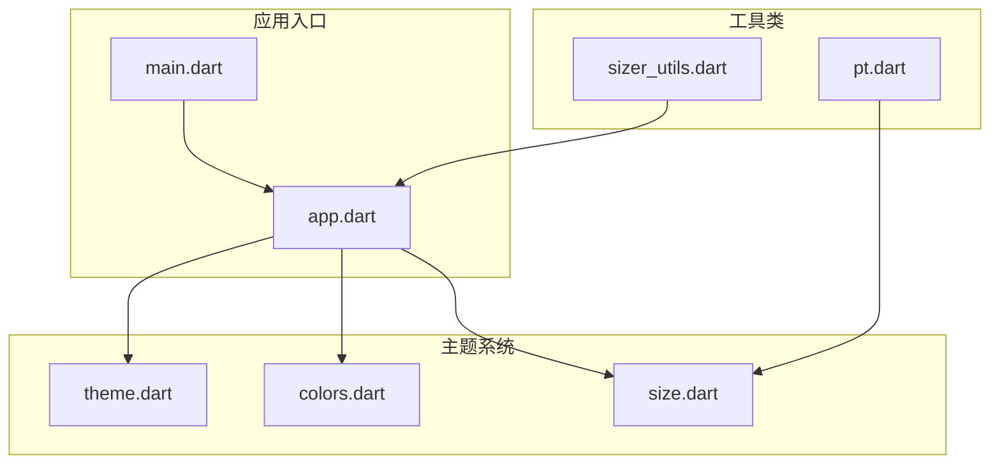
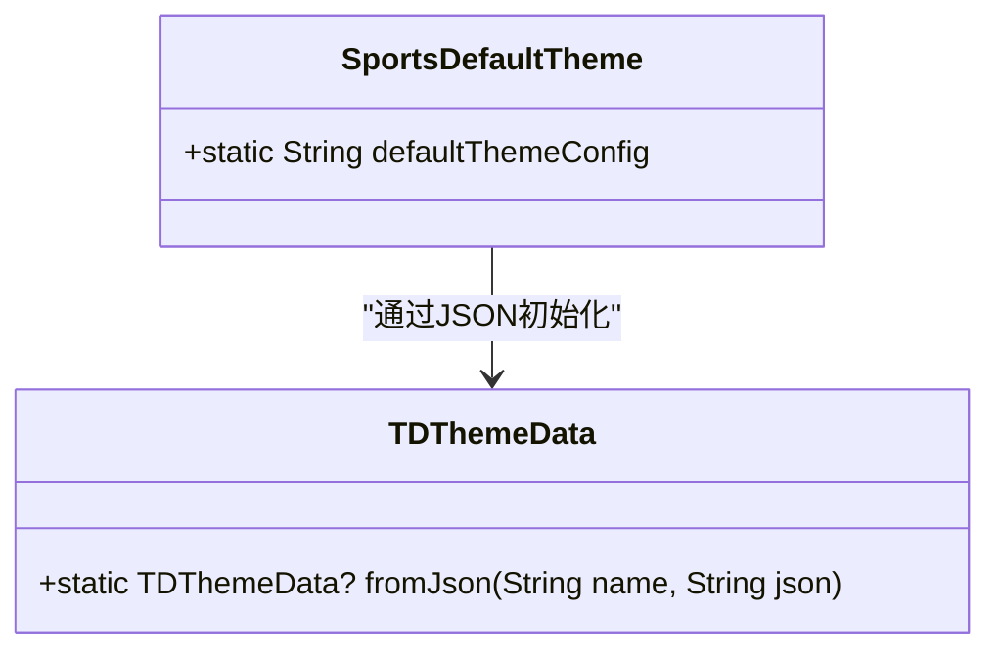
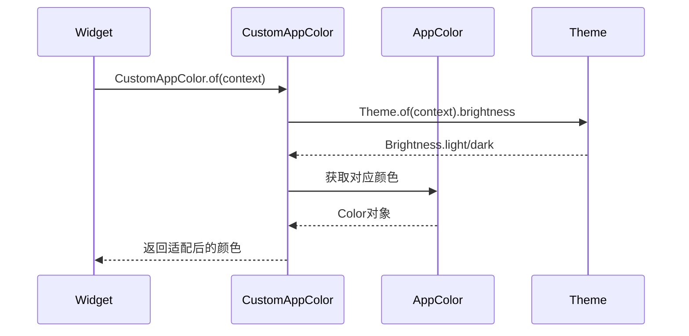
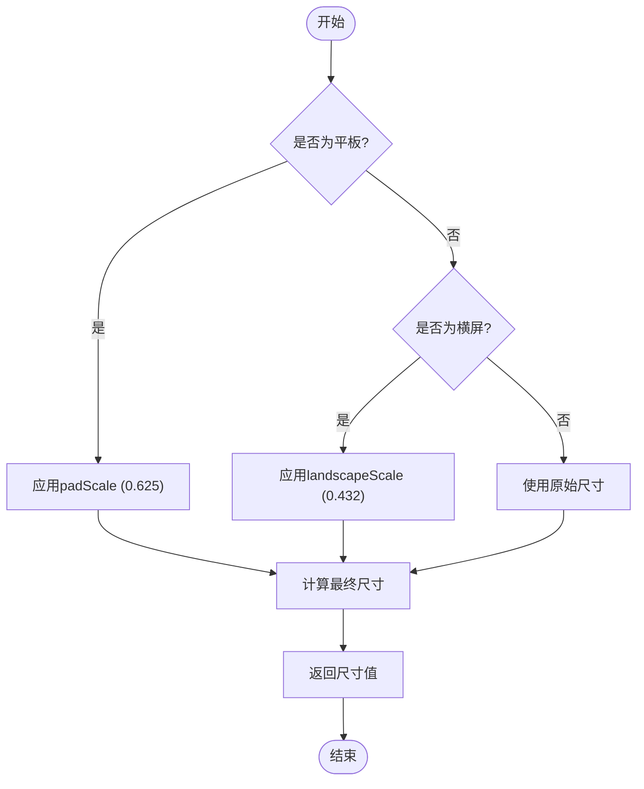
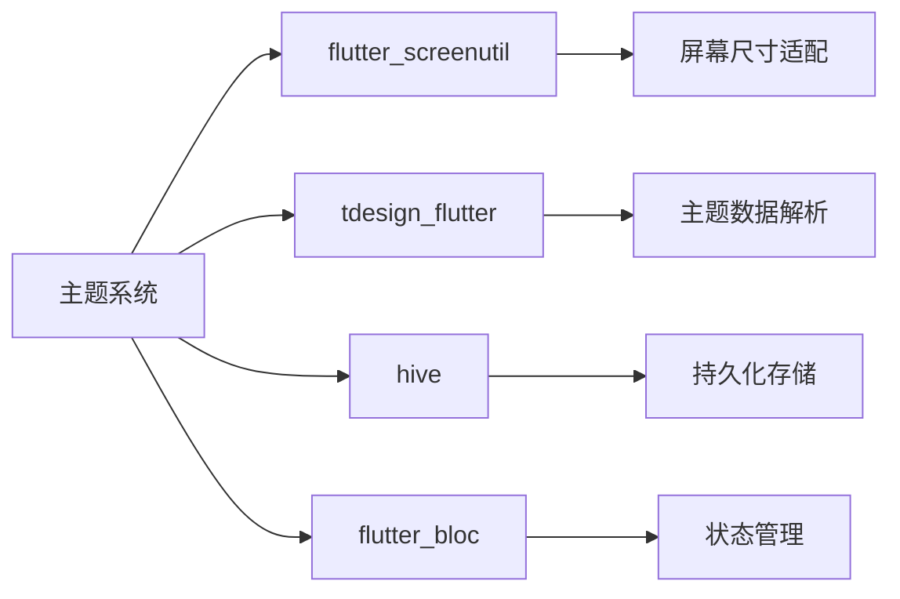

# 主题加载与应用

<cite>
**本文档引用的文件**  
- [theme.dart](file://lib/resources/theme.dart)
- [colors.dart](file://lib/resources/colors.dart)
- [size.dart](file://lib/resources/size.dart)
- [app.dart](file://lib/app.dart)
- [main.dart](file://lib/main.dart)
- [pt.dart](file://lib/utils/pt.dart)
- [sizer_utils.dart](file://lib/utils/sizer_utils.dart)
- [storage.dart](file://lib/global/storage.dart)
</cite>

## 目录
1. [简介](#简介)
2. [项目结构](#项目结构)
3. [核心组件](#核心组件)
4. [架构概述](#架构概述)
5. [详细组件分析](#详细组件分析)
6. [依赖分析](#依赖分析)
7. [性能考虑](#性能考虑)
8. [故障排除指南](#故障排除指南)
9. [结论](#结论)

## 简介
本文档详细说明了油品业务应用中的主题加载与应用机制。文档涵盖了主题系统在应用启动时的初始化过程、CustomAppColor类如何解析JSON配置并提供上下文相关的颜色适配、AppSize类如何结合主题配置实现响应式尺寸管理，以及主题在运行时的动态切换流程。同时提供了主题应用的最佳实践指导。

## 项目结构
主题系统主要位于`lib/resources/`目录下，由`theme.dart`、`colors.dart`和`size.dart`三个核心文件组成。主题配置在应用启动时通过`app.dart`中的`SportsInitedApp`组件加载，并通过`main.dart`进行初始化。尺寸适配功能由`utils/`目录下的`pt.dart`和`sizer_utils.dart`提供支持。



**Diagram sources**
- [theme.dart](file://lib/resources/theme.dart#L1-L316)
- [colors.dart](file://lib/resources/colors.dart#L1-L361)
- [size.dart](file://lib/resources/size.dart#L1-L17)
- [app.dart](file://lib/app.dart#L1-L92)
- [main.dart](file://lib/main.dart#L1-L22)

**Section sources**
- [theme.dart](file://lib/resources/theme.dart#L1-L316)
- [colors.dart](file://lib/resources/colors.dart#L1-L361)
- [size.dart](file://lib/resources/size.dart#L1-L17)

## 核心组件
主题系统由三个核心组件构成：主题配置加载器、颜色适配器和尺寸管理器。主题配置通过`SportsDefaultTheme.defaultThemeConfig`静态字段定义，颜色适配通过`CustomAppColor.of(context)`工厂方法实现，尺寸管理通过`AppSize`类和`pt()`函数提供响应式支持。

**Section sources**
- [theme.dart](file://lib/resources/theme.dart#L1-L316)
- [colors.dart](file://lib/resources/colors.dart#L1-L361)
- [size.dart](file://lib/resources/size.dart#L1-L17)

## 架构概述
主题系统采用分层架构设计，底层是JSON格式的主题配置，中间层是Dart类对配置的解析和封装，上层是UI组件对主题数据的消费。系统通过Flutter的`ThemeData.extensions`机制将自定义主题数据注入到应用中，并利用`BuildContext`实现上下文相关的主题查询。

```mermaid
graph TD
A[JSON主题配置] --> B[TDThemeData解析]
B --> C[ThemeData.extensions]
C --> D[CustomAppColor.of(context)]
D --> E[Widget颜色应用]
F[pt()函数] --> G[响应式尺寸计算]
G --> H[Widget尺寸应用]
```

**Diagram sources**
- [theme.dart](file://lib/resources/theme.dart#L1-L316)
- [colors.dart](file://lib/resources/colors.dart#L1-L361)
- [size.dart](file://lib/resources/size.dart#L1-L17)
- [app.dart](file://lib/app.dart#L47-L53)

## 详细组件分析

### 主题配置加载分析
主题配置在应用启动时初始化，通过`SportsDefaultTheme.defaultThemeConfig`静态字段定义默认主题配置。该配置以JSON格式存储，包含颜色、字体、圆角、阴影等多种设计令牌。



**Diagram sources**
- [theme.dart](file://lib/resources/theme.dart#L1-L316)
- [app.dart](file://lib/app.dart#L49-L52)

**Section sources**
- [theme.dart](file://lib/resources/theme.dart#L1-L316)
- [app.dart](file://lib/app.dart#L47-L53)

### 颜色适配器分析
`CustomAppColor`类负责解析主题配置并提供上下文相关的颜色适配。通过`of(BuildContext context)`工厂方法创建实例，根据当前主题的亮度自动选择合适的颜色变体。



**Diagram sources**
- [colors.dart](file://lib/resources/colors.dart#L3-L287)
- [app.dart](file://lib/app.dart#L59-L70)

**Section sources**
- [colors.dart](file://lib/resources/colors.dart#L3-L287)

### 尺寸管理器分析
`AppSize`类结合`pt()`函数实现响应式尺寸管理。`pt()`函数根据设备类型和方向进行尺寸缩放，确保在不同设备上保持一致的视觉体验。



**Diagram sources**
- [size.dart](file://lib/resources/size.dart#L1-L17)
- [pt.dart](file://lib/utils/pt.dart#L3-L28)
- [sizer_utils.dart](file://lib/utils/sizer_utils.dart#L7-L105)

**Section sources**
- [size.dart](file://lib/resources/size.dart#L1-L17)
- [pt.dart](file://lib/utils/pt.dart#L3-L28)

## 依赖分析
主题系统依赖于多个外部组件和库。核心依赖包括`flutter_screenutil`用于屏幕适配，`tdesign_flutter`用于主题数据解析，`hive`用于持久化存储。系统通过`BlocProvider`和`BlocBuilder`实现状态管理，确保主题变更时UI能够及时更新。



**Diagram sources**
- [app.dart](file://lib/app.dart#L6-L7)
- [main.dart](file://lib/main.dart#L2-L3)
- [sizer_utils.dart](file://lib/utils/sizer_utils.dart#L4-L5)

**Section sources**
- [app.dart](file://lib/app.dart#L6-L7)
- [main.dart](file://lib/main.dart#L2-L3)

## 性能考虑
主题系统在设计时考虑了性能优化。通过将主题配置定义为静态常量，避免了运行时重复解析。颜色适配采用惰性计算策略，只有在需要时才根据当前上下文计算具体颜色值。尺寸计算通过预计算和缓存机制减少重复运算，提高渲染性能。

## 故障排除指南
当主题应用出现问题时，首先检查`SportsDefaultTheme.defaultThemeConfig`中的JSON格式是否正确。确保所有颜色值都以十六进制格式表示，并且JSON结构完整。如果颜色适配不生效，确认是否正确使用了`CustomAppColor.of(context)`而不是直接引用`AppColor`常量。

**Section sources**
- [theme.dart](file://lib/resources/theme.dart#L1-L316)
- [colors.dart](file://lib/resources/colors.dart#L3-L287)

## 结论
本文档详细介绍了油品业务应用的主题加载与应用机制。系统通过结构化的JSON配置、上下文相关的颜色适配和响应式尺寸管理，实现了灵活的主题定制能力。开发者应遵循最佳实践，使用`CustomAppColor.of(context)`获取主题颜色，确保应用在不同主题模式下都能提供一致的用户体验。