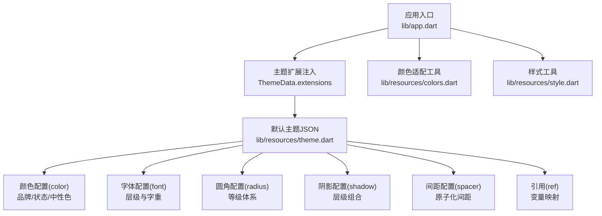
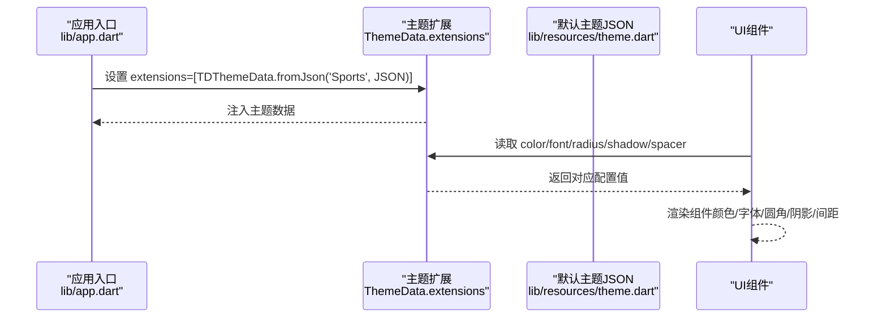
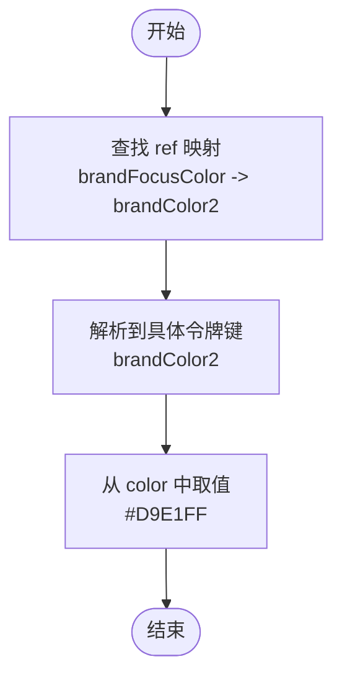
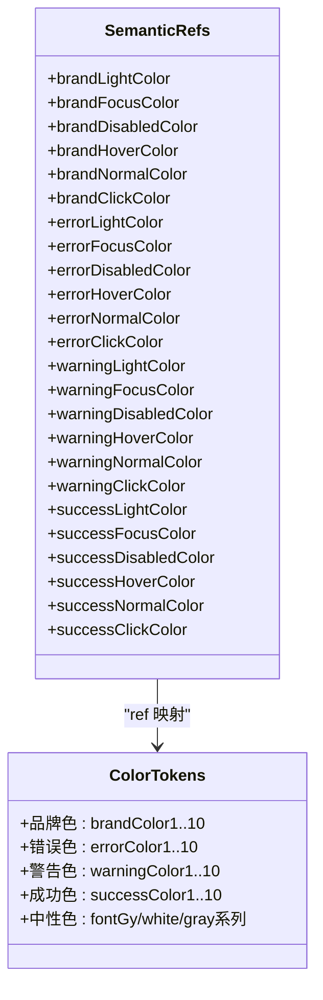
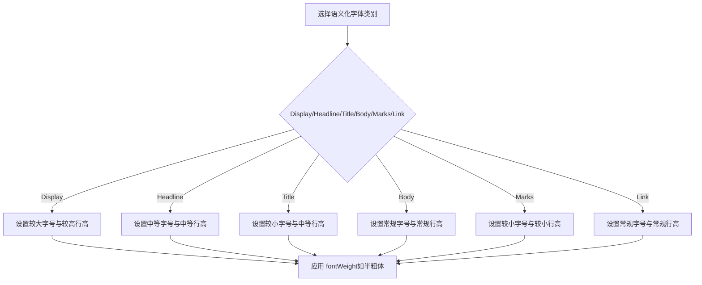
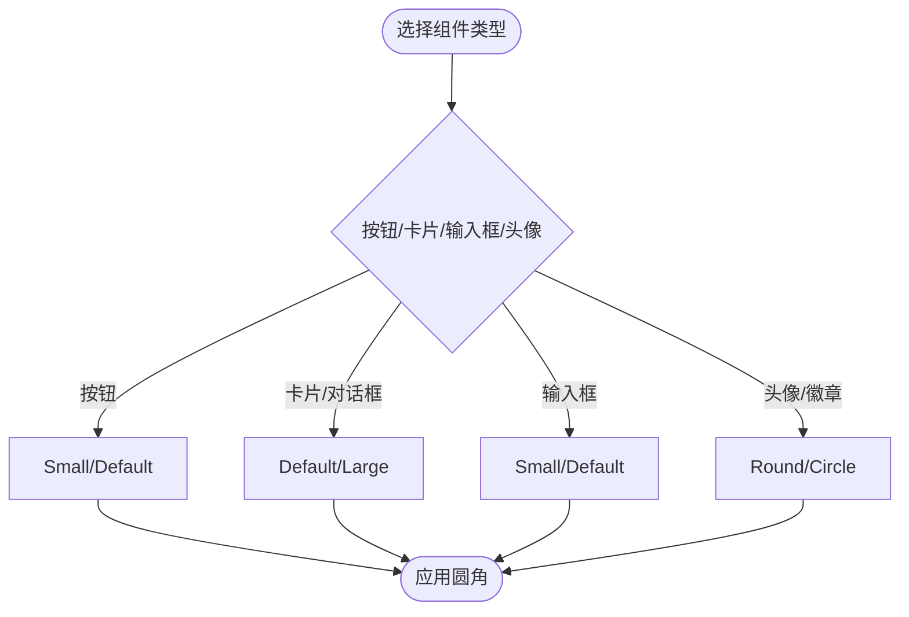
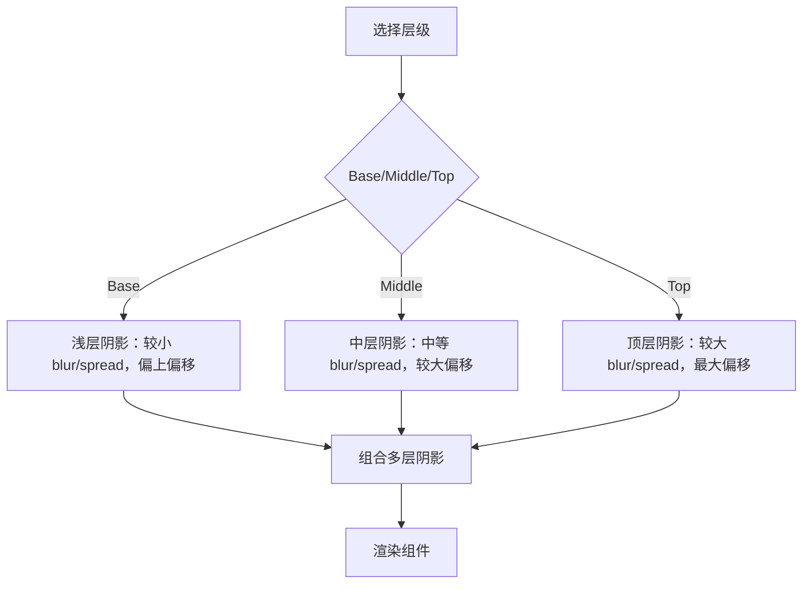
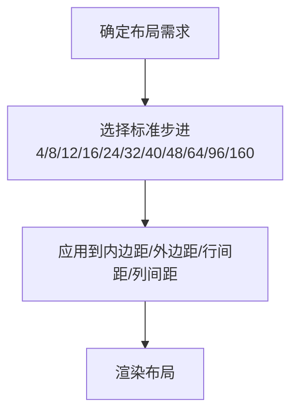
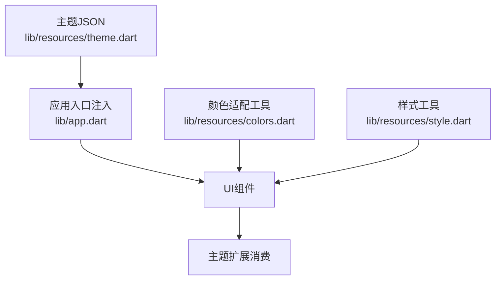

# 主题配置结构

<cite>
**本文引用的文件**
- [theme.dart](file://lib/resources/theme.dart)
- [app.dart](file://lib/app.dart)
- [colors.dart](file://lib/resources/colors.dart)
- [style.dart](file://lib/resources/style.dart)
- [UI规范.md](file://UI_SPECIFICATION.md)
- [项目变更说明-更新品牌主题-琥珀金.md](file://openspec/changes/update-brand-theme-amber/specs/app-theme/spec.md)
- [项目变更说明-更新品牌主题-琥珀金-提案.md](file://openspec/changes/update-brand-theme-amber/proposal.md)
</cite>

## 目录
1. [引言](#引言)
2. [项目结构](#项目结构)
3. [核心组件](#核心组件)
4. [架构总览](#架构总览)
5. [详细组件分析](#详细组件分析)
6. [依赖关系分析](#依赖关系分析)
7. [性能考量](#性能考量)
8. [故障排查指南](#故障排查指南)
9. [结论](#结论)
10. [附录](#附录)

## 引言
本文件围绕 SportsDefaultTheme 类中定义的 JSON 主题配置进行系统化解析，重点说明 color、font、radius、shadow、spacer 等核心配置项的结构与作用，并深入阐释 ref 引用机制如何实现颜色变量的映射与复用。同时结合项目中的实际使用方式，解释各配置项的设计意图与典型使用场景，帮助读者理解如何通过 JSON 结构实现设计系统的原子化管理与跨平台一致性。

## 项目结构
本主题配置位于资源层，通过 MaterialApp 的 theme.extensions 注入到应用中，供全局 UI 组件按需消费。核心文件与职责如下：
- lib/resources/theme.dart：定义默认主题 JSON 字符串，包含 color、font、radius、shadow、spacer、ref 等键值。
- lib/app.dart：在应用入口处将 JSON 主题注入到 ThemeData.extensions 中，使组件可通过主题扩展访问配置。
- lib/resources/colors.dart：提供基于明暗主题切换的颜色适配工具类，便于在 UI 层直接使用语义化颜色。
- lib/resources/style.dart：提供基础 TextStyle 的样式集合，配合字体族与字号体系使用。
- UI规范.md、openspec/.../app-theme/spec.md：补充了字体家族、品牌色规范与主题切换一致性要求。

图表来源
- [app.dart](file://lib/app.dart#L46-L55)
- [theme.dart](file://lib/resources/theme.dart#L1-L315)
- [colors.dart](file://lib/resources/colors.dart#L1-L361)
- [style.dart](file://lib/resources/style.dart#L1-L41)

章节来源
- [app.dart](file://lib/app.dart#L46-L55)
- [theme.dart](file://lib/resources/theme.dart#L1-L315)

## 核心组件
本节对 JSON 主题配置中的五大核心模块进行逐项解析，说明其结构、设计意图与使用场景。

- color（颜色）
  - 设计意图：通过分层的命名空间组织品牌色、状态色与中性色，形成可维护的颜色令牌体系。
  - 结构要点：
    - 品牌色：以 brandColor1..10 表示从浅到深的品牌色阶，便于在 hover/focus/disabled/click 等交互态中选择合适色阶。
    - 状态色：error/warning/success 各自包含 1..10 的色阶，覆盖从弱强调到强强调的多种状态。
    - 中性色：包含灰阶与白/黑等基础中性色，满足背景、文本、边框等通用需求。
  - 使用场景：
    - 主按钮、选中态、强调图标使用品牌色。
    - 错误/警告/成功状态分别使用对应状态色，确保信息传达清晰。
    - 背景与文本颜色使用中性色，保证对比度与可读性。

- font（字体）
  - 设计意图：建立从标题到正文再到标记与链接的完整字体层级体系，统一字号、行高与字重。
  - 结构要点：
    - 层级划分：Display/Headline/Title/Body/Marks/Link 等，每类包含 size、lineHeight、fontWeight 等属性。
    - 字重策略：标题多采用半粗体（如 6），正文与辅助信息采用常规或略粗。
  - 使用场景：
    - 页面主标题使用 Display/Headline 系列；段落正文使用 Body 系列；辅助信息使用 Marks/Link 系列。

- radius（圆角）
  - 设计意图：提供从小到大的圆角等级，支持按钮、卡片、输入框等组件的统一圆角风格。
  - 结构要点：
    - Small/Default/Large/ExtraLarge：适用于不同尺寸与视觉权重的组件。
    - Round/Circle：用于头像、徽章、圆形按钮等特殊场景。
  - 使用场景：
    - 小按钮与输入框使用 Small；卡片与对话框使用 Default；大按钮与轮播图使用 Large。

- shadow（阴影）
  - 设计意图：通过多层阴影叠加模拟层级感，区分悬浮、中等与顶部层级。
  - 结构要点：
    - shadowsBase/shadowsMiddle/shadowsTop：每层包含 color、blurRadius、spreadRadius、offset(x,y)。
    - 通过组合多层阴影实现立体感与深度。
  - 使用场景：
    - 底部导航、卡片、模态框等根据层级选择对应阴影集。

- spacer（间距）
  - 设计意图：提供原子化的间距单位，减少重复计算与硬编码，提升布局一致性。
  - 结构要点：
    - 从 4 到 160 的连续步进，覆盖从微距到大间距的常见需求。
  - 使用场景：
    - 内边距、外边距、行间距、列间距均可按需选择标准步进。

章节来源
- [theme.dart](file://lib/resources/theme.dart#L32-L310)

## 架构总览
下图展示了应用如何将 JSON 主题注入到 Flutter 主题系统，并在运行时被 UI 组件消费的过程。

图表来源
- [app.dart](file://lib/app.dart#L46-L55)
- [theme.dart](file://lib/resources/theme.dart#L1-L315)

章节来源
- [app.dart](file://lib/app.dart#L46-L55)
- [theme.dart](file://lib/resources/theme.dart#L1-L315)

## 详细组件分析

### ref 引用机制与颜色映射
- 设计目的：通过 ref 将“语义化名称”映射到具体的颜色令牌，实现“语义化命名 + 具体色值”的解耦，便于在不同主题或交互态下灵活切换。
- 结构说明：
  - ref 下的键（如 brandLightColor、brandFocusColor、errorHoverColor 等）代表语义化名称。
  - 值为 color 下的具体令牌键（如 brandColor1、brandColor6 等）。
- 使用流程：
  - UI 或主题扩展在需要某语义化颜色时，先查 ref 映射，再定位到具体色值。
  - 若同一语义化名称在不同主题中需要不同色值，只需调整 ref 映射即可，无需改动组件代码。

图表来源
- [theme.dart](file://lib/resources/theme.dart#L6-L31)

章节来源
- [theme.dart](file://lib/resources/theme.dart#L6-L31)

### color 配置的分类与设计意图
- 品牌色（brandColor1..10）：从浅到深的渐变，覆盖 hover/focus/disabled/click 等交互态，确保品牌一致性与可读性。
- 状态色（error/warning/success 1..10）：覆盖弱强调到强强调的状态表达，便于在不同上下文中传达明确信息。
- 中性色（fontGy/white/gray 系列）：满足背景、文本、边框等通用场景，保证对比度与可读性。

图表来源
- [theme.dart](file://lib/resources/theme.dart#L6-L96)

章节来源
- [theme.dart](file://lib/resources/theme.dart#L6-L96)

### font 配置的层级体系
- 层级划分：Display/Headline/Title/Body/Marks/Link，覆盖从大标题到辅助信息的完整场景。
- 字重策略：标题多采用半粗体，正文与辅助信息采用常规或略粗，确保信息层次清晰。
- 字体家族：通过 fontFamily 指定，确保跨平台一致的排版体验。

图表来源
- [theme.dart](file://lib/resources/theme.dart#L97-L194)
- [style.dart](file://lib/resources/style.dart#L1-L41)

章节来源
- [theme.dart](file://lib/resources/theme.dart#L97-L194)
- [style.dart](file://lib/resources/style.dart#L1-L41)

### radius 配置的圆角等级
- 等级体系：Small/Default/Large/ExtraLarge，满足不同组件的视觉权重与尺寸需求。
- 特殊值：Round/Circle 用于头像、徽章、圆形按钮等特殊场景。

图表来源
- [theme.dart](file://lib/resources/theme.dart#L201-L208)

章节来源
- [theme.dart](file://lib/resources/theme.dart#L201-L208)

### shadow 配置的层级组合
- 层级：Base/Middle/Top，分别对应底部导航、卡片、模态框等不同层级。
- 组合策略：通过多层阴影叠加，控制 blur、spread、offset，营造立体感与深度。

图表来源
- [theme.dart](file://lib/resources/theme.dart#L209-L296)

章节来源
- [theme.dart](file://lib/resources/theme.dart#L209-L296)

### spacer 配置的原子化间距
- 步进：从 4 到 160 的连续步进，覆盖微距到大间距。
- 使用建议：优先使用标准步进，避免硬编码具体像素，提升一致性与可维护性。

图表来源
- [theme.dart](file://lib/resources/theme.dart#L298-L310)

章节来源
- [theme.dart](file://lib/resources/theme.dart#L298-L310)

## 依赖关系分析
- 主题注入依赖：应用入口通过 ThemeData.extensions 注入 JSON 主题，组件通过主题扩展读取配置。
- 颜色适配依赖：UI 层可直接使用 CustomAppColor 工具类获取明暗主题下的语义化颜色，避免硬编码。
- 字体与样式依赖：TextStyle 工具与字体家族常量配合使用，确保排版一致性。

图表来源
- [app.dart](file://lib/app.dart#L46-L55)
- [theme.dart](file://lib/resources/theme.dart#L1-L315)
- [colors.dart](file://lib/resources/colors.dart#L1-L361)
- [style.dart](file://lib/resources/style.dart#L1-L41)

章节来源
- [app.dart](file://lib/app.dart#L46-L55)
- [theme.dart](file://lib/resources/theme.dart#L1-L315)
- [colors.dart](file://lib/resources/colors.dart#L1-L361)
- [style.dart](file://lib/resources/style.dart#L1-L41)

## 性能考量
- JSON 主题一次性注入，避免在运行时频繁解析，降低开销。
- 使用原子化间距与标准圆角等级，减少布局计算差异，提升渲染稳定性。
- 字体与颜色通过主题扩展与工具类统一管理，避免重复计算与不一致的样式分支。

## 故障排查指南
- 主题未生效
  - 检查是否正确将 JSON 主题注入到 ThemeData.extensions。
  - 确认键名与层级是否匹配（例如 "Sports" 根键）。
- 颜色显示异常
  - 检查 ref 映射是否指向正确的 color 令牌键。
  - 确认明暗主题切换逻辑是否正确（CustomAppColor 会根据亮度切换）。
- 字体不一致
  - 检查字体家族与字号配置是否正确。
  - 确保 TextStyle 工具类与字体家族常量一致。
- 阴影层级错乱
  - 检查阴影组合参数（color、blurRadius、spreadRadius、offset）是否符合预期层级。

章节来源
- [app.dart](file://lib/app.dart#L46-L55)
- [theme.dart](file://lib/resources/theme.dart#L1-L315)
- [colors.dart](file://lib/resources/colors.dart#L1-L361)
- [style.dart](file://lib/resources/style.dart#L1-L41)

## 结论
通过 JSON 主题配置，项目实现了设计系统的原子化管理：以 ref 机制解耦语义化名称与具体色值，以 color/font/radius/shadow/spacer 的标准化结构支撑跨组件的一致性与可维护性。结合明暗主题适配工具与字体样式工具，整体提升了开发效率与设计一致性。建议在新增组件时优先使用标准令牌，避免硬编码，确保主题体系的长期稳定演进。

## 附录
- 最佳实践
  - 使用 ref 映射语义化名称，避免直接绑定具体色值。
  - 严格遵循字体层级与字重策略，保持信息层次清晰。
  - 优先使用标准圆角等级与间距步进，减少布局碎片化。
  - 在明暗主题切换时，确保对比度与可读性达标。
- 相关规范参考
  - 品牌色与主题切换一致性要求参见项目变更说明中的品牌主题规范。
  - 字体家族与字号规范参见 UI 规范文档。

章节来源
- [项目变更说明-更新品牌主题-琥珀金.md](file://openspec/changes/update-brand-theme-amber/specs/app-theme/spec.md#L1-L25)
- [UI规范.md](file://UI_SPECIFICATION.md#L112-L154)
- [项目变更说明-更新品牌主题-琥珀金-提案.md](file://openspec/changes/update-brand-theme-amber/proposal.md#L11-L14)