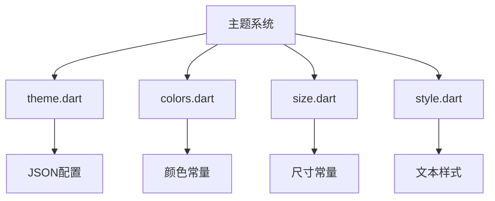
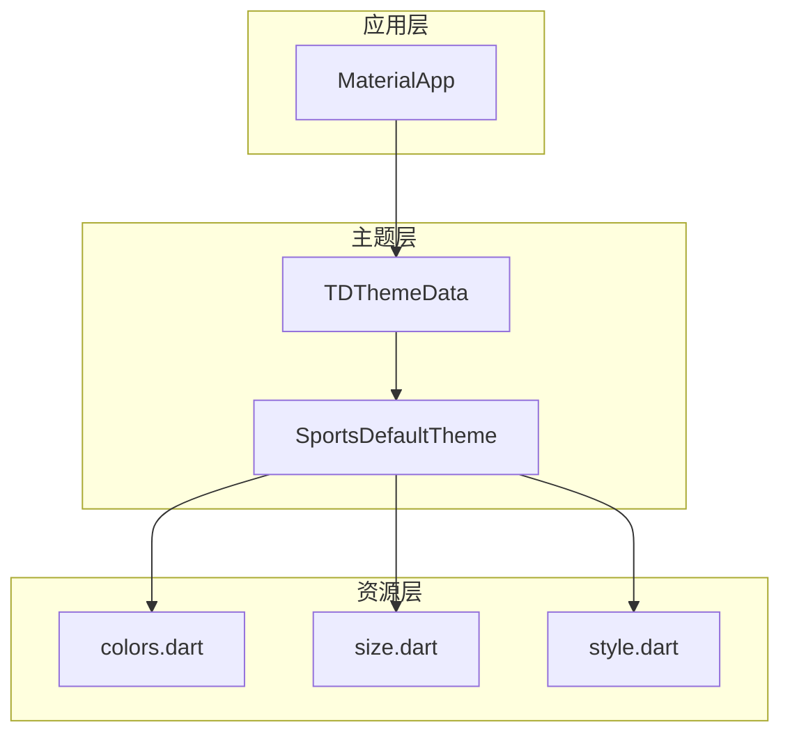
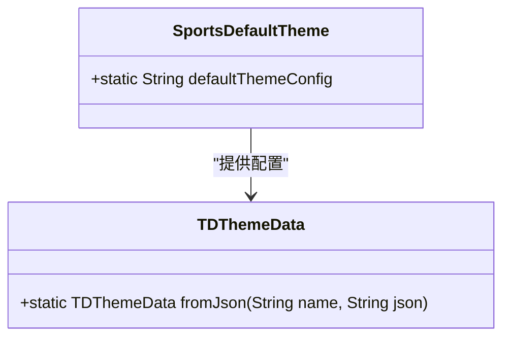
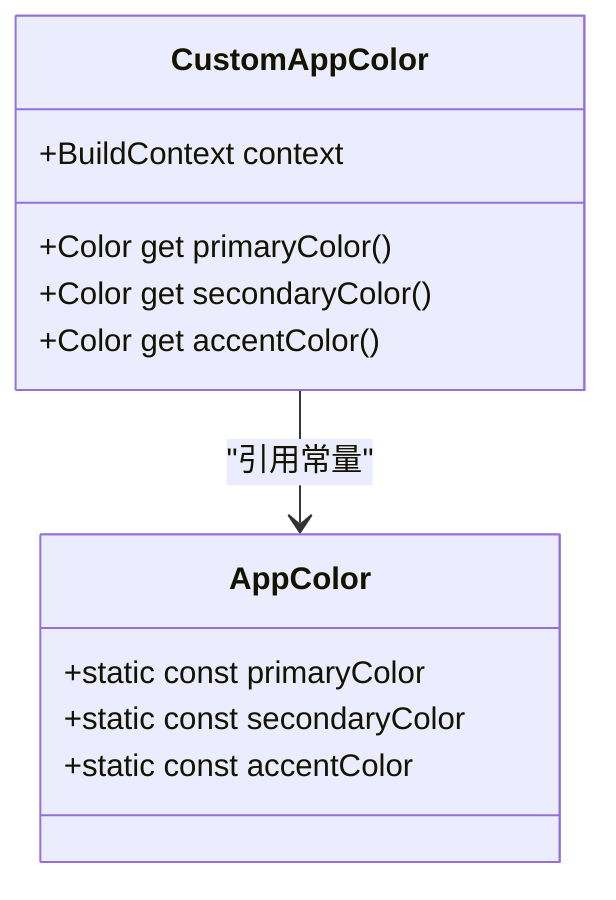
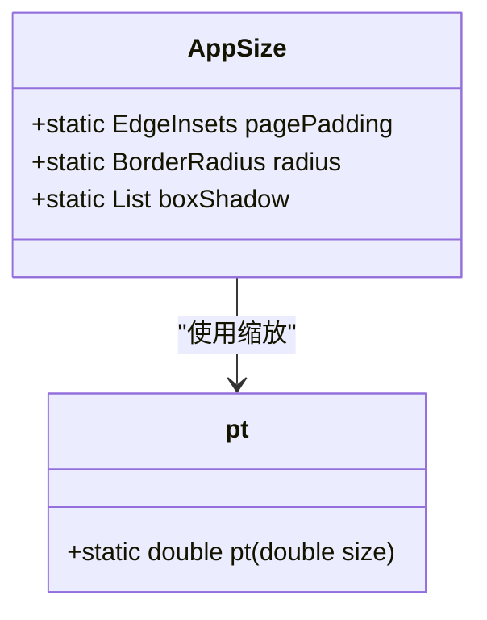
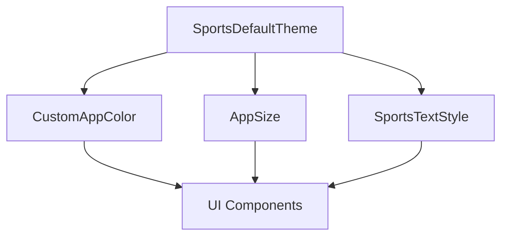

# 自定义主题扩展

<cite>
**本文档引用的文件**
- [theme.dart](file://lib/resources/theme.dart)
- [colors.dart](file://lib/resources/colors.dart)
- [size.dart](file://lib/resources/size.dart)
- [style.dart](file://lib/resources/style.dart)
- [app.dart](file://lib/app.dart)
- [common_button.dart](file://lib/widgets/base/button/common_button.dart)
</cite>

## 目录
1. [项目结构](#项目结构)
2. [核心组件](#核心组件)
3. [架构概述](#架构概述)
4. [详细组件分析](#详细组件分析)
5. [依赖分析](#依赖分析)

## 项目结构

本项目采用典型的Flutter应用结构，主题系统主要集中在`lib/resources/`目录下。主题配置通过JSON结构定义，并在应用启动时注入。核心主题文件包括颜色、尺寸、字体和阴影等设计属性。

**Diagram sources**
- [theme.dart](file://lib/resources/theme.dart#L1-L316)
- [colors.dart](file://lib/resources/colors.dart#L1-L361)
- [size.dart](file://lib/resources/size.dart#L1-L17)
- [style.dart](file://lib/resources/style.dart#L1-L41)

**Section sources**
- [theme.dart](file://lib/resources/theme.dart#L1-L316)
- [colors.dart](file://lib/resources/colors.dart#L1-L361)

## 核心组件

主题系统由多个核心组件构成：`SportsDefaultTheme`类定义了JSON格式的主题配置，`CustomAppColor`类提供了基于上下文的颜色获取方法，`AppSize`类管理布局尺寸，`SportsTextStyle`扩展提供了统一的文本样式。这些组件共同构成了应用的设计系统基础。

**Section sources**
- [theme.dart](file://lib/resources/theme.dart#L1-L316)
- [colors.dart](file://lib/resources/colors.dart#L3-L287)
- [size.dart](file://lib/resources/size.dart#L4-L16)
- [style.dart](file://lib/resources/style.dart#L5-L40)

## 架构概述

主题系统采用分层架构设计，通过`TDThemeData.fromJson`方法将JSON配置解析为可扩展的主题数据，并在`MaterialApp`中通过`theme.extensions`注入。这种设计允许在运行时动态切换主题，同时保持类型安全。

**Diagram sources**
- [app.dart](file://lib/app.dart#L47-L54)
- [theme.dart](file://lib/resources/theme.dart#L1-L316)

## 详细组件分析

### SportsDefaultTheme 分析

`SportsDefaultTheme`类通过静态JSON字符串定义了完整的主题配置，包括颜色、字体、圆角、阴影和间距等设计属性。该配置采用层级结构组织，便于维护和扩展。

**Diagram sources**
- [theme.dart](file://lib/resources/theme.dart#L1-L316)

**Section sources**
- [theme.dart](file://lib/resources/theme.dart#L1-L316)

### CustomAppColor 分析

`CustomAppColor`类作为颜色访问的中间层，通过`BuildContext`获取当前主题亮度，并返回相应的颜色值。它维护了语义化颜色与具体颜色值的映射关系，支持深色模式切换。

**Diagram sources**
- [colors.dart](file://lib/resources/colors.dart#L3-L287)

**Section sources**
- [colors.dart](file://lib/resources/colors.dart#L3-L287)

### AppSize 分析

`AppSize`类定义了应用中的布局尺寸规范，包括内边距、圆角半径和阴影效果。这些尺寸值通过`pt`函数进行响应式缩放，确保在不同设备上保持一致的视觉效果。

**Diagram sources**
- [size.dart](file://lib/resources/size.dart#L4-L16)
- [pt.dart](file://lib/utils/pt.dart#L3-L27)

**Section sources**
- [size.dart](file://lib/resources/size.dart#L4-L16)

## 依赖分析

主题系统各组件之间存在明确的依赖关系。`SportsDefaultTheme`提供基础配置，`CustomAppColor`和`AppSize`等类基于此配置实现具体功能，最终在UI组件中被引用。

**Diagram sources**
- [theme.dart](file://lib/resources/theme.dart#L1-L316)
- [colors.dart](file://lib/resources/colors.dart#L3-L287)
- [size.dart](file://lib/resources/size.dart#L4-L16)
- [style.dart](file://lib/resources/style.dart#L5-L40)

**Section sources**
- [theme.dart](file://lib/resources/theme.dart#L1-L316)
- [colors.dart](file://lib/resources/colors.dart#L1-L361)
- [size.dart](file://lib/resources/size.dart#L1-L17)
- [style.dart](file://lib/resources/style.dart#L1-L41)