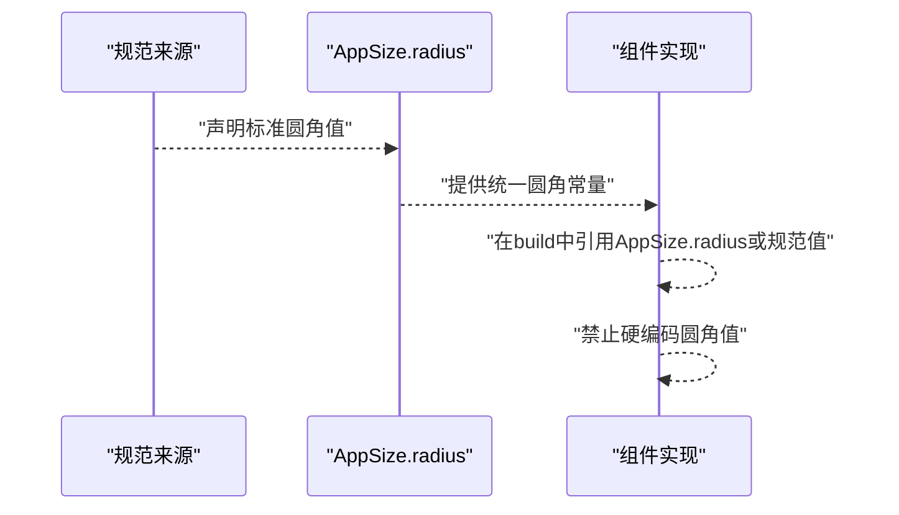
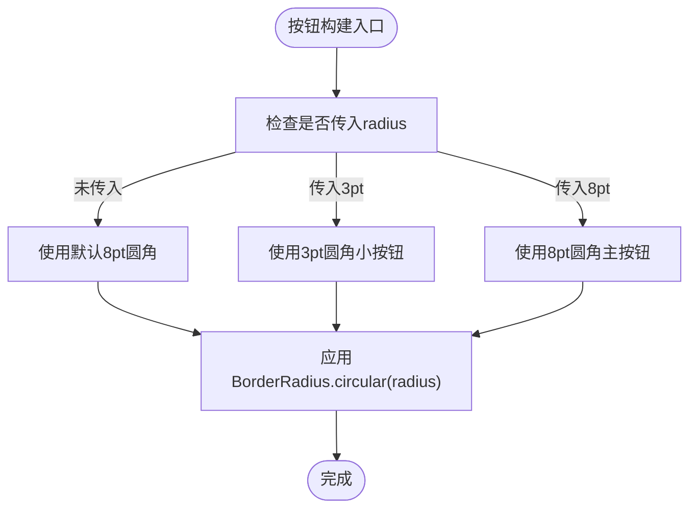
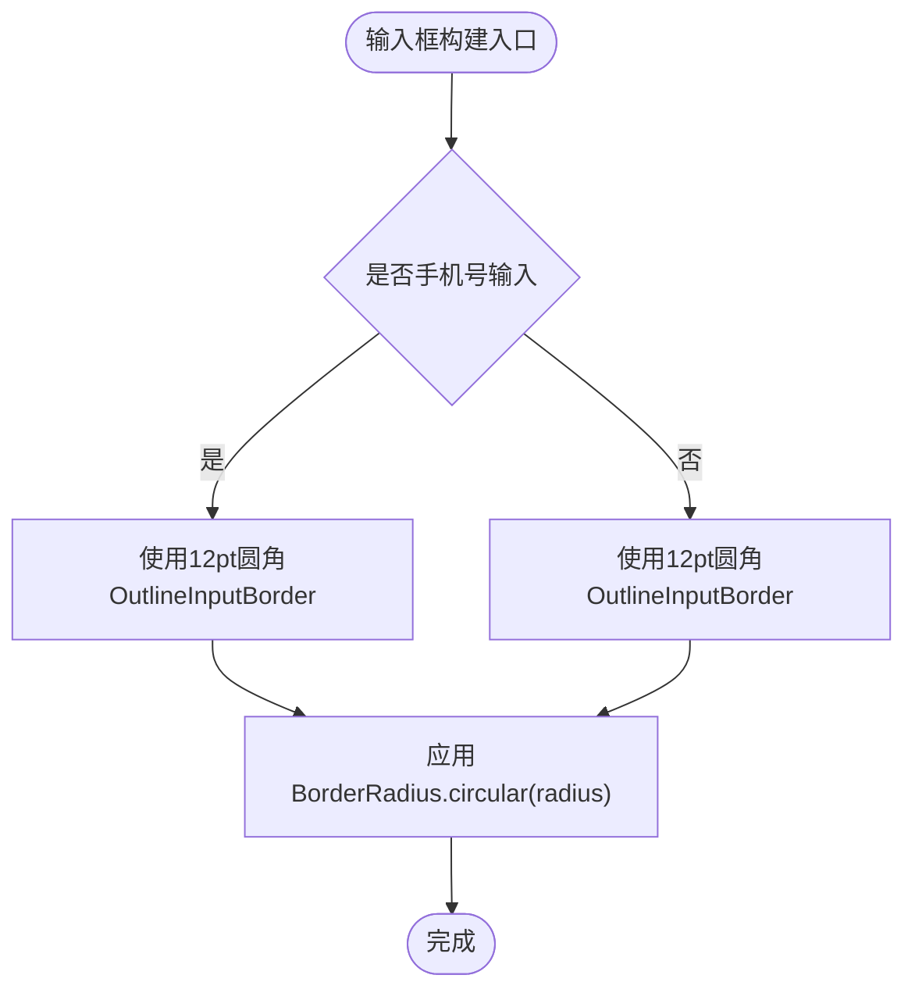
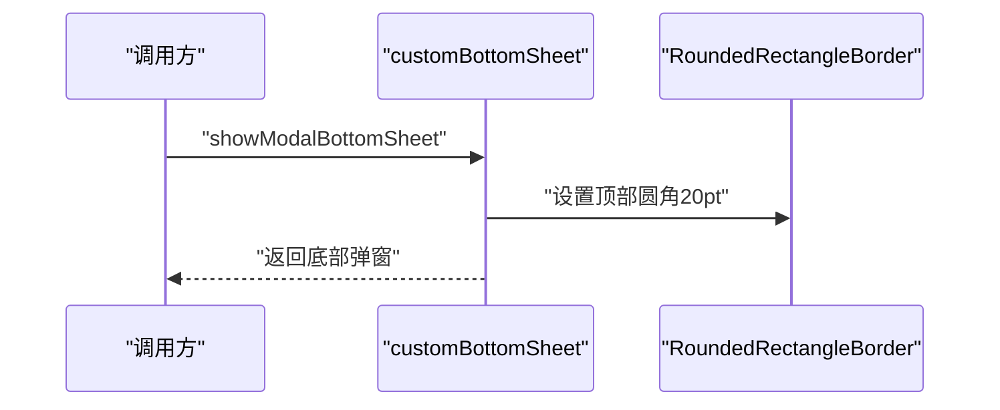
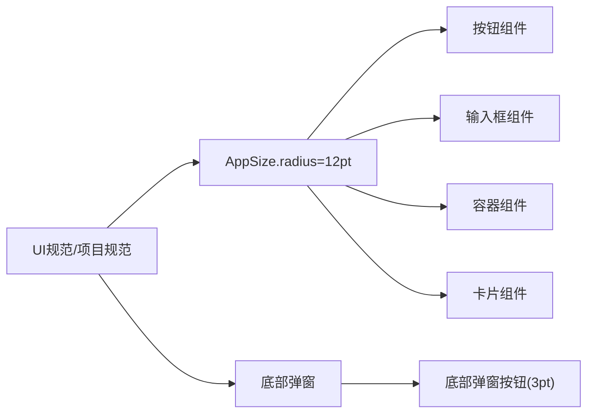

# 圆角规范

<cite>
**本文引用的文件**
- [UI规范总览.md](file://UI_SPECIFICATION.md)
- [项目规范.md](file://openspec/project.md)
- [AppSize尺寸与圆角定义](file://lib/resources/size.dart)
- [按钮组件实现](file://lib/widgets/base/button/common_button.dart)
- [输入框组件实现](file://lib/widgets/base/textfield/common_textformfield.dart)
- [城市选择输入框实现](file://lib/widgets/base/textfield/common_city_picker.dart)
- [容器组件实现](file://lib/widgets/base/container/common_container.dart)
- [底部弹窗组件实现](file://lib/widgets/base/bottom_sheet/bottom_sheet.dart)
- [卡片组件实现](file://lib/widgets/common/section_card.dart)
- [油品支付卡片示例](file://lib/pages/main_oil_pay/widgets/depots_item.dart)
</cite>

## 目录
1. [引言](#引言)
2. [项目结构](#项目结构)
3. [核心组件](#核心组件)
4. [架构总览](#架构总览)
5. [详细组件分析](#详细组件分析)
6. [依赖关系分析](#依赖关系分析)
7. [性能考量](#性能考量)
8. [故障排查指南](#故障排查指南)
9. [结论](#结论)
10. [附录](#附录)

## 引言
本规范文档聚焦于App端统一圆角体系，明确AppSize.radius的定义（固定12pt圆角），并阐述其在按钮、卡片、输入框等组件中的视觉一致性作用。结合UI_SPECIFICATION.md与openspec/project.md中的圆角规范，给出不同场景的标准圆角值：3pt用于小按钮、8pt用于标准卡片/容器/主按钮、12pt用于输入框、20pt用于BottomSheet。强调所有圆角必须引用AppSize.radius或设计规范中的标准值，严禁硬编码。

## 项目结构
围绕圆角规范的关键文件分布如下：
- 规范来源：UI_SPECIFICATION.md、openspec/project.md
- 统一圆角定义：lib/resources/size.dart
- 组件实现：按钮、输入框、容器、底部弹窗、卡片等

```mermaid
graph TB
A["UI规范总览.md<br/>圆角规范与组件规范"] --> B["AppSize尺寸与圆角定义<br/>lib/resources/size.dart"]
C["项目规范.md<br/>圆角规范与尺寸规范"] --> B
D["按钮组件实现<br/>lib/widgets/base/button/common_button.dart"] --> B
E["输入框组件实现<br/>lib/widgets/base/textfield/common_textformfield.dart"] --> B
F["城市选择输入框实现<br/>lib/widgets/base/textfield/common_city_picker.dart"] --> B
G["容器组件实现<br/>lib/widgets/base/container/common_container.dart"] --> B
H["底部弹窗组件实现<br/>lib/widgets/base/bottom_sheet/bottom_sheet.dart"] --> B
I["卡片组件实现<br/>lib/widgets/common/section_card.dart"] --> B
J["油品支付卡片示例<br/>lib/pages/main_oil_pay/widgets/depots_item.dart"] --> B
```

图表来源
- [UI规范总览.md](file://UI_SPECIFICATION.md#L222-L233)
- [项目规范.md](file://openspec/project.md#L515-L524)
- [AppSize尺寸与圆角定义](file://lib/resources/size.dart#L1-L17)
- [按钮组件实现](file://lib/widgets/base/button/common_button.dart#L40-L60)
- [输入框组件实现](file://lib/widgets/base/textfield/common_textformfield.dart#L138-L212)
- [城市选择输入框实现](file://lib/widgets/base/textfield/common_city_picker.dart#L339-L370)
- [容器组件实现](file://lib/widgets/base/container/common_container.dart#L22-L41)
- [底部弹窗组件实现](file://lib/widgets/base/bottom_sheet/bottom_sheet.dart#L19-L30)
- [卡片组件实现](file://lib/widgets/common/section_card.dart#L32-L46)
- [油品支付卡片示例](file://lib/pages/main_oil_pay/widgets/depots_item.dart#L27-L62)

章节来源
- [UI规范总览.md](file://UI_SPECIFICATION.md#L222-L233)
- [项目规范.md](file://openspec/project.md#L515-L524)
- [AppSize尺寸与圆角定义](file://lib/resources/size.dart#L1-L17)

## 核心组件
- AppSize.radius：统一的圆角常量，值为12pt，作为全局圆角基准。
- 组件层：按钮、输入框、容器、卡片、底部弹窗等组件在各自实现中引用该常量或按规范使用标准圆角值。

章节来源
- [AppSize尺寸与圆角定义](file://lib/resources/size.dart#L1-L17)

## 架构总览
统一圆角策略通过“规范定义 + 组件实现约束”的方式落地：
- 规范层：UI_SPECIFICATION.md与openspec/project.md明确各场景圆角值。
- 定义层：AppSize.radius提供统一圆角常量。
- 实施层：各组件在构建时优先使用AppSize.radius或按规范设定圆角值，避免硬编码。

图表来源
- [UI规范总览.md](file://UI_SPECIFICATION.md#L222-L233)
- [项目规范.md](file://openspec/project.md#L515-L524)
- [AppSize尺寸与圆角定义](file://lib/resources/size.dart#L1-L17)

## 详细组件分析

### AppSize.radius 的定义与使用
- 定义：AppSize.radius为固定12pt圆角，便于全局一致的视觉体验。
- 使用：组件在需要统一圆角时应优先引用AppSize.radius；若场景另有规范，则遵循对应场景值。

章节来源
- [AppSize尺寸与圆角定义](file://lib/resources/size.dart#L1-L17)

### 按钮组件（CommonButton）
- 圆角策略：
  - 主要按钮：默认8pt圆角（规范值）。
  - 小按钮：3pt圆角（规范值）。
  - 图标按钮：3pt圆角（规范值）。
- 实现要点：
  - 组件内部通过BorderRadius.circular(radius)应用圆角，radius可由外部传入，默认8pt。
  - 若外部传入radius为3pt或8pt，符合规范；若传入其他值，需确保与规范一致。

图表来源
- [按钮组件实现](file://lib/widgets/base/button/common_button.dart#L22-L38)
- [按钮组件实现](file://lib/widgets/base/button/common_button.dart#L40-L60)

章节来源
- [按钮组件实现](file://lib/widgets/base/button/common_button.dart#L22-L38)
- [按钮组件实现](file://lib/widgets/base/button/common_button.dart#L40-L60)

### 输入框组件（CommonTextFormField）
- 圆角策略：
  - 输入框默认12pt圆角（规范值）。
  - 当启用手机号输入时，内部使用12pt圆角的OutlineInputBorder。
- 实现要点：
  - 组件默认radius=12，可通过外部传参覆盖。
  - 焦点态与边框样式与圆角配合，保持视觉统一。

图表来源
- [输入框组件实现](file://lib/widgets/base/textfield/common_textformfield.dart#L138-L212)
- [输入框组件实现](file://lib/widgets/base/textfield/common_textformfield.dart#L235-L360)

章节来源
- [输入框组件实现](file://lib/widgets/base/textfield/common_textformfield.dart#L138-L212)
- [输入框组件实现](file://lib/widgets/base/textfield/common_textformfield.dart#L235-L360)

### 城市选择输入框（common_city_picker）
- 圆角策略：
  - 默认8pt圆角（规范值）。
- 实现要点：
  - 当外部未传入radius时，使用8pt圆角；传入则以传入为准，但建议遵循规范。

章节来源
- [城市选择输入框实现](file://lib/widgets/base/textfield/common_city_picker.dart#L339-L370)

### 容器组件（CustomContainer）
- 圆角策略：
  - 默认15pt圆角（规范值）。
- 实现要点：
  - 外部可传入borderRadius覆盖默认值；若不传，使用15pt圆角。

章节来源
- [容器组件实现](file://lib/widgets/base/container/common_container.dart#L22-L41)

### 底部弹窗（customBottomSheet）
- 圆角策略：
  - 顶部圆角20pt（规范值）。
- 实现要点：
  - 通过RoundedRectangleBorder(shape)设置顶部圆角为20pt。
  - 底部按钮区域使用3pt圆角，符合小按钮规范。

图表来源
- [底部弹窗组件实现](file://lib/widgets/base/bottom_sheet/bottom_sheet.dart#L19-L30)
- [底部弹窗组件实现](file://lib/widgets/base/bottom_sheet/bottom_sheet.dart#L100-L121)

章节来源
- [底部弹窗组件实现](file://lib/widgets/base/bottom_sheet/bottom_sheet.dart#L19-L30)
- [底部弹窗组件实现](file://lib/widgets/base/bottom_sheet/bottom_sheet.dart#L100-L121)

### 卡片组件（SectionCard 与 depots_item 示例）
- 圆角策略：
  - 卡片默认16pt圆角（示例值）。
  - 油品支付卡片示例使用12pt圆角。
- 实现要点：
  - 卡片组件示例采用pt(16)圆角；业务卡片示例采用12pt圆角，符合输入框圆角规范。

章节来源
- [卡片组件实现](file://lib/widgets/common/section_card.dart#L32-L46)
- [油品支付卡片示例](file://lib/pages/main_oil_pay/widgets/depots_item.dart#L27-L62)

## 依赖关系分析
- 规范来源与AppSize.radius的关系：
  - UI规范与项目规范共同定义了各场景圆角值。
  - AppSize.radius作为全局统一圆角常量，优先用于需要统一圆角的组件。
- 组件与AppSize.radius的耦合：
  - 组件在构建时通过BorderRadius.circular引用AppSize.radius或按规范设定圆角值。
  - 通过参数化radius，组件既可复用统一常量，又可灵活适配不同场景。

图表来源
- [UI规范总览.md](file://UI_SPECIFICATION.md#L222-L233)
- [项目规范.md](file://openspec/project.md#L515-L524)
- [AppSize尺寸与圆角定义](file://lib/resources/size.dart#L1-L17)
- [底部弹窗组件实现](file://lib/widgets/base/bottom_sheet/bottom_sheet.dart#L19-L30)

章节来源
- [UI规范总览.md](file://UI_SPECIFICATION.md#L222-L233)
- [项目规范.md](file://openspec/project.md#L515-L524)
- [AppSize尺寸与圆角定义](file://lib/resources/size.dart#L1-L17)

## 性能考量
- 圆角绘制成本：BorderRadius.circular的计算开销极低，对性能影响可忽略。
- 统一常量的优势：减少重复计算与内存占用，提升渲染一致性。
- 建议：优先使用AppSize.radius，避免在大量组件中重复计算同一数值。

## 故障排查指南
- 症状：组件圆角与规范不一致
  - 检查组件是否直接硬编码圆角值，应改为引用AppSize.radius或按规范设定。
  - 检查组件是否传入了与规范不符的radius值。
- 症状：底部弹窗顶部圆角异常
  - 确认RoundedRectangleBorder的顶部圆角是否为20pt。
- 症状：输入框圆角与卡片圆角冲突
  - 输入框默认12pt；卡片示例可使用12pt或16pt，但需保持组件内一致性。

章节来源
- [底部弹窗组件实现](file://lib/widgets/base/bottom_sheet/bottom_sheet.dart#L19-L30)
- [输入框组件实现](file://lib/widgets/base/textfield/common_textformfield.dart#L235-L360)
- [卡片组件实现](file://lib/widgets/common/section_card.dart#L32-L46)

## 结论
- AppSize.radius为12pt圆角，是统一视觉的基础。
- 各组件应遵循UI规范与项目规范，优先引用AppSize.radius或按规范设定圆角值。
- 严禁硬编码圆角值，确保跨页面、跨组件的一致性与可维护性。

## 附录
- 圆角规范对照（摘自UI规范与项目规范）
  - 小按钮：3pt
  - 标准卡片/容器/主按钮：8pt
  - 输入框：12pt
  - BottomSheet：20pt

章节来源
- [UI规范总览.md](file://UI_SPECIFICATION.md#L222-L233)
- [项目规范.md](file://openspec/project.md#L515-L524)