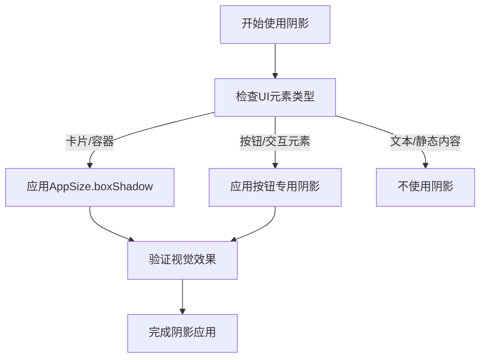

# 尺寸系统

<cite>
**本文档引用文件**  
- [size.dart](file://lib/resources/size.dart)
- [pt.dart](file://lib/utils/pt.dart)
- [screen.dart](file://lib/utils/screen.dart)
- [sizer_utils.dart](file://lib/utils/sizer_utils.dart)
- [common_button.dart](file://lib/widgets/base/button/common_button.dart)
- [common_container.dart](file://lib/widgets/base/container/common_container.dart)
- [oil_purchase_detail/view.dart](file://lib/pages/main_oil_pay/oil_purchase_detail/view.dart)
- [empty_card.dart](file://lib/widgets/common/empty_card.dart)
- [project.md](file://openspec/project.md)
- [UI_SPECIFICATION.md](file://UI_SPECIFICATION.md)
</cite>

## 目录
1. [简介](#简介)
2. [AppSize.pagePadding 页面内边距](#appsizepagepadding-页面内边距)
3. [AppSize.radius 圆角规范](#appsize-radius-圆角规范)
4. [AppSize.boxShadow 阴影规范](#appsizeboxshadow-阴影规范)
5. [尺寸系统使用原则](#尺寸系统使用原则)

## 简介
本尺寸系统文档详细说明了油商业务App的设计规范，包括间距、圆角、阴影等核心设计元素。系统通过`AppSize`类统一管理所有尺寸相关属性，确保UI在不同设备上的一致性。所有组件必须使用`AppSize`中定义的常量，禁止硬编码像素值，以实现响应式布局和设计统一性。

## AppSize.pagePadding 页面内边距

`AppSize.pagePadding`是应用中页面内容的标准水平内边距，定义了页面内容与屏幕边缘的安全距离。该属性确保了内容在不同屏幕尺寸设备上都能保持一致的视觉舒适度。

```dart
static final EdgeInsets pagePadding =
    EdgeInsets.symmetric(vertical: 0, horizontal: pt(12));
```

该内边距在页面布局中具有重要作用：
- **水平对称**：通过`EdgeInsets.symmetric`设置左右对称的内边距
- **垂直无间距**：垂直方向不设置内边距，由具体组件自行管理
- **响应式适配**：使用`pt(12)`函数实现跨设备尺寸适配

**使用场景**：
- 滚动页面内容容器的水平边距
- 表单元素的水平对齐基准
- 列表项的水平边界控制

**Section sources**
- [size.dart](file://lib/resources/size.dart#L5-L6)

## AppSize.radius 圆角规范

`AppSize.radius`定义了应用中标准UI元素的圆角半径，为按钮、卡片、输入框等组件提供统一的视觉风格。

```dart
static final BorderRadius radius = BorderRadius.circular(12);
```

该圆角规范在不同UI元素中的应用：

### 按钮组件
- 应用于`common_button.dart`中的通用按钮
- 为按钮提供现代、友好的视觉外观
- 增强点击区域的可识别性

### 卡片组件
- 在`oil_purchase_detail/view.dart`中用于订单详情卡片
- 创建内容区域的视觉边界
- 提升卡片的层次感和可读性

### 输入框组件
- 与边框结合使用，创建柔和的输入区域
- 改善用户体验，减少尖锐边缘的视觉压力

**最佳实践**：
- 所有需要圆角的组件应优先使用`AppSize.radius`
- 特殊场景需要不同圆角时，应通过设计评审并更新规范
- 禁止直接硬编码圆角值如`BorderRadius.circular(12)`

**Section sources**
- [size.dart](file://lib/resources/size.dart#L7)
- [common_button.dart](file://lib/widgets/base/button/common_button.dart#L55)
- [oil_purchase_detail/view.dart](file://lib/pages/main_oil_pay/oil_purchase_detail/view.dart#L68)

## AppSize.boxShadow 阴影规范

`AppSize.boxShadow`定义了应用中标准的阴影效果，为UI元素提供深度感和层次结构。

```dart
static final List<BoxShadow> boxShadow = [
  BoxShadow(
    color: const Color(0xffe6e6e6),
    offset: const Offset(0, 4),
    blurRadius: pt(8),
    spreadRadius: 0,
  )
];
```

### 阴影构成
| 属性 | 值 | 说明 |
|------|-----|------|
| 颜色 | `#e6e6e6` | 浅灰色，提供柔和的阴影效果 |
| 偏移 | `(0, 4)` | 向下偏移4个单位，模拟光源在上方 |
| 模糊半径 | `pt(8)` | 8dp模糊，创建柔和的渐变边缘 |
| 扩散半径 | `0` | 不扩散，保持阴影原始尺寸 |

### 应用场景
- **内容卡片**：在`empty_card.dart`中用于空状态卡片
- **表单容器**：在`oil_purchase_detail/view.dart`中用于订单表单
- **浮动元素**：为提升视觉层次的组件添加深度感

### 最佳实践
- 所有需要阴影效果的组件应使用`AppSize.boxShadow`
- 避免过度使用阴影，保持界面简洁
- 在深色主题下自动适配阴影透明度



**Diagram sources**
- [size.dart](file://lib/resources/size.dart#L8-L15)
- [empty_card.dart](file://lib/widgets/common/empty_card.dart#L49)
- [oil_purchase_detail/view.dart](file://lib/pages/main_oil_pay/oil_purchase_detail/view.dart#L69)

**Section sources**
- [size.dart](file://lib/resources/size.dart#L8-L15)
- [empty_card.dart](file://lib/widgets/common/empty_card.dart#L49)
- [oil_purchase_detail/view.dart](file://lib/pages/main_oil_pay/oil_purchase_detail/view.dart#L69)

## 尺寸系统使用原则

### 统一管理
所有尺寸相关属性必须通过`AppSize`类进行管理，确保设计一致性：
- 禁止硬编码像素值（如`12.0`）
- 禁止直接使用`EdgeInsets`或`BorderRadius`构造函数
- 所有尺寸变更需通过`AppSize`类统一调整

### 响应式适配
系统通过多层适配机制实现跨设备兼容：
- `pt()`函数：基于`screen.dart`实现基础尺寸转换
- `AppSizes`类：提供字体、宽度、高度的响应式方法
- 设备类型判断：自动适配手机、平板、折叠屏设备

### 工具函数说明
```dart
// pt.dart - 基础尺寸转换
pt(double size, {double padScale = 0.625, double landscapeScale = 0.432})

// sizer_utils.dart - 高级尺寸管理
AppSizes.setFontSize(14)  // 响应式字体
AppSizes.setWidth(80)     // 响应式宽度
AppSizes.setHeight(60)    // 响应式高度
```

### 违规示例
```dart
// ❌ 错误：硬编码尺寸
Container(
  padding: EdgeInsets.all(12),
  decoration: BoxDecoration(
    borderRadius: BorderRadius.circular(12),
  ),
)

// ✅ 正确：使用AppSize常量
Container(
  padding: AppSize.pagePadding,
  decoration: BoxDecoration(
    borderRadius: AppSize.radius,
    boxShadow: AppSize.boxShadow,
  ),
)
```

**Section sources**
- [size.dart](file://lib/resources/size.dart)
- [pt.dart](file://lib/utils/pt.dart)
- [screen.dart](file://lib/utils/screen.dart)
- [sizer_utils.dart](file://lib/utils/sizer_utils.dart)
- [project.md](file://openspec/project.md)
- [UI_SPECIFICATION.md](file://UI_SPECIFICATION.md)