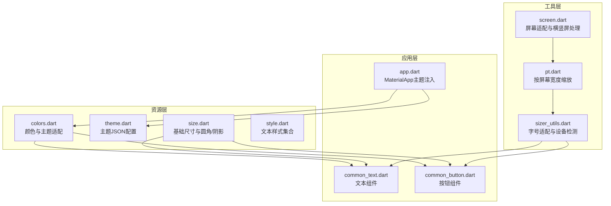
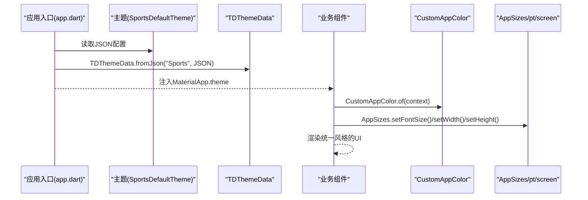
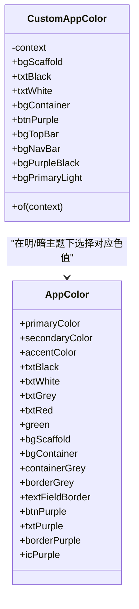
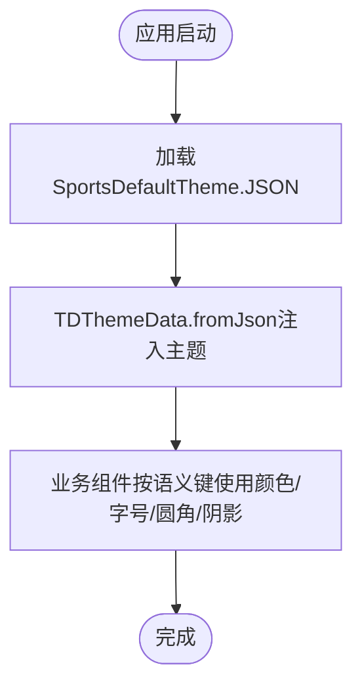
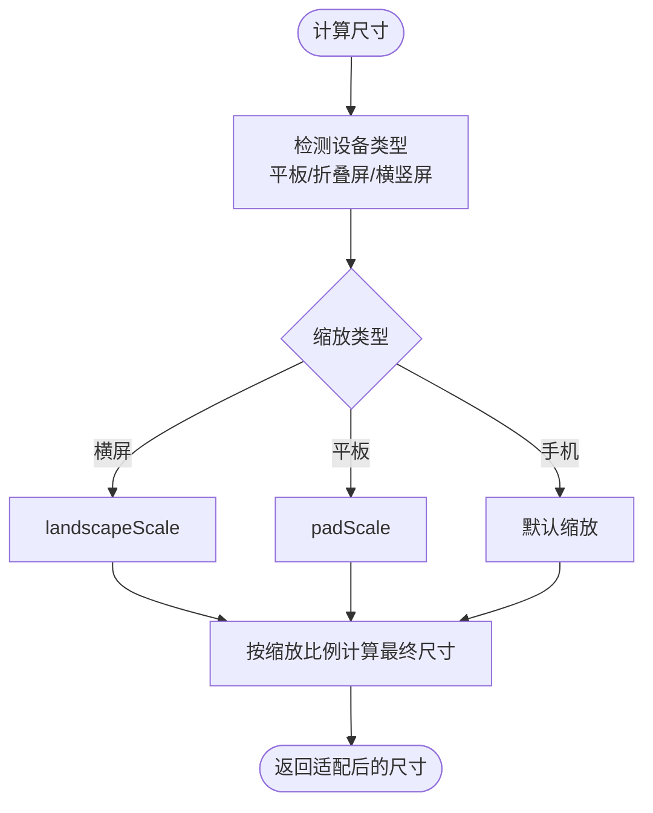
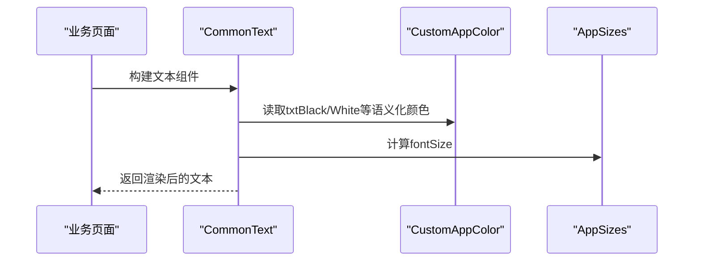
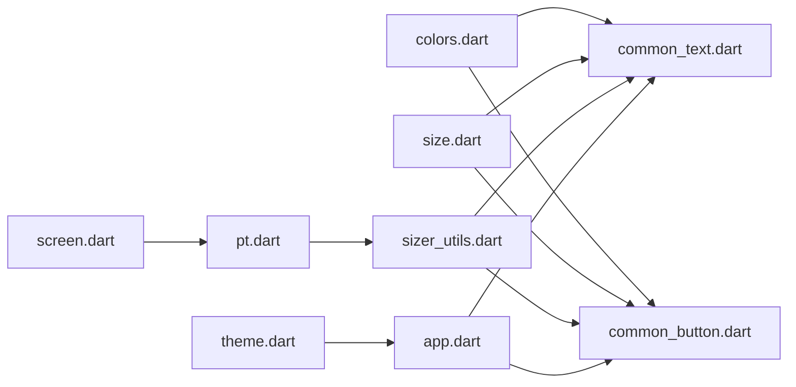

# 设计系统与主题规范

<cite>
**本文引用的文件**
- [colors.dart](file://lib/resources/colors.dart)
- [theme.dart](file://lib/resources/theme.dart)
- [size.dart](file://lib/resources/size.dart)
- [style.dart](file://lib/resources/style.dart)
- [sizer_utils.dart](file://lib/utils/sizer_utils.dart)
- [pt.dart](file://lib/utils/pt.dart)
- [screen.dart](file://lib/utils/screen.dart)
- [app.dart](file://lib/app.dart)
- [common_text.dart](file://lib/widgets/base/text/common_text.dart)
- [common_button.dart](file://lib/widgets/base/button/common_button.dart)
- [UI规范.md](file://UI_SPECIFICATION.md)
- [项目变更记录.md](file://openspec/project.md)
- [更新品牌主题提案.md](file://openspec/changes/update-brand-theme-amber/proposal.md)
- [colors_test.dart](file://test/resources/colors_test.dart)
</cite>

## 目录
1. [引言](#引言)
2. [项目结构](#项目结构)
3. [核心组件](#核心组件)
4. [架构总览](#架构总览)
5. [详细组件分析](#详细组件分析)
6. [依赖关系分析](#依赖关系分析)
7. [性能考量](#性能考量)
8. [故障排查指南](#故障排查指南)
9. [结论](#结论)
10. [附录](#附录)

## 引言
本文件旨在建立一套完整的设计系统与主题规范，覆盖颜色系统、间距系统、字体与字号体系、圆角与阴影规范，并明确主题在明暗模式下的自适应策略。所有UI开发必须遵循“统一使用AppSizes.setFontSize()与CustomAppColor.of(context)”的强制规范，严禁在业务代码中直接硬编码颜色与尺寸，以确保跨平台、跨设备的一致性与可维护性。

## 项目结构
围绕设计系统的文件主要分布在以下位置：
- 颜色与主题：lib/resources/colors.dart、lib/resources/theme.dart
- 尺寸与字号：lib/resources/size.dart、lib/utils/sizer_utils.dart、lib/utils/pt.dart、lib/utils/screen.dart
- 字体样式：lib/resources/style.dart
- 应用入口与主题注入：lib/app.dart
- 基础组件示例：lib/widgets/base/text/common_text.dart、lib/widgets/base/button/common_button.dart
- 规范与约束：UI规范.md、项目变更记录.md、更新品牌主题提案.md、test/resources/colors_test.dart

图表来源
- [colors.dart](file://lib/resources/colors.dart#L1-L288)
- [theme.dart](file://lib/resources/theme.dart#L1-L316)
- [size.dart](file://lib/resources/size.dart#L1-L17)
- [style.dart](file://lib/resources/style.dart#L1-L41)
- [sizer_utils.dart](file://lib/utils/sizer_utils.dart#L1-L105)
- [pt.dart](file://lib/utils/pt.dart#L1-L28)
- [screen.dart](file://lib/utils/screen.dart#L1-L152)
- [app.dart](file://lib/app.dart#L1-L92)
- [common_text.dart](file://lib/widgets/base/text/common_text.dart#L1-L56)
- [common_button.dart](file://lib/widgets/base/button/common_button.dart#L1-L93)

章节来源
- [colors.dart](file://lib/resources/colors.dart#L1-L288)
- [theme.dart](file://lib/resources/theme.dart#L1-L316)
- [size.dart](file://lib/resources/size.dart#L1-L17)
- [style.dart](file://lib/resources/style.dart#L1-L41)
- [sizer_utils.dart](file://lib/utils/sizer_utils.dart#L1-L105)
- [pt.dart](file://lib/utils/pt.dart#L1-L28)
- [screen.dart](file://lib/utils/screen.dart#L1-L152)
- [app.dart](file://lib/app.dart#L1-L92)
- [common_text.dart](file://lib/widgets/base/text/common_text.dart#L1-L56)
- [common_button.dart](file://lib/widgets/base/button/common_button.dart#L1-L93)

## 核心组件
- 颜色系统与主题适配
  - AppColor：集中定义品牌色、中性色、功能色、背景色与容器色等，提供语义化命名与向后兼容别名。
  - CustomAppColor：根据BuildContext的Brightness.light/dark动态返回明/暗主题下的对应颜色，实现主题自适应。
- 主题配置
  - SportsDefaultTheme：以JSON字符串形式定义品牌色、错误/警告/成功色、字体族、字号、圆角半径、阴影与间距等主题参数，并通过TDThemeData.fromJson注入到MaterialApp。
- 尺寸与字号
  - AppSize：统一管理页面边距、圆角、阴影等基础尺寸常量。
  - AppSizes：提供setFontSize/setWidth/setHeight等工具方法，结合flutter_screenutil与设备检测实现响应式布局与字号缩放。
  - pt与screen：按设备横竖屏、平板/折叠屏等进行宽度缩放，保证视觉一致性。
- 字体样式
  - SportsTextStyle：提供常用文本样式的静态集合，统一字体家族与字号来源。

章节来源
- [colors.dart](file://lib/resources/colors.dart#L1-L288)
- [theme.dart](file://lib/resources/theme.dart#L1-L316)
- [size.dart](file://lib/resources/size.dart#L1-L17)
- [style.dart](file://lib/resources/style.dart#L1-L41)
- [sizer_utils.dart](file://lib/utils/sizer_utils.dart#L1-L105)
- [pt.dart](file://lib/utils/pt.dart#L1-L28)
- [screen.dart](file://lib/utils/screen.dart#L1-L152)

## 架构总览
应用启动时，通过app.dart将SportsDefaultTheme的JSON配置注入到MaterialApp的ThemeData.extensions中，并使用TDThemeData.fromJson加载主题。同时，全局启用ScreenUtilInit以支持响应式布局。业务组件通过CustomAppColor.of(context)读取当前明/暗主题的颜色，通过AppSizes.setFontSize()与AppSizes.setWidth/Height()读取统一的尺寸与字号，确保一致的设计语言。

图表来源
- [app.dart](file://lib/app.dart#L1-L92)
- [theme.dart](file://lib/resources/theme.dart#L1-L316)
- [common_text.dart](file://lib/widgets/base/text/common_text.dart#L1-L56)
- [common_button.dart](file://lib/widgets/base/button/common_button.dart#L1-L93)

## 详细组件分析

### 颜色系统与主题适配（CustomAppColor）
- 设计目标
  - 通过语义化命名统一表达品牌、中性、功能与背景色彩，避免业务层直接依赖具体色值。
  - 在明/暗主题下自动切换，保障对比度与可读性。
- 关键点
  - AppColor：集中定义品牌色(primaryColor、secondaryColor、accentColor)、中性色(txtBlack、txtWhite、txtGrey)、功能色(txtRed、green)、背景色(bgScaffold、bgContainer)等。
  - CustomAppColor.of(context)：根据Theme.of(context).brightness返回明/暗主题下的颜色，如txtBlack/White、bgScaffold、bgContainer等。
  - 向后兼容别名：btnPurple、txtPurple、borderPurple、icPurple等均指向语义化颜色，便于迁移与统一。
- 自适应切换逻辑要点
  - Brightness.light：优先使用AppColor中的亮色方案。
  - Brightness.dark：切换至暗色方案，如bgScaffold使用深色背景、txtBlack切换为txtWhite等。
- 使用建议
  - 文本颜色：优先使用CustomAppColor.of(context).txtBlack/White等语义化getter。
  - 背景颜色：优先使用bgScaffold、bgContainer等语义化getter。
  - 功能色：如错误/成功/警告等状态色，统一从AppColor或CustomAppColor中获取。

图表来源
- [colors.dart](file://lib/resources/colors.dart#L1-L288)

章节来源
- [colors.dart](file://lib/resources/colors.dart#L1-L288)
- [colors_test.dart](file://test/resources/colors_test.dart#L35-L68)

### 主题配置（SportsDefaultTheme）
- JSON结构概览
  - ref：引用映射，将语义键映射到具体颜色键。
  - color：品牌色、错误/警告/成功系列的多级色阶。
  - font：字号、行高、字重的分级定义。
  - fontFamily：数字字体族配置。
  - radius：圆角半径分级。
  - shadow：阴影层级配置（基础、中等、顶部）。
  - spacer：间距分级。
- 注入方式
  - app.dart中通过TDThemeData.fromJson('Sports', SportsDefaultTheme.defaultThemeConfig)注入到MaterialApp.theme。
- 使用建议
  - 字体与字号：优先使用font系列键，配合AppSizes.setFontSize()进行动态缩放。
  - 圆角与阴影：优先使用radius/shadow系列键，避免硬编码数值。
  - 间距：优先使用spacer系列键，保持页面布局一致性。

图表来源
- [theme.dart](file://lib/resources/theme.dart#L1-L316)
- [app.dart](file://lib/app.dart#L1-L92)

章节来源
- [theme.dart](file://lib/resources/theme.dart#L1-L316)
- [app.dart](file://lib/app.dart#L1-L92)

### 间距系统与尺寸适配（AppSize/AppSizes/pt/screen）
- AppSize
  - pagePadding：统一页面水平边距，使用pt()进行宽度缩放。
  - radius：统一圆角半径。
  - boxShadow：统一阴影配置。
- AppSizes
  - setFontSize()/setFontSizeCustom()：结合flutter_screenutil与用户文本缩放限制，支持平板/折叠屏缩放。
  - setWidth()/setHeight()：统一宽度/高度适配。
  - buttonHeight/topBarHeight：标准组件高度。
- pt与screen
  - pt()：基于screen.getWidth()按设备类型（横竖屏、平板、折叠屏）进行缩放。
  - screen.getWidth()：支持landscapeScale、padScale、isPad等参数，适配不同设备形态。
- 使用规范
  - 禁止在UI中直接硬编码尺寸；统一使用AppSizes.setFontSize()/setWidth()/setHeight()。
  - 页面边距统一使用AppSize.pagePadding。

图表来源
- [sizer_utils.dart](file://lib/utils/sizer_utils.dart#L1-L105)
- [pt.dart](file://lib/utils/pt.dart#L1-L28)
- [screen.dart](file://lib/utils/screen.dart#L1-L152)

章节来源
- [size.dart](file://lib/resources/size.dart#L1-L17)
- [sizer_utils.dart](file://lib/utils/sizer_utils.dart#L1-L105)
- [pt.dart](file://lib/utils/pt.dart#L1-L28)
- [screen.dart](file://lib/utils/screen.dart#L1-L152)

### 字体与字号体系（SportsTextStyle）
- 设计目标
  - 统一字体家族与字号来源，避免业务层直接硬编码字体属性。
- 关键点
  - SportsTextStyle.baseNormal/baseBold、grayNormal/grayBold、blueNormal/blueBold等，均来自AppColor与pt()的统一来源。
- 使用建议
  - 优先使用SportsTextStyle提供的预设样式，必要时再进行微调。

章节来源
- [style.dart](file://lib/resources/style.dart#L1-L41)

### 基础组件示例（CommonText/CommonButton）
- CommonText
  - 默认fontSize使用AppSizes.setFontSize(14)，默认颜色使用CustomAppColor.of(context).txtBlack，行高统一为1.2。
- CommonButton
  - 背景色使用CustomAppColor.of(context).btnPurple，边框色使用CustomAppColor.of(context).transparent，文本颜色使用CustomAppColor.of(context).white。
  - 高度使用AppSizes.buttonHeight，宽度默认全宽。

图表来源
- [common_text.dart](file://lib/widgets/base/text/common_text.dart#L1-L56)
- [common_button.dart](file://lib/widgets/base/button/common_button.dart#L1-L93)

章节来源
- [common_text.dart](file://lib/widgets/base/text/common_text.dart#L1-L56)
- [common_button.dart](file://lib/widgets/base/button/common_button.dart#L1-L93)

## 依赖关系分析
- 组件耦合
  - CustomAppColor依赖BuildContext以读取Brightness，从而实现明/暗主题切换。
  - AppSizes与pt/screen共同负责响应式布局与字号缩放，二者通过screen.getWidth()与flutter_screenutil协同工作。
  - SportsDefaultTheme作为JSON配置源，被TDThemeData.fromJson消费，间接影响业务组件的颜色与字号。
- 外部依赖
  - tdesign_flutter：用于主题扩展与字体族配置。
  - flutter_screenutil：用于统一尺寸与字号适配。
- 循环依赖
  - 当前模块间无明显循环依赖；颜色与尺寸工具相互独立，主题配置通过注入方式被使用。

图表来源
- [colors.dart](file://lib/resources/colors.dart#L1-L288)
- [size.dart](file://lib/resources/size.dart#L1-L17)
- [sizer_utils.dart](file://lib/utils/sizer_utils.dart#L1-L105)
- [pt.dart](file://lib/utils/pt.dart#L1-L28)
- [screen.dart](file://lib/utils/screen.dart#L1-L152)
- [theme.dart](file://lib/resources/theme.dart#L1-L316)
- [app.dart](file://lib/app.dart#L1-L92)
- [common_text.dart](file://lib/widgets/base/text/common_text.dart#L1-L56)
- [common_button.dart](file://lib/widgets/base/button/common_button.dart#L1-L93)

章节来源
- [colors.dart](file://lib/resources/colors.dart#L1-L288)
- [size.dart](file://lib/resources/size.dart#L1-L17)
- [sizer_utils.dart](file://lib/utils/sizer_utils.dart#L1-L105)
- [pt.dart](file://lib/utils/pt.dart#L1-L28)
- [screen.dart](file://lib/utils/screen.dart#L1-L152)
- [theme.dart](file://lib/resources/theme.dart#L1-L316)
- [app.dart](file://lib/app.dart#L1-L92)
- [common_text.dart](file://lib/widgets/base/text/common_text.dart#L1-L56)
- [common_button.dart](file://lib/widgets/base/button/common_button.dart#L1-L93)

## 性能考量
- 主题注入成本低：TDThemeData.fromJson在应用启动阶段一次性完成，后续组件按需读取，开销可控。
- 响应式适配：AppSizes与pt/screen仅在计算时参与，渲染阶段使用缓存结果，避免重复计算。
- 字体缩放：setFontSizeCustom对用户文本缩放进行上限控制，防止极端缩放导致布局抖动。

## 故障排查指南
- 现象：明/暗主题颜色未切换
  - 排查：确认CustomAppColor.of(context)是否在正确的BuildContext上调用；检查Theme.of(context).brightness是否符合预期。
  - 参考：[colors.dart](file://lib/resources/colors.dart#L1-L288)
- 现象：字号过大或过小
  - 排查：检查AppSizes.setFontSizeCustom中的设备类型判断与用户文本缩放上限；确认是否正确传入fontSize。
  - 参考：[sizer_utils.dart](file://lib/utils/sizer_utils.dart#L1-L105)
- 现象：页面边距不一致
  - 排查：统一使用AppSize.pagePadding；避免在组件内部硬编码边距。
  - 参考：[size.dart](file://lib/resources/size.dart#L1-L17)
- 现象：主题JSON未生效
  - 排查：确认app.dart中TDThemeData.fromJson('Sports', ...)已正确注入；检查JSON键名与引用映射是否一致。
  - 参考：[app.dart](file://lib/app.dart#L1-L92)、[theme.dart](file://lib/resources/theme.dart#L1-L316)

章节来源
- [colors.dart](file://lib/resources/colors.dart#L1-L288)
- [sizer_utils.dart](file://lib/utils/sizer_utils.dart#L1-L105)
- [size.dart](file://lib/resources/size.dart#L1-L17)
- [app.dart](file://lib/app.dart#L1-L92)
- [theme.dart](file://lib/resources/theme.dart#L1-L316)

## 结论
本设计系统通过语义化颜色、统一的主题JSON配置、响应式尺寸与字号体系，以及强制性的颜色与尺寸使用规范，实现了跨平台、跨设备的一致视觉体验。建议在所有新功能开发中严格遵循“统一使用AppSizes.setFontSize()与CustomAppColor.of(context)”的原则，确保设计语言的稳定与可维护性。

## 附录

### 颜色系统定义与使用场景
- 品牌色
  - primaryColor：主品牌色，用于按钮、选中态、强调边框等。
  - secondaryColor：暖黄色背景，用于页面背景与容器背景。
  - accentColor：Logo呼应色，用于强调与提示。
  - btnPurple：按钮主色别名，指向primaryColor。
- 中性色
  - txtBlack/txtWhite：文本主色，明/暗主题自动切换。
  - txtGrey：辅助文本与占位符颜色。
  - bgScaffold/bgContainer：页面骨架与容器背景色，明/暗主题自动切换。
- 功能色
  - txtRed：错误状态文本。
  - green/darkGreen：成功/状态提示。
- 背景色
  - bgTopBar/bgNavBar：顶部栏与底部导航背景。
  - bgPurpleBlack：品牌色半透明背景。
- 向后兼容别名
  - txtPurple/borderPurple/icPurple：与语义化颜色保持一致。

章节来源
- [colors.dart](file://lib/resources/colors.dart#L1-L288)
- [colors_test.dart](file://test/resources/colors_test.dart#L35-L68)

### 间距系统与页面边距
- AppSize.pagePadding：统一页面水平边距，使用pt()进行宽度缩放，确保在不同设备上的视觉一致性。
- 建议：所有页面统一使用AppSize.pagePadding作为外层边距，避免硬编码边距。

章节来源
- [size.dart](file://lib/resources/size.dart#L1-L17)
- [pt.dart](file://lib/utils/pt.dart#L1-L28)

### 主题配置（SportsDefaultTheme）关键字段
- color：品牌/错误/警告/成功系列色阶。
- font：字号、行高、字重分级。
- fontFamily：数字字体族配置。
- radius：圆角半径分级。
- shadow：阴影层级配置。
- spacer：间距分级。

章节来源
- [theme.dart](file://lib/resources/theme.dart#L1-L316)

### 强制规范清单
- 必须使用：AppSizes.setFontSize()、AppSizes.setWidth()/setHeight()、AppSizes.buttonHeight/topBarHeight。
- 必须使用：CustomAppColor.of(context)读取颜色。
- 禁止硬编码：颜色值、尺寸值、字号值。
- 参考：UI规范与项目变更记录中的约束条款。

章节来源
- [UI规范.md](file://UI_SPECIFICATION.md#L153-L250)
- [项目变更记录.md](file://openspec/project.md#L453-L513)
- [更新品牌主题提案.md](file://openspec/changes/update-brand-theme-amber/proposal.md#L11-L14)