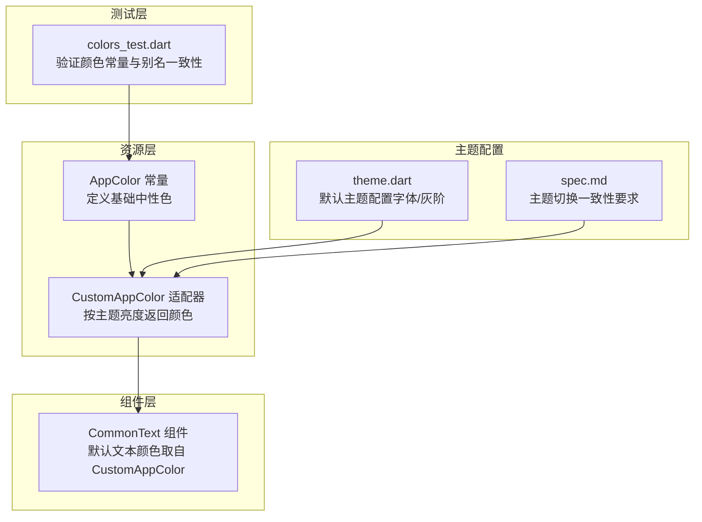
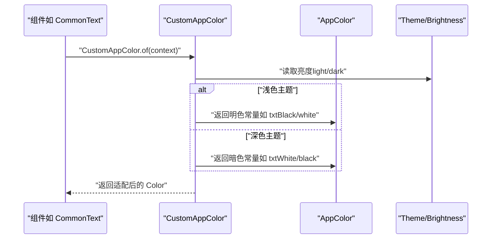
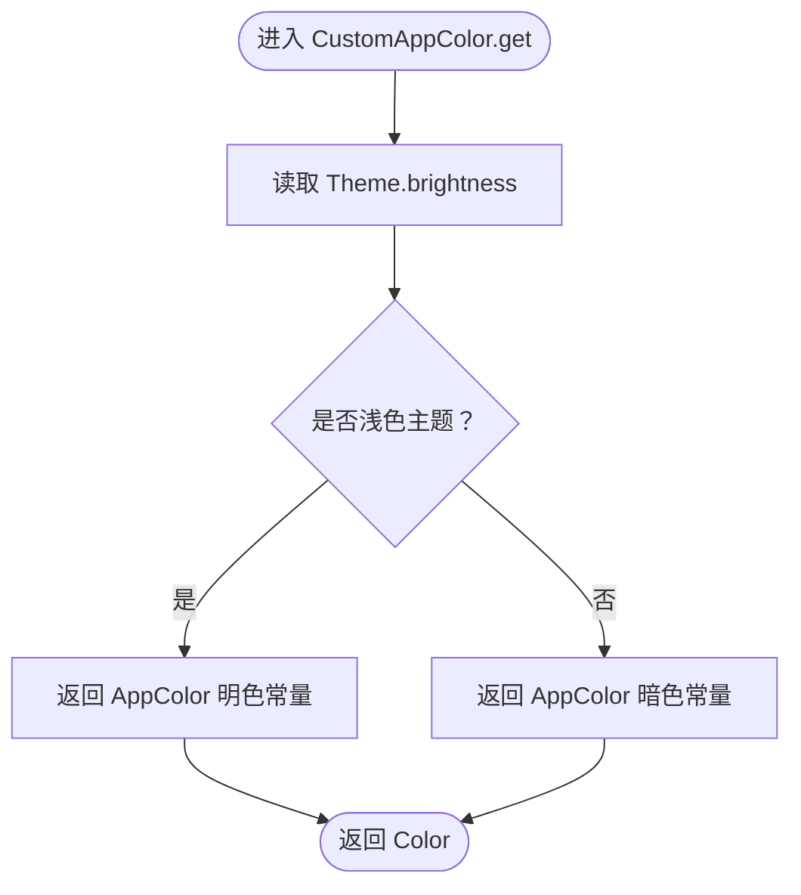
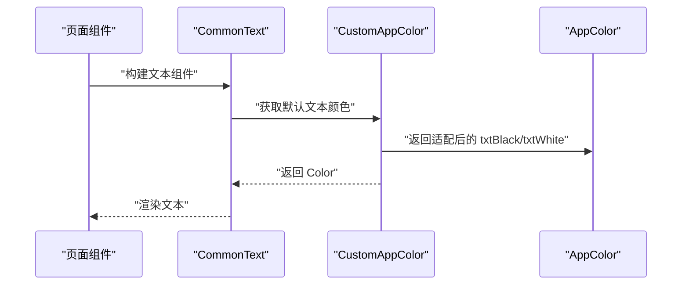
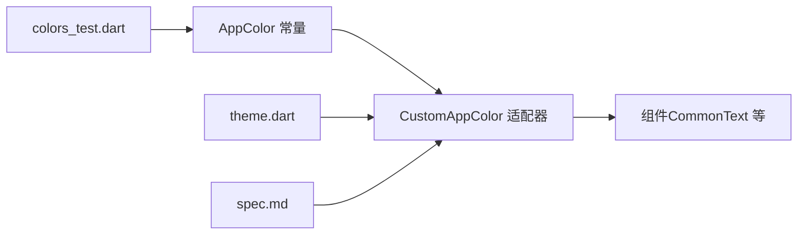

# 中性色规范

<cite>
**本文引用的文件**
- [colors.dart](file://lib/resources/colors.dart)
- [common_text.dart](file://lib/widgets/base/text/common_text.dart)
- [colors_test.dart](file://test/resources/colors_test.dart)
- [theme.dart](file://lib/resources/theme.dart)
- [spec.md](file://openspec/changes/update-brand-theme-amber/specs/app-theme/spec.md)
</cite>

## 目录
1. [引言](#引言)
2. [项目结构](#项目结构)
3. [核心组件](#核心组件)
4. [架构总览](#架构总览)
5. [详细组件分析](#详细组件分析)
6. [依赖关系分析](#依赖关系分析)
7. [性能考量](#性能考量)
8. [故障排查指南](#故障排查指南)
9. [结论](#结论)
10. [附录](#附录)

## 引言
本规范旨在统一并明确应用中的中性色系统，确保在浅色与深色主题之间具备一致的可读性与视觉体验。重点覆盖以下内容：
- 中性色常量定义与命名语义（如 txtBlack、txtWhite、txtGrey、hintGrey、black、white 等）
- 文本颜色在浅色主题显示黑色、深色主题显示白色的自动适配逻辑
- 使用 CustomAppColor.of(context) 获取适配后的颜色，禁止直接使用 Colors.black/white
- 不同背景下的文本颜色使用示例与可读性建议
- 所有中性色常量的十六进制值与其设计意图

## 项目结构
中性色系统主要由资源层的颜色定义与组件层的颜色消费构成：
- 资源层：集中定义 AppColor 常量与 CustomAppColor 适配器
- 组件层：通过 CustomAppColor.of(context) 获取适配后的颜色，保障主题切换一致性

**图表来源**
- [colors.dart](file://lib/resources/colors.dart#L1-L361)
- [common_text.dart](file://lib/widgets/base/text/common_text.dart#L1-L56)
- [colors_test.dart](file://test/resources/colors_test.dart#L1-L69)
- [theme.dart](file://lib/resources/theme.dart#L1-L316)
- [spec.md](file://openspec/changes/update-brand-theme-amber/specs/app-theme/spec.md#L21-L25)

**章节来源**
- [colors.dart](file://lib/resources/colors.dart#L1-L361)
- [common_text.dart](file://lib/widgets/base/text/common_text.dart#L1-L56)
- [colors_test.dart](file://test/resources/colors_test.dart#L1-L69)
- [theme.dart](file://lib/resources/theme.dart#L1-L316)
- [spec.md](file://openspec/changes/update-brand-theme-amber/specs/app-theme/spec.md#L21-L25)

## 核心组件
- AppColor：集中定义品牌与基础中性色常量，包含 txtBlack、txtWhite、txtGrey、hintGrey、black、white 等。
- CustomAppColor：基于当前主题亮度（浅色/深色）动态返回适配后的颜色，确保在深色模式下文本仍具备高可读性。
- CommonText：默认文本颜色取自 CustomAppColor.of(context).txtBlack，体现“文本颜色自动适配”的最佳实践。
- 测试 colors_test.dart：验证 AppColor 常量值与别名一致性，间接保障中性色体系的稳定性。

**章节来源**
- [colors.dart](file://lib/resources/colors.dart#L289-L361)
- [colors.dart](file://lib/resources/colors.dart#L1-L111)
- [common_text.dart](file://lib/widgets/base/text/common_text.dart#L36-L56)
- [colors_test.dart](file://test/resources/colors_test.dart#L1-L69)

## 架构总览
中性色系统的运行机制如下：
- 当组件需要文本颜色时，不直接使用 Colors.black/white，而是通过 CustomAppColor.of(context) 获取
- CustomAppColor 内部根据 Theme.of(context).brightness 判断当前主题亮度
- 在浅色主题下，返回 AppColor 中的明色（如 txtBlack、white），在深色主题下返回暗色（如 txtWhite、black）
- AppColor 提供统一的十六进制值与语义化命名，便于维护与扩展

**图表来源**
- [colors.dart](file://lib/resources/colors.dart#L1-L111)
- [common_text.dart](file://lib/widgets/base/text/common_text.dart#L36-L56)

**章节来源**
- [colors.dart](file://lib/resources/colors.dart#L1-L111)
- [common_text.dart](file://lib/widgets/base/text/common_text.dart#L36-L56)

## 详细组件分析

### 中性色常量与设计意图
以下为中性色常量的定义与用途说明（以 AppColor 中的常量为准）：
- txtBlack：主文本色，浅色主题显示深色，深色主题显示浅色，确保高对比度可读性
- txtWhite：反相文本色，浅色主题显示浅色，深色主题显示深色，用于深色背景上的文字
- txtGrey：辅助信息文本色，浅/深色主题均保持一致的中性灰度，适合弱化信息
- hintGrey：提示性文本色，用于占位符、说明文案等弱提示场景
- black：通用黑色，深色主题下仍保持可用性（例如图标、分割线）
- white：通用白色，浅色主题下保持可用性（例如卡片背景、输入框背景）

这些常量均以十六进制值在 AppColor 中定义，便于统一管理与版本演进。

**章节来源**
- [colors.dart](file://lib/resources/colors.dart#L289-L361)

### 自动适配逻辑（浅/深色主题）
- CustomAppColor 的 getter 会根据 Theme.of(context).brightness 返回不同的 AppColor 常量
- 关键适配点包括：
  - txtBlack ↔ txtWhite：浅色主题用 txtBlack，深色主题用 txtWhite
  - bgBlackWhiteScaffold：浅色主题用 white，深色主题用 black
  - white/black：在深色模式下仍保持可用性
- 这种设计确保在主题切换时，文本与背景始终维持足够的对比度

**图表来源**
- [colors.dart](file://lib/resources/colors.dart#L1-L111)

**章节来源**
- [colors.dart](file://lib/resources/colors.dart#L1-L111)

### 使用示例与可读性建议
- 默认文本：CommonText 默认使用 CustomAppColor.of(context).txtBlack，确保在浅/深色主题下均可读
- 表单与输入：在浅色背景上使用 txtBlack；在深色背景上使用 txtWhite
- 提示与弱化信息：使用 txtGrey 或 hintGrey，避免干扰主信息
- 分割线与边框：使用 black/white 或 borderGrey，确保层次清晰
- 禁止直接使用 Colors.black/white：必须通过 CustomAppColor.of(context) 获取适配后的颜色

**图表来源**
- [common_text.dart](file://lib/widgets/base/text/common_text.dart#L36-L56)
- [colors.dart](file://lib/resources/colors.dart#L1-L111)

**章节来源**
- [common_text.dart](file://lib/widgets/base/text/common_text.dart#L36-L56)
- [colors.dart](file://lib/resources/colors.dart#L1-L111)

### 常量表与十六进制值
以下为 AppColor 中与中性色相关的关键常量及其十六进制值（节选）：
- txtBlack：用于主文本，浅色主题显示深色，深色主题显示浅色
- txtWhite：用于深色背景上的文本
- txtGrey：用于辅助信息
- hintGrey：用于提示性文本
- black：通用黑色
- white：通用白色
- 其他基础中性色：grey、borderGrey、containerGrey、textFieldBorder、icGrey 等

注：以上值以 AppColor 常量定义为准，具体数值请参考源码文件。

**章节来源**
- [colors.dart](file://lib/resources/colors.dart#L289-L361)

### 与主题配置的关系
- theme.dart 定义了默认主题配置，其中包含大量灰阶与字体颜色映射，可作为中性色体系的补充参考
- spec.md 明确了主题切换时品牌色 token 的一致性要求，并强调在深色模式下需保证文字/背景对比度不低于浅色模式

**章节来源**
- [theme.dart](file://lib/resources/theme.dart#L1-L316)
- [spec.md](file://openspec/changes/update-brand-theme-amber/specs/app-theme/spec.md#L21-L25)

## 依赖关系分析
- 组件依赖 CustomAppColor：所有文本颜色消费均通过 CustomAppColor.of(context) 获取
- CustomAppColor 依赖 AppColor：适配逻辑最终返回 AppColor 常量
- 测试依赖 AppColor：colors_test.dart 验证常量值与别名一致性
- 主题配置影响适配结果：Theme.brightness 决定浅/深色分支

**图表来源**
- [colors.dart](file://lib/resources/colors.dart#L1-L361)
- [common_text.dart](file://lib/widgets/base/text/common_text.dart#L1-L56)
- [colors_test.dart](file://test/resources/colors_test.dart#L1-L69)
- [theme.dart](file://lib/resources/theme.dart#L1-L316)
- [spec.md](file://openspec/changes/update-brand-theme-amber/specs/app-theme/spec.md#L21-L25)

**章节来源**
- [colors.dart](file://lib/resources/colors.dart#L1-L361)
- [common_text.dart](file://lib/widgets/base/text/common_text.dart#L1-L56)
- [colors_test.dart](file://test/resources/colors_test.dart#L1-L69)
- [theme.dart](file://lib/resources/theme.dart#L1-L316)
- [spec.md](file://openspec/changes/update-brand-theme-amber/specs/app-theme/spec.md#L21-L25)

## 性能考量
- CustomAppColor 的适配逻辑仅在构建阶段读取 Theme.brightness 并返回常量，开销极低
- 建议在组件内部缓存 CustomAppColor 实例，避免重复创建
- 大量文本组件共享同一颜色常量，减少颜色对象分配

[本节为通用指导，无需特定文件引用]

## 故障排查指南
- 症状：深色模式下文字不可读
  - 排查：确认是否通过 CustomAppColor.of(context) 获取颜色，而非直接使用 Colors.black/white
  - 参考：适配逻辑与常量定义
- 症状：颜色值与预期不符
  - 排查：检查 AppColor 常量值与测试用例
  - 参考：colors_test.dart 对常量值的断言
- 症状：主题切换后颜色未变化
  - 排查：确认组件在 rebuild 时重新调用 CustomAppColor.of(context)，且上下文有效

**章节来源**
- [colors.dart](file://lib/resources/colors.dart#L1-L111)
- [colors_test.dart](file://test/resources/colors_test.dart#L1-L69)

## 结论
通过 CustomAppColor 的主题适配与 AppColor 的统一常量定义，应用实现了在浅/深色主题下的一致可读性与可维护性。遵循“禁止直接使用 Colors.black/white，必须通过 CustomAppColor.of(context) 获取”的规范，可有效避免主题切换带来的视觉问题，提升用户体验与开发效率。

[本节为总结，无需特定文件引用]

## 附录
- 快速对照
  - 主文本：CustomAppColor.of(context).txtBlack
  - 反相文本：CustomAppColor.of(context).txtWhite
  - 辅助信息：CustomAppColor.of(context).txtGrey
  - 提示文本：CustomAppColor.of(context).hintText
  - 通用黑/白：CustomAppColor.of(context).black / CustomAppColor.of(context).white
- 设计原则
  - 以语义化命名替代硬编码颜色
  - 保证在深色模式下的高对比度可读性
  - 通过测试与规范约束颜色常量的稳定性

[本节为补充说明，无需特定文件引用]