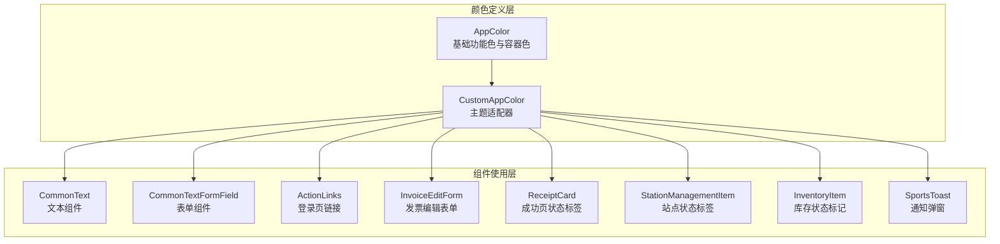
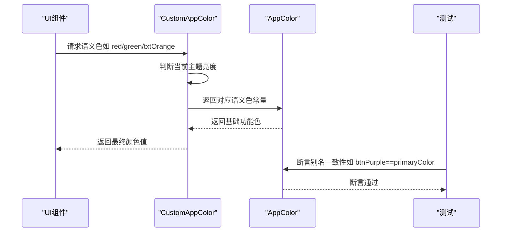
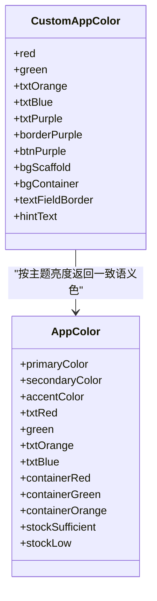
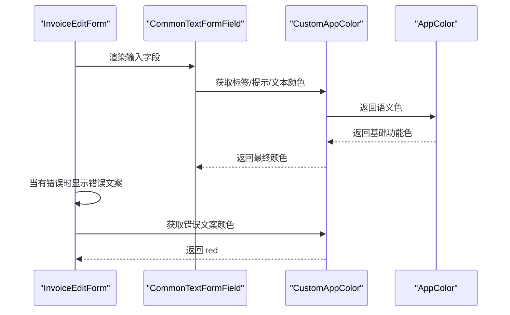
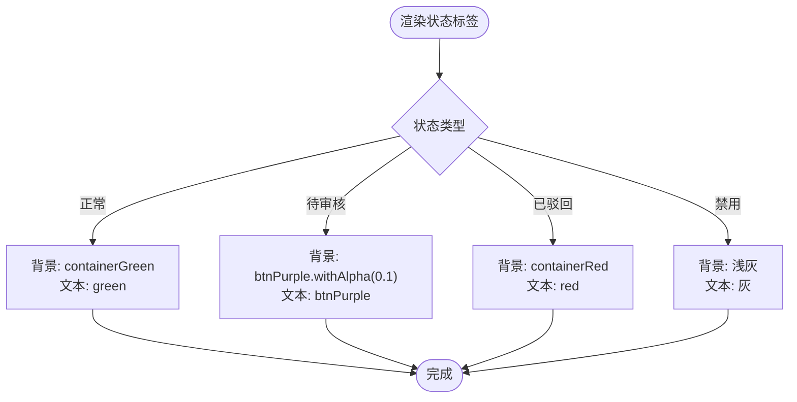
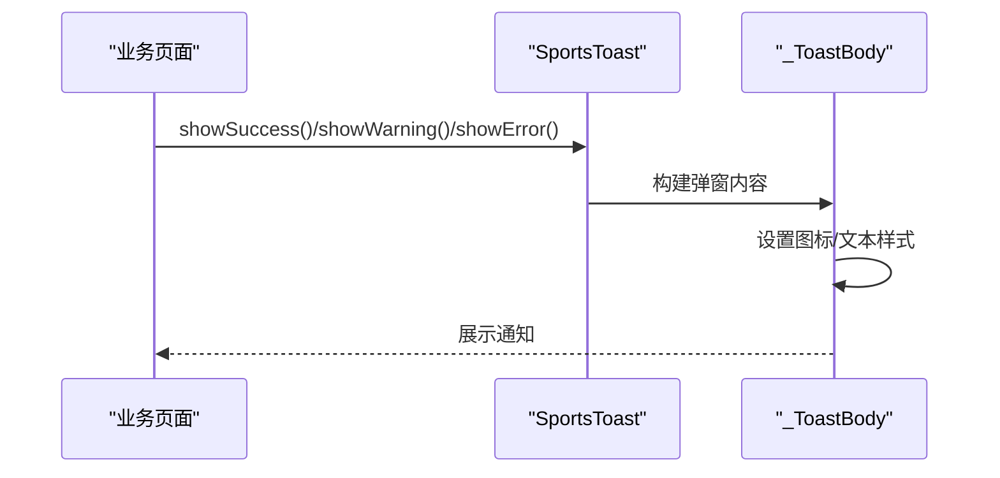
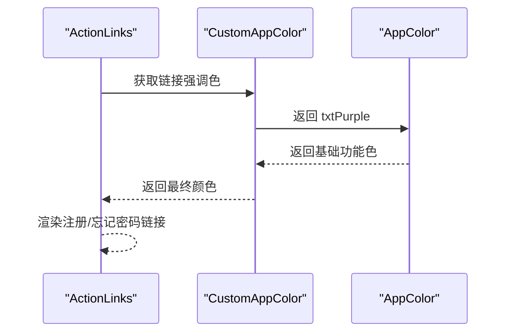
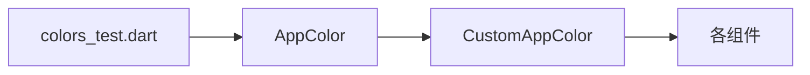

# 功能色规范

<cite>
**本文引用的文件**
- [colors.dart](file://lib/resources/colors.dart)
- [theme.dart](file://lib/resources/theme.dart)
- [common_text.dart](file://lib/widgets/base/text/common_text.dart)
- [common_textformfield.dart](file://lib/widgets/base/textfield/common_textformfield.dart)
- [action_links.dart](file://lib/pages/login/widgets/action_links.dart)
- [invoice_edit_form.dart](file://lib/pages/invoice_edit/widgets/invoice_edit_form.dart)
- [receipt_card.dart](file://lib/pages/oil_pickup_success/widgets/receipt_card.dart)
- [station_management_item.dart](file://lib/pages/station_management_list/widgets/station_management_item.dart)
- [inventory_item.dart](file://lib/pages/oil_pickup/widgets/inventory_item.dart)
- [toast.dart](file://lib/widgets/popup/toast.dart)
- [colors_test.dart](file://test/resources/colors_test.dart)
- [payment_success.html](file://assets/html/payment_success.html)
</cite>

## 目录
1. [简介](#简介)
2. [项目结构](#项目结构)
3. [核心组件](#核心组件)
4. [架构总览](#架构总览)
5. [详细组件分析](#详细组件分析)
6. [依赖关系分析](#依赖关系分析)
7. [性能考量](#性能考量)
8. [故障排查指南](#故障排查指南)
9. [结论](#结论)
10. [附录](#附录)

## 简介
本规范旨在统一应用中的功能性颜色系统，明确错误提示、成功状态、警告信息、链接文本等场景下的颜色定义与使用边界，并确保在浅色/深色主题切换下仍能保持语义一致，避免信息传达错误。本文聚焦以下功能色：
- 错误：txtRed（#FF4141）
- 成功：green（#2AB126）
- 警告：txtOrange（#FF9B00）
- 状态指示：txtBlue（#383EAF）

同时，结合表单验证、状态标签、通知消息等典型场景，给出可落地的使用建议与示例路径，帮助开发者在不同页面与组件中正确应用功能色。

## 项目结构
功能色体系由“语义化颜色定义 + 主题适配 + 组件使用”三层构成：
- 语义化颜色定义：集中于颜色资源文件，提供基础功能色与容器色。
- 主题适配：通过颜色适配器在浅色/深色主题间映射到一致的语义值。
- 组件使用：在表单、文本、标签、通知等组件中按规范引用颜色。

图表来源
- [colors.dart](file://lib/resources/colors.dart#L289-L361)
- [common_text.dart](file://lib/widgets/base/text/common_text.dart#L1-L56)
- [common_textformfield.dart](file://lib/widgets/base/textfield/common_textformfield.dart#L1-L361)
- [action_links.dart](file://lib/pages/login/widgets/action_links.dart#L1-L60)
- [invoice_edit_form.dart](file://lib/pages/invoice_edit/widgets/invoice_edit_form.dart#L245-L287)
- [receipt_card.dart](file://lib/pages/oil_pickup_success/widgets/receipt_card.dart#L149-L169)
- [station_management_item.dart](file://lib/pages/station_management_list/widgets/station_management_item.dart#L112-L156)
- [inventory_item.dart](file://lib/pages/oil_pickup/widgets/inventory_item.dart#L182-L250)
- [toast.dart](file://lib/widgets/popup/toast.dart#L1-L264)

章节来源
- [colors.dart](file://lib/resources/colors.dart#L289-L361)
- [theme.dart](file://lib/resources/theme.dart#L1-L316)

## 核心组件
- AppColor：集中定义基础功能色与容器色，包括 txtRed、green、txtOrange、txtBlue、red、orange、containerRed、containerGreen、containerOrange 等。
- CustomAppColor：根据当前主题亮度返回一致的语义颜色值，保证浅色/深色主题下语义不变。
- 通用文本组件 CommonText：默认文本颜色来自主题适配器，支持覆盖。
- 表单组件 CommonTextFormField：焦点态、标签态、错误态的颜色均来自主题适配器或 AppColor 的语义色。
- 登录页链接 ActionLinks：使用 AppColor.txtPurple 作为强调链接色。
- 发票编辑表单 InvoiceEditForm：错误文案使用 CustomAppColor.of(context).red。
- 成功页状态标签 ReceiptCard：使用 CustomAppColor.of(context).txtPurple 与 btnPurple 边框。
- 站点管理状态标签 StationManagementItem：使用主题适配器与固定色值组合表达状态。
- 库存状态标记 InventoryItem：使用 AppColor.stockSufficient 与 AppColor.stockLow。
- 通知弹窗 SportsToast：内置 success/warning/error 类型图标与文本颜色。

章节来源
- [colors.dart](file://lib/resources/colors.dart#L289-L361)
- [common_text.dart](file://lib/widgets/base/text/common_text.dart#L1-L56)
- [common_textformfield.dart](file://lib/widgets/base/textfield/common_textformfield.dart#L1-L361)
- [action_links.dart](file://lib/pages/login/widgets/action_links.dart#L1-L60)
- [invoice_edit_form.dart](file://lib/pages/invoice_edit/widgets/invoice_edit_form.dart#L245-L287)
- [receipt_card.dart](file://lib/pages/oil_pickup_success/widgets/receipt_card.dart#L149-L169)
- [station_management_item.dart](file://lib/pages/station_management_list/widgets/station_management_item.dart#L112-L156)
- [inventory_item.dart](file://lib/pages/oil_pickup/widgets/inventory_item.dart#L182-L250)
- [toast.dart](file://lib/widgets/popup/toast.dart#L1-L264)

## 架构总览
功能色在系统中的流转如下：
- 定义层：AppColor 提供语义化颜色常量。
- 适配层：CustomAppColor 在浅色/深色主题下返回一致的语义值，确保错误、成功、警告等颜色在不同主题下仍传达相同语义。
- 使用层：各组件通过 CustomAppColor 或 AppColor 的语义色引用颜色，避免硬编码色值。

图表来源
- [colors.dart](file://lib/resources/colors.dart#L1-L288)
- [colors_test.dart](file://test/resources/colors_test.dart#L35-L68)

章节来源
- [colors.dart](file://lib/resources/colors.dart#L1-L288)
- [colors_test.dart](file://test/resources/colors_test.dart#L35-L68)

## 详细组件分析

### 功能色定义与语义
- 错误：txtRed（#FF4141），容器背景 containerRed（#FF2762）；用于错误提示、失败状态、错误文案背景。
- 成功：green（#2AB126），容器背景 containerGreen（#CAFFCA）；用于成功状态、完成提示。
- 警告：txtOrange（#FF9B00），容器背景 containerOrange（#FFC0BE）；用于警告提示、风险提醒。
- 状态指示：txtBlue（#383EAF）；用于状态标签、辅助信息、强调链接等。

图表来源
- [colors.dart](file://lib/resources/colors.dart#L289-L361)
- [colors.dart](file://lib/resources/colors.dart#L1-L288)

章节来源
- [colors.dart](file://lib/resources/colors.dart#L289-L361)

### 表单验证与错误提示
- 错误文案颜色：在发票编辑表单中，当存在错误时，错误文案使用 CustomAppColor.of(context).red，确保在浅/深色主题下均传达错误语义。
- 输入框边框与标签：焦点态边框使用 CustomAppColor.of(context).borderPurple；错误态边框使用固定红色（便于对比）。
- 文本颜色：表单文本默认使用 CustomAppColor.of(context).txtBlack，确保在浅/深色主题下可读性一致。

图表来源
- [invoice_edit_form.dart](file://lib/pages/invoice_edit/widgets/invoice_edit_form.dart#L245-L287)
- [common_textformfield.dart](file://lib/widgets/base/textfield/common_textformfield.dart#L1-L361)
- [colors.dart](file://lib/resources/colors.dart#L1-L288)

章节来源
- [invoice_edit_form.dart](file://lib/pages/invoice_edit/widgets/invoice_edit_form.dart#L245-L287)
- [common_textformfield.dart](file://lib/widgets/base/textfield/common_textformfield.dart#L1-L361)
- [colors.dart](file://lib/resources/colors.dart#L1-L288)

### 状态标签与库存状态
- 成功/警告/错误状态标签：使用 AppColor.containerGreen/containerOrange/containerRed 与对应文本色，确保在浅/深色主题下语义一致。
- 站点管理状态标签：根据状态动态选择背景与文本色，使用主题适配器与固定色值组合，保证可读性与一致性。
- 库存状态标记：使用 AppColor.stockSufficient（#10B981）与 AppColor.stockLow（#F59E0B）进行视觉区分。

图表来源
- [station_management_item.dart](file://lib/pages/station_management_list/widgets/station_management_item.dart#L112-L156)
- [inventory_item.dart](file://lib/pages/oil_pickup/widgets/inventory_item.dart#L182-L250)
- [colors.dart](file://lib/resources/colors.dart#L289-L361)

章节来源
- [station_management_item.dart](file://lib/pages/station_management_list/widgets/station_management_item.dart#L112-L156)
- [inventory_item.dart](file://lib/pages/oil_pickup/widgets/inventory_item.dart#L182-L250)
- [colors.dart](file://lib/resources/colors.dart#L289-L361)

### 通知消息与弹窗
- 成功/警告/错误通知：SportsToast 内置三类图标与文本颜色，文本默认使用 AppColor.txtGrey，确保在浅/深色主题下可读性一致。
- 自定义弹窗：可通过 backgroundColor、padding、decoration 等参数控制外观，但建议优先使用内置类型以保持语义一致性。

图表来源
- [toast.dart](file://lib/widgets/popup/toast.dart#L1-L264)

章节来源
- [toast.dart](file://lib/widgets/popup/toast.dart#L1-L264)

### 链接文本与交互
- 登录页链接：注册与忘记密码链接使用 AppColor.txtPurple 作为强调色，确保在浅/深色主题下均具备高对比度与可识别性。
- 通用文本组件：默认文本颜色来自 CustomAppColor.of(context).txtBlack，支持覆盖；链接文本建议使用语义化的强调色（如 txtPurple）。

图表来源
- [action_links.dart](file://lib/pages/login/widgets/action_links.dart#L1-L60)
- [colors.dart](file://lib/resources/colors.dart#L1-L288)

章节来源
- [action_links.dart](file://lib/pages/login/widgets/action_links.dart#L1-L60)
- [colors.dart](file://lib/resources/colors.dart#L1-L288)

### HTML 页面中的功能色示例
- 支付成功页面：金额使用绿色（#52c41a）进行强调，确保在网页端与移动端风格一致。
- 通知文案：使用浅灰/深灰文本，保证可读性。

章节来源
- [payment_success.html](file://assets/html/payment_success.html#L54-L124)

## 依赖关系分析
- AppColor 为所有功能色的唯一真实来源，CustomAppColor 仅负责主题适配与别名映射。
- 组件层通过 CustomAppColor 或 AppColor 的语义色引用颜色，避免直接硬编码色值。
- 测试层对别名一致性进行断言，确保 btnPurple、txtPurple、borderPurple、icPurple 等别名与语义色一致。

图表来源
- [colors.dart](file://lib/resources/colors.dart#L1-L288)
- [colors_test.dart](file://test/resources/colors_test.dart#L35-L68)

章节来源
- [colors.dart](file://lib/resources/colors.dart#L1-L288)
- [colors_test.dart](file://test/resources/colors_test.dart#L35-L68)

## 性能考量
- 颜色计算与主题切换：CustomAppColor 在每次访问时进行亮度判断与映射，建议在组件内部缓存常用颜色值，减少重复计算。
- 图标与阴影：通知弹窗使用阴影与图标，注意在低端设备上的渲染开销，必要时降低阴影强度或延迟加载。
- 字体与文本：文本颜色与字体大小在浅/深色主题下保持一致，避免频繁重绘。

## 故障排查指南
- 颜色不一致问题：检查是否直接使用了固定色值而非语义色；应通过 CustomAppColor.of(context).red/green/txtOrange/txtBlue 获取。
- 主题切换异常：确认 CustomAppColor 的主题亮度判断逻辑是否被覆盖；确保 AppColor 中的基础功能色未被修改。
- 表单错误态不明显：检查输入框边框与错误文案颜色是否与背景形成足够对比；必要时调整 alpha 值或使用容器色。
- 状态标签可读性差：检查状态标签的背景与文本色是否满足对比度要求；必要时调整容器色或文本色。

章节来源
- [colors.dart](file://lib/resources/colors.dart#L1-L288)
- [common_textformfield.dart](file://lib/widgets/base/textfield/common_textformfield.dart#L1-L361)
- [toast.dart](file://lib/widgets/popup/toast.dart#L1-L264)

## 结论
通过将功能色定义集中在 AppColor 并由 CustomAppColor 在浅/深色主题下提供一致的语义映射，可以有效避免主题切换导致的信息传达错误。在表单验证、状态标签、通知消息等场景中，遵循本文规范可显著提升界面一致性与可读性。建议在新增组件时优先使用语义色，避免硬编码色值，并在测试中持续验证别名一致性。

## 附录
- 功能色清单与使用建议
  - 错误：txtRed（#FF4141）、containerRed（#FF2762）；用于错误提示、失败状态、错误文案背景。
  - 成功：green（#2AB126）、containerGreen（#CAFFCA）；用于成功状态、完成提示。
  - 警告：txtOrange（#FF9B00）、containerOrange（#FFC0BE）；用于警告提示、风险提醒。
  - 状态指示：txtBlue（#383EAF）；用于状态标签、辅助信息、强调链接。
- 示例路径参考
  - 表单验证与错误提示：[invoice_edit_form.dart](file://lib/pages/invoice_edit/widgets/invoice_edit_form.dart#L245-L287)
  - 状态标签与库存状态：[station_management_item.dart](file://lib/pages/station_management_list/widgets/station_management_item.dart#L112-L156)、[inventory_item.dart](file://lib/pages/oil_pickup/widgets/inventory_item.dart#L182-L250)
  - 通知消息与弹窗：[toast.dart](file://lib/widgets/popup/toast.dart#L1-L264)
  - 链接文本：[action_links.dart](file://lib/pages/login/widgets/action_links.dart#L1-L60)
  - HTML 页面中的功能色：[payment_success.html](file://assets/html/payment_success.html#L54-L124)