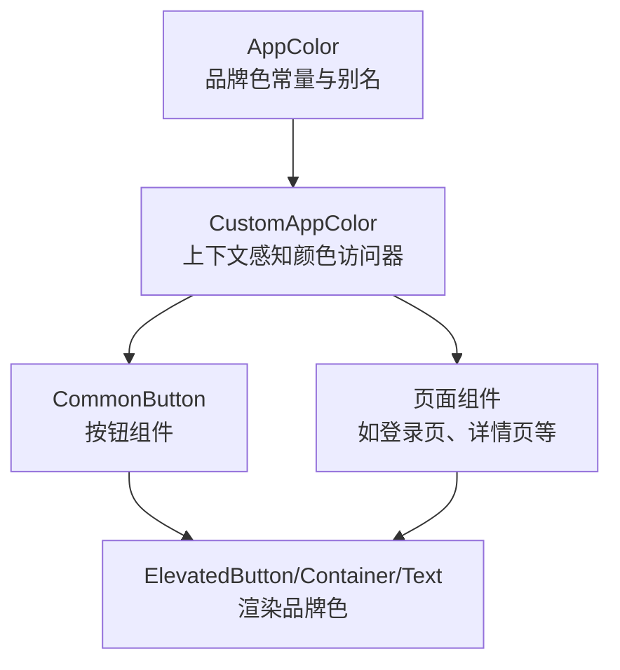
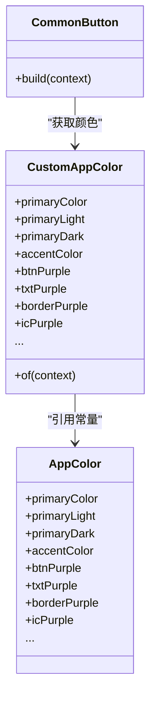
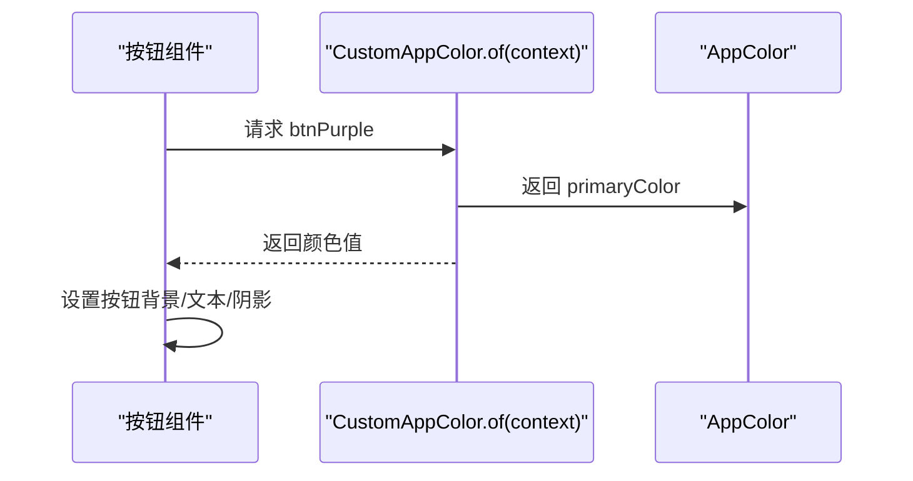
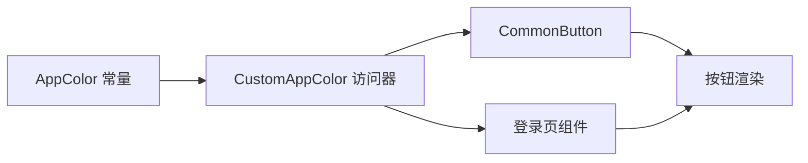

# 品牌色规范

<cite>
**本文引用的文件**
- [lib/resources/colors.dart](file://lib/resources/colors.dart)
- [lib/widgets/base/button/common_button.dart](file://lib/widgets/base/button/common_button.dart)
- [lib/pages/main_oil_pay/oil_purchase_detail/view.dart](file://lib/pages/main_oil_pay/oil_purchase_detail/view.dart)
- [lib/pages/login/widgets/action_links.dart](file://lib/pages/login/widgets/action_links.dart)
- [lib/pages/pending_review/pending_review_screen.dart](file://lib/pages/pending_review/pending_review_screen.dart)
- [lib/pages/oil_pickup_detail/widgets/smart_parse_card.dart](file://lib/pages/oil_pickup_detail/widgets/smart_parse_card.dart)
- [openspec/changes/update-brand-theme-amber/specs/app-theme/spec.md](file://openspec/changes/update-brand-theme-amber/specs/app-theme/spec.md)
- [openspec/changes/update-brand-theme-amber/proposal.md](file://openspec/changes/update-brand-theme-amber/proposal.md)
- [test/resources/colors_test.dart](file://test/resources/colors_test.dart)
</cite>

## 目录
1. [简介](#简介)
2. [项目结构](#项目结构)
3. [核心组件](#核心组件)
4. [架构总览](#架构总览)
5. [详细组件分析](#详细组件分析)
6. [依赖关系分析](#依赖关系分析)
7. [性能考量](#性能考量)
8. [故障排查指南](#故障排查指南)
9. [结论](#结论)
10. [附录](#附录)

## 简介
本规范旨在统一应用的品牌色系统，确保在浅色与深色主题下保持一致的品牌识别与可读性。核心品牌色包括：
- 主色：#D97706（深琥珀色），用于主按钮、选中态、主操作边框等关键交互
- 主色亮色：#F59E0B（明亮琥珀色），用于高亮、强调或次级强调
- 主色暗色：#B45309（深琥珀色），用于深色背景或强调层级
- 强调色：#F59E0B（Logo呼应色），用于图标、高亮文本等

同时，提供别名体系：btnPurple、txtPurple、borderPurple、icPurple，均指向主品牌色体系，确保设计一致性与维护成本最小化。所有颜色必须通过 CustomAppColor.of(context) 获取，严禁直接硬编码颜色值。

## 项目结构
品牌色系统由“常量定义 + 上下文感知的颜色访问器 + 组件使用”三部分组成：
- 常量定义：AppColor 中集中存放品牌色与语义化别名
- 访问器：CustomAppColor 封装基于主题亮度的上下文感知颜色选择逻辑
- 组件使用：各页面与组件通过 CustomAppColor.of(context) 或 AppColor 直接引用

图表来源
- [lib/resources/colors.dart](file://lib/resources/colors.dart#L1-L361)
- [lib/widgets/base/button/common_button.dart](file://lib/widgets/base/button/common_button.dart#L1-L93)

章节来源
- [lib/resources/colors.dart](file://lib/resources/colors.dart#L1-L361)

## 核心组件
- AppColor：集中定义品牌色与别名，包含主色、主色变体、强调色及语义化容器色、文本色、图标色等。
- CustomAppColor：封装基于 Theme.of(context).brightness 的颜色选择逻辑，保证浅色/深色主题下的一致性与可读性。

章节来源
- [lib/resources/colors.dart](file://lib/resources/colors.dart#L1-L361)

## 架构总览
品牌色系统通过“常量层 -> 访问器层 -> 使用层”的分层设计实现：
- 常量层：AppColor 提供品牌色与别名，确保全局唯一
- 访问器层：CustomAppColor.of(context) 返回当前主题下的颜色值，屏蔽明暗差异
- 使用层：组件通过 CustomAppColor.of(context) 获取颜色，避免硬编码

图表来源
- [lib/resources/colors.dart](file://lib/resources/colors.dart#L1-L361)
- [lib/widgets/base/button/common_button.dart](file://lib/widgets/base/button/common_button.dart#L1-L93)

## 详细组件分析

### 品牌色定义与别名映射
- 主色与主色变体
  - primaryColor：#D97706（深琥珀色）
  - primaryLight：#F59E0B（明亮琥珀色）
  - primaryDark：#B45309（深琥珀色）
- 强调色
  - accentColor：#F59E0B（Logo呼应色）
- 别名映射
  - btnPurple → primaryColor
  - txtPurple → accentColor
  - borderPurple → primaryColor
  - icPurple → accentColor

章节来源
- [lib/resources/colors.dart](file://lib/resources/colors.dart#L289-L308)
- [test/resources/colors_test.dart](file://test/resources/colors_test.dart#L35-L68)

### 浅色/深色主题一致性
- CustomAppColor 基于 Theme.of(context).brightness 返回对应颜色，确保在浅色与深色主题下品牌色 token 保持一致
- 规格要求：浅/深主题切换时，#D97706、#FFFBEB、#F59E0B 作为品牌色 token 保持不变；深色模式需保证对比度与可读性

章节来源
- [lib/resources/colors.dart](file://lib/resources/colors.dart#L1-L120)
- [openspec/changes/update-brand-theme-amber/specs/app-theme/spec.md](file://openspec/changes/update-brand-theme-amber/specs/app-theme/spec.md#L21-L25)

### 在按钮中的应用
- 主按钮背景：使用 AppColor.btnPurple 或 CustomAppColor.of(context).btnPurple
- 文本颜色：建议使用浅色（如白），保证对比度
- 阴影：可使用 AppColor.btnPurple.withValues(alpha: 0.25) 实现品牌阴影效果
- 禁用态：使用 CustomAppColor.of(context).txtGrey

图表来源
- [lib/widgets/base/button/common_button.dart](file://lib/widgets/base/button/common_button.dart#L40-L93)
- [lib/resources/colors.dart](file://lib/resources/colors.dart#L197-L201)

章节来源
- [lib/widgets/base/button/common_button.dart](file://lib/widgets/base/button/common_button.dart#L40-L93)
- [lib/pages/main_oil_pay/oil_purchase_detail/view.dart](file://lib/pages/main_oil_pay/oil_purchase_detail/view.dart#L191-L216)

### 在文本与图标的使用
- 高亮文本：使用 AppColor.txtPurple 或 CustomAppColor.of(context).txtPurple
- 图标颜色：使用 AppColor.icPurple 或 CustomAppColor.of(context).icPurple
- 登录页“立即注册”链接采用 AppColor.txtPurple

章节来源
- [lib/pages/login/widgets/action_links.dart](file://lib/pages/login/widgets/action_links.dart#L35-L40)
- [lib/resources/colors.dart](file://lib/resources/colors.dart#L119-L123)
- [lib/resources/colors.dart](file://lib/resources/colors.dart#L215-L219)

### 在边框与容器中的使用
- 主边框：使用 AppColor.borderPurple 或 CustomAppColor.of(context).borderPurple
- 输入框边框：使用 CustomAppColor.of(context).textFieldBorder
- 选中态边框：使用 AppColor.btnPurple 或 CustomAppColor.of(context).btnPurple

章节来源
- [lib/pages/pending_review/pending_review_screen.dart](file://lib/pages/pending_review/pending_review_screen.dart#L342-L346)
- [lib/pages/oil_pickup_detail/widgets/smart_parse_card.dart](file://lib/pages/oil_pickup_detail/widgets/smart_parse_card.dart#L176-L191)
- [lib/resources/colors.dart](file://lib/resources/colors.dart#L173-L177)
- [lib/resources/colors.dart](file://lib/resources/colors.dart#L191-L195)

### 禁止硬编码颜色值
- 所有颜色必须通过 CustomAppColor.of(context) 或 AppColor 获取
- 测试用例验证别名一致性，防止误改导致品牌色不一致

章节来源
- [test/resources/colors_test.dart](file://test/resources/colors_test.dart#L35-L68)

## 依赖关系分析
- AppColor 为常量定义中心，被 CustomAppColor 与各组件引用
- CustomAppColor 依赖 Theme.of(context).brightness 实现主题感知
- 组件通过 CustomAppColor.of(context) 获取颜色，降低耦合与重复

图表来源
- [lib/resources/colors.dart](file://lib/resources/colors.dart#L1-L361)
- [lib/widgets/base/button/common_button.dart](file://lib/widgets/base/button/common_button.dart#L1-L93)
- [lib/pages/login/widgets/action_links.dart](file://lib/pages/login/widgets/action_links.dart#L1-L60)

## 性能考量
- 颜色计算为常量访问与简单分支判断，开销极低
- 建议在构建阶段复用颜色变量，减少重复查询
- 深色模式下的颜色切换仅影响返回值，不影响业务逻辑复杂度

## 故障排查指南
- 现象：深色模式下文字不可读
  - 排查：确认是否使用 CustomAppColor.of(context) 获取前景色，而非固定浅色
  - 参考：规格要求深色模式下需保证对比度与可读性
- 现象：按钮颜色与品牌色不一致
  - 排查：检查是否使用 AppColor.btnPurple 或 CustomAppColor.of(context).btnPurple
  - 参考：测试用例验证别名一致性
- 现象：边框颜色异常
  - 排查：确认使用 AppColor.borderPurple 或 CustomAppColor.of(context).borderPurple
  - 参考：组件中对边框与输入框边框的使用

章节来源
- [openspec/changes/update-brand-theme-amber/specs/app-theme/spec.md](file://openspec/changes/update-brand-theme-amber/specs/app-theme/spec.md#L21-L25)
- [test/resources/colors_test.dart](file://test/resources/colors_test.dart#L35-L68)

## 结论
通过 AppColor 与 CustomAppColor 的分层设计，品牌色系统实现了：
- 明确的品牌色 token 与别名映射
- 浅色/深色主题下的一致性与可读性保障
- 组件层统一的颜色获取方式，杜绝硬编码
建议在后续开发中严格遵循本规范，确保品牌视觉一致性与用户体验稳定性。

## 附录
- 品牌色 token 与使用场景对照
  - 主色：#D97706，用于主按钮、选中态、主操作边框
  - 主色亮色：#F59E0B，用于高亮、强调
  - 主色暗色：#B45309，用于深色背景或强调层级
  - 强调色：#F59E0B，用于图标、高亮文本
  - 别名：btnPurple → 主色；txtPurple → 强调色；borderPurple → 主色；icPurple → 强调色

章节来源
- [lib/resources/colors.dart](file://lib/resources/colors.dart#L289-L308)
- [openspec/changes/update-brand-theme-amber/specs/app-theme/spec.md](file://openspec/changes/update-brand-theme-amber/specs/app-theme/spec.md#L5-L20)