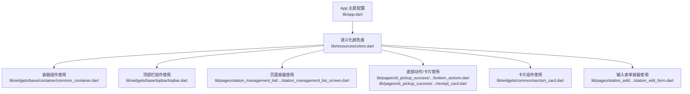
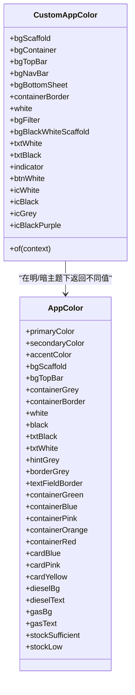
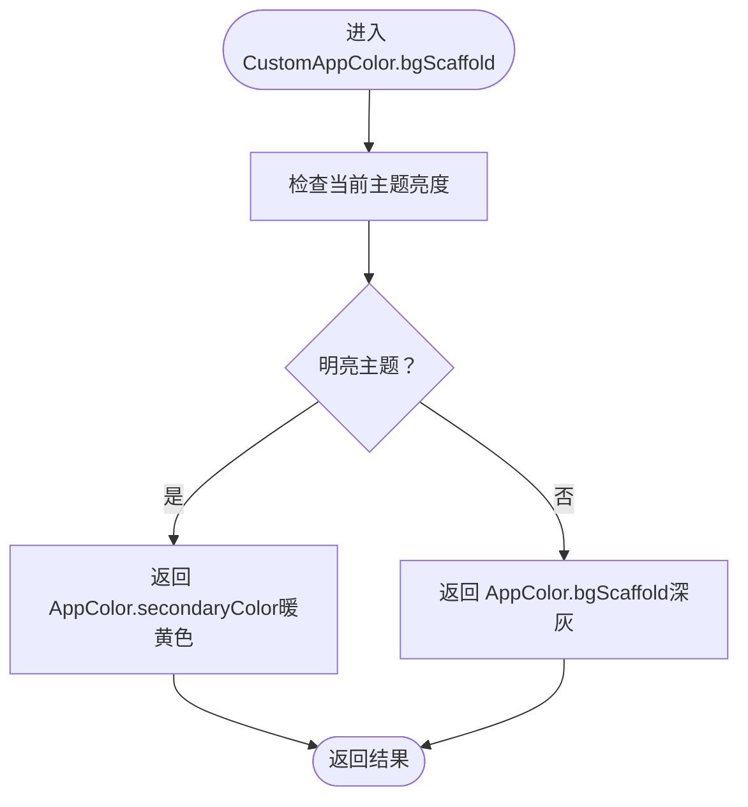
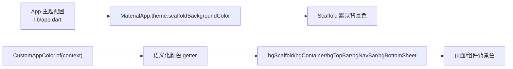

# 背景色规范

<cite>
**本文引用的文件列表**
- [lib/resources/colors.dart](file://lib/resources/colors.dart)
- [lib/app.dart](file://lib/app.dart)
- [lib/widgets/base/container/common_container.dart](file://lib/widgets/base/container/common_container.dart)
- [lib/widgets/base/topbar/topbar.dart](file://lib/widgets/base/topbar/topbar.dart)
- [lib/pages/station_management_list/widgets/station_management_list_screen.dart](file://lib/pages/station_management_list/widgets/station_management_list_screen.dart)
- [lib/pages/oil_pickup_success/widgets/bottom_actions.dart](file://lib/pages/oil_pickup_success/widgets/bottom_actions.dart)
- [lib/pages/oil_pickup_success/widgets/receipt_card.dart](file://lib/pages/oil_pickup_success/widgets/receipt_card.dart)
- [lib/widgets/common/section_card.dart](file://lib/widgets/common/section_card.dart)
- [lib/pages/main_oil_pay/widgets/depots_item.dart](file://lib/pages/main_oil_pay/widgets/depots_item.dart)
- [lib/pages/station_edit/widgets/station_edit_form.dart](file://lib/pages/station_edit/widgets/station_edit_form.dart)
- [openspec/changes/update-brand-theme-amber/proposal.md](file://openspec/changes/update-brand-theme-amber/proposal.md)
</cite>

## 目录
1. [引言](#引言)
2. [项目结构](#项目结构)
3. [核心组件](#核心组件)
4. [架构总览](#架构总览)
5. [详细组件分析](#详细组件分析)
6. [依赖关系分析](#依赖关系分析)
7. [性能考量](#性能考量)
8. [故障排查指南](#故障排查指南)
9. [结论](#结论)
10. [附录](#附录)

## 引言
本规范旨在统一应用的背景色体系，明确容器背景色的定义与使用场景，确保在浅色与深色主题下具备一致的视觉层次与可读性。重点覆盖以下语义化背景色：
- bgScaffold：页面级背景色（浅色主题为暖黄色，深色主题为深灰）
- bgContainer：卡片/容器背景色（浅色主题为白色，深色主题为深灰）
- bgTopBar：顶部栏背景色（浅色主题为浅灰白，深色主题为黑色）
- bgNavBar：导航栏背景色（浅色主题为白色，深色主题为黑色）
- bgBottomSheet：底部弹层背景色（浅色主题为白色，深色主题为白色）

同时，规范强调不得硬编码背景色值，必须通过 CustomAppColor.of(context) 获取；并给出背景色与边框色 containerBorder 的搭配原则，以保证界面层次清晰。

## 项目结构
背景色系统由“语义化颜色类 + 主题适配 + 组件使用”三部分构成：
- 语义化颜色类：定义语义化 getter，并根据明暗主题返回不同颜色值
- 主题适配：在明/暗主题下对 bgScaffold、bgContainer、bgTopBar、bgNavBar、bgBottomSheet 等进行差异化返回
- 组件使用：各页面与组件通过 CustomAppColor.of(context) 获取对应语义色，避免硬编码

图表来源
- [lib/app.dart](file://lib/app.dart#L46-L72)
- [lib/resources/colors.dart](file://lib/resources/colors.dart#L1-L287)
- [lib/widgets/base/container/common_container.dart](file://lib/widgets/base/container/common_container.dart#L22-L38)
- [lib/widgets/base/topbar/topbar.dart](file://lib/widgets/base/topbar/topbar.dart#L51-L72)
- [lib/pages/station_management_list/widgets/station_management_list_screen.dart](file://lib/pages/station_management_list/widgets/station_management_list_screen.dart#L42-L63)
- [lib/pages/oil_pickup_success/widgets/bottom_actions.dart](file://lib/pages/oil_pickup_success/widgets/bottom_actions.dart#L27-L65)
- [lib/pages/oil_pickup_success/widgets/receipt_card.dart](file://lib/pages/oil_pickup_success/widgets/receipt_card.dart#L51-L62)
- [lib/widgets/common/section_card.dart](file://lib/widgets/common/section_card.dart#L32-L45)
- [lib/pages/station_edit/widgets/station_edit_form.dart](file://lib/pages/station_edit/widgets/station_edit_form.dart#L267-L278)

章节来源
- [lib/resources/colors.dart](file://lib/resources/colors.dart#L1-L287)
- [lib/app.dart](file://lib/app.dart#L46-L72)

## 核心组件
- 语义化颜色类 CustomAppColor
  - 提供 bgScaffold、bgContainer、bgTopBar、bgNavBar、bgBottomSheet 等语义化 getter
  - 在明/暗主题下返回不同的颜色值，确保对比度与可读性
- AppColor 常量
  - 定义品牌主色、辅色、基础色、容器色、边框色等常量
  - 作为明/暗主题下的具体颜色值来源
- 组件使用
  - 通过 CustomAppColor.of(context) 获取语义色，避免硬编码
  - 在 Scaffold、卡片、输入框、顶部栏等处统一应用

章节来源
- [lib/resources/colors.dart](file://lib/resources/colors.dart#L1-L287)

## 架构总览
背景色系统遵循“语义化 + 主题适配”的设计模式：
- 明亮主题：优先使用浅色背景与高对比文本
- 深色主题：优先使用深色背景与低饱和边框，提升可读性
- 组件层：仅依赖语义化 getter，不关心具体颜色值

图表来源
- [lib/resources/colors.dart](file://lib/resources/colors.dart#L1-L287)

## 详细组件分析

### 背景色语义与适配逻辑
- bgScaffold
  - 明亮主题：使用 AppColor.secondaryColor（暖黄色）
  - 深色主题：使用 AppColor.bgScaffold（深灰）
- bgContainer
  - 明亮主题：使用 AppColor.white（白色）
  - 深色主题：使用 AppColor.containerGrey（深灰）
- bgTopBar
  - 明亮主题：使用 AppColor.bgTopBar（浅灰白）
  - 深色主题：使用 AppColor.black（黑色）
- bgNavBar
  - 明亮主题：使用 AppColor.white（白色）
  - 深色主题：使用 AppColor.black（黑色）
- bgBottomSheet
  - 明亮主题：使用 AppColor.white（白色）
  - 深色主题：使用 AppColor.white（白色）

图表来源
- [lib/resources/colors.dart](file://lib/resources/colors.dart#L16-L20)

章节来源
- [lib/resources/colors.dart](file://lib/resources/colors.dart#L16-L20)
- [lib/resources/colors.dart](file://lib/resources/colors.dart#L186-L189)
- [lib/resources/colors.dart](file://lib/resources/colors.dart#L245-L249)
- [lib/resources/colors.dart](file://lib/resources/colors.dart#L251-L255)
- [lib/resources/colors.dart](file://lib/resources/colors.dart#L269-L273)

### 在 Scaffold 中应用背景色
- 页面级背景色应统一使用语义化 bgScaffold
- 示例路径
  - [lib/widgets/base/container/common_container.dart](file://lib/widgets/base/container/common_container.dart#L22-L38)
  - [lib/pages/station_management_list/widgets/station_management_list_screen.dart](file://lib/pages/station_management_list/widgets/station_management_list_screen.dart#L42-L63)

章节来源
- [lib/widgets/base/container/common_container.dart](file://lib/widgets/base/container/common_container.dart#L22-L38)
- [lib/pages/station_management_list/widgets/station_management_list_screen.dart](file://lib/pages/station_management_list/widgets/station_management_list_screen.dart#L42-L63)

### 在卡片中应用背景色
- 卡片背景色使用语义化 bgContainer 或白色
- 示例路径
  - [lib/pages/oil_pickup_success/widgets/receipt_card.dart](file://lib/pages/oil_pickup_success/widgets/receipt_card.dart#L51-L62)
  - [lib/widgets/common/section_card.dart](file://lib/widgets/common/section_card.dart#L32-L45)
  - [lib/pages/main_oil_pay/widgets/depots_item.dart](file://lib/pages/main_oil_pay/widgets/depots_item.dart#L37-L52)

章节来源
- [lib/pages/oil_pickup_success/widgets/receipt_card.dart](file://lib/pages/oil_pickup_success/widgets/receipt_card.dart#L51-L62)
- [lib/widgets/common/section_card.dart](file://lib/widgets/common/section_card.dart#L32-L45)
- [lib/pages/main_oil_pay/widgets/depots_item.dart](file://lib/pages/main_oil_pay/widgets/depots_item.dart#L37-L52)

### 在输入框/表单容器中应用背景色
- 表单容器背景色使用语义化 bgContainer
- 示例路径
  - [lib/pages/station_edit/widgets/station_edit_form.dart](file://lib/pages/station_edit/widgets/station_edit_form.dart#L267-L278)

章节来源
- [lib/pages/station_edit/widgets/station_edit_form.dart](file://lib/pages/station_edit/widgets/station_edit_form.dart#L267-L278)

### 在顶部栏/导航栏中应用背景色
- 顶部栏背景色使用语义化 bgTopBar
- 导航栏背景色使用语义化 bgNavBar
- 示例路径
  - [lib/widgets/base/topbar/topbar.dart](file://lib/widgets/base/topbar/topbar.dart#L51-L72)
  - [lib/pages/station_management_list/widgets/station_management_list_screen.dart](file://lib/pages/station_management_list/widgets/station_management_list_screen.dart#L66-L80)

章节来源
- [lib/widgets/base/topbar/topbar.dart](file://lib/widgets/base/topbar/topbar.dart#L51-L72)
- [lib/pages/station_management_list/widgets/station_management_list_screen.dart](file://lib/pages/station_management_list/widgets/station_management_list_screen.dart#L66-L80)

### 在底部弹层中应用背景色
- 底部弹层背景色使用语义化 bgBottomSheet
- 示例路径
  - [lib/pages/oil_pickup_success/widgets/bottom_actions.dart](file://lib/pages/oil_pickup_success/widgets/bottom_actions.dart#L27-L65)

章节来源
- [lib/pages/oil_pickup_success/widgets/bottom_actions.dart](file://lib/pages/oil_pickup_success/widgets/bottom_actions.dart#L27-L65)

### 背景色与边框色 containerBorder 的搭配原则
- 背景色与边框色应保持对比度与层次感
- 明亮主题：containerBorder 使用浅色边框色，确保卡片与背景区分明显
- 深色主题：containerBorder 使用低饱和透明边框，避免过强对比
- 示例路径
  - [lib/resources/colors.dart](file://lib/resources/colors.dart#L179-L183)
  - [lib/pages/oil_pickup_success/widgets/bottom_actions.dart](file://lib/pages/oil_pickup_success/widgets/bottom_actions.dart#L60-L65)

章节来源
- [lib/resources/colors.dart](file://lib/resources/colors.dart#L179-L183)
- [lib/pages/oil_pickup_success/widgets/bottom_actions.dart](file://lib/pages/oil_pickup_success/widgets/bottom_actions.dart#L60-L65)

## 依赖关系分析
- App 主题配置
  - 在 MaterialApp.theme 中设置 scaffoldBackgroundColor 为白色，作为兜底背景色
  - 但页面级背景仍应通过语义化 bgScaffold 控制
- 语义化颜色类依赖
  - CustomAppColor.of(context) 依赖 Theme.of(context).brightness 进行明/暗主题判断
  - AppColor 提供明/暗主题下的具体颜色值

图表来源
- [lib/app.dart](file://lib/app.dart#L58-L65)
- [lib/resources/colors.dart](file://lib/resources/colors.dart#L16-L20)
- [lib/resources/colors.dart](file://lib/resources/colors.dart#L186-L189)
- [lib/resources/colors.dart](file://lib/resources/colors.dart#L245-L249)
- [lib/resources/colors.dart](file://lib/resources/colors.dart#L251-L255)
- [lib/resources/colors.dart](file://lib/resources/colors.dart#L269-L273)

章节来源
- [lib/app.dart](file://lib/app.dart#L58-L65)
- [lib/resources/colors.dart](file://lib/resources/colors.dart#L16-L20)
- [lib/resources/colors.dart](file://lib/resources/colors.dart#L186-L189)
- [lib/resources/colors.dart](file://lib/resources/colors.dart#L245-L249)
- [lib/resources/colors.dart](file://lib/resources/colors.dart#L251-L255)
- [lib/resources/colors.dart](file://lib/resources/colors.dart#L269-L273)

## 性能考量
- 使用语义化颜色 getter 可减少重复计算，提高渲染效率
- 避免在热路径中频繁创建 Color 对象，建议缓存 CustomAppColor 实例或复用已获取的颜色值
- 在深色主题下，尽量使用低饱和边框与柔和阴影，降低 GPU 渲染压力

## 故障排查指南
- 症状：页面背景色未随主题切换
  - 排查点：确认使用的是 CustomAppColor.of(context) 的语义化 getter，而非硬编码颜色值
  - 参考路径：[lib/resources/colors.dart](file://lib/resources/colors.dart#L16-L20)
- 症状：卡片与背景对比不足
  - 排查点：检查 bgContainer 与 containerBorder 的搭配是否合理
  - 参考路径：[lib/resources/colors.dart](file://lib/resources/colors.dart#L186-L189), [lib/resources/colors.dart](file://lib/resources/colors.dart#L179-L183)
- 症状：顶部栏/导航栏背景色异常
  - 排查点：确认使用 bgTopBar 或 bgNavBar，且未被外部样式覆盖
  - 参考路径：[lib/widgets/base/topbar/topbar.dart](file://lib/widgets/base/topbar/topbar.dart#L51-L72), [lib/pages/station_management_list/widgets/station_management_list_screen.dart](file://lib/pages/station_management_list/widgets/station_management_list_screen.dart#L66-L80)
- 症状：底部弹层背景色不一致
  - 排查点：确认使用 bgBottomSheet，避免直接使用白色导致与页面背景混淆
  - 参考路径：[lib/pages/oil_pickup_success/widgets/bottom_actions.dart](file://lib/pages/oil_pickup_success/widgets/bottom_actions.dart#L27-L65)

章节来源
- [lib/resources/colors.dart](file://lib/resources/colors.dart#L16-L20)
- [lib/resources/colors.dart](file://lib/resources/colors.dart#L179-L183)
- [lib/resources/colors.dart](file://lib/resources/colors.dart#L186-L189)
- [lib/widgets/base/topbar/topbar.dart](file://lib/widgets/base/topbar/topbar.dart#L51-L72)
- [lib/pages/station_management_list/widgets/station_management_list_screen.dart](file://lib/pages/station_management_list/widgets/station_management_list_screen.dart#L66-L80)
- [lib/pages/oil_pickup_success/widgets/bottom_actions.dart](file://lib/pages/oil_pickup_success/widgets/bottom_actions.dart#L27-L65)

## 结论
通过语义化背景色与明/暗主题适配，应用实现了统一、可维护的背景色体系。建议在所有页面与组件中坚持使用 CustomAppColor.of(context) 获取语义化颜色，避免硬编码颜色值；并遵循背景色与边框色的搭配原则，确保界面层次清晰、可读性强。

## 附录
- 影响范围与变更说明
  - 更新品牌主题（琥珀金）相关变更可能影响背景色与按钮色等，需同步更新组件使用
  - 参考路径：[openspec/changes/update-brand-theme-amber/proposal.md](file://openspec/changes/update-brand-theme-amber/proposal.md#L11-L14)

章节来源
- [openspec/changes/update-brand-theme-amber/proposal.md](file://openspec/changes/update-brand-theme-amber/proposal.md#L11-L14)