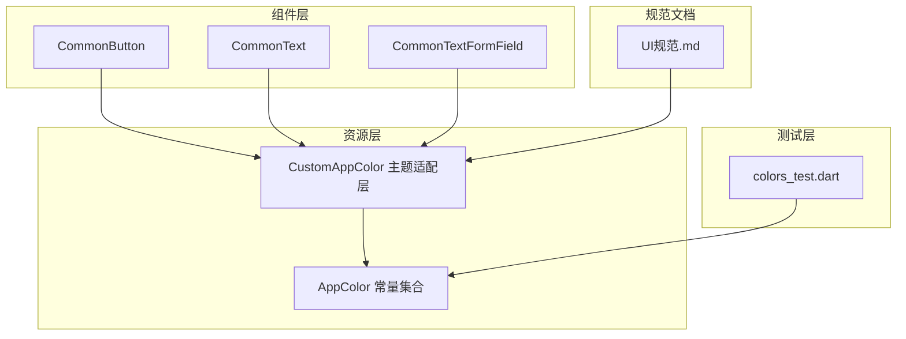
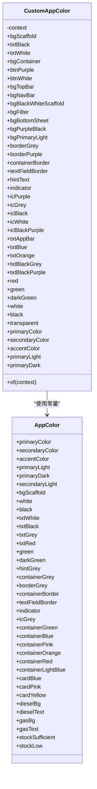
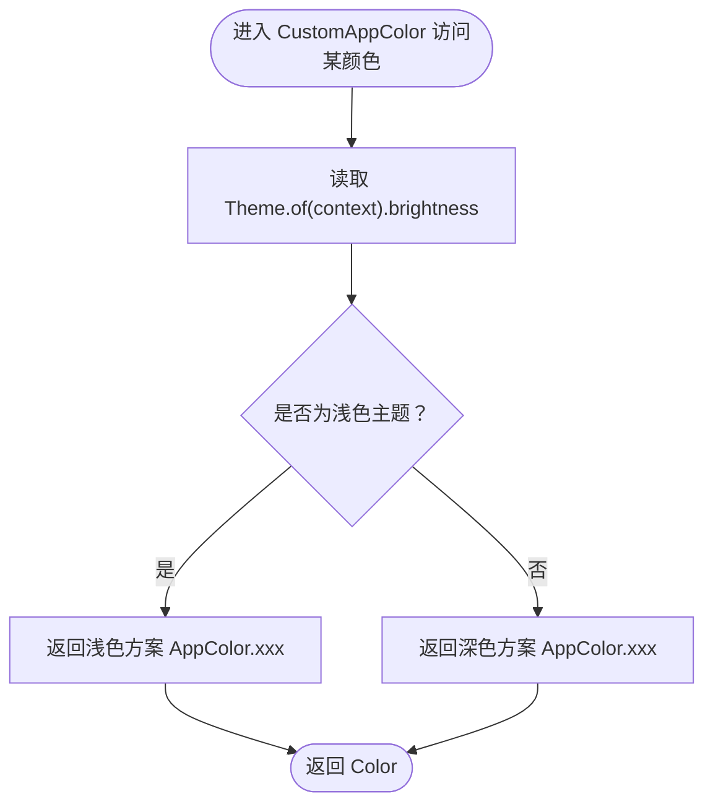
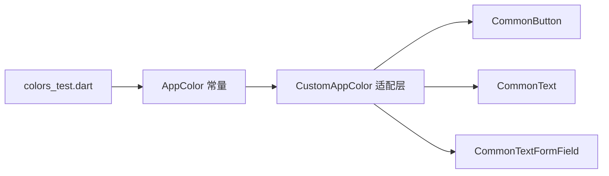

# 颜色规范

<cite>
**本文引用的文件**
- [colors.dart](file://lib/resources/colors.dart)
- [common_button.dart](file://lib/widgets/base/button/common_button.dart)
- [common_text.dart](file://lib/widgets/base/text/common_text.dart)
- [common_textformfield.dart](file://lib/widgets/base/textfield/common_textformfield.dart)
- [colors_test.dart](file://test/resources/colors_test.dart)
- [UI规范.md](file://UI_SPECIFICATION.md)
- [theme.dart](file://lib/resources/theme.dart)
</cite>

## 目录
1. [简介](#简介)
2. [项目结构](#项目结构)
3. [核心组件](#核心组件)
4. [架构总览](#架构总览)
5. [详细组件分析](#详细组件分析)
6. [依赖关系分析](#依赖关系分析)
7. [性能考量](#性能考量)
8. [故障排查指南](#故障排查指南)
9. [结论](#结论)
10. [附录](#附录)

## 简介
本文件系统化阐述应用的颜色体系，包括品牌色、中性色、功能色与背景色的定义与使用场景；重点说明 CustomAppColor 如何基于 Brightness.light/dark 实现主题自适应，尤其是 txtBlack/White、bgScaffold 等关键颜色的切换逻辑；并提供在按钮、文本、输入框等组件中的正确使用示例，强调禁止硬编码颜色值，必须通过 CustomAppColor.of(context) 获取颜色。最后列出所有颜色常量及其对应十六进制值与设计意图。

## 项目结构
颜色系统位于资源层，核心文件为 colors.dart，提供 AppColor 常量与 CustomAppColor 主题适配层；组件层通过 CustomAppColor.of(context) 获取颜色，确保在浅色/深色主题下自动切换。

图表来源
- [colors.dart](file://lib/resources/colors.dart#L1-L361)
- [common_button.dart](file://lib/widgets/base/button/common_button.dart#L1-L93)
- [common_text.dart](file://lib/widgets/base/text/common_text.dart#L1-L56)
- [common_textformfield.dart](file://lib/widgets/base/textfield/common_textformfield.dart#L1-L361)
- [colors_test.dart](file://test/resources/colors_test.dart#L1-L69)
- [UI规范.md](file://UI_SPECIFICATION.md#L93-L110)

章节来源
- [colors.dart](file://lib/resources/colors.dart#L1-L361)
- [UI规范.md](file://UI_SPECIFICATION.md#L93-L110)

## 核心组件
- AppColor：定义品牌色、中性色、功能色、容器色、卡片色、边框色等语义化常量，统一管理十六进制值。
- CustomAppColor：封装基于 Theme.of(context).brightness 的主题自适应逻辑，按需在浅色/深色主题间切换颜色值。
- 组件层：CommonButton、CommonText、CommonTextFormField 等通过 CustomAppColor.of(context) 获取颜色，保证主题一致性和可维护性。

章节来源
- [colors.dart](file://lib/resources/colors.dart#L289-L361)
- [colors.dart](file://lib/resources/colors.dart#L1-L288)
- [common_button.dart](file://lib/widgets/base/button/common_button.dart#L1-L93)
- [common_text.dart](file://lib/widgets/base/text/common_text.dart#L1-L56)
- [common_textformfield.dart](file://lib/widgets/base/textfield/common_textformfield.dart#L1-L361)

## 架构总览
CustomAppColor 作为颜色适配门面，依据当前主题亮度在浅色与深色之间切换关键颜色，其余颜色保持不变，从而实现“语义化颜色 + 主题自适应”的双层设计。

图表来源
- [colors.dart](file://lib/resources/colors.dart#L1-L361)

## 详细组件分析

### CustomAppColor 主题自适应机制
- 适配入口：CustomAppColor.of(context) 返回当前上下文的颜色适配实例。
- 切换逻辑：读取 Theme.of(context).brightness，若为 Brightness.light，则返回浅色方案；若为 Brightness.dark，则返回深色方案。
- 关键切换点：
  - 文本颜色：txtBlack 与 txtWhite 在浅/深主题间互换；txtBlackGrey、txtBlackPurple、txtAppBar 等按规则切换。
  - 背景颜色：bgScaffold、bgBlackWhiteScaffold、bgContainer、bgTopBar、bgNavBar、bgPurpleBlack 等在浅/深主题间切换。
  - 其他：containerBorder、textFieldBorder、indicator、icGrey、icBlack、icWhite、icBlackPurple 等在浅/深主题间切换或保持不变。

图表来源
- [colors.dart](file://lib/resources/colors.dart#L1-L288)

章节来源
- [colors.dart](file://lib/resources/colors.dart#L1-L288)

### AppColor 常量与设计意图
- 品牌色（primaryColor、secondaryColor、accentColor、primaryLight、primaryDark、secondaryLight）
  - primaryColor：深琥珀色，用于按钮、选中态、边框等强调元素。
  - secondaryColor：极浅黄色，用于背景。
  - accentColor：Logo呼应色，用于强调文本或图标。
  - primaryLight/primaryDark/secondaryLight：用于不同状态或层级的辅助强调。
- 中性色（txtBlack、txtWhite、txtGrey、hintGrey、containerGrey、white、black、transparent）
  - 文本主色：txtBlack（浅色主题黑，深色主题白），txtWhite（浅色主题白，深色主题黑）。
  - 辅助文本：txtGrey、hintGrey。
  - 容器背景：containerGrey（深色主题容器背景）。
  - 基础色：white、black、transparent。
- 功能色（txtRed、green、darkGreen、indicator、icGrey、icPurple、icBlack、icWhite、icBlackPurple）
  - 错误/提示：txtRed。
  - 成功/状态：green、darkGreen、indicator。
  - 图标：icGrey、icPurple、icBlack、icWhite、icBlackPurple。
- 背景色（bgScaffold、bgContainer、bgTopBar、bgNavBar、bgBlackWhiteScaffold、bgFilter、bgBottomSheet、bgPurpleBlack、bgPrimaryLight）
  - bgScaffold：页面主背景（浅色主题背景色，深色主题深灰）。
  - bgContainer：容器背景（浅色主题白色，深色主题深灰）。
  - bgTopBar/bgNavBar：顶部/底部导航背景。
  - bgBlackWhiteScaffold：黑白背景（浅色主题白，深色主题黑）。
  - bgFilter：筛选面板背景。
  - bgBottomSheet：底部弹窗背景。
  - bgPurpleBlack：浅色主题带透明度的紫色背景。
  - bgPrimaryLight：浅色主题淡主色背景，深色主题使用 bgScaffold。

章节来源
- [colors.dart](file://lib/resources/colors.dart#L289-L361)

### 组件中的颜色使用示例
- 按钮组件（CommonButton）
  - 背景色：默认使用 CustomAppColor.of(context).btnPurple。
  - 文字颜色：默认使用 CustomAppColor.of(context).white。
  - 边框/阴影：可使用 CustomAppColor.of(context).transparent 或其他边框色。
  - 示例参考：[common_button.dart](file://lib/widgets/base/button/common_button.dart#L1-L93)
- 文本组件（CommonText）
  - 文字颜色：默认使用 CustomAppColor.of(context).txtBlack。
  - 示例参考：[common_text.dart](file://lib/widgets/base/text/common_text.dart#L1-L56)
- 输入框组件（CommonTextFormField）
  - 文本颜色：CustomAppColor.of(context).txtBlack。
  - 占位符颜色：CustomAppColor.of(context).hintText。
  - 边框颜色：默认使用 CustomAppColor.of(context).borderGrey（聚焦态使用 CustomAppColor.of(context).borderPurple）。
  - 填充背景：CustomAppColor.of(context).bgScaffold 或自定义填充色。
  - 示例参考：[common_textformfield.dart](file://lib/widgets/base/textfield/common_textformfield.dart#L1-L361)

章节来源
- [common_button.dart](file://lib/widgets/base/button/common_button.dart#L1-L93)
- [common_text.dart](file://lib/widgets/base/text/common_text.dart#L1-L56)
- [common_textformfield.dart](file://lib/widgets/base/textfield/common_textformfield.dart#L1-L361)

### 颜色常量与十六进制值对照
以下为 AppColor 中定义的颜色常量与其十六进制值（节选，完整见文件）：

- 品牌色
  - primaryColor：#D97706
  - secondaryColor：#FFFFFBEB
  - accentColor：#F59E0B
  - primaryLight：#F59E0B
  - primaryDark：#B45309
  - secondaryLight：#FEF3C7
- 中性色
  - bgScaffold：#181A20
  - white：#FFFFFF
  - black：#000000
  - txtWhite：#FFFFFF
  - txtBlack：#000000
  - txtGrey：#9EA6BE
  - hintGrey：#AFB0B6
  - containerGrey：#1F222A
  - transparent：#00FFFFFF
- 功能色
  - txtRed：#FF4141
  - green：#2AB126
  - darkGreen：#128C7E
  - indicator：#FCD34D
  - icGrey：#EEEEEE
  - icPurple：#F59E0B
  - icBlack：#000000
  - icWhite：#FFFFFF
  - icBlackPurple：#000000
- 背景色
  - bgTopBar：#F9F9FB
  - bgContainer：#FFFFFF（浅色主题），#1F222A（深色主题）
  - bgBlackWhiteScaffold：#FFFFFF（浅色主题），#000000（深色主题）
  - bgFilter：#FFFFFF（浅色主题），#181A20（深色主题）
  - bgBottomSheet：#FFFFFF（浅色主题），#FFFFFF（深色主题）
  - bgPurpleBlack：#D97706（浅色主题透明度处理），#181A20（深色主题）
  - bgPrimaryLight：#D97706（浅色主题透明度处理），#181A20（深色主题）
- 边框与容器
  - borderGrey：#9EA6BE
  - containerBorder：#EEEEEE
  - textFieldBorder：#EEEEEE
- 容器与卡片
  - containerGreen：#CAFFCA
  - containerBlue：#C2F1FF
  - containerPink：#FFCDDB
  - containerOrange：#FFC0BE
  - containerRed：#FF2762
  - containerLightBlue：#65C5E3
  - cardBlue：#DFF7FC
  - cardPink：#FBE9F1
  - cardYellow：#FDF4E6
- 油品主题
  - dieselBg：#FEF3C7
  - dieselText：#B45309
  - gasBg：#FFF7ED
  - gasText：#F59E0B
- 库存状态
  - stockSufficient：#10B981
  - stockLow：#F59E0B

章节来源
- [colors.dart](file://lib/resources/colors.dart#L289-L361)

### 主题适配规则与使用规范
- 文本颜色适配
  - txtBlack：浅色主题显示黑色，深色主题显示白色。
  - txtWhite：浅色主题显示白色，深色主题显示黑色。
  - txtBlackGrey：浅色主题黑色，深色主题灰色。
  - txtBlackPurple：浅色主题黑色，深色主题紫色。
  - txtAppBar：浅色主题黑色，深色主题紫色。
- 背景颜色适配
  - bgScaffold：浅色主题背景色，深色主题深灰。
  - bgBlackWhiteScaffold：浅色主题白色，深色主题黑色。
  - bgContainer：浅色主题白色，深色主题深灰。
  - bgTopBar：浅色主题浅灰，深色主题黑色。
  - bgNavBar：浅色主题白色，深色主题黑色。
  - bgPurpleBlack：浅色主题淡紫色透明，深色主题深灰。
- 使用规范
  - 必须使用 CustomAppColor.of(context) 获取颜色，禁止直接硬编码十六进制值。
  - 组件内部颜色统一通过 CustomAppColor.of(context) 获取，确保主题一致。

章节来源
- [UI规范.md](file://UI_SPECIFICATION.md#L93-L110)

## 依赖关系分析
- 组件依赖 CustomAppColor：按钮、文本、输入框等组件均通过 CustomAppColor.of(context) 获取颜色，形成“语义化颜色 + 主题自适应”的解耦。
- CustomAppColor 依赖 AppColor：CustomAppColor 的 getter 仅在浅/深主题切换时改变返回值，其余颜色直接返回 AppColor 常量。
- 测试覆盖：colors_test.dart 对 AppColor 常量值进行断言，确保颜色值正确且别名映射一致。

图表来源
- [colors.dart](file://lib/resources/colors.dart#L1-L361)
- [common_button.dart](file://lib/widgets/base/button/common_button.dart#L1-L93)
- [common_text.dart](file://lib/widgets/base/text/common_text.dart#L1-L56)
- [common_textformfield.dart](file://lib/widgets/base/textfield/common_textformfield.dart#L1-L361)
- [colors_test.dart](file://test/resources/colors_test.dart#L1-L69)

章节来源
- [colors.dart](file://lib/resources/colors.dart#L1-L361)
- [colors_test.dart](file://test/resources/colors_test.dart#L1-L69)

## 性能考量
- 颜色计算为 O(1) 操作，Theme.of(context) 读取亮度亦为轻量级操作，整体开销可忽略。
- 建议在组件构建时缓存 CustomAppColor 实例（例如在 State 中保存），避免重复创建实例带来的微小成本。
- 避免在热路径中频繁创建 Color 对象，优先复用 CustomAppColor.of(context) 返回的颜色值。

## 故障排查指南
- 现象：颜色未随主题切换
  - 检查是否使用 CustomAppColor.of(context) 获取颜色，而非直接使用 AppColor 常量。
  - 确认 Theme.of(context).brightness 是否符合预期（浅色/深色）。
- 现象：颜色值不正确
  - 使用 colors_test.dart 中的断言用例验证 AppColor 常量值。
  - 若涉及别名一致性（如 btnPurple、txtPurple、borderPurple、icPurple），检查 AppColor 别名映射是否正确。
- 现象：组件颜色未生效
  - 检查组件是否传入了覆盖颜色参数（如按钮的 buttonColor、textColor，输入框的 fillColor、borderColor），这些参数会覆盖默认颜色。
  - 确认组件构建时上下文有效，且 CustomAppColor.of(context) 在 BuildContext 可用范围内调用。

章节来源
- [colors_test.dart](file://test/resources/colors_test.dart#L1-L69)
- [colors.dart](file://lib/resources/colors.dart#L1-L361)

## 结论
本颜色规范通过 AppColor 语义化常量与 CustomAppColor 主题自适应层，实现了清晰、可维护、跨主题一致的颜色体系。组件层统一通过 CustomAppColor.of(context) 获取颜色，杜绝硬编码，提升一致性与可扩展性。建议在新增颜色或调整主题策略时，遵循现有模式，确保测试覆盖与规范文档同步更新。

## 附录
- 主题切换与全局主题配置参考：[theme.dart](file://lib/resources/theme.dart#L1-L316)
- 页面布局与颜色使用示例参考：[UI规范.md](file://UI_SPECIFICATION.md#L787-L800)