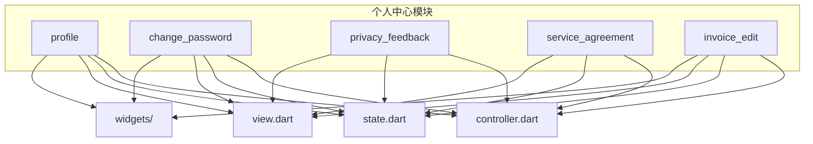
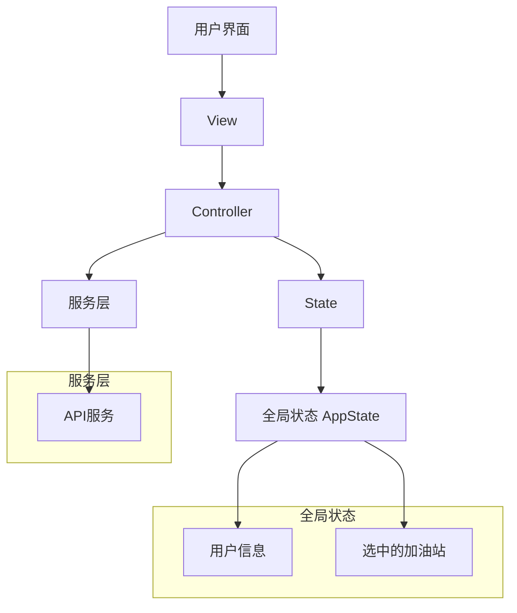
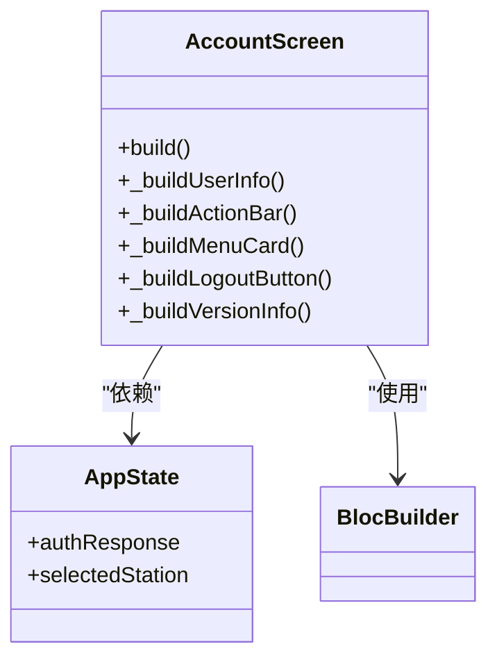
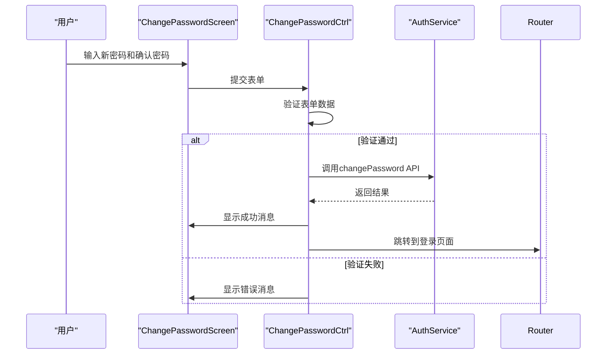
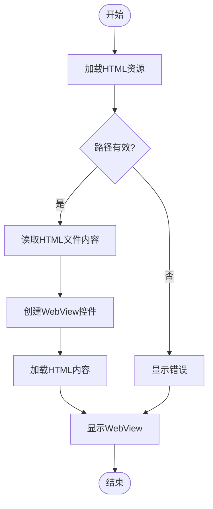
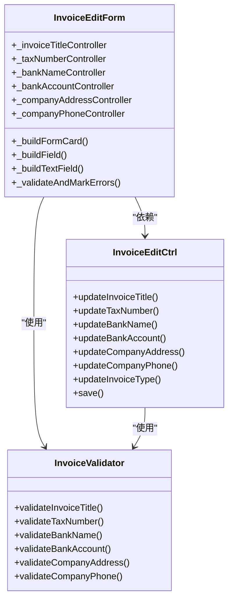
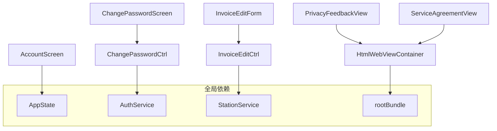

# 个人中心模块

<cite>
**本文档引用的文件**
- [account_screen.dart](file://lib/pages/profile/widgets/account_screen.dart)
- [change_password_screen.dart](file://lib/pages/change_password/widgets/change_password_screen.dart)
- [privacy_feedback.dart](file://lib/pages/privacy_feedback/view.dart)
- [service_agreement.dart](file://lib/pages/service_agreement/view.dart)
- [invoice_edit_form.dart](file://lib/pages/invoice_edit/widgets/invoice_edit_form.dart)
- [profile_controller.dart](file://lib/pages/profile/controller.dart)
- [change_password_controller.dart](file://lib/pages/change_password/controller.dart)
- [invoice_edit_controller.dart](file://lib/pages/invoice_edit/controller.dart)
- [app_state.dart](file://lib/global/app_state.dart)
- [html_webview_container.dart](file://lib/widgets/common/html_webview_container.dart)
- [html.dart](file://lib/static/html.dart)
- [privacy_policy.html](file://assets/html/privacy_policy.html)
- [service_agreement.html](file://assets/html/service_agreement.html)
- [invoice_validator.dart](file://lib/utils/invoice_validator.dart)
</cite>

## 目录
1. [简介](#简介)
2. [项目结构](#项目结构)
3. [核心组件](#核心组件)
4. [架构概述](#架构概述)
5. [详细组件分析](#详细组件分析)
6. [依赖分析](#依赖分析)
7. [性能考虑](#性能考虑)
8. [故障排除指南](#故障排除指南)
9. [结论](#结论)

## 简介
本文档详细记录了个人中心模块的各项功能实现，包括账户信息展示、密码修改、隐私反馈、服务协议和发票信息编辑。文档详细说明了profile页面的布局结构和数据绑定方式，描述了change_password_screen的密码强度验证规则和更新流程。解释了privacy_feedback和service_agreement如何通过HTML WebView容器加载外部内容，分析了invoice_edit_form的表单验证逻辑和关联加油站选择功能。提供了代码示例展示全局状态（AppState）如何在个人中心各页面间共享数据，并给出了UI一致性维护建议。为开发者提供了扩展点说明，如新增安全设置项或第三方账号绑定功能。

## 项目结构
个人中心模块主要包含以下几个核心页面和组件：
- profile：账户信息展示页面
- change_password：密码修改页面
- privacy_feedback：隐私政策页面
- service_agreement：服务协议页面
- invoice_edit：发票信息编辑页面

这些页面都位于`lib/pages`目录下，每个页面都遵循了MVC架构模式，包含controller、state、view和widgets子目录。

**图示来源**
- [account_screen.dart](file://lib/pages/profile/widgets/account_screen.dart)
- [change_password_screen.dart](file://lib/pages/change_password/widgets/change_password_screen.dart)
- [privacy_feedback.dart](file://lib/pages/privacy_feedback/view.dart)
- [service_agreement.dart](file://lib/pages/service_agreement/view.dart)
- [invoice_edit_form.dart](file://lib/pages/invoice_edit/widgets/invoice_edit_form.dart)

**章节来源**
- [account_screen.dart](file://lib/pages/profile/widgets/account_screen.dart)
- [change_password_screen.dart](file://lib/pages/change_password/widgets/change_password_screen.dart)
- [privacy_feedback.dart](file://lib/pages/privacy_feedback/view.dart)
- [service_agreement.dart](file://lib/pages/service_agreement/view.dart)
- [invoice_edit_form.dart](file://lib/pages/invoice_edit/widgets/invoice_edit_form.dart)

## 核心组件
个人中心模块的核心组件包括账户信息展示、密码修改、隐私政策、服务协议和发票信息编辑。这些组件通过全局状态管理器AppState共享数据，并使用统一的UI组件库保持界面一致性。

账户信息展示组件（AccountScreen）位于profile页面，负责展示用户的头像、姓名和手机号等基本信息。密码修改组件（ChangePasswordScreen）提供了一个表单界面，用于修改用户密码。隐私政策和服务协议组件使用HTML WebView容器加载外部HTML内容。发票信息编辑组件（InvoiceEditForm）提供了一个完整的表单，用于编辑和保存发票相关信息。

**章节来源**
- [account_screen.dart](file://lib/pages/profile/widgets/account_screen.dart)
- [change_password_screen.dart](file://lib/pages/change_password/widgets/change_password_screen.dart)
- [privacy_feedback.dart](file://lib/pages/privacy_feedback/view.dart)
- [service_agreement.dart](file://lib/pages/service_agreement/view.dart)
- [invoice_edit_form.dart](file://lib/pages/invoice_edit/widgets/invoice_edit_form.dart)

## 架构概述
个人中心模块采用了Flutter的BLoC模式进行状态管理，每个页面都有自己的Controller（BLoC）来管理状态和业务逻辑。全局状态通过AppState在不同页面间共享，确保了用户信息的一致性。

**图示来源**
- [app_state.dart](file://lib/global/app_state.dart)
- [profile_controller.dart](file://lib/pages/profile/controller.dart)
- [change_password_controller.dart](file://lib/pages/change_password/controller.dart)
- [invoice_edit_controller.dart](file://lib/pages/invoice_edit/controller.dart)

## 详细组件分析

### 账户信息展示分析
账户信息展示组件（AccountScreen）是个人中心的主页面，采用了Stack布局结构，包含紫色头部背景和可滚动的内容区域。用户信息通过BlocBuilder从AppState中获取并实时更新。

**图示来源**
- [account_screen.dart](file://lib/pages/profile/widgets/account_screen.dart)
- [app_state.dart](file://lib/global/app_state.dart)

**章节来源**
- [account_screen.dart](file://lib/pages/profile/widgets/account_screen.dart)

### 密码修改分析
密码修改组件（ChangePasswordScreen）使用FormBuilder实现表单验证，包含新密码和确认密码两个输入字段。密码强度验证规则为8-20位，必须包含字母和数字。

**图示来源**
- [change_password_screen.dart](file://lib/pages/change_password/widgets/change_password_screen.dart)
- [change_password_controller.dart](file://lib/pages/change_password/controller.dart)

**章节来源**
- [change_password_screen.dart](file://lib/pages/change_password/widgets/change_password_screen.dart)

### 隐私政策和服务协议分析
隐私政策和服务协议组件通过HtmlWebViewContainer加载本地HTML文件，实现了外部内容的内嵌显示。这种方式避免了网络请求，提高了加载速度和安全性。

**图示来源**
- [privacy_feedback.dart](file://lib/pages/privacy_feedback/view.dart)
- [service_agreement.dart](file://lib/pages/service_agreement/view.dart)
- [html_webview_container.dart](file://lib/widgets/common/html_webview_container.dart)
- [html.dart](file://lib/static/html.dart)

**章节来源**
- [privacy_feedback.dart](file://lib/pages/privacy_feedback/view.dart)
- [service_agreement.dart](file://lib/pages/service_agreement/view.dart)

### 发票信息编辑分析
发票信息编辑组件（InvoiceEditForm）实现了完整的表单验证逻辑，包括发票抬头、纳税人识别号等字段的验证。表单根据发票类型（普通增值税发票或专用增值税发票）动态显示必填字段。

**图示来源**
- [invoice_edit_form.dart](file://lib/pages/invoice_edit/widgets/invoice_edit_form.dart)
- [invoice_edit_controller.dart](file://lib/pages/invoice_edit/controller.dart)
- [invoice_validator.dart](file://lib/utils/invoice_validator.dart)

**章节来源**
- [invoice_edit_form.dart](file://lib/pages/invoice_edit/widgets/invoice_edit_form.dart)

## 依赖分析
个人中心模块的依赖关系清晰，各组件之间的耦合度较低。通过分析代码结构，可以发现主要的依赖关系如下：

**图示来源**
- [account_screen.dart](file://lib/pages/profile/widgets/account_screen.dart)
- [change_password_screen.dart](file://lib/pages/change_password/widgets/change_password_screen.dart)
- [privacy_feedback.dart](file://lib/pages/privacy_feedback/view.dart)
- [service_agreement.dart](file://lib/pages/service_agreement/view.dart)
- [invoice_edit_form.dart](file://lib/pages/invoice_edit/widgets/invoice_edit_form.dart)
- [change_password_controller.dart](file://lib/pages/change_password/controller.dart)
- [invoice_edit_controller.dart](file://lib/pages/invoice_edit/controller.dart)

**章节来源**
- [account_screen.dart](file://lib/pages/profile/widgets/account_screen.dart)
- [change_password_screen.dart](file://lib/pages/change_password/widgets/change_password_screen.dart)
- [privacy_feedback.dart](file://lib/pages/privacy_feedback/view.dart)
- [service_agreement.dart](file://lib/pages/service_agreement/view.dart)
- [invoice_edit_form.dart](file://lib/pages/invoice_edit/widgets/invoice_edit_form.dart)

## 性能考虑
个人中心模块在性能方面做了以下优化：
1. 使用BlocBuilder进行局部重建，避免不必要的UI重绘
2. 通过HtmlWebViewContainer预加载HTML内容，提高页面加载速度
3. 使用EasyRefresh实现下拉刷新，优化用户体验
4. 采用FormBuilder进行表单验证，减少手动验证的复杂性
5. 使用全局状态管理，避免重复的API调用

此外，代码中还使用了Future.delayed来模拟API调用延迟，这在开发阶段有助于测试加载状态和错误处理。

## 故障排除指南
在开发和维护个人中心模块时，可能会遇到以下常见问题：

1. **账户信息不更新**：检查AppState是否正确更新，确保BlocBuilder正确监听状态变化
2. **密码修改失败**：检查表单验证逻辑，确保新密码和确认密码一致
3. **HTML内容无法加载**：检查HTML文件路径是否正确，确保文件存在于assets目录下
4. **发票信息保存失败**：检查表单验证逻辑，确保所有必填字段都已填写
5. **WebView显示异常**：检查网络权限和WebView配置，确保可以正常加载内容

对于这些问题，建议使用Flutter DevTools进行调试，查看Widget树和状态变化，定位问题根源。

**章节来源**
- [account_screen.dart](file://lib/pages/profile/widgets/account_screen.dart)
- [change_password_screen.dart](file://lib/pages/change_password/widgets/change_password_screen.dart)
- [privacy_feedback.dart](file://lib/pages/privacy_feedback/view.dart)
- [service_agreement.dart](file://lib/pages/service_agreement/view.dart)
- [invoice_edit_form.dart](file://lib/pages/invoice_edit/widgets/invoice_edit_form.dart)

## 结论
个人中心模块是一个功能完整、结构清晰的Flutter应用模块。它采用了现代化的状态管理方案，通过BLoC模式实现了业务逻辑与UI的分离。模块中的各个组件都遵循了单一职责原则，具有良好的可维护性和可扩展性。

为开发者提供的扩展点包括：
1. 新增安全设置项：可以在profile页面添加新的菜单项，链接到新的安全设置页面
2. 第三方账号绑定：可以扩展AuthService支持第三方登录，如微信、支付宝等
3. 消息通知中心：可以添加消息中心功能，显示系统通知和重要消息
4. 个性化设置：可以添加主题切换、字体大小调整等个性化功能

这些扩展点都可以在现有架构基础上进行，保持代码的一致性和可维护性。