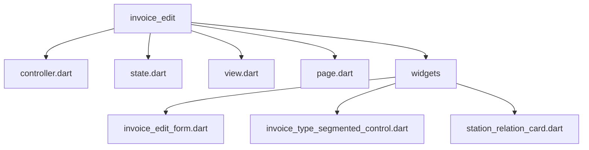
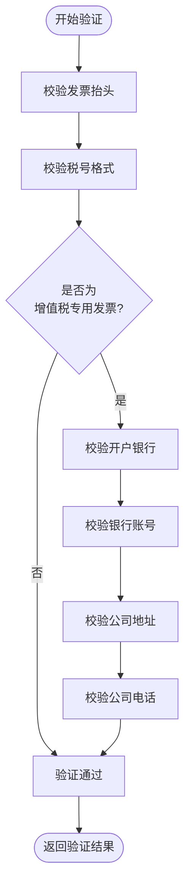
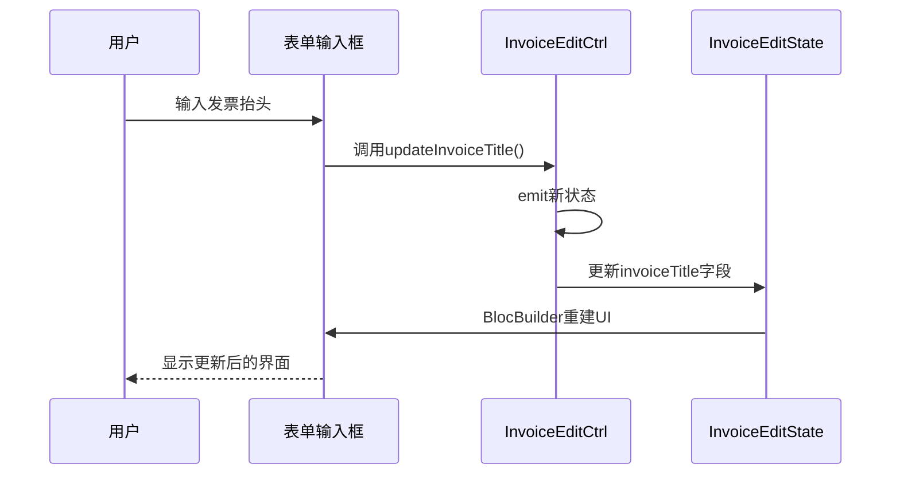
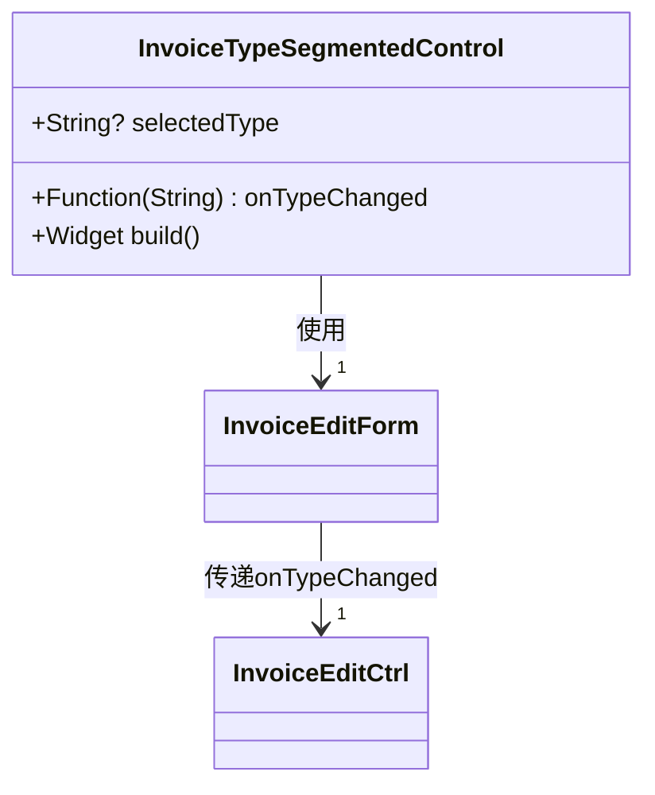
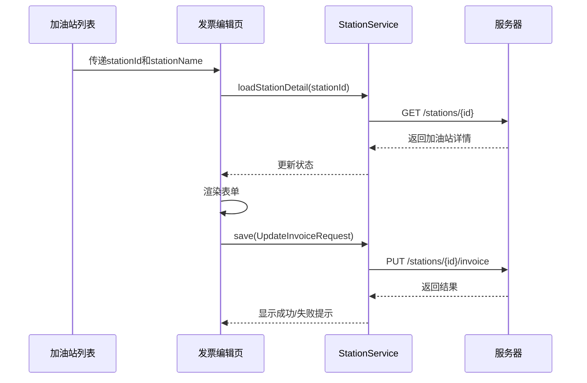
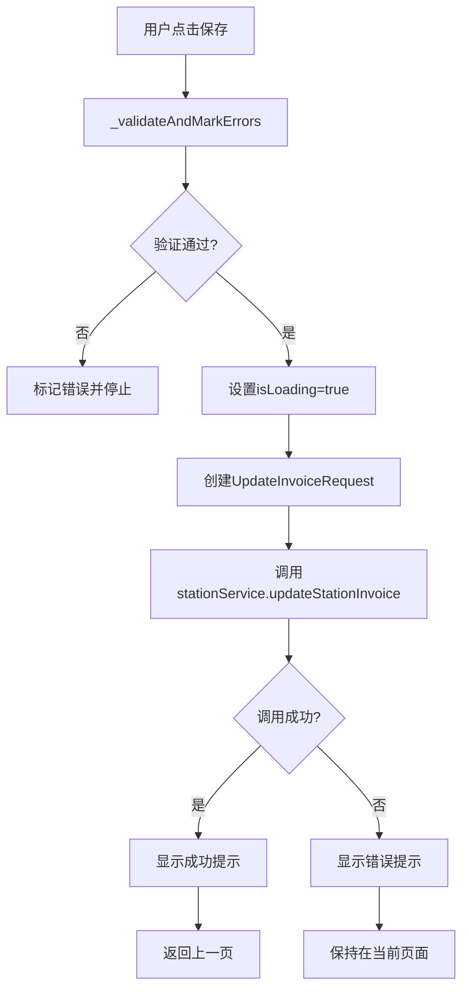
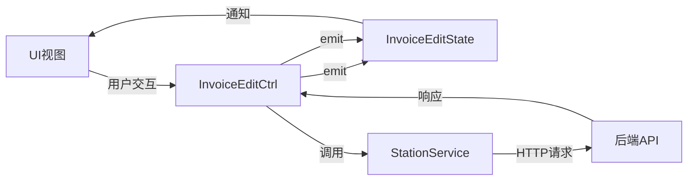

# 发票管理

<cite>
**本文档引用文件**  
- [invoice_edit_form.dart](file://lib/pages/invoice_edit/widgets/invoice_edit_form.dart)
- [invoice_type_segmented_control.dart](file://lib/pages/invoice_edit/widgets/invoice_type_segmented_control.dart)
- [station_relation_card.dart](file://lib/pages/invoice_edit/widgets/station_relation_card.dart)
- [controller.dart](file://lib/pages/invoice_edit/controller.dart)
- [state.dart](file://lib/pages/invoice_edit/state.dart)
- [invoice_validator.dart](file://lib/utils/invoice_validator.dart)
- [invoice_info.dart](file://lib/global/model/invoice_info.dart)
- [app_state.dart](file://lib/global/app_state.dart)
- [page.dart](file://lib/pages/invoice_edit/page.dart)
- [station_service.dart](file://lib/global/service/station_service.dart)
- [invoice_req_type.dart](file://lib/global/model/invoice_req_type.dart)
</cite>

## 目录
1. [项目结构](#项目结构)
2. [核心组件](#核心组件)
3. [表单验证逻辑](#表单验证逻辑)
4. [发票类型切换机制](#发票类型切换机制)
5. [加油站关联逻辑](#加油站关联逻辑)
6. [表单提交流程](#表单提交流程)
7. [状态管理与数据流](#状态管理与数据流)

## 项目结构

发票信息编辑功能位于 `lib/pages/invoice_edit` 目录下，采用典型的 Flutter 页面架构模式，包含控制器、状态、视图和页面入口四个核心文件，并通过独立的 widgets 组件实现 UI 模块化。



**Diagram sources**
- [controller.dart](file://lib/pages/invoice_edit/controller.dart)
- [state.dart](file://lib/pages/invoice_edit/state.dart)
- [view.dart](file://lib/pages/invoice_edit/view.dart)
- [page.dart](file://lib/pages/invoice_edit/page.dart)
- [invoice_edit_form.dart](file://lib/pages/invoice_edit/widgets/invoice_edit_form.dart)

## 核心组件

发票编辑功能由多个核心组件构成，采用 Bloc 模式进行状态管理。`InvoiceEditPage` 作为页面入口，通过 `InvoiceEditCtrl` 控制器管理状态变更，`InvoiceEditState` 存储表单数据和 UI 状态，`InvoiceEditView` 负责构建视图，最终由 `InvoiceEditForm` 实现具体的表单 UI。

**Section sources**
- [page.dart](file://lib/pages/invoice_edit/page.dart#L1-L38)
- [controller.dart](file://lib/pages/invoice_edit/controller.dart#L1-L226)
- [state.dart](file://lib/pages/invoice_edit/state.dart#L1-L90)
- [view.dart](file://lib/pages/invoice_edit/view.dart#L1-L19)

## 表单验证逻辑

### 多字段验证规则

发票表单实现了严格的多字段验证机制，通过 `invoice_validator.dart` 工具类集中管理所有校验规则：

- **发票抬头**：必填项，不能为空
- **税号**：15-20位字母数字组合，使用正则表达式 `^[A-Za-z0-9]{15,20}$` 进行校验
- **开户银行**：必填项（仅增值税专用发票）
- **银行账号**：纯数字格式，使用正则表达式 `^\d+$` 进行校验
- **公司地址**：必填项（仅增值税专用发票）
- **公司电话**：支持手机号（11位）或座机号（区号-号码格式），使用正则表达式 `^1[3-9]\d{9}$` 或 `^(\d{3,4}-?)?\d{7,8}$` 进行校验



**Diagram sources**
- [invoice_validator.dart](file://lib/utils/invoice_validator.dart#L1-L93)
- [invoice_edit_form.dart](file://lib/pages/invoice_edit/widgets/invoice_edit_form.dart#L172-L228)

### 动态UI更新机制

表单采用动态UI更新机制，当用户输入内容或切换发票类型时，界面会实时响应：

1. 每个输入框通过 `TextEditingController` 绑定到对应的状态字段
2. `onChanged` 回调触发控制器的更新方法
3. 控制器通过 `emit` 发出新状态
4. `BlocBuilder` 检测到状态变化后重建UI



**Diagram sources**
- [invoice_edit_form.dart](file://lib/pages/invoice_edit/widgets/invoice_edit_form.dart#L174-L177)
- [controller.dart](file://lib/pages/invoice_edit/controller.dart#L50-L57)
- [state.dart](file://lib/pages/invoice_edit/state.dart#L46-L88)

## 发票类型切换机制

### Segmented Control实现

`invoice_type_segmented_control.dart` 实现了发票类型的分段选择控件，提供两种发票类型选择：

- 增值税普通发票 (general_vat)
- 增值税专用发票 (special_vat)

该控件通过 `GestureDetector` 捕获用户点击事件，当用户选择不同发票类型时，通过回调函数通知父组件。



**Diagram sources**
- [invoice_type_segmented_control.dart](file://lib/pages/invoice_edit/widgets/invoice_type_segmented_control.dart#L1-L75)
- [invoice_edit_form.dart](file://lib/pages/invoice_edit/widgets/invoice_edit_form.dart#L163-L170)

### 条件渲染逻辑

发票类型切换会触发表单项的条件渲染，主要体现在：

1. **必填项变化**：当选择"增值税专用发票"时，银行信息和地址电话变为必填项
2. **UI提示变化**：普通发票的银行信息区域显示为"（选填）"
3. **错误校验变化**：仅对当前需要的字段进行校验

```dart
// 条件渲染逻辑实现
final isSpecialVat = widget.state.invoiceType == 'special_vat';

// 银行信息区域标题
_buildDivider('银行及地址信息${isSpecialVat ? '' : '（选填）'}'),

// 字段必填性控制
isRequired: isSpecialVat,
```

**Section sources**
- [invoice_edit_form.dart](file://lib/pages/invoice_edit/widgets/invoice_edit_form.dart#L144-L145)
- [invoice_edit_form.dart](file://lib/pages/invoice_edit/widgets/invoice_edit_form.dart#L189-L228)

## 加油站关联逻辑

### 数据获取机制

`station_relation_card.dart` 组件用于显示当前编辑的加油站信息，其数据来源如下：

1. 从 `AppState` 中获取已选择的加油站信息
2. 通过页面路由参数传递加油站名称
3. 在页面初始化时从服务端加载完整信息


**Diagram sources**
- [station_relation_card.dart](file://lib/pages/invoice_edit/widgets/station_relation_card.dart#L1-L62)
- [controller.dart](file://lib/pages/invoice_edit/controller.dart#L24-L48)
- [station_service.dart](file://lib/global/service/station_service.dart#L23-L25)

### 关联选择实现

加油站关联选择通过以下流程实现：

1. 用户在加油站管理列表中选择目标加油站
2. 点击"编辑发票"按钮，传递加油站ID和名称
3. 发票编辑页面根据ID加载详细信息
4. 用户完成编辑后保存，更新服务器数据



**Diagram sources**
- [page.dart](file://lib/pages/invoice_edit/page.dart#L21-L24)
- [controller.dart](file://lib/pages/invoice_edit/controller.dart#L173-L224)
- [station_service.dart](file://lib/global/service/station_service.dart#L37-L42)

**Section sources**
- [station_relation_card.dart](file://lib/pages/invoice_edit/widgets/station_relation_card.dart#L1-L62)
- [app_state.dart](file://lib/global/app_state.dart#L1-L23)

## 表单提交流程

### 提交处理流程

表单提交流程遵循严格的验证和处理步骤：



**Diagram sources**
- [controller.dart](file://lib/pages/invoice_edit/controller.dart#L173-L224)
- [invoice_req_type.dart](file://lib/global/model/invoice_req_type.dart#L1-L55)

### 错误提示策略

系统采用多层次的错误提示策略：

1. **字段级错误**：在每个输入框下方显示具体的错误信息
2. **全局错误**：在验证失败时记录第一个错误信息
3. **Toast提示**：操作成功或失败时显示短暂的Toast消息
4. **加载状态**：提交时显示加载动画，防止重复提交

```dart
// 错误提示实现
emit(state.copyWith(
  hasError: hasError,
  errorMessage: firstError,
  invoiceTitleError: invoiceTitleError,
  // ...其他字段错误
));
```

**Section sources**
- [controller.dart](file://lib/pages/invoice_edit/controller.dart#L158-L167)
- [invoice_edit_form.dart](file://lib/pages/invoice_edit/widgets/invoice_edit_form.dart#L258-L266)

### 成功状态持久化

提交成功后，系统通过以下方式实现状态持久化：

1. 服务器端保存数据
2. 客户端显示成功提示
3. 自动返回上一页
4. 通过路由返回值通知刷新

```dart
// 成功处理逻辑
BaseRouter.pop(result: {'refresh': true});
```

## 状态管理与数据流

### Bloc模式应用

系统采用 Flutter Bloc 模式进行状态管理，实现了清晰的数据流：



**Diagram sources**
- [controller.dart](file://lib/pages/invoice_edit/controller.dart)
- [state.dart](file://lib/pages/invoice_edit/state.dart)
- [station_service.dart](file://lib/global/service/station_service.dart)

### 数据流分析

从页面加载到提交的完整数据流如下：

1. **初始化**：页面创建 `InvoiceEditCtrl`，加载加油站详情
2. **数据获取**：通过 `stationService.getStationDetail` 获取数据
3. **状态更新**：将获取的数据更新到 `InvoiceEditState`
4. **UI渲染**：`BlocBuilder` 根据状态重建UI
5. **用户交互**：用户修改表单，触发控制器更新方法
6. **提交处理**：验证数据，调用服务保存
7. **结果反馈**：根据结果更新状态，显示提示

**Section sources**
- [controller.dart](file://lib/pages/invoice_edit/controller.dart#L11-L226)
- [state.dart](file://lib/pages/invoice_edit/state.dart#L3-L90)
- [view.dart](file://lib/pages/invoice_edit/view.dart#L1-L19)