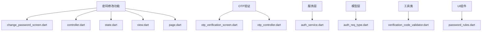
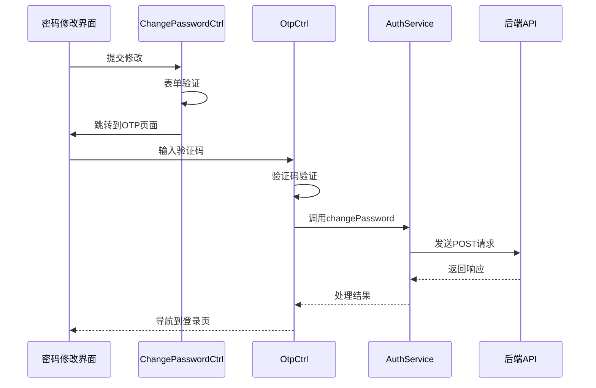
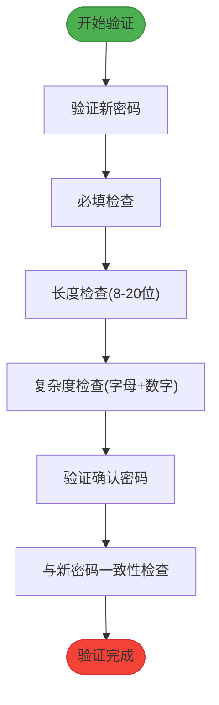
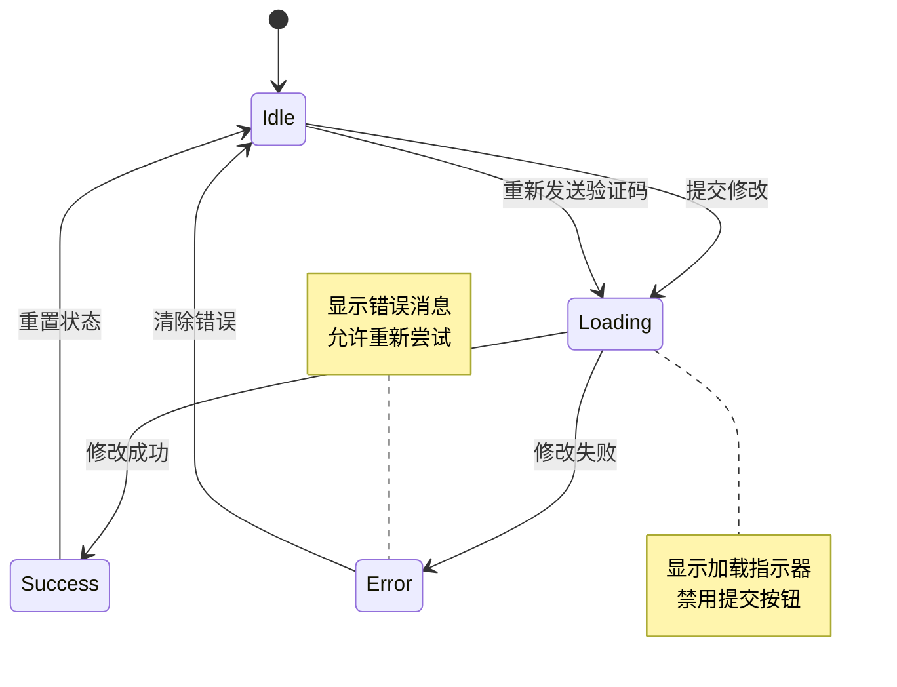
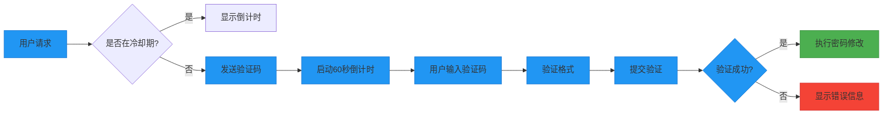

# 密码修改

<cite>
**本文档引用的文件**  
- [change_password_screen.dart](file://lib/pages/change_password/widgets/change_password_screen.dart)
- [controller.dart](file://lib/pages/change_password/controller.dart)
- [state.dart](file://lib/pages/change_password/state.dart)
- [auth_service.dart](file://lib/global/service/auth_service.dart)
- [otp_verification_screen.dart](file://lib/pages/otp/widgets/otp_verification_screen.dart)
- [password_rules.dart](file://lib/pages/forgot_password/widgets/password_rules.dart)
- [verification_code_validator.dart](file://lib/utils/validators/verification_code_validator.dart)
- [auth_req_type.dart](file://lib/global/model/auth_req_type.dart)
- [otp_controller.dart](file://lib/pages/otp/controller.dart)
</cite>

## 目录
1. [简介](#简介)
2. [项目结构](#项目结构)
3. [核心组件](#核心组件)
4. [架构概述](#架构概述)
5. [详细组件分析](#详细组件分析)
6. [依赖分析](#依赖分析)
7. [性能考虑](#性能考虑)
8. [故障排除指南](#故障排除指南)
9. [结论](#结论)

## 简介
本文档深入解析密码修改功能的实现流程，重点阐述表单验证逻辑、密码强度规则、验证码机制、状态管理及安全性增强建议。文档涵盖从用户界面交互到后端服务调用的完整流程，为开发者提供全面的技术参考。

## 项目结构
密码修改功能位于 `lib/pages/change_password` 目录下，采用标准的 Flutter 页面结构组织。该功能与其他认证流程紧密集成，通过 BLoC 模式实现状态管理，并与 OTP 验证码系统协同工作。



**Diagram sources**
- [change_password_screen.dart](file://lib/pages/change_password/widgets/change_password_screen.dart)
- [otp_verification_screen.dart](file://lib/pages/otp/widgets/otp_verification_screen.dart)
- [auth_service.dart](file://lib/global/service/auth_service.dart)

**Section sources**
- [change_password_screen.dart](file://lib/pages/change_password/widgets/change_password_screen.dart)
- [controller.dart](file://lib/pages/change_password/controller.dart)
- [state.dart](file://lib/pages/change_password/state.dart)

## 核心组件
密码修改功能由多个核心组件构成，包括表单界面、控制器、状态管理、服务调用和验证机制。这些组件通过清晰的职责划分实现了高内聚低耦合的设计。

**Section sources**
- [change_password_screen.dart](file://lib/pages/change_password/widgets/change_password_screen.dart)
- [controller.dart](file://lib/pages/change_password/controller.dart)
- [state.dart](file://lib/pages/change_password/state.dart)

## 架构概述
系统采用分层架构设计，前端界面与业务逻辑分离，通过 BLoC 模式实现响应式状态管理。密码修改流程涉及多个服务间的协作，确保了安全性和可靠性。



**Diagram sources**
- [controller.dart](file://lib/pages/change_password/controller.dart)
- [otp_controller.dart](file://lib/pages/otp/controller.dart)
- [auth_service.dart](file://lib/global/service/auth_service.dart)

## 详细组件分析

### 表单验证与密码强度规则
密码修改表单实现了严格的客户端验证机制，确保用户输入符合安全要求。

#### 表单验证逻辑


**Diagram sources**
- [change_password_screen.dart](file://lib/pages/change_password/widgets/change_password_screen.dart#L400-L414)

#### 密码强度规则
系统要求密码必须满足以下条件：
- 长度在8-20个字符之间
- 必须包含字母和数字
- 不允许特殊字符（根据代码中的提示文本推断）

这些规则在界面中通过 `_buildPasswordRules` 方法可视化展示，帮助用户理解要求。

**Section sources**
- [change_password_screen.dart](file://lib/pages/change_password/widgets/change_password_screen.dart#L441-L463)
- [password_rules.dart](file://lib/pages/forgot_password/widgets/password_rules.dart)

### 控制器与服务调用
控制器负责协调界面与服务层之间的交互，处理业务逻辑和状态转换。

#### 状态管理


**Diagram sources**
- [state.dart](file://lib/pages/change_password/state.dart)
- [controller.dart](file://lib/pages/change_password/controller.dart)

#### 服务调用流程
控制器通过 `authService.changePassword` 方法调用后端服务，传递包含手机号、验证码和新密码的请求参数。整个过程采用异步处理，确保UI流畅性。

**Section sources**
- [controller.dart](file://lib/pages/change_password/controller.dart#L68-L96)
- [auth_service.dart](file://lib/global/service/auth_service.dart#L30-L32)

### 验证码机制
系统采用OTP验证码机制增强安全性，防止自动化攻击和频繁操作。

#### 验证码发送与校验


**Diagram sources**
- [otp_controller.dart](file://lib/pages/otp/controller.dart#L69-L114)
- [verification_code_validator.dart](file://lib/utils/validators/verification_code_validator.dart)

### 状态转换分析
系统通过BLoC模式管理各种状态，包括加载、成功和错误状态。

#### 状态转换规则
- **加载状态**：当发起网络请求时激活，显示加载指示器并禁用相关按钮
- **成功状态**：密码修改成功后，自动跳转到登录页面
- **错误状态**：捕获异常并显示适当的错误消息，允许用户重新尝试

**Section sources**
- [state.dart](file://lib/pages/change_password/state.dart)
- [controller.dart](file://lib/pages/change_password/controller.dart#L72-L95)

## 依赖分析
密码修改功能依赖于多个核心模块，形成了紧密的协作关系。

```mermaid
dependencyDiagram
change_password_screen --> controller : 使用
controller --> state : 管理
controller --> auth_service : 调用
auth_service --> net_manager : 依赖
otp_verification_screen --> otp_controller : 使用
otp_controller --> auth_service : 调用
password_rules --> ui_components : 组合
```

**Diagram sources**
- [go.mod](file://pubspec.yaml)
- [controller.dart](file://lib/pages/change_password/controller.dart)

**Section sources**
- [controller.dart](file://lib/pages/change_password/controller.dart)
- [auth_service.dart](file://lib/global/service/auth_service.dart)

## 性能考虑
系统在性能方面进行了优化，确保用户体验流畅：
- 采用异步操作避免UI阻塞
- 合理管理资源，及时释放控制器和定时器
- 使用轻量级验证器减少计算开销
- 通过状态管理最小化不必要的重建

## 故障排除指南

### 常见问题解决方案

#### 输入框焦点管理
系统通过 `FocusNode` 精确控制输入框焦点，确保用户交互流畅。在密码输入框获得焦点时，界面会高亮显示当前输入区域。

**Section sources**
- [change_password_screen.dart](file://lib/pages/change_password/widgets/change_password_screen.dart#L96-L97)

#### 密码可见性切换
提供密码可见性切换功能，使用眼睛图标表示当前状态：
- 闭眼图标表示密码隐藏
- 开眼图标表示密码可见
- 点击图标可切换显示状态

**Section sources**
- [change_password_screen.dart](file://lib/pages/change_password/widgets/change_password_screen.dart#L417-L433)

### 安全性增强建议
1. **增加密码复杂度要求**：建议添加特殊字符要求
2. **实施密码历史检查**：防止重复使用旧密码
3. **加强验证码安全**：增加图形验证码作为补充
4. **日志审计**：记录密码修改操作用于安全审计
5. **多因素认证**：对于敏感操作引入额外验证层

## 结论
密码修改功能实现了完整的安全认证流程，从表单验证到服务调用都经过精心设计。系统采用现代化的架构模式，确保了代码的可维护性和扩展性。通过OTP验证机制和严格的状态管理，为用户提供了安全可靠的密码修改体验。