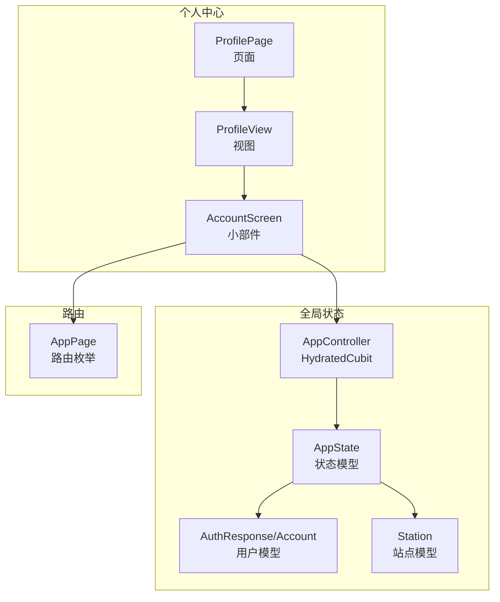
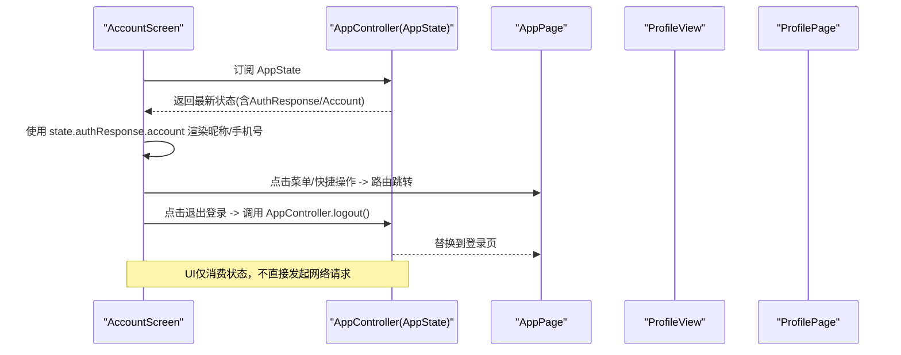
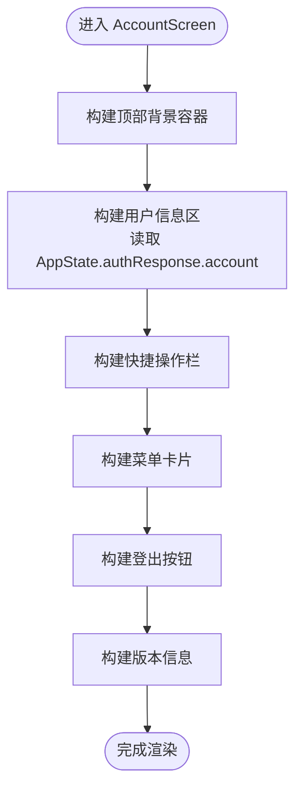
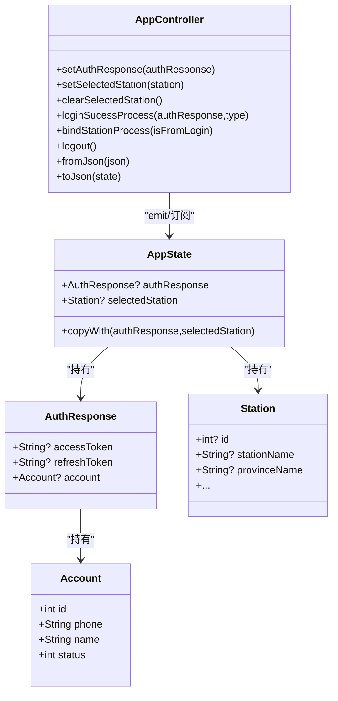
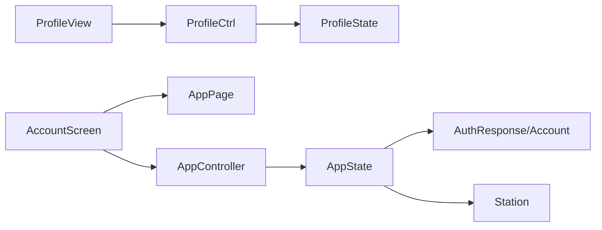

# 账户信息

<cite>
**本文引用的文件**
- [account_screen.dart](file://lib/pages/profile/widgets/account_screen.dart)
- [account_data.dart](file://lib/pages/profile/widgets/account_data.dart)
- [app_state.dart](file://lib/global/app_state.dart)
- [app_controller.dart](file://lib/global/app_controller.dart)
- [auth_rep_type.dart](file://lib/global/model/auth_rep_type.dart)
- [station_res_type.dart](file://lib/global/model/station_res_type.dart)
- [routes.dart](file://lib/router/routes.dart)
- [page.dart](file://lib/pages/profile/page.dart)
- [view.dart](file://lib/pages/profile/view.dart)
- [state.dart](file://lib/pages/profile/state.dart)
- [controller.dart](file://lib/pages/profile/controller.dart)
- [page_loading.dart](file://lib/widgets/common/page_loading.dart)
</cite>

## 目录
1. [简介](#简介)
2. [项目结构](#项目结构)
3. [核心组件](#核心组件)
4. [架构总览](#架构总览)
5. [详细组件分析](#详细组件分析)
6. [依赖分析](#依赖分析)
7. [性能考虑](#性能考虑)
8. [故障排查指南](#故障排查指南)
9. [结论](#结论)
10. [附录](#附录)

## 简介
本文件围绕账户信息页面的UI布局、数据绑定与响应式更新进行系统化说明，重点解释 account_screen.dart 如何通过 Bloc 模式从 AppState 中获取用户数据并实现界面自动刷新；梳理 account_data.dart 中菜单项字段的展示逻辑及其与后端 API 的映射关系；给出基于实际代码的 State 与 Controller 交互示例；最后总结页面刷新机制与权限控制策略，并指导开发者如何扩展账户信息项（例如添加第三方认证标识）以保持 UI 一致性。

## 项目结构
账户信息页面位于“个人中心”模块，采用“页面-控制器-视图-小部件”的分层组织方式：
- 页面层：ProfilePage 负责创建并注入 ProfileCtrl，使用 BlocBuilder 渲染 ProfileView。
- 视图层：ProfileView 接收 ProfileState 并返回 AccountScreen。
- 小部件层：AccountScreen 实现完整的 UI 结构与交互，包括顶部信息区、快捷操作栏、菜单卡片、登出按钮与版本信息等。
- 全局状态：AppController 继承 HydratedCubit<AppState>，负责全局认证状态与站点选择状态的维护与持久化。
- 数据模型：AuthResponse/Account 映射后端返回的用户信息；Station 映射站点信息。

图表来源
- [page.dart](file://lib/pages/profile/page.dart#L16-L26)
- [view.dart](file://lib/pages/profile/view.dart#L1-L18)
- [account_screen.dart](file://lib/pages/profile/widgets/account_screen.dart#L1-L84)
- [app_controller.dart](file://lib/global/app_controller.dart#L16-L21)
- [app_state.dart](file://lib/global/app_state.dart#L1-L23)
- [auth_rep_type.dart](file://lib/global/model/auth_rep_type.dart#L1-L46)
- [station_res_type.dart](file://lib/global/model/station_res_type.dart#L1-L164)
- [routes.dart](file://lib/router/routes.dart#L35-L123)

章节来源
- [page.dart](file://lib/pages/profile/page.dart#L16-L26)
- [view.dart](file://lib/pages/profile/view.dart#L1-L18)
- [account_screen.dart](file://lib/pages/profile/widgets/account_screen.dart#L1-L84)
- [app_controller.dart](file://lib/global/app_controller.dart#L16-L21)
- [app_state.dart](file://lib/global/app_state.dart#L1-L23)
- [auth_rep_type.dart](file://lib/global/model/auth_rep_type.dart#L1-L46)
- [station_res_type.dart](file://lib/global/model/station_res_type.dart#L1-L164)
- [routes.dart](file://lib/router/routes.dart#L35-L123)

## 核心组件
- AccountScreen：负责构建账户页的整体布局，包含头像与昵称/手机号展示、快捷操作栏、菜单卡片、登出按钮与版本信息。
- AppController/AppState：提供全局认证状态（AuthResponse/Account），用于在 AccountScreen 中通过 BlocBuilder 实时响应式渲染。
- ProfileCtrl/ProfileState：Profile 页面自身的局部状态与业务逻辑（加载用户信息、开放平台配置、修改密码、退出登录、刷新等），与 AccountScreen 的全局状态解耦。
- AccountData：定义账户菜单项的图标、标签与导航行为（是否带后缀图标、是否跳转）。

章节来源
- [account_screen.dart](file://lib/pages/profile/widgets/account_screen.dart#L86-L129)
- [app_controller.dart](file://lib/global/app_controller.dart#L16-L21)
- [app_state.dart](file://lib/global/app_state.dart#L1-L23)
- [controller.dart](file://lib/pages/profile/controller.dart#L1-L145)
- [state.dart](file://lib/pages/profile/state.dart#L1-L29)
- [account_data.dart](file://lib/pages/profile/widgets/account_data.dart#L1-L33)

## 架构总览
AccountScreen 通过 BlocBuilder 订阅 AppController 的 AppState，从而实现对用户昵称与手机号的响应式展示。同时，AccountScreen 内部的菜单项与快捷操作通过路由跳转到对应页面，而退出登录则由 AppController 处理全局状态清理与页面跳转。

图表来源
- [account_screen.dart](file://lib/pages/profile/widgets/account_screen.dart#L86-L129)
- [app_controller.dart](file://lib/global/app_controller.dart#L111-L116)
- [routes.dart](file://lib/router/routes.dart#L180-L182)
- [view.dart](file://lib/pages/profile/view.dart#L12-L16)
- [page.dart](file://lib/pages/profile/page.dart#L16-L26)

## 详细组件分析

### AccountScreen：UI 布局与数据绑定
- 布局结构
  - 顶部紫色背景容器与滚动内容区域组合，形成“头图+内容”的常见移动端账户页风格。
  - 用户信息区：圆形头像、姓名、手机号三行信息，均来自 AppState 中的 AuthResponse.account。
  - 快捷操作栏：三个功能入口（买油订单、提油订单、加油站管理），点击后通过路由跳转。
  - 菜单卡片：修改密码、隐私政策等条目，部分条目带有后缀图标或直接跳转。
  - 登出按钮：弹窗确认后调用 AppController.logout() 清理全局状态并跳转登录页。
  - 版本信息：展示应用名称与版本号，支持检测新版本并引导更新。
- 数据绑定机制
  - 使用 BlocBuilder<AppController, AppState> 订阅全局状态，当 AppState.authResponse 变更时，UI 自动重建。
  - 用户名与手机号来源于 state.authResponse?.account?.name/phone，若为空则显示占位文本。
- 交互与导航
  - 菜单项与快捷操作通过 BaseRouter.push 或 BaseRouter.replace 进行页面跳转。
  - 登出流程通过 AppController.logout() 完成，内部会清空选中站点与认证信息并替换到登录页。

图表来源
- [account_screen.dart](file://lib/pages/profile/widgets/account_screen.dart#L30-L84)
- [account_screen.dart](file://lib/pages/profile/widgets/account_screen.dart#L86-L129)
- [account_screen.dart](file://lib/pages/profile/widgets/account_screen.dart#L131-L179)
- [account_screen.dart](file://lib/pages/profile/widgets/account_screen.dart#L226-L254)
- [account_screen.dart](file://lib/pages/profile/widgets/account_screen.dart#L287-L310)
- [account_screen.dart](file://lib/pages/profile/widgets/account_screen.dart#L312-L351)

章节来源
- [account_screen.dart](file://lib/pages/profile/widgets/account_screen.dart#L30-L84)
- [account_screen.dart](file://lib/pages/profile/widgets/account_screen.dart#L86-L129)
- [account_screen.dart](file://lib/pages/profile/widgets/account_screen.dart#L131-L179)
- [account_screen.dart](file://lib/pages/profile/widgets/account_screen.dart#L226-L254)
- [account_screen.dart](file://lib/pages/profile/widgets/account_screen.dart#L287-L310)
- [account_screen.dart](file://lib/pages/profile/widgets/account_screen.dart#L312-L351)

### AccountData：菜单项字段与展示逻辑
- 字段说明
  - leadingIcon：左侧图标资源路径。
  - label：菜单项文本。
  - isSuffixIcon：是否显示右侧后缀图标（如箭头）。
  - isNavigate：是否直接跳转到目标页面（与路由表中的 AppPage 对应）。
- 展示逻辑
  - AccountData 列表用于驱动菜单卡片的生成，每个条目决定图标、文字与交互行为。
  - 在 AccountScreen 中，菜单项通过 _buildMenuItem 构建，点击后根据 isNavigate 决定是否路由跳转。
- 与后端 API 的映射关系
  - AccountData 本身为前端静态配置，不直接映射后端 API；但菜单项所指向的页面（如“修改密码”、“隐私政策”）由路由表 AppPage 统一管理，页面内部可按需调用后端服务。

章节来源
- [account_data.dart](file://lib/pages/profile/widgets/account_data.dart#L1-L33)
- [account_screen.dart](file://lib/pages/profile/widgets/account_screen.dart#L226-L254)
- [routes.dart](file://lib/router/routes.dart#L35-L123)

### AppController/AppState：全局状态与响应式更新
- AppState
  - 包含 AuthResponse 与 selectedStation，提供 copyWith 以不可变方式更新状态。
- AppController
  - 继承 HydratedCubit<AppState>，具备状态持久化能力。
  - 提供 setAuthResponse、setSelectedStation、clearSelectedStation 等方法以更新状态。
  - 提供 loginSucessProcess、bindStationProcess、logout 等业务流程方法。
  - 实现 fromJson/toJson 以支持 HydratedBloc 的序列化。
- 在 AccountScreen 中的应用
  - AccountScreen 通过 BlocBuilder<AppController, AppState> 订阅 AppState，当 AppController.emit(...) 更新状态时，UI 自动刷新。

图表来源
- [app_controller.dart](file://lib/global/app_controller.dart#L16-L21)
- [app_controller.dart](file://lib/global/app_controller.dart#L50-L60)
- [app_controller.dart](file://lib/global/app_controller.dart#L111-L116)
- [app_state.dart](file://lib/global/app_state.dart#L1-L23)
- [auth_rep_type.dart](file://lib/global/model/auth_rep_type.dart#L1-L46)
- [station_res_type.dart](file://lib/global/model/station_res_type.dart#L1-L164)

章节来源
- [app_controller.dart](file://lib/global/app_controller.dart#L16-L21)
- [app_controller.dart](file://lib/global/app_controller.dart#L50-L60)
- [app_controller.dart](file://lib/global/app_controller.dart#L111-L116)
- [app_state.dart](file://lib/global/app_state.dart#L1-L23)
- [auth_rep_type.dart](file://lib/global/model/auth_rep_type.dart#L1-L46)
- [station_res_type.dart](file://lib/global/model/station_res_type.dart#L1-L164)

### ProfileCtrl/ProfileState：页面内状态与交互
- ProfileCtrl
  - 负责加载用户信息、开放平台配置、修改密码、退出登录、刷新等业务逻辑。
  - 使用 emit(...) 更新 ProfileState，从而驱动 ProfileView 的 UI 变化。
- ProfileState
  - 包含 isLoading、hasError、errorMessage 等标志位，便于页面级的加载态与错误态展示。
- 与 AccountScreen 的关系
  - AccountScreen 与 ProfileCtrl/ProfileState 解耦，AccountScreen 仅消费全局 AppState；Profile 页面内部的 ProfileCtrl/ProfileState 仅影响 ProfileView 的局部 UI。

章节来源
- [controller.dart](file://lib/pages/profile/controller.dart#L1-L145)
- [state.dart](file://lib/pages/profile/state.dart#L1-L29)
- [view.dart](file://lib/pages/profile/view.dart#L1-L18)
- [page.dart](file://lib/pages/profile/page.dart#L16-L26)

### 页面刷新机制与权限控制策略
- 页面刷新机制
  - AccountScreen 通过 BlocBuilder 订阅 AppState，无需手动刷新即可响应全局状态变化。
  - Profile 页面内部的刷新可通过 ProfileCtrl.refreshProfile() 调用 loadUserProfile()/loadOpenPlatformConfig()，更新 ProfileState 以驱动局部 UI。
  - 若需要统一的页面级加载/错误态，可参考通用组件 OilPageLoading 的 PageStatus 枚举与重试逻辑。
- 权限控制策略
  - 当前代码未实现显式的权限校验函数。ProfileCtrl 中 hasPermission(...) 返回固定值，建议后续结合后端返回的权限清单与本地缓存进行扩展。
  - 对于敏感操作（如修改密码、退出登录），AccountScreen 已通过弹窗确认与路由跳转实现基本的安全约束。

章节来源
- [account_screen.dart](file://lib/pages/profile/widgets/account_screen.dart#L353-L367)
- [controller.dart](file://lib/pages/profile/controller.dart#L112-L118)
- [page_loading.dart](file://lib/widgets/common/page_loading.dart#L1-L84)

## 依赖分析
- 组件耦合
  - AccountScreen 与 AppController 为弱耦合：AccountScreen 仅读取 AppState，不直接调用 AppController 的业务方法。
  - Profile 页面内部使用 ProfileCtrl/ProfileState，与 AccountScreen 的全局状态解耦。
- 外部依赖
  - 路由：通过 AppPage 统一管理页面路径与构建器。
  - 模型：AuthResponse/Account/Station 由 freezed 生成 JSON 序列化方法，便于与后端 API 交互。
  - 状态持久化：HydratedBloc 提供 fromJson/toJson，实现 AppState 的本地持久化。

图表来源
- [account_screen.dart](file://lib/pages/profile/widgets/account_screen.dart#L1-L84)
- [routes.dart](file://lib/router/routes.dart#L35-L123)
- [view.dart](file://lib/pages/profile/view.dart#L1-L18)
- [page.dart](file://lib/pages/profile/page.dart#L16-L26)
- [controller.dart](file://lib/pages/profile/controller.dart#L1-L145)
- [state.dart](file://lib/pages/profile/state.dart#L1-L29)
- [app_controller.dart](file://lib/global/app_controller.dart#L16-L21)
- [app_state.dart](file://lib/global/app_state.dart#L1-L23)
- [auth_rep_type.dart](file://lib/global/model/auth_rep_type.dart#L1-L46)
- [station_res_type.dart](file://lib/global/model/station_res_type.dart#L1-L164)

章节来源
- [routes.dart](file://lib/router/routes.dart#L35-L123)
- [auth_rep_type.dart](file://lib/global/model/auth_rep_type.dart#L1-L46)
- [station_res_type.dart](file://lib/global/model/station_res_type.dart#L1-L164)

## 性能考虑
- 响应式渲染：使用 BlocBuilder 订阅 AppState，避免手动 setState，减少不必要的重建。
- 状态不可变：AppState.copyWith 与 HydratedCubit 的 emit 模式，有助于追踪状态变更与调试。
- 图片与图标：AccountScreen 使用本地资源图标，避免网络请求带来的开销。
- 页面级刷新：ProfileCtrl 的 refreshProfile() 仅在需要时触发局部刷新，避免全局重建。

[本节为通用建议，不直接分析具体文件]

## 故障排查指南
- 用户名/手机号不显示
  - 检查 AppState.authResponse 是否已设置；若为空，UI 将显示占位文本。
  - 确认 AppController.setAuthResponse(...) 是否被正确调用。
- 登出后未跳转登录页
  - 检查 AppController.logout() 是否执行；确认 BaseRouter.replace 路由替换是否生效。
- 菜单项点击无反应
  - 检查 AppPage 对应路径是否存在且构建器正确；确认 BaseRouter.push/replace 调用是否正确。
- 页面级加载/错误态
  - 可参考 OilPageLoading 的 PageStatus 枚举与重试逻辑，为 Profile 页面增加统一的加载/错误/空态处理。

章节来源
- [account_screen.dart](file://lib/pages/profile/widgets/account_screen.dart#L86-L129)
- [app_controller.dart](file://lib/global/app_controller.dart#L111-L116)
- [routes.dart](file://lib/router/routes.dart#L180-L182)
- [page_loading.dart](file://lib/widgets/common/page_loading.dart#L1-L84)

## 结论
账户信息页面通过 Bloc 模式实现了全局状态的响应式绑定，AccountScreen 仅负责消费 AppState 并渲染 UI，业务逻辑集中在 AppController 与 ProfileCtrl 中，职责清晰、耦合度低。菜单项与快捷操作通过路由表统一管理，便于扩展与维护。建议后续补充权限校验与统一的页面级加载/错误态组件，以进一步提升安全性与用户体验。

[本节为总结性内容，不直接分析具体文件]

## 附录

### 基于实际代码的 State 与 Controller 交互示例
- 全局状态更新
  - AppController.setAuthResponse(...) -> emit(state.copyWith(...)) -> AccountScreen 通过 BlocBuilder 自动刷新。
- 页面内状态更新
  - ProfileCtrl.loadUserProfile()/loadOpenPlatformConfig() -> emit(state.copyWith(...)) -> ProfileView 通过 BlocBuilder 刷新局部 UI。
- 退出登录
  - AccountScreen.logoutBottomSheet() -> AppController.logout() -> 清理状态并跳转登录页。

章节来源
- [app_controller.dart](file://lib/global/app_controller.dart#L50-L60)
- [app_controller.dart](file://lib/global/app_controller.dart#L111-L116)
- [controller.dart](file://lib/pages/profile/controller.dart#L22-L40)
- [controller.dart](file://lib/pages/profile/controller.dart#L112-L118)
- [account_screen.dart](file://lib/pages/profile/widgets/account_screen.dart#L353-L367)

### 扩展账户信息项（添加第三方认证标识）步骤
- 在 AccountData 列表中新增一项，设置 leadingIcon、label、isSuffixIcon/isNavigate。
- 在 AccountScreen 中根据 isNavigate 决定是否路由跳转，或在点击回调中执行相应业务逻辑。
- 若涉及后端 API，建议在 ProfileCtrl 中新增方法（如 loadOpenPlatformConfig）并使用 emit(...) 更新状态，配合 UI 组件展示结果。
- 保持 UI 一致性：复用现有图标、颜色与间距工具类，确保新增项与既有菜单风格一致。

章节来源
- [account_data.dart](file://lib/pages/profile/widgets/account_data.dart#L1-L33)
- [account_screen.dart](file://lib/pages/profile/widgets/account_screen.dart#L226-L254)
- [controller.dart](file://lib/pages/profile/controller.dart#L43-L52)