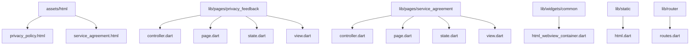
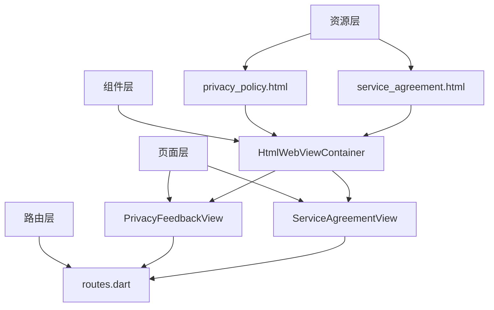
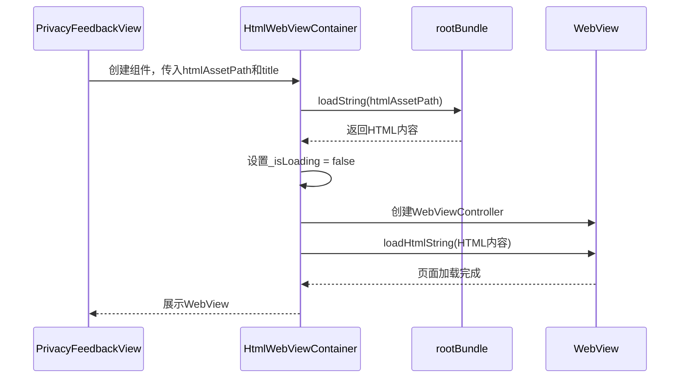
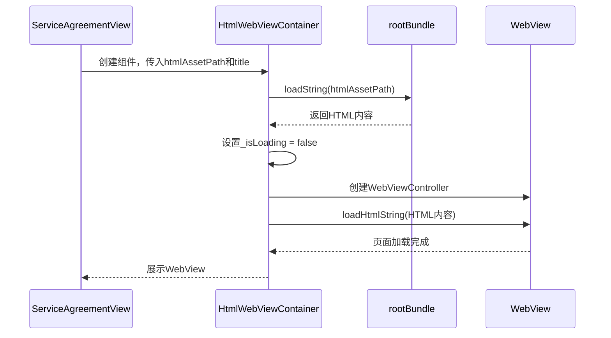
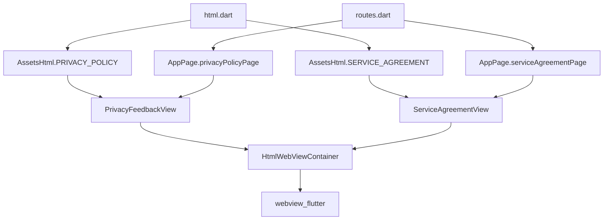

# 隐私与协议

<cite>
**本文档引用文件**  
- [html_webview_container.dart](file://lib/widgets/common/html_webview_container.dart)
- [privacy_policy.html](file://assets/html/privacy_policy.html)
- [service_agreement.html](file://assets/html/service_agreement.html)
- [privacy_feedback.dart](file://lib/pages/privacy_feedback/view.dart)
- [service_agreement.dart](file://lib/pages/service_agreement/view.dart)
- [html.dart](file://lib/static/html.dart)
- [routes.dart](file://lib/router/routes.dart)
</cite>

## 目录
1. [项目结构](#项目结构)
2. [核心组件](#核心组件)
3. [架构概述](#架构概述)
4. [详细组件分析](#详细组件分析)
5. [依赖分析](#依赖分析)

## 项目结构

本项目采用标准的Flutter应用结构，隐私政策与用户协议相关功能主要分布在以下目录中：
- `assets/html/`：存放本地HTML资源文件，包括`privacy_policy.html`和`service_agreement.html`
- `lib/pages/privacy_feedback/`：隐私反馈页面的MVC结构实现
- `lib/pages/service_agreement/`：服务协议页面的MVC结构实现
- `lib/widgets/common/`：通用组件`HtmlWebViewContainer`的实现
- `lib/static/`：静态资源路径常量定义
- `lib/router/`：路由配置，包含隐私与协议页面的导航路径



**Diagram sources**
- [privacy_policy.html](file://assets/html/privacy_policy.html)
- [service_agreement.html](file://assets/html/service_agreement.html)
- [privacy_feedback.dart](file://lib/pages/privacy_feedback/view.dart)
- [service_agreement.dart](file://lib/pages/service_agreement/view.dart)
- [html_webview_container.dart](file://lib/widgets/common/html_webview_container.dart)
- [html.dart](file://lib/static/html.dart)
- [routes.dart](file://lib/router/routes.dart)

**Section sources**
- [assets/html](file://assets/html)
- [lib/pages/privacy_feedback](file://lib/pages/privacy_feedback)
- [lib/pages/service_agreement](file://lib/pages/service_agreement)
- [lib/widgets/common](file://lib/widgets/common)
- [lib/static](file://lib/static)
- [lib/router](file://lib/router)

## 核心组件

隐私反馈与服务协议页面的核心实现依赖于`HtmlWebViewContainer`组件，该组件封装了WebView的初始化、加载、错误处理等逻辑。页面通过传入HTML资源路径和标题，即可实现本地HTML文件的加载与展示。`privacy_feedback`和`service_agreement`页面通过`view.dart`文件中的`PrivacyFeedbackView`和`ServiceAgreementView`组件，调用`HtmlWebViewContainer`并传入相应的HTML路径和标题，实现页面内容的展示。

**Section sources**
- [html_webview_container.dart](file://lib/widgets/common/html_webview_container.dart)
- [privacy_feedback.dart](file://lib/pages/privacy_feedback/view.dart)
- [service_agreement.dart](file://lib/pages/service_agreement/view.dart)

## 架构概述

本功能模块采用分层架构设计，从下至上分别为：
1. **资源层**：存放HTML静态资源文件
2. **组件层**：`HtmlWebViewContainer`作为可复用的WebView容器组件
3. **页面层**：`privacy_feedback`和`service_agreement`页面通过MVC模式组织，`view`层调用`HtmlWebViewContainer`
4. **路由层**：`routes.dart`定义了页面的导航路径



**Diagram sources**
- [privacy_policy.html](file://assets/html/privacy_policy.html)
- [service_agreement.html](file://assets/html/service_agreement.html)
- [html_webview_container.dart](file://lib/widgets/common/html_webview_container.dart)
- [privacy_feedback.dart](file://lib/pages/privacy_feedback/view.dart)
- [service_agreement.dart](file://lib/pages/service_agreement/view.dart)
- [routes.dart](file://lib/router/routes.dart)

## 详细组件分析

### HtmlWebViewContainer 组件分析

`HtmlWebViewContainer`是核心的WebView容器组件，负责加载本地HTML资源并提供统一的UI展示。

#### 组件实现
```mermaid
classDiagram
class HtmlWebViewContainer {
+String htmlAssetPath
+String? title
+HtmlWebViewContainer({Key? key, required String htmlAssetPath, String? title})
+State createState()
}
class _HtmlWebViewContainerState {
-WebViewController? _controller
-bool _isLoading
-String? _errorMessage
-String? _htmlContent
+void initState()
+Future<void> _loadHtmlContent()
+Widget build(BuildContext context)
}
HtmlWebViewContainer --> _HtmlWebViewContainerState : "creates"
```

**Diagram sources**
- [html_webview_container.dart](file://lib/widgets/common/html_webview_container.dart)

**Section sources**
- [html_webview_container.dart](file://lib/widgets/common/html_webview_container.dart)

### 隐私反馈页面分析

隐私反馈页面通过`PrivacyFeedbackView`组件调用`HtmlWebViewContainer`，传入隐私政策的HTML路径和标题。

#### 页面实现


**Diagram sources**
- [privacy_feedback.dart](file://lib/pages/privacy_feedback/view.dart)
- [html_webview_container.dart](file://lib/widgets/common/html_webview_container.dart)

**Section sources**
- [privacy_feedback.dart](file://lib/pages/privacy_feedback/view.dart)

### 服务协议页面分析

服务协议页面与隐私反馈页面实现方式相同，通过`ServiceAgreementView`组件调用`HtmlWebViewContainer`，传入服务协议的HTML路径和标题。

#### 页面实现


**Diagram sources**
- [service_agreement.dart](file://lib/pages/service_agreement/view.dart)
- [html_webview_container.dart](file://lib/widgets/common/html_webview_container.dart)

**Section sources**
- [service_agreement.dart](file://lib/pages/service_agreement/view.dart)

## 依赖分析

本功能模块的依赖关系清晰，`HtmlWebViewContainer`作为核心组件，被`privacy_feedback`和`service_agreement`页面依赖。`html.dart`文件定义了HTML资源路径常量，被`view.dart`文件引用。`routes.dart`文件定义了页面的导航路径，被应用的路由系统引用。



**Diagram sources**
- [html.dart](file://lib/static/html.dart)
- [privacy_feedback.dart](file://lib/pages/privacy_feedback/view.dart)
- [service_agreement.dart](file://lib/pages/service_agreement/view.dart)
- [html_webview_container.dart](file://lib/widgets/common/html_webview_container.dart)
- [routes.dart](file://lib/router/routes.dart)

**Section sources**
- [html.dart](file://lib/static/html.dart)
- [routes.dart](file://lib/router/routes.dart)