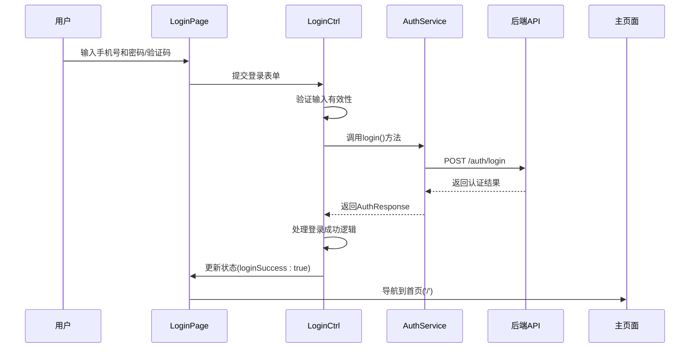
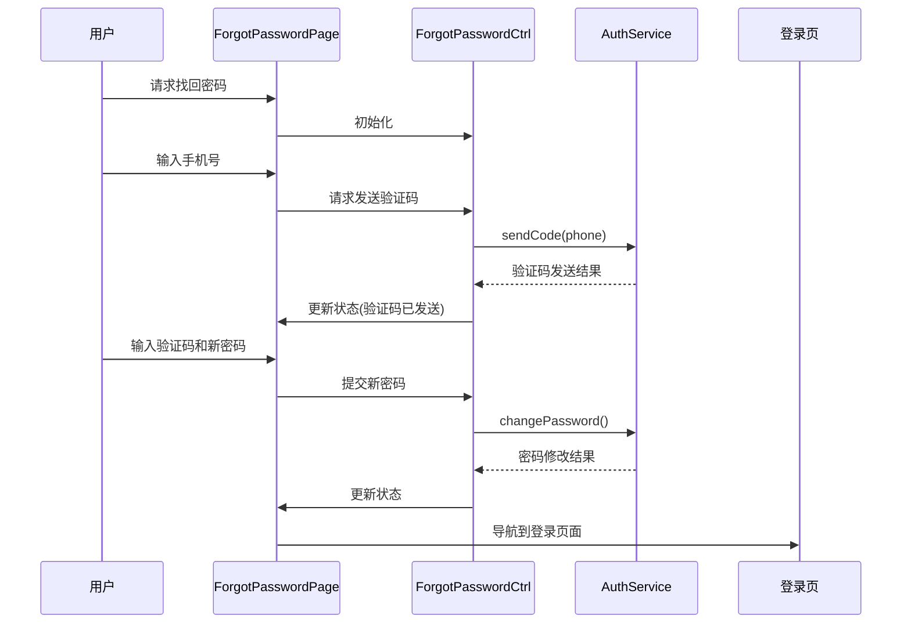
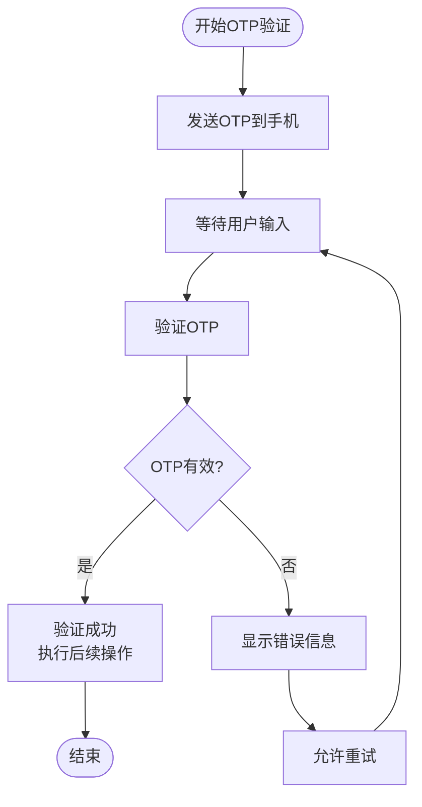
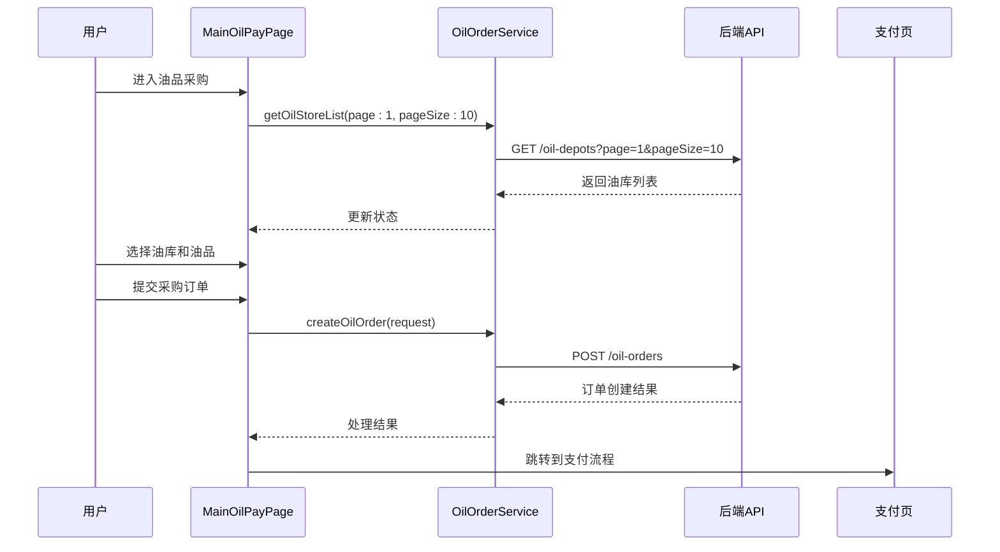
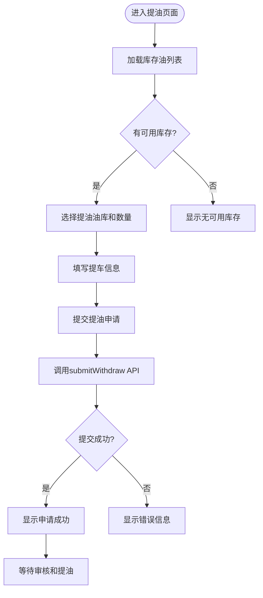
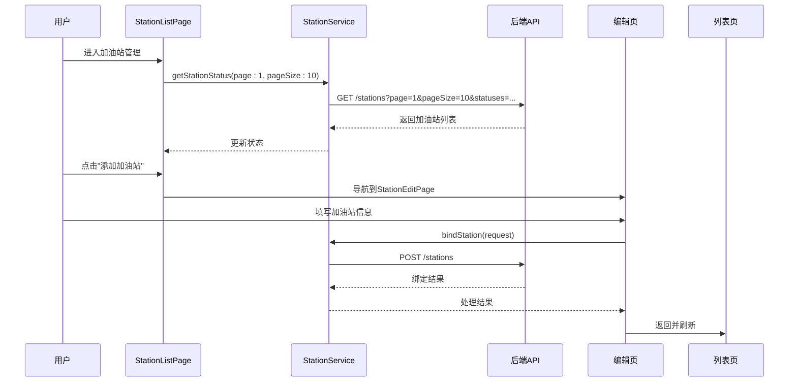
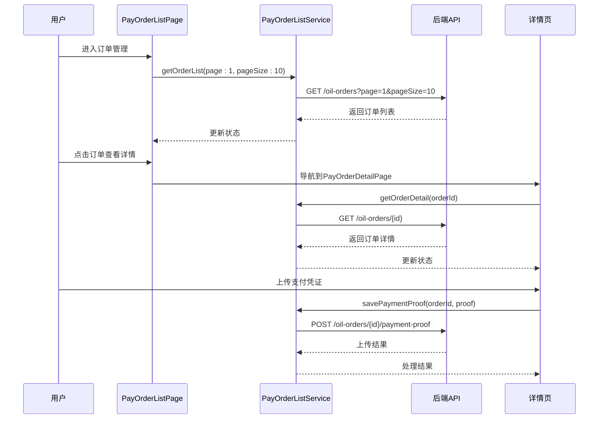
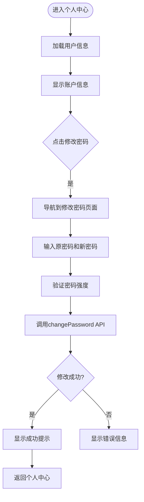

# 功能模块文档

<cite>
**本文档引用的文件**  
- [login/page.dart](file://lib/pages/login/page.dart)
- [login/controller.dart](file://lib/pages/login/controller.dart)
- [global/service/auth_service.dart](file://lib/global/service/auth_service.dart)
- [forgot_password/page.dart](file://lib/pages/forgot_password/page.dart)
- [otp/page.dart](file://lib/pages/otp/page.dart)
- [register/page.dart](file://lib/pages/register/page.dart)
- [main_oil_pay/model/oil_order_res.type.dart](file://lib/pages/main_oil_pay/model/oil_order_res.type.dart)
- [main_oil_pay/service/oil_order_service.dart](file://lib/pages/main_oil_pay/service/oil_order_service.dart)
- [oil_pickup/service/oil_pickup_service.dart](file://lib/pages/oil_pickup/service/oil_pickup_service.dart)
- [station_service.dart](file://lib/global/service/station_service.dart)
- [pay_order_list/service/pay_order_list.dart](file://lib/pages/pay_order_list/service/pay_order_list.dart)
- [pay_order_detail/service/pay_order_service.dart](file://lib/pages/pay_order_detail/service/pay_order_service.dart)
- [profile/page.dart](file://lib/pages/profile/page.dart)
- [profile/controller.dart](file://lib/pages/profile/controller.dart)
</cite>

## 目录
1. [用户认证模块](#用户认证模块)
2. [油品业务模块](#油品业务模块)
3. [加油站管理模块](#加油站管理模块)
4. [订单管理模块](#订单管理模块)
5. [个人中心模块](#个人中心模块)

## 用户认证模块

本模块实现了完整的用户认证流程，包括登录、注册、忘记密码和OTP验证功能。系统采用BLoC架构模式，将页面、控制器、状态和视图分离，确保代码的可维护性和可测试性。

### 登录流程

登录功能通过`LoginPage`实现，采用统一登录界面支持密码登录和验证码登录两种方式。页面结构遵循标准的BLoC模式：

- **Page**: `login/page.dart` - 页面入口和路由配置
- **Controller**: `login/controller.dart` - 业务逻辑处理
- **State**: `login/state.dart` - 状态管理
- **View**: `login/view.dart` - UI渲染

登录流程如下：
1. 用户输入手机号
2. 选择密码登录或验证码登录模式
3. 验证表单数据有效性
4. 调用AuthService进行身份验证
5. 处理登录结果并跳转到主页面



**表单验证逻辑**：
- 手机号格式验证：使用phone_validator进行格式校验
- 密码强度验证：要求至少6位字符
- 协议勾选验证：必须同意用户协议才能提交
- 错误处理：显示友好的错误消息，如"手机号或密码错误"、"验证码错误或已过期"

**与AuthService的API交互**：
- `authService.login()`：处理用户登录请求
- `authService.sendCode()`：发送验证码
- 使用LoginRequest数据模型封装请求参数

**Section sources**
- [login/page.dart](file://lib/pages/login/page.dart#L1-L28)
- [login/controller.dart](file://lib/pages/login/controller.dart#L1-L354)
- [global/service/auth_service.dart](file://lib/global/service/auth_service.dart#L1-L41)

### 注册流程

注册功能通过`RegisterPage`实现，流程包括：
1. 用户填写注册信息（手机号、密码等）
2. 发送验证码进行手机验证
3. 提交注册表单
4. 调用AuthService注册接口
5. 注册成功后跳转到账户创建完成页面

注册页面同样采用BLoC架构，与登录页面共享部分验证逻辑和组件。

**Section sources**
- [register/page.dart](file://lib/pages/register/page.dart#L1-L37)

### 忘记密码流程

忘记密码功能通过`ForgotPasswordPage`实现，采用三步流程：
1. 输入注册手机号
2. 获取验证码（调用`authService.sendCode()`）
3. 设置新密码

该流程确保了账户安全，防止未经授权的密码修改。



**Section sources**
- [forgot_password/page.dart](file://lib/pages/forgot_password/page.dart#L1-L33)

### OTP验证流程

OTP（一次性密码）验证通过`OtpPage`实现，主要用于敏感操作的身份验证：
1. 系统自动发送OTP到用户手机
2. 用户输入收到的验证码
3. 验证OTP有效性
4. 验证通过后执行相应操作

OTP页面设计为可复用组件，可通过extra参数传递上下文信息。



**Section sources**
- [otp/page.dart](file://lib/pages/otp/page.dart#L1-L36)

## 油品业务模块

油品业务模块包含油品采购、提油操作和支付订单等核心功能。

### 油品采购流程

油品采购功能通过`MainOilPayPage`实现，主要流程如下：

1. 用户进入油品采购页面
2. 选择油库和油品类型
3. 输入采购数量
4. 创建采购订单
5. 跳转到支付流程

**数据模型分析**：
`oil_order_res.type.dart`文件定义了油品相关的数据结构：

```dart
class GetOilStoreResponse {
  final int? page;
  final int? pageSize;
  final int? total;
  final List<Depot>? list;
}

class Depot {
  final int? depotId;
  final String? depotName;
  final String? provinceName;
  final String? cityName;
  final String? areaName;
  final String? addressDetail;
  final List<Fuel>? fuels;
}

class Fuel {
  final String? fuelType;
  final double? priceCny;
}
```

**服务调用**：
`oil_order_service.dart`提供了油品业务的API接口：

- `getOilStoreList()`：获取油库列表
- `createOilOrder()`：创建买油订单



**Section sources**
- [main_oil_pay/model/oil_order_res.type.dart](file://lib/pages/main_oil_pay/model/oil_order_res.type.dart#L1-L82)
- [main_oil_pay/service/oil_order_service.dart](file://lib/pages/main_oil_pay/service/oil_order_service.dart#L1-L26)

### 提油操作流程

提油操作通过`OilPickupPage`实现，流程包括：

1. 查看可用库存油
2. 选择提油油库和数量
3. 提交提油申请
4. 等待审核和提油

**服务调用**：
`oil_pickup_service.dart`提供了提油相关的API接口：

- `getInventories()`：查询用户可用库存油
- `getWithdrawOrderList()`：获取提油订单列表
- `submitWithdraw()`：提交提油申请
- `cancelWithdraw()`：取消提油申请



**Section sources**
- [oil_pickup/service/oil_pickup_service.dart](file://lib/pages/oil_pickup/service/oil_pickup_service.dart#L1-L50)

## 加油站管理模块

加油站管理模块提供加油站的列表展示、编辑和绑定功能。

### 加油站列表

`StationListPage`实现了加油站列表功能，支持分页加载：

- 每页显示固定数量的加油站
- 支持下拉刷新
- 支持上拉加载更多

**分页实现**：
通过`station_service.dart`的`getStationStatus()`方法实现分页：

```dart
Future<GetStationResponse> getStationStatus(
  @Query('page') int page,
  @Query('pageSize') int pageSize,
  @Query('statuses') List<String> statuses,
);
```

### 加油站编辑和绑定

加油站编辑和绑定功能通过`StationEditPage`实现：

- **编辑功能**：修改加油站基本信息
- **绑定功能**：将加油站与用户账户关联

**选择UI**：
使用自定义的选择组件，提供良好的用户体验。

**服务调用**：
`station_service.dart`提供了相关API：

- `getStationDetail()`：获取加油站详情
- `bindStation()`：新增加油站
- `updateStation()`：编辑加油站



**Section sources**
- [station_service.dart](file://lib/global/service/station_service.dart#L1-L48)

## 订单管理模块

订单管理模块负责订单的展示、详情查看和支付凭证上传。

### 订单列表展示

`PayOrderListPage`实现了订单列表功能：

- 支持分页加载订单
- 支持按状态筛选
- 显示订单基本信息（金额、状态、时间等）

**服务调用**：
`pay_order_list.dart`提供了订单列表API：

```dart
Future<OrderListResponse> getOrderList({
  @Query('status') int? status,
  @Query('page') required int page,
  @Query('pageSize') required int pageSize,
});
```

### 订单详情查看

`PayOrderDetailPage`显示订单的详细信息：

- 订单号、金额、状态
- 油品信息
- 支付信息
- 时间戳等

### 支付凭证上传

支持上传支付凭证图片：

- 调用`savePaymentProof()` API
- 支持图片选择和预览
- 显示上传进度和结果



**Section sources**
- [pay_order_list/service/pay_order_list.dart](file://lib/pages/pay_order_list/service/pay_order_list.dart#L1-L31)
- [pay_order_detail/service/pay_order_service.dart](file://lib/pages/pay_order_detail/service/pay_order_service.dart#L1-L35)

## 个人中心模块

个人中心模块提供账户信息管理、密码修改和隐私政策查看功能。

### 账户信息

`ProfilePage`显示用户的基本信息：

- 用户名、手机号
- 代理商信息
- 开放平台配置等

通过`ProfileCtrl`加载和刷新用户信息。

### 修改密码

提供独立的密码修改页面：

- 验证原密码
- 输入新密码
- 确认新密码
- 提交修改请求



### 隐私政策

集成HTML WebView显示隐私政策和用户协议：

- 从assets/html/privacy_policy.html加载内容
- 提供良好的阅读体验
- 支持页面内导航

**Section sources**
- [profile/page.dart](file://lib/pages/profile/page.dart#L1-L27)
- [profile/controller.dart](file://lib/pages/profile/controller.dart#L1-L145)