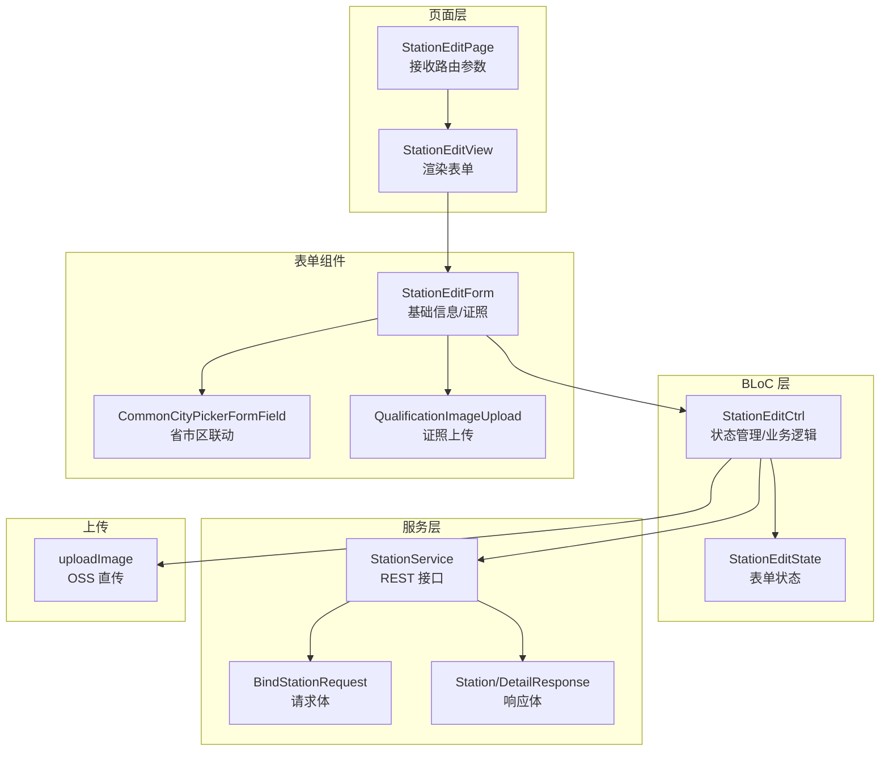
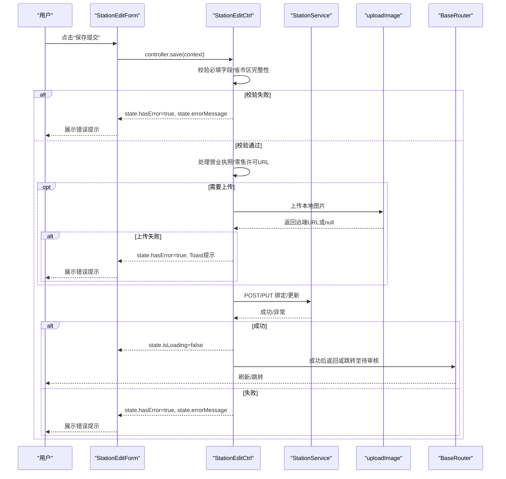
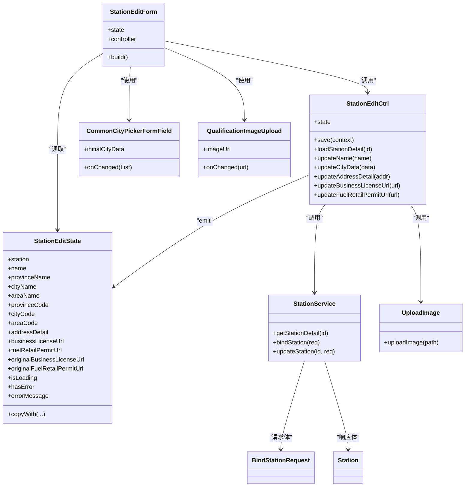

# 加油站信息编辑

<cite>
**本文引用的文件**
- [station_edit_form.dart](file://lib/pages/station_edit/widgets/station_edit_form.dart)
- [controller.dart](file://lib/pages/station_edit/controller.dart)
- [state.dart](file://lib/pages/station_edit/state.dart)
- [view.dart](file://lib/pages/station_edit/view.dart)
- [page.dart](file://lib/pages/station_edit/page.dart)
- [station_service.dart](file://lib/global/service/station_service.dart)
- [common_city_picker.dart](file://lib/widgets/base/textfield/common_city_picker.dart)
- [qualification_image_upload.dart](file://lib/widgets/common/qualification_image_upload.dart)
- [upload.dart](file://lib/global/commom/upload.dart)
- [station_req_type.dart](file://lib/global/model/station_req_type.dart)
- [station_res_type.dart](file://lib/global/model/station_res_type.dart)
- [routes.dart](file://lib/router/routes.dart)
- [router.dart](file://lib/router/router.dart)
</cite>

## 目录
1. [简介](#简介)
2. [项目结构](#项目结构)
3. [核心组件](#核心组件)
4. [架构总览](#架构总览)
5. [详细组件分析](#详细组件分析)
6. [依赖关系分析](#依赖关系分析)
7. [性能考量](#性能考量)
8. [故障排查指南](#故障排查指南)
9. [结论](#结论)
10. [附录](#附录)

## 简介
本文件深入解析“加油站信息编辑”模块的表单处理流程，重点覆盖：
- 表单字段与绑定方式：加油站名称、地址（省市区+详细地址）、证照图片（营业执照、成品油零售许可证）
- 验证规则与错误处理：必填校验、省市区完整性校验、图片上传状态与错误提示
- 数据提交机制：Controller 中 updateStation 方法如何调用服务层 PUT 接口
- 加载状态管理：按钮加载态、错误消息展示
- 三级联动选择：省市区选择器的使用与数据同步
- 常见问题与调试方案：数据不同步、图片上传失败
- 扩展建议：字段校验增强、批量编辑能力

## 项目结构
该模块采用典型的 MVVM + BLoC 架构：
- 页面容器：page.dart 负责接收路由参数并注入 BLoC Provider
- 视图层：view.dart 渲染 StationEditForm
- 表单组件：station_edit_form.dart 包含基础信息与资质证照两部分
- 控制器：controller.dart 负责状态管理、业务逻辑、调用服务层
- 状态对象：state.dart 描述表单状态与错误信息
- 服务层：station_service.dart 定义 REST 接口
- UI 组件：common_city_picker.dart 实现省市区三级联动；qualification_image_upload.dart 实现图片上传
- 上传工具：upload.dart 封装 OSS 上传签名与直传
- 请求/响应模型：station_req_type.dart、station_res_type.dart

图表来源
- [page.dart](file://lib/pages/station_edit/page.dart#L1-L39)
- [view.dart](file://lib/pages/station_edit/view.dart#L1-L19)
- [station_edit_form.dart](file://lib/pages/station_edit/widgets/station_edit_form.dart#L1-L331)
- [common_city_picker.dart](file://lib/widgets/base/textfield/common_city_picker.dart#L1-L385)
- [qualification_image_upload.dart](file://lib/widgets/common/qualification_image_upload.dart#L1-L153)
- [controller.dart](file://lib/pages/station_edit/controller.dart#L1-L264)
- [state.dart](file://lib/pages/station_edit/state.dart#L1-L80)
- [station_service.dart](file://lib/global/service/station_service.dart#L1-L48)
- [station_req_type.dart](file://lib/global/model/station_req_type.dart#L1-L83)
- [station_res_type.dart](file://lib/global/model/station_res_type.dart#L1-L164)
- [upload.dart](file://lib/global/commom/upload.dart#L1-L72)

章节来源
- [page.dart](file://lib/pages/station_edit/page.dart#L1-L39)
- [view.dart](file://lib/pages/station_edit/view.dart#L1-L19)
- [station_edit_form.dart](file://lib/pages/station_edit/widgets/station_edit_form.dart#L1-L331)
- [controller.dart](file://lib/pages/station_edit/controller.dart#L1-L264)
- [state.dart](file://lib/pages/station_edit/state.dart#L1-L80)
- [station_service.dart](file://lib/global/service/station_service.dart#L1-L48)
- [common_city_picker.dart](file://lib/widgets/base/textfield/common_city_picker.dart#L1-L385)
- [qualification_image_upload.dart](file://lib/widgets/common/qualification_image_upload.dart#L1-L153)
- [upload.dart](file://lib/global/commom/upload.dart#L1-L72)
- [station_req_type.dart](file://lib/global/model/station_req_type.dart#L1-L83)
- [station_res_type.dart](file://lib/global/model/station_res_type.dart#L1-L164)

## 核心组件
- 表单组件 StationEditForm：负责渲染基础信息与资质证照区域，绑定控制器与状态，展示错误信息，触发保存提交
- 控制器 StationEditCtrl：负责初始化表单、处理省市区联动、图片上传、调用服务层接口、错误处理与加载状态管理
- 状态对象 StationEditState：承载表单字段、原始图片 URL、加载与错误状态
- 服务层 StationService：定义 GET/POST/PUT 接口，供控制器调用
- 省市区选择器 CommonCityPickerFormField：提供三级联动选择，返回省市区名称与编码
- 图片上传组件 QualificationImageUpload：封装图片选择与占位展示
- 上传工具 uploadImage：生成 OSS 上传签名并直传

章节来源
- [station_edit_form.dart](file://lib/pages/station_edit/widgets/station_edit_form.dart#L1-L331)
- [controller.dart](file://lib/pages/station_edit/controller.dart#L1-L264)
- [state.dart](file://lib/pages/station_edit/state.dart#L1-L80)
- [station_service.dart](file://lib/global/service/station_service.dart#L1-L48)
- [common_city_picker.dart](file://lib/widgets/base/textfield/common_city_picker.dart#L1-L385)
- [qualification_image_upload.dart](file://lib/widgets/common/qualification_image_upload.dart#L1-L153)
- [upload.dart](file://lib/global/commom/upload.dart#L1-L72)

## 架构总览
下图展示了从用户操作到服务端请求的完整链路，以及错误与加载状态的传播路径。

图表来源
- [station_edit_form.dart](file://lib/pages/station_edit/widgets/station_edit_form.dart#L200-L260)
- [controller.dart](file://lib/pages/station_edit/controller.dart#L126-L262)
- [station_service.dart](file://lib/global/service/station_service.dart#L22-L43)
- [upload.dart](file://lib/global/commom/upload.dart#L1-L72)
- [router.dart](file://lib/router/router.dart#L127-L189)

## 详细组件分析

### 表单字段与绑定方式
- 字段绑定
  - 加油站名称：通过 CommonTextFormField 绑定 TextEditingController，控制器在 onChanged 中调用 updateName
  - 省市区：通过 CommonCityPickerFormField 绑定 TextEditingController，onChanged 回调中调用 updateCityData，并刷新显示文本
  - 详细地址：通过 CommonTextFormField 绑定 TextEditingController，控制器在 onChanged 中调用 updateAddressDetail
  - 证照图片：通过 QualificationImageUpload 组件，onChanged 回调中分别调用 updateBusinessLicenseUrl 与 updateFuelRetailPermitUrl
- 数据同步
  - 表单组件在 didUpdateWidget 中根据 state 的变化同步控制器文本，避免数据不同步
  - 省市区选择器内部维护 selectedIndexes 并在选择时回调，控制器将名称与编码同时写入状态

章节来源
- [station_edit_form.dart](file://lib/pages/station_edit/widgets/station_edit_form.dart#L26-L76)
- [station_edit_form.dart](file://lib/pages/station_edit/widgets/station_edit_form.dart#L118-L173)
- [station_edit_form.dart](file://lib/pages/station_edit/widgets/station_edit_form.dart#L134-L159)
- [station_edit_form.dart](file://lib/pages/station_edit/widgets/station_edit_form.dart#L180-L205)
- [controller.dart](file://lib/pages/station_edit/controller.dart#L94-L124)
- [common_city_picker.dart](file://lib/widgets/base/textfield/common_city_picker.dart#L228-L255)

### 验证规则与错误处理
- 必填校验
  - 加油站名称非空
  - 省市区编码均非空
  - 详细地址非空
- 省市区完整性
  - 通过 CommonCityPickerFormField 内部的 FormBuilderField 校验器进行必填校验（若未显式提供自定义校验器，默认必填）
- 错误处理
  - 校验失败时设置 state.hasError 与 state.errorMessage
  - 上传失败时通过 Toast 提示并保持 isLoading 状态
  - 服务端异常时捕获并设置错误消息与 Toast

章节来源
- [controller.dart](file://lib/pages/station_edit/controller.dart#L126-L174)
- [common_city_picker.dart](file://lib/widgets/base/textfield/common_city_picker.dart#L290-L306)

### 图片上传集成
- 上传时机
  - 在 save 流程中，若图片 URL 不是 http 开头且与原始 URL 不同，则调用 uploadImage 进行上传
- 上传签名与直传
  - uploadImage 先向通用服务获取 OSS 上传签名，再使用 Dio 直接上传到 OSS
- URL 规范化
  - 若图片 URL 已带查询参数，先截断查询串，避免重复签名
- 失败处理
  - 上传失败时弹出警告 Toast，并将 isLoading 置为 false，阻止继续提交

章节来源
- [controller.dart](file://lib/pages/station_edit/controller.dart#L176-L214)
- [upload.dart](file://lib/global/commom/upload.dart#L1-L72)

### 提交流程与服务层调用
- 新增与编辑
  - 当 _stationId 为空时调用 bindStation（POST /stations）
  - 当 _stationId 存在时调用 updateStation（PUT /stations/{id}）
- 请求体
  - 使用 BindStationRequest 封装字段：名称、省市区编码与名称、详细地址、两张证照 URL
- 成功与失败
  - 成功后弹出成功 Toast，并根据 isFromPendingReview 决定返回或跳转至待审核页面
  - 失败时设置错误状态与 Toast

章节来源
- [controller.dart](file://lib/pages/station_edit/controller.dart#L216-L262)
- [station_service.dart](file://lib/global/service/station_service.dart#L22-L43)
- [station_req_type.dart](file://lib/global/model/station_req_type.dart#L19-L83)

### 加载状态管理
- 按钮加载态：表单底部按钮通过 isLoading 控制
- 页面加载态：加载详情时设置 isLoading
- 错误态：hasError 与 errorMessage 控制错误提示展示

章节来源
- [station_edit_form.dart](file://lib/pages/station_edit/widgets/station_edit_form.dart#L240-L254)
- [controller.dart](file://lib/pages/station_edit/controller.dart#L35-L68)

### 省市区三级联动选择
- 选择器行为
  - 选择器内部加载 pca-code.json，构建三级树形数据
  - 支持根据初始省市区编码定位默认选中项
  - 确认后回调 province/city/area 名称与编码，控制器据此更新状态
- 文本显示
  - 表单内部 _buildCityText 将省市区名称拼接为显示文本

章节来源
- [common_city_picker.dart](file://lib/widgets/base/textfield/common_city_picker.dart#L110-L171)
- [common_city_picker.dart](file://lib/widgets/base/textfield/common_city_picker.dart#L190-L284)
- [station_edit_form.dart](file://lib/pages/station_edit/widgets/station_edit_form.dart#L58-L68)

### Controller 中 updateStation 方法说明
- 实际上该模块并未直接暴露名为 updateStation 的方法；控制器中存在 updateCityData 用于省市区更新，以及 save 方法用于提交
- 若需调用服务端 PUT 接口，控制器内部在 save 中根据是否存在 _stationId 来决定调用 bindStation 或 updateStation

章节来源
- [controller.dart](file://lib/pages/station_edit/controller.dart#L98-L112)
- [controller.dart](file://lib/pages/station_edit/controller.dart#L216-L235)
- [station_service.dart](file://lib/global/service/station_service.dart#L26-L43)

## 依赖关系分析

图表来源
- [station_edit_form.dart](file://lib/pages/station_edit/widgets/station_edit_form.dart#L1-L331)
- [controller.dart](file://lib/pages/station_edit/controller.dart#L1-L264)
- [state.dart](file://lib/pages/station_edit/state.dart#L1-L80)
- [station_service.dart](file://lib/global/service/station_service.dart#L1-L48)
- [common_city_picker.dart](file://lib/widgets/base/textfield/common_city_picker.dart#L1-L385)
- [qualification_image_upload.dart](file://lib/widgets/common/qualification_image_upload.dart#L1-L153)
- [upload.dart](file://lib/global/commom/upload.dart#L1-L72)
- [station_req_type.dart](file://lib/global/model/station_req_type.dart#L19-L83)
- [station_res_type.dart](file://lib/global/model/station_res_type.dart#L26-L103)

章节来源
- [station_edit_form.dart](file://lib/pages/station_edit/widgets/station_edit_form.dart#L1-L331)
- [controller.dart](file://lib/pages/station_edit/controller.dart#L1-L264)
- [state.dart](file://lib/pages/station_edit/state.dart#L1-L80)
- [station_service.dart](file://lib/global/service/station_service.dart#L1-L48)
- [common_city_picker.dart](file://lib/widgets/base/textfield/common_city_picker.dart#L1-L385)
- [qualification_image_upload.dart](file://lib/widgets/common/qualification_image_upload.dart#L1-L153)
- [upload.dart](file://lib/global/commom/upload.dart#L1-L72)
- [station_req_type.dart](file://lib/global/model/station_req_type.dart#L19-L83)
- [station_res_type.dart](file://lib/global/model/station_res_type.dart#L26-L103)

## 性能考量
- 表单渲染优化
  - 使用 SingleChildScrollView 与 Column 布局，避免复杂嵌套导致的重建
  - 省市区选择器仅在选择时触发 setState，减少不必要的重绘
- 上传性能
  - 上传前对本地图片进行压缩参数设置，降低体积
  - OSS 直传避免应用服务器中转，提升上传效率
- 状态更新
  - 使用 copyWith 生成新状态，避免深层拷贝带来的开销

[本节为通用指导，无需列出具体文件来源]

## 故障排查指南

- 数据不同步
  - 症状：输入框内容与状态不一致
  - 排查：检查 didUpdateWidget 是否正确同步 name/province/city/area/addressDetail
  - 参考路径
    - [station_edit_form.dart](file://lib/pages/station_edit/widgets/station_edit_form.dart#L42-L56)
- 省市区选择不生效
  - 症状：选择后显示文本未更新或状态未变更
  - 排查：确认 CommonCityPickerFormField 的 onChanged 是否被触发；检查 updateCityData 是否写入 province/city/area 名称与编码
  - 参考路径
    - [common_city_picker.dart](file://lib/widgets/base/textfield/common_city_picker.dart#L228-L255)
    - [controller.dart](file://lib/pages/station_edit/controller.dart#L98-L112)
- 图片上传失败
  - 症状：上传返回 null 或 Toast 提示失败
  - 排查：检查 uploadImage 的签名返回 host/path 是否为空；确认 OSS 直传状态码与异常日志
  - 参考路径
    - [controller.dart](file://lib/pages/station_edit/controller.dart#L176-L214)
    - [upload.dart](file://lib/global/commom/upload.dart#L1-L72)
- 提交后无响应
  - 症状：点击保存无反应或页面不刷新
  - 排查：确认 save 中是否进入上传分支；检查服务端返回与路由跳转逻辑
  - 参考路径
    - [controller.dart](file://lib/pages/station_edit/controller.dart#L216-L262)
    - [router.dart](file://lib/router/router.dart#L127-L189)

章节来源
- [station_edit_form.dart](file://lib/pages/station_edit/widgets/station_edit_form.dart#L42-L56)
- [common_city_picker.dart](file://lib/widgets/base/textfield/common_city_picker.dart#L228-L255)
- [controller.dart](file://lib/pages/station_edit/controller.dart#L176-L262)
- [upload.dart](file://lib/global/commom/upload.dart#L1-L72)
- [router.dart](file://lib/router/router.dart#L127-L189)

## 结论
该模块通过清晰的分层设计与完善的错误处理，实现了加油站信息编辑的完整闭环。表单字段绑定简洁可靠，省市区联动与图片上传流程顺畅，服务层接口调用明确。建议后续可引入更细粒度的字段校验与国际化提示，以及考虑支持批量编辑场景下的多站点操作。

[本节为总结性内容，无需列出具体文件来源]

## 附录

### 代码示例路径（不展示具体代码）
- 表单数据初始化
  - [controller.dart](file://lib/pages/station_edit/controller.dart#L70-L92)
- 图片上传集成
  - [controller.dart](file://lib/pages/station_edit/controller.dart#L176-L214)
  - [upload.dart](file://lib/global/commom/upload.dart#L1-L72)
- 提交流程（新增/编辑）
  - [controller.dart](file://lib/pages/station_edit/controller.dart#L216-L262)
  - [station_service.dart](file://lib/global/service/station_service.dart#L26-L43)
- 省市区三级联动选择
  - [common_city_picker.dart](file://lib/widgets/base/textfield/common_city_picker.dart#L110-L171)
  - [common_city_picker.dart](file://lib/widgets/base/textfield/common_city_picker.dart#L190-L284)
  - [station_edit_form.dart](file://lib/pages/station_edit/widgets/station_edit_form.dart#L58-L68)

### 验证器说明
- RequiredValidator
  - 省市区选择器内部使用 FormBuilderValidators.required 进行必填校验
  - 参考路径
    - [common_city_picker.dart](file://lib/widgets/base/textfield/common_city_picker.dart#L290-L306)
- StringLengthValidator
  - 本模块未直接使用 StringLengthValidator；如需长度限制可在表单字段处添加相应校验
  - 参考路径
    - [station_edit_form.dart](file://lib/pages/station_edit/widgets/station_edit_form.dart#L118-L173)