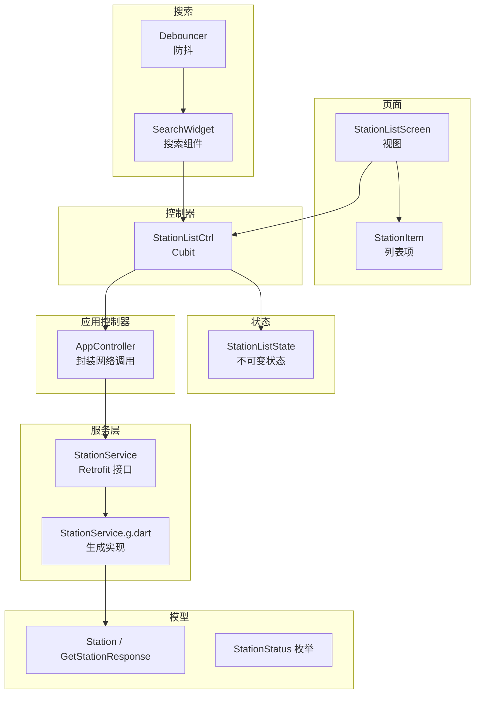
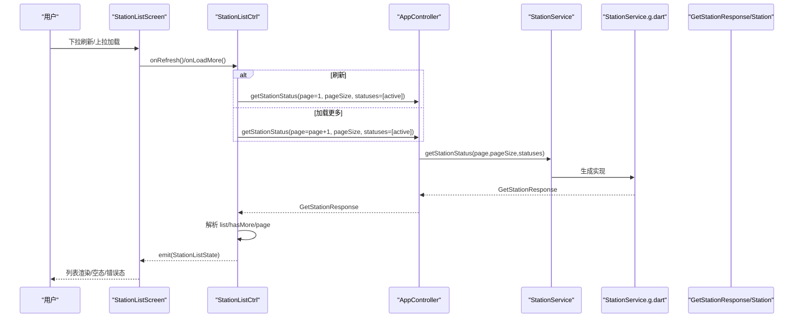
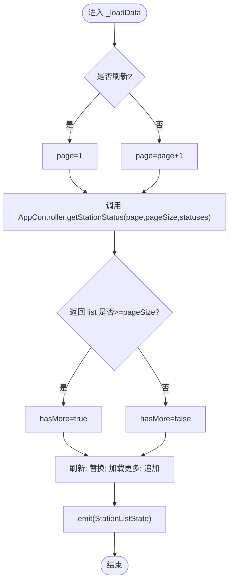
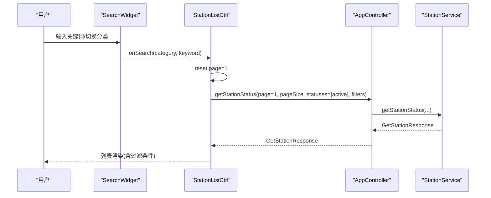
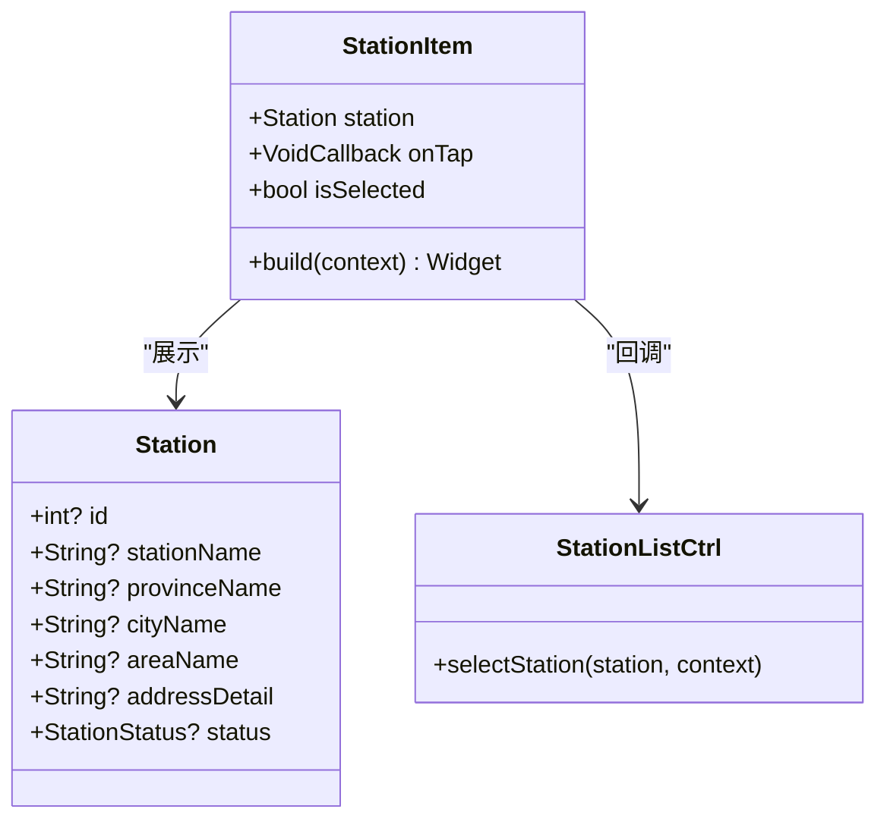
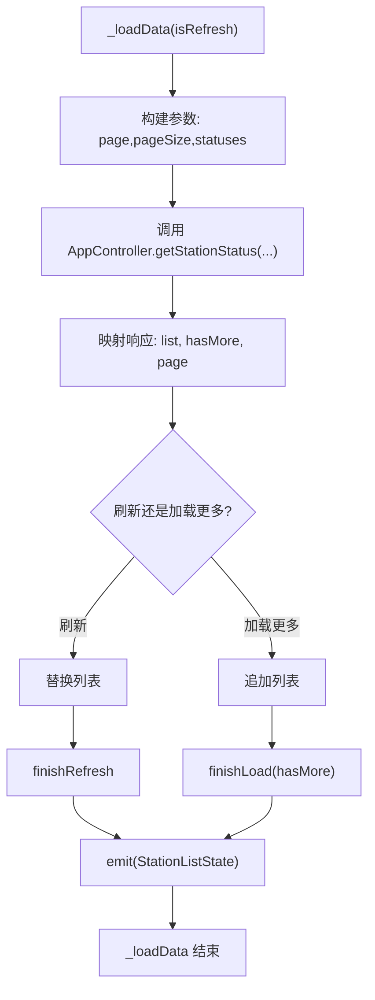
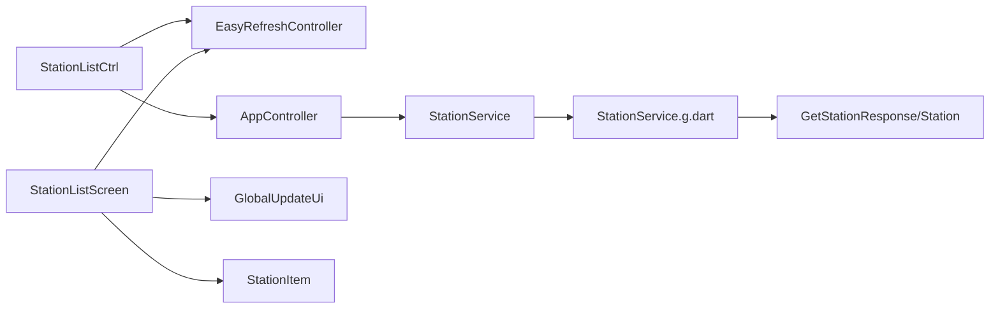

# 加油站列表

<cite>
**本文引用的文件**
- [station_list_screen.dart](file://lib/pages/station_list/widgets/station_list_screen.dart)
- [station_item.dart](file://lib/pages/station_list/widgets/station_item.dart)
- [controller.dart](file://lib/pages/station_list/controller.dart)
- [state.dart](file://lib/pages/station_list/state.dart)
- [station_service.dart](file://lib/global/service/station_service.dart)
- [station_service.g.dart](file://lib/global/service/station_service.g.dart)
- [app_controller.dart](file://lib/global/app_controller.dart)
- [station_res_type.dart](file://lib/global/model/station_res_type.dart)
- [common.dart](file://lib/global/enum/common.dart)
- [search_widget.dart](file://lib/widgets/common/search_widget.dart)
- [debouncer.dart](file://lib/utils/debouncer.dart)
</cite>

## 目录
1. [简介](#简介)
2. [项目结构](#项目结构)
3. [核心组件](#核心组件)
4. [架构总览](#架构总览)
5. [详细组件分析](#详细组件分析)
6. [依赖关系分析](#依赖关系分析)
7. [性能考虑](#性能考虑)
8. [故障排查指南](#故障排查指南)
9. [结论](#结论)
10. [附录](#附录)

## 简介
本文件系统性解析“加油站列表”模块的实现机制，重点覆盖：
- 分页加载与懒加载：基于 EasyRefresh 的下拉刷新与上拉加载，结合控制器中的页码与“是否还有更多”标志位实现懒加载。
- 搜索过滤：当前页面未直接集成搜索过滤逻辑，但提供了可复用的搜索组件与防抖工具，便于扩展。
- UI 结构与状态展示：列表项组件负责展示加油站名称、地址与选中态；屏幕组件负责空态、错误态、底部按钮与全局更新。
- 数据流：Controller 中的 fetchStations 方法通过 AppController 调用 StationService，完成请求参数构建与响应映射。
- 实战示例：提供列表刷新、加载更多、搜索查询的调用路径与关键参数说明。
- 常见问题与优化：分页去重、无结果状态、列表项缓存、搜索防抖等。

## 项目结构
加油站列表模块位于 pages/station_list 目录，采用“视图-控制器-状态”的典型 BLoC 架构组织：
- 视图层：station_list_screen.dart（屏幕）、station_item.dart（列表项）
- 控制器：controller.dart（Cubit）
- 状态：state.dart（不可变状态对象）
- 服务层：app_controller.dart（应用级控制器，封装网络调用）、station_service.dart（Retrofit 接口）、station_service.g.dart（生成的网络实现）
- 数据模型：station_res_type.dart（Station、GetStationResponse 等）
- 过滤与搜索：search_widget.dart（通用搜索组件）、debouncer.dart（防抖工具）

图表来源
- [station_list_screen.dart](file://lib/pages/station_list/widgets/station_list_screen.dart#L1-L191)
- [station_item.dart](file://lib/pages/station_list/widgets/station_item.dart#L1-L119)
- [controller.dart](file://lib/pages/station_list/controller.dart#L1-L110)
- [state.dart](file://lib/pages/station_list/state.dart#L1-L44)
- [app_controller.dart](file://lib/global/app_controller.dart#L101-L109)
- [station_service.dart](file://lib/global/service/station_service.dart#L14-L20)
- [station_service.g.dart](file://lib/global/service/station_service.g.dart#L21-L53)
- [station_res_type.dart](file://lib/global/model/station_res_type.dart#L6-L24)
- [common.dart](file://lib/global/enum/common.dart#L12-L24)
- [search_widget.dart](file://lib/widgets/common/search_widget.dart#L1-L183)
- [debouncer.dart](file://lib/utils/debouncer.dart#L1-L22)

章节来源
- [station_list_screen.dart](file://lib/pages/station_list/widgets/station_list_screen.dart#L1-L191)
- [controller.dart](file://lib/pages/station_list/controller.dart#L1-L110)
- [state.dart](file://lib/pages/station_list/state.dart#L1-L44)

## 核心组件
- StationListScreen：负责渲染空态、错误态、列表主体与底部确认按钮；通过 PullOrRefreshEasy 集成下拉刷新与上拉加载。
- StationItem：展示加油站名称、地址、选中态视觉反馈；点击回调由父级控制器处理。
- StationListCtrl：Cubit，维护分页状态、触发刷新/加载更多、与服务层交互、更新 UI 状态。
- StationListState：不可变状态对象，包含 stations、isLoading、hasError、page、hasMore、isLoadingMore 等字段。
- AppController：应用级控制器，封装 getStationStatus 并调用 StationService。
- StationService：Retrofit 接口，定义 /stations 列表接口及参数（page、pageSize、statuses）。
- StationService.g.dart：自动生成的网络实现，负责参数序列化与响应反序列化。
- Station/GetStationResponse：数据模型，承载列表数据与分页元信息。
- StationStatus：枚举，用于筛选状态。
- SearchWidget/Debouncer：通用搜索组件与防抖工具，便于后续扩展搜索过滤。

章节来源
- [station_list_screen.dart](file://lib/pages/station_list/widgets/station_list_screen.dart#L1-L191)
- [station_item.dart](file://lib/pages/station_list/widgets/station_item.dart#L1-L119)
- [controller.dart](file://lib/pages/station_list/controller.dart#L1-L110)
- [state.dart](file://lib/pages/station_list/state.dart#L1-L44)
- [app_controller.dart](file://lib/global/app_controller.dart#L101-L109)
- [station_service.dart](file://lib/global/service/station_service.dart#L14-L20)
- [station_service.g.dart](file://lib/global/service/station_service.g.dart#L21-L53)
- [station_res_type.dart](file://lib/global/model/station_res_type.dart#L6-L24)
- [common.dart](file://lib/global/enum/common.dart#L12-L24)
- [search_widget.dart](file://lib/widgets/common/search_widget.dart#L1-L183)
- [debouncer.dart](file://lib/utils/debouncer.dart#L1-L22)

## 架构总览
下图展示了从用户操作到数据渲染的关键调用链路，以及分页与状态流转。

图表来源
- [station_list_screen.dart](file://lib/pages/station_list/widgets/station_list_screen.dart#L103-L137)
- [controller.dart](file://lib/pages/station_list/controller.dart#L24-L83)
- [app_controller.dart](file://lib/global/app_controller.dart#L101-L109)
- [station_service.dart](file://lib/global/service/station_service.dart#L14-L20)
- [station_service.g.dart](file://lib/global/service/station_service.g.dart#L21-L53)
- [station_res_type.dart](file://lib/global/model/station_res_type.dart#L6-L24)

## 详细组件分析

### 分页加载与懒加载（PaginationController 与 EasyRefresh）
- 列表容器使用 PullOrRefreshEasy，其 refreshController 由控制器持有，用于控制刷新与加载的结束与“没有更多”状态。
- 控制器在 onRefresh 时将 page 设为 1，并清空旧数据；在 onLoadMore 时 page 自增 1，拼接新数据。
- 通过 hasMore 决定 EasyRefresh Footer 的“成功/无更多”指示，避免无效加载。
- 初始加载时若 stations 为空，会先置 isLoading 为 true，以显示全屏加载。

图表来源
- [controller.dart](file://lib/pages/station_list/controller.dart#L38-L83)
- [state.dart](file://lib/pages/station_list/state.dart#L9-L22)
- [station_service.dart](file://lib/global/service/station_service.dart#L14-L20)
- [station_service.g.dart](file://lib/global/service/station_service.g.dart#L21-L53)

章节来源
- [controller.dart](file://lib/pages/station_list/controller.dart#L13-L83)
- [state.dart](file://lib/pages/station_list/state.dart#L9-L22)
- [station_list_screen.dart](file://lib/pages/station_list/widgets/station_list_screen.dart#L103-L137)

### 搜索过滤（当前实现与扩展建议）
- 当前页面未直接集成搜索过滤逻辑，但提供了通用搜索组件 SearchWidget 与防抖工具 Debouncer。
- SearchWidget 支持分类与输入框，回调 onSearch(category, keyword)，可用于触发控制器的过滤逻辑。
- 扩展思路：在控制器中新增 filterStations 方法，接收分类与关键词，重置 page=1 后调用 _loadData(isRefresh=true)；在视图中将 SearchWidget 的 onSearch 与控制器绑定。

图表来源
- [search_widget.dart](file://lib/widgets/common/search_widget.dart#L1-L183)
- [controller.dart](file://lib/pages/station_list/controller.dart#L38-L83)
- [app_controller.dart](file://lib/global/app_controller.dart#L101-L109)
- [station_service.dart](file://lib/global/service/station_service.dart#L14-L20)

章节来源
- [search_widget.dart](file://lib/widgets/common/search_widget.dart#L1-L183)
- [debouncer.dart](file://lib/utils/debouncer.dart#L1-L22)

### UI 结构与状态展示（StationItem）
- 展示字段：显示名称、完整地址（最多两行省略），支持选中态高亮边框、阴影与对勾图标。
- 选中态：根据全局 AppController 中的 selectedStation.id 与当前项 id 对比决定 isSelected。
- 点击行为：将选中项传入控制器 selectStation，随后关闭页面并返回结果。

图表来源
- [station_item.dart](file://lib/pages/station_list/widgets/station_item.dart#L1-L119)
- [station_res_type.dart](file://lib/global/model/station_res_type.dart#L26-L103)
- [controller.dart](file://lib/pages/station_list/controller.dart#L85-L90)

章节来源
- [station_item.dart](file://lib/pages/station_list/widgets/station_item.dart#L1-L119)
- [station_list_screen.dart](file://lib/pages/station_list/widgets/station_list_screen.dart#L114-L129)

### Controller 中 fetchStations 与 StationService 交互
- 请求参数构建：
  - page：根据 isRefresh 或当前 state.page 自增计算。
  - pageSize：固定值 10。
  - statuses：默认仅包含 active。
- 响应映射：
  - 读取 response.list 作为新数据源。
  - 根据 list 长度与 pageSize 判断 hasMore。
  - 刷新时替换列表，加载更多时追加。
  - 成功/失败分别调用 refreshController.finishRefresh/finishLoad，并设置 isLoading/hasError。
- 错误处理：
  - 捕获异常后设置 hasError 与错误消息，并向用户反馈。

图表来源
- [controller.dart](file://lib/pages/station_list/controller.dart#L38-L83)
- [app_controller.dart](file://lib/global/app_controller.dart#L101-L109)
- [station_service.dart](file://lib/global/service/station_service.dart#L14-L20)
- [station_service.g.dart](file://lib/global/service/station_service.g.dart#L21-L53)

章节来源
- [controller.dart](file://lib/pages/station_list/controller.dart#L38-L83)
- [app_controller.dart](file://lib/global/app_controller.dart#L101-L109)
- [station_service.dart](file://lib/global/service/station_service.dart#L14-L20)
- [station_service.g.dart](file://lib/global/service/station_service.g.dart#L21-L53)

### State 中 paginationData 的结构设计
- 字段说明：
  - page：当前页码，默认 1。
  - hasMore：是否存在下一页。
  - isLoadingMore：是否正在加载更多（可扩展用于 UI 反馈）。
  - isLoading/hasError/errorMessage：用于空态、错误态与重试。
- 设计要点：
  - 不可变状态对象，通过 copyWith 生成新状态，保证 BLoC 的单向数据流。
  - 与 EasyRefresh 的 finishRefresh/finishLoad 协同，避免 UI 与状态不同步。

章节来源
- [state.dart](file://lib/pages/station_list/state.dart#L9-L22)

## 依赖关系分析
- 控制器依赖：
  - EasyRefreshController：控制刷新/加载指示。
  - AppController：封装网络调用，统一鉴权与路由。
  - StationService：Retrofit 接口，生成实现负责参数与响应映射。
- 视图依赖：
  - 全局更新 UI（GlobalUpdateUi）：用于联动全局选中站点状态。
  - PullOrRefreshEasy：提供下拉刷新与上拉加载能力。
- 模型依赖：
  - Station/GetStationResponse：承载列表数据与分页元信息。
  - StationStatus：筛选状态枚举。

图表来源
- [controller.dart](file://lib/pages/station_list/controller.dart#L1-L23)
- [app_controller.dart](file://lib/global/app_controller.dart#L101-L109)
- [station_service.dart](file://lib/global/service/station_service.dart#L14-L20)
- [station_service.g.dart](file://lib/global/service/station_service.g.dart#L21-L53)
- [station_list_screen.dart](file://lib/pages/station_list/widgets/station_list_screen.dart#L103-L137)
- [station_item.dart](file://lib/pages/station_list/widgets/station_item.dart#L1-L119)

章节来源
- [controller.dart](file://lib/pages/station_list/controller.dart#L1-L23)
- [station_list_screen.dart](file://lib/pages/station_list/widgets/station_list_screen.dart#L103-L137)

## 性能考虑
- 列表项缓存与复用：
  - 使用 ListView.builder，按需渲染，避免一次性构建所有项。
  - 列表项内部尽量保持无状态或最小状态，减少重建开销。
- 防抖搜索：
  - 使用 Debouncer 工具对输入事件进行节流，降低频繁请求频率。
- 分页去重：
  - 在加载更多时采用追加策略，并依据 hasMore 控制 Footer 状态，避免重复请求。
- 网络与序列化：
  - Retrofit 自动生成的实现已内置参数与响应映射，减少手写样板代码与出错概率。
- 错误与空态：
  - 在空列表且非加载时显示“暂无数据”，并在错误时提供“重试”入口，提升用户体验。

章节来源
- [debouncer.dart](file://lib/utils/debouncer.dart#L1-L22)
- [controller.dart](file://lib/pages/station_list/controller.dart#L38-L83)
- [station_list_screen.dart](file://lib/pages/station_list/widgets/station_list_screen.dart#L50-L101)

## 故障排查指南
- 分页数据重复：
  - 确认 isRefresh 与 isLoadMore 的分支逻辑正确，刷新时替换列表，加载更多时追加。
  - 检查 hasMore 判断是否基于 list.length 与 pageSize 的关系。
- 无结果状态展示：
  - 当 stations 为空且非加载时，显示“暂无加油站数据”，并提供“新增加油站”入口。
  - 错误态时显示“加载失败”与“重试”按钮，点击后触发 onRefresh。
- 请求失败：
  - 捕获异常后设置 hasError 与错误消息，并调用 finishRefresh/finishLoad 失败指示。
- 选中态不一致：
  - 确保全局 selectedStation 来自 AppController，列表项通过 isSelected 判断渲染。

章节来源
- [controller.dart](file://lib/pages/station_list/controller.dart#L24-L83)
- [station_list_screen.dart](file://lib/pages/station_list/widgets/station_list_screen.dart#L50-L101)
- [station_item.dart](file://lib/pages/station_list/widgets/station_item.dart#L1-L119)

## 结论
加油站列表模块通过清晰的 BLoC 分层与 EasyRefresh 集成，实现了稳定的分页加载与懒加载体验。控制器负责参数构建、状态更新与错误处理，视图负责空态、错误态与交互反馈。当前未直接集成搜索过滤，但已提供可复用的搜索组件与防抖工具，便于快速扩展。建议在后续迭代中：
- 将搜索与过滤逻辑接入控制器，统一重置 page=1 并触发刷新。
- 引入列表项缓存与更细粒度的加载指示，进一步优化性能与体验。

## 附录
- 关键实现路径参考：
  - 列表刷新：[controller.dart](file://lib/pages/station_list/controller.dart#L24-L33)
  - 加载更多：[controller.dart](file://lib/pages/station_list/controller.dart#L34-L36)
  - 参数构建与响应映射：[controller.dart](file://lib/pages/station_list/controller.dart#L38-L68)
  - 网络调用封装：[app_controller.dart](file://lib/global/app_controller.dart#L101-L109)
  - Retrofit 接口与实现：[station_service.dart](file://lib/global/service/station_service.dart#L14-L20), [station_service.g.dart](file://lib/global/service/station_service.g.dart#L21-L53)
  - 数据模型：[station_res_type.dart](file://lib/global/model/station_res_type.dart#L6-L24), [common.dart](file://lib/global/enum/common.dart#L12-L24)
  - 搜索组件与防抖：[search_widget.dart](file://lib/widgets/common/search_widget.dart#L1-L183), [debouncer.dart](file://lib/utils/debouncer.dart#L1-L22)