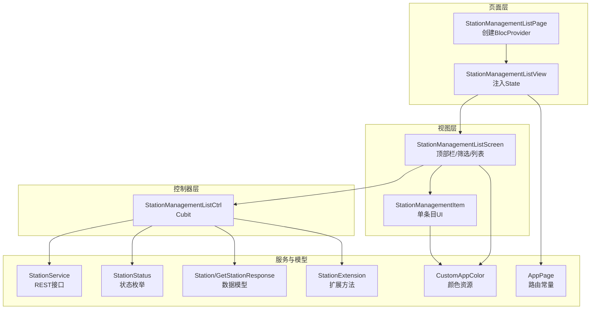
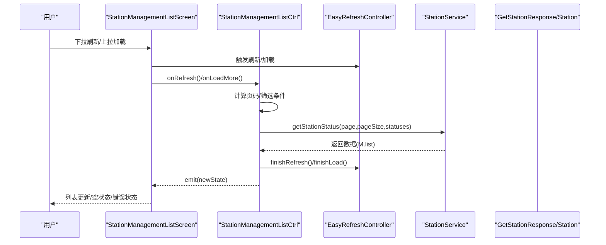
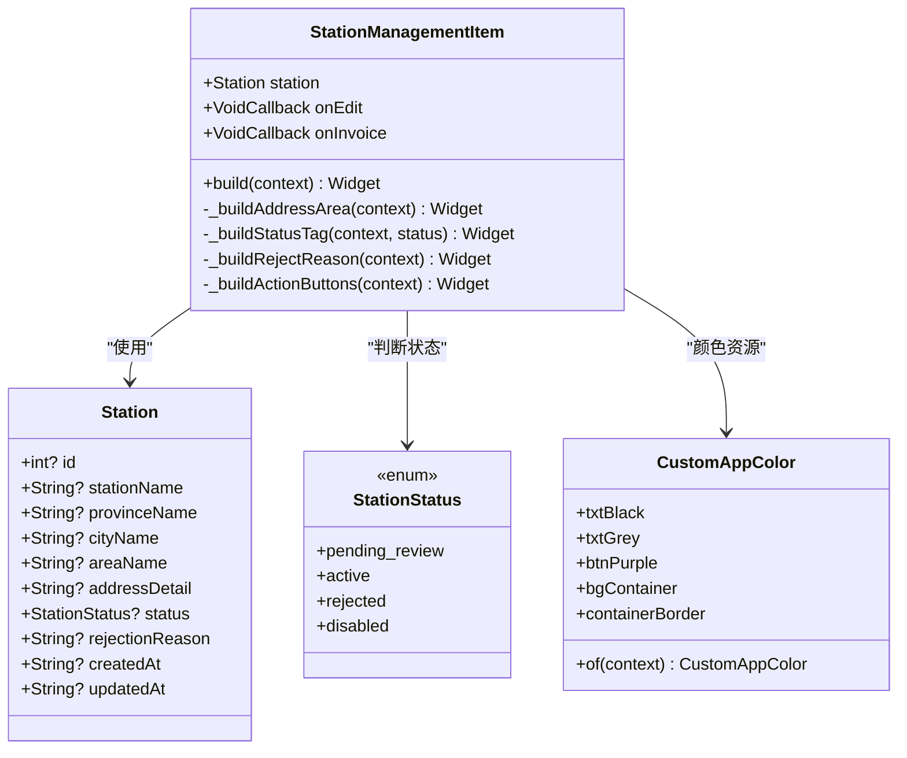
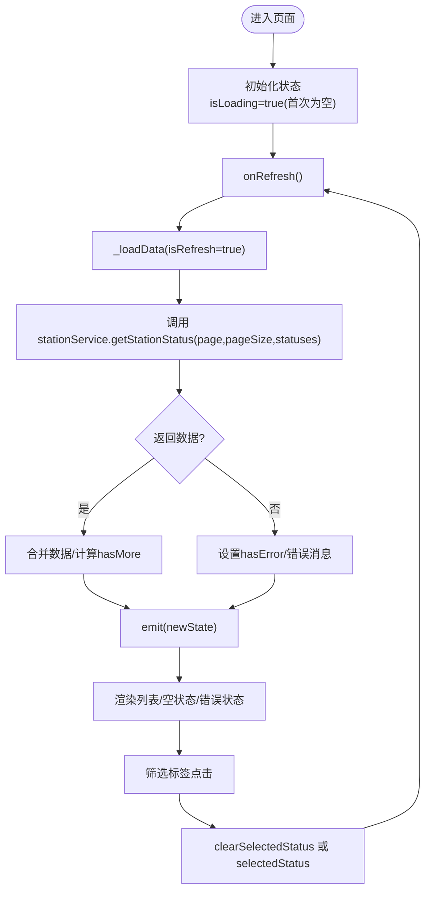
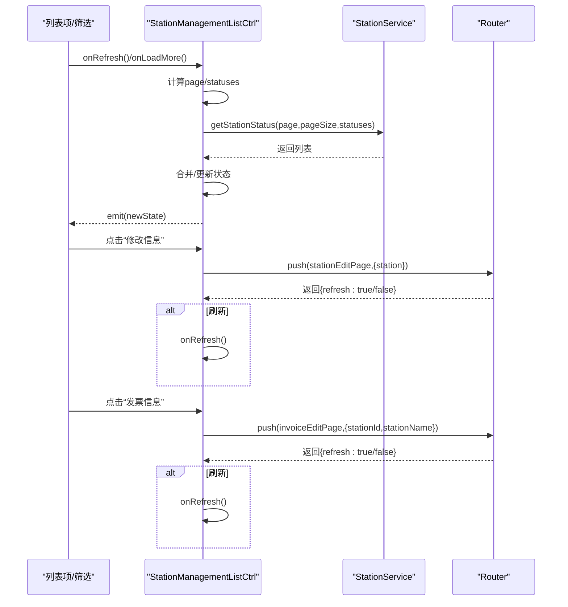
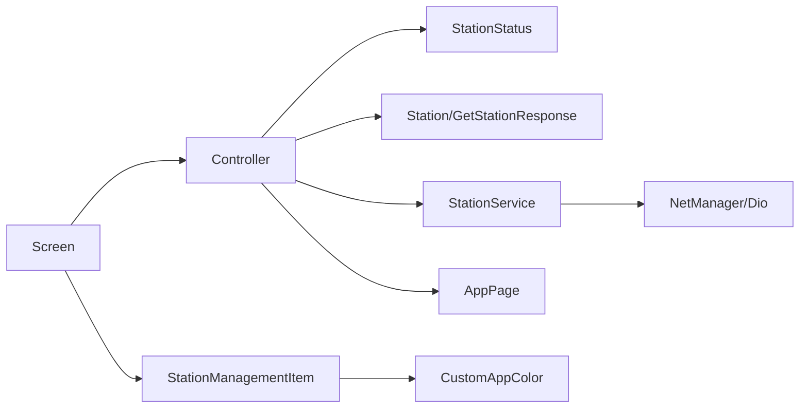

# 加油站管理列表

<cite>
**本文引用的文件**
- [controller.dart](file://lib/pages/station_management_list/controller.dart)
- [state.dart](file://lib/pages/station_management_list/state.dart)
- [view.dart](file://lib/pages/station_management_list/view.dart)
- [page.dart](file://lib/pages/station_management_list/page.dart)
- [station_management_list_screen.dart](file://lib/pages/station_management_list/widgets/station_management_list_screen.dart)
- [station_management_item.dart](file://lib/pages/station_management_list/widgets/station_management_item.dart)
- [station_service.dart](file://lib/global/service/station_service.dart)
- [common.dart](file://lib/global/enum/common.dart)
- [station_res_type.dart](file://lib/global/model/station_res_type.dart)
- [station_extension.dart](file://lib/utils/station_extension.dart)
- [colors.dart](file://lib/resources/colors.dart)
- [routes.dart](file://lib/router/routes.dart)
</cite>

## 目录
1. [简介](#简介)
2. [项目结构](#项目结构)
3. [核心组件](#核心组件)
4. [架构总览](#架构总览)
5. [详细组件分析](#详细组件分析)
6. [依赖分析](#依赖分析)
7. [性能考虑](#性能考虑)
8. [故障排查指南](#故障排查指南)
9. [结论](#结论)
10. [附录](#附录)

## 简介
本文件围绕“加油站管理列表”模块进行系统性文档化，重点阐述UI优化策略与交互设计，包括：
- 列表项的多状态展示（待审核、已通过、已拒绝、禁用）与视觉反馈
- station_management_item 组件的布局结构与状态指示设计（颜色、图标、文字提示）
- Controller 中分页加载与筛选功能的实现，以及与 stationService 的接口调用关系
- 列表项点击事件处理、状态刷新机制与空状态处理
- 针对UI卡顿、状态显示错误等常见问题的性能优化与调试建议
- 扩展方向（排序、批量操作）

## 项目结构
该模块采用典型的“页面-控制器-视图-组件”分层组织，配合全局服务与枚举模型，形成清晰的数据流与控制流。

图表来源
- [page.dart](file://lib/pages/station_management_list/page.dart#L1-L30)
- [view.dart](file://lib/pages/station_management_list/view.dart#L1-L20)
- [station_management_list_screen.dart](file://lib/pages/station_management_list/widgets/station_management_list_screen.dart#L1-L304)
- [station_management_item.dart](file://lib/pages/station_management_list/widgets/station_management_item.dart#L1-L317)
- [controller.dart](file://lib/pages/station_management_list/controller.dart#L1-L144)
- [station_service.dart](file://lib/global/service/station_service.dart#L1-L48)
- [common.dart](file://lib/global/enum/common.dart#L1-L84)
- [station_res_type.dart](file://lib/global/model/station_res_type.dart#L1-L164)
- [station_extension.dart](file://lib/utils/station_extension.dart#L1-L24)
- [colors.dart](file://lib/resources/colors.dart#L1-L361)
- [routes.dart](file://lib/router/routes.dart#L1-L260)

章节来源
- [page.dart](file://lib/pages/station_management_list/page.dart#L1-L30)
- [view.dart](file://lib/pages/station_management_list/view.dart#L1-L20)
- [station_management_list_screen.dart](file://lib/pages/station_management_list/widgets/station_management_list_screen.dart#L1-L304)
- [station_management_item.dart](file://lib/pages/station_management_list/widgets/station_management_item.dart#L1-L317)
- [controller.dart](file://lib/pages/station_management_list/controller.dart#L1-L144)
- [station_service.dart](file://lib/global/service/station_service.dart#L1-L48)
- [common.dart](file://lib/global/enum/common.dart#L1-L84)
- [station_res_type.dart](file://lib/global/model/station_res_type.dart#L1-L164)
- [station_extension.dart](file://lib/utils/station_extension.dart#L1-L24)
- [colors.dart](file://lib/resources/colors.dart#L1-L361)
- [routes.dart](file://lib/router/routes.dart#L1-L260)

## 核心组件
- 页面与视图：负责渲染顶部栏、筛选区、列表主体与空状态；通过 BlocProvider 注入控制器与状态。
- 控制器：封装分页加载、筛选、路由跳转、状态刷新等逻辑；与服务层交互获取数据。
- 屏幕组件：构建顶部导航、筛选标签、列表容器与空状态卡片。
- 列表项组件：根据状态渲染标题、地址、状态标签、驳回原因与操作按钮。
- 全局服务与模型：提供 REST 接口、状态枚举、Station 数据模型与扩展方法。
- 资源与路由：统一颜色资源与页面路由常量。

章节来源
- [page.dart](file://lib/pages/station_management_list/page.dart#L1-L30)
- [view.dart](file://lib/pages/station_management_list/view.dart#L1-L20)
- [controller.dart](file://lib/pages/station_management_list/controller.dart#L1-L144)
- [station_management_list_screen.dart](file://lib/pages/station_management_list/widgets/station_management_list_screen.dart#L1-L304)
- [station_management_item.dart](file://lib/pages/station_management_list/widgets/station_management_item.dart#L1-L317)
- [station_service.dart](file://lib/global/service/station_service.dart#L1-L48)
- [common.dart](file://lib/global/enum/common.dart#L1-L84)
- [station_res_type.dart](file://lib/global/model/station_res_type.dart#L1-L164)
- [station_extension.dart](file://lib/utils/station_extension.dart#L1-L24)
- [colors.dart](file://lib/resources/colors.dart#L1-L361)
- [routes.dart](file://lib/router/routes.dart#L1-L260)

## 架构总览
该模块遵循“状态驱动UI”的思想，使用 Cubit 管理状态，使用 EasyRefresh 提供下拉刷新与上拉加载，使用 go_router 进行页面跳转，使用 Retrofit/Dio 进行网络请求。

图表来源
- [controller.dart](file://lib/pages/station_management_list/controller.dart#L1-L144)
- [station_management_list_screen.dart](file://lib/pages/station_management_list/widgets/station_management_list_screen.dart#L1-L304)
- [station_service.dart](file://lib/global/service/station_service.dart#L1-L48)

## 详细组件分析

### 列表项组件：station_management_item
该组件负责单条加油站记录的展示，包含标题、地址、状态标签、驳回原因与操作按钮。其状态指示通过颜色、图标与文字组合呈现，确保在不同状态下具备明确的可读性与可操作性。

图表来源
- [station_management_item.dart](file://lib/pages/station_management_list/widgets/station_management_item.dart#L1-L317)
- [station_res_type.dart](file://lib/global/model/station_res_type.dart#L1-L164)
- [common.dart](file://lib/global/enum/common.dart#L1-L84)
- [colors.dart](file://lib/resources/colors.dart#L1-L361)

状态指示设计要点
- 正常：绿色背景与深绿色文字，表示可用状态。
- 待审核：浅紫色背景与紫色文字，强调审核中。
- 已驳回：浅红色背景与红色文字，突出异常状态并附带驳回原因区域。
- 禁用：浅灰背景与灰色文字，表示不可用状态。
- 地址区域：使用位置图标与弱色文字，避免干扰主信息。
- 操作按钮：仅在非禁用状态下显示；当被驳回时优先引导“去修改并重新提交”。

章节来源
- [station_management_item.dart](file://lib/pages/station_management_list/widgets/station_management_item.dart#L1-L317)
- [colors.dart](file://lib/resources/colors.dart#L1-L361)
- [station_res_type.dart](file://lib/global/model/station_res_type.dart#L1-L164)
- [common.dart](file://lib/global/enum/common.dart#L1-L84)

### 列表屏幕：station_management_list_screen
该组件负责顶部栏、筛选标签、列表主体与空状态处理。通过 PullOrRefreshEasy 实现下拉刷新与上拉加载，ListView.builder 渲染列表项。

图表来源
- [controller.dart](file://lib/pages/station_management_list/controller.dart#L1-L144)
- [station_management_list_screen.dart](file://lib/pages/station_management_list/widgets/station_management_list_screen.dart#L1-L304)
- [station_service.dart](file://lib/global/service/station_service.dart#L1-L48)

筛选与分页逻辑
- 分页：每页固定大小，根据返回列表长度与固定页大小判断是否还有更多数据。
- 筛选：当未选择状态时，默认传入所有状态；当选择某状态时仅传该状态。
- 刷新：清空 footer 并结束刷新指示；加载更多：根据是否有更多数据决定结束状态。

章节来源
- [controller.dart](file://lib/pages/station_management_list/controller.dart#L1-L144)
- [station_management_list_screen.dart](file://lib/pages/station_management_list/widgets/station_management_list_screen.dart#L1-L304)

### 控制器：StationManagementListCtrl
控制器承担数据加载、筛选、路由跳转与状态刷新的核心职责。

关键流程
- 初始化：构造函数触发一次刷新，确保首次进入即加载数据。
- 刷新/加载：根据 isRefresh 决定页码与合并策略；捕获异常并设置错误状态。
- 筛选：切换状态后重置到第一页并刷新。
- 路由：新增/编辑/发票信息页面返回后，根据返回参数决定是否刷新列表。
- 状态刷新：直接替换内存中的某条记录，避免全量刷新。

图表来源
- [controller.dart](file://lib/pages/station_management_list/controller.dart#L1-L144)
- [station_service.dart](file://lib/global/service/station_service.dart#L1-L48)
- [routes.dart](file://lib/router/routes.dart#L1-L260)

章节来源
- [controller.dart](file://lib/pages/station_management_list/controller.dart#L1-L144)
- [routes.dart](file://lib/router/routes.dart#L1-L260)

### 空状态与错误状态处理
- 首次加载且为空：显示加载指示器。
- 请求失败且为空：显示“加载失败”与“重试”按钮。
- 无数据且非加载：显示“暂无加油站数据”与“新增加油站”按钮。
- 错误恢复：点击重试触发 onRefresh。

章节来源
- [station_management_list_screen.dart](file://lib/pages/station_management_list/widgets/station_management_list_screen.dart#L227-L278)

### 列表项点击事件与状态刷新机制
- 点击“修改信息”：跳转至编辑页，返回后若携带刷新标记则刷新列表。
- 点击“发票信息”：跳转至发票编辑页，返回后若携带刷新标记则刷新列表。
- 状态刷新：当编辑或发票信息更新后，控制器通过 map 替换内存中的某条记录，避免全量刷新。

章节来源
- [controller.dart](file://lib/pages/station_management_list/controller.dart#L104-L142)
- [station_management_list_screen.dart](file://lib/pages/station_management_list/widgets/station_management_list_screen.dart#L280-L301)

## 依赖分析
- 控制器依赖：枚举（状态）、模型（Station/响应）、服务（StationService）、路由（AppPage）、日志、扩展方法。
- 屏幕组件依赖：颜色资源、通用文本与按钮、下拉刷新组件、列表项组件。
- 服务依赖：网络管理器、Retrofit 注解生成的服务代理。
- 模型依赖：freezed 序列化生成的模型与扩展方法。

图表来源
- [controller.dart](file://lib/pages/station_management_list/controller.dart#L1-L144)
- [station_management_list_screen.dart](file://lib/pages/station_management_list/widgets/station_management_list_screen.dart#L1-L304)
- [station_management_item.dart](file://lib/pages/station_management_list/widgets/station_management_item.dart#L1-L317)
- [station_service.dart](file://lib/global/service/station_service.dart#L1-L48)
- [common.dart](file://lib/global/enum/common.dart#L1-L84)
- [station_res_type.dart](file://lib/global/model/station_res_type.dart#L1-L164)
- [colors.dart](file://lib/resources/colors.dart#L1-L361)
- [routes.dart](file://lib/router/routes.dart#L1-L260)

章节来源
- [controller.dart](file://lib/pages/station_management_list/controller.dart#L1-L144)
- [station_management_list_screen.dart](file://lib/pages/station_management_list/widgets/station_management_list_screen.dart#L1-L304)
- [station_management_item.dart](file://lib/pages/station_management_list/widgets/station_management_item.dart#L1-L317)
- [station_service.dart](file://lib/global/service/station_service.dart#L1-L48)
- [common.dart](file://lib/global/enum/common.dart#L1-L84)
- [station_res_type.dart](file://lib/global/model/station_res_type.dart#L1-L164)
- [colors.dart](file://lib/resources/colors.dart#L1-L361)
- [routes.dart](file://lib/router/routes.dart#L1-L260)

## 性能考虑
- 列表渲染优化
  - 使用 ListView.builder 与固定间距，避免一次性构建大量子项。
  - 列表项内部按需渲染（例如仅在被驳回时显示原因区域）。
- 网络与状态更新
  - 分页加载避免一次性拉取过多数据；根据返回长度判断是否还有更多。
  - 状态刷新采用局部替换，减少不必要的重建。
- UI反馈
  - 刷新/加载完成后及时结束指示器，避免“卡住”感。
  - 错误状态与空状态分别处理，避免重复渲染。
- 可访问性与一致性
  - 颜色与文字大小遵循统一主题，保证在深浅主题下的可读性。
  - 状态标签与图标保持一致风格，降低认知负担。

[本节为通用性能建议，无需特定文件引用]

## 故障排查指南
- UI卡顿
  - 检查是否存在大量子组件在每次 rebuild 中被重建；确认使用 ListView.builder 与必要的键值。
  - 确认刷新/加载指示器在正确时机结束，避免阻塞后续交互。
- 状态显示错误
  - 确认状态枚举与服务端返回值一致；检查 Station.status 是否正确映射。
  - 若出现“未知”状态，检查默认分支与枚举值是否匹配。
- 空状态不正确
  - 确认 isLoading 与 stations 长度的判断逻辑；确保首次加载与失败场景覆盖完整。
- 列表不刷新
  - 确认编辑/发票信息页面返回时携带刷新标记；控制器中 onRefresh 被调用。
- 筛选无效
  - 确认 selectedStatus 的切换逻辑与 statuses 参数传递正确；刷新时页码应重置为 1。

章节来源
- [controller.dart](file://lib/pages/station_management_list/controller.dart#L1-L144)
- [station_management_list_screen.dart](file://lib/pages/station_management_list/widgets/station_management_list_screen.dart#L227-L278)
- [station_management_item.dart](file://lib/pages/station_management_list/widgets/station_management_item.dart#L1-L317)

## 结论
该模块通过清晰的状态管理与组件化设计，实现了加油站管理列表的多状态展示、筛选与分页加载。UI层面以颜色、图标与文字提示强化状态表达，交互层面以路由返回刷新与局部状态更新提升用户体验。建议在现有基础上引入排序与批量操作能力，进一步完善管理效率。

[本节为总结性内容，无需特定文件引用]

## 附录

### 代码示例路径（不含具体代码）
- 列表项点击事件处理（编辑/发票信息）
  - [点击编辑](file://lib/pages/station_management_list/widgets/station_management_list_screen.dart#L280-L301)
  - [控制器路由跳转](file://lib/pages/station_management_list/controller.dart#L104-L135)
- 状态刷新机制（局部替换）
  - [状态刷新](file://lib/pages/station_management_list/controller.dart#L137-L142)
- 空状态处理
  - [空状态与错误状态](file://lib/pages/station_management_list/widgets/station_management_list_screen.dart#L227-L278)
- 多状态展示（颜色/图标/文字）
  - [状态标签渲染](file://lib/pages/station_management_list/widgets/station_management_item.dart#L111-L160)
  - [驳回原因区域](file://lib/pages/station_management_list/widgets/station_management_item.dart#L162-L212)
- 分页与筛选集成
  - [分页加载与筛选](file://lib/pages/station_management_list/controller.dart#L38-L102)
  - [筛选标签交互](file://lib/pages/station_management_list/widgets/station_management_list_screen.dart#L132-L189)
- 与服务接口调用关系
  - [服务接口定义](file://lib/global/service/station_service.dart#L1-L48)
  - [状态枚举](file://lib/global/enum/common.dart#L12-L24)
  - [数据模型](file://lib/global/model/station_res_type.dart#L1-L164)
  - [地址扩展](file://lib/utils/station_extension.dart#L1-L24)