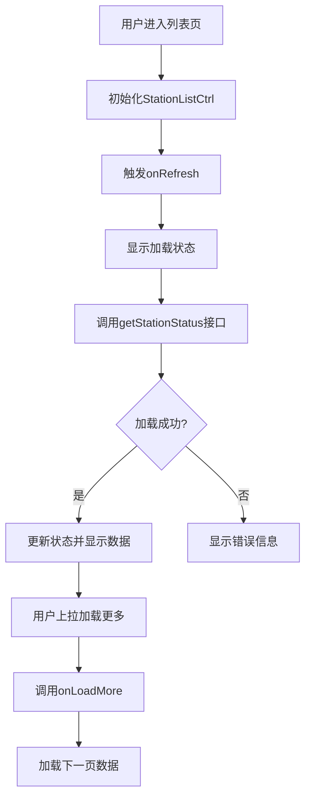
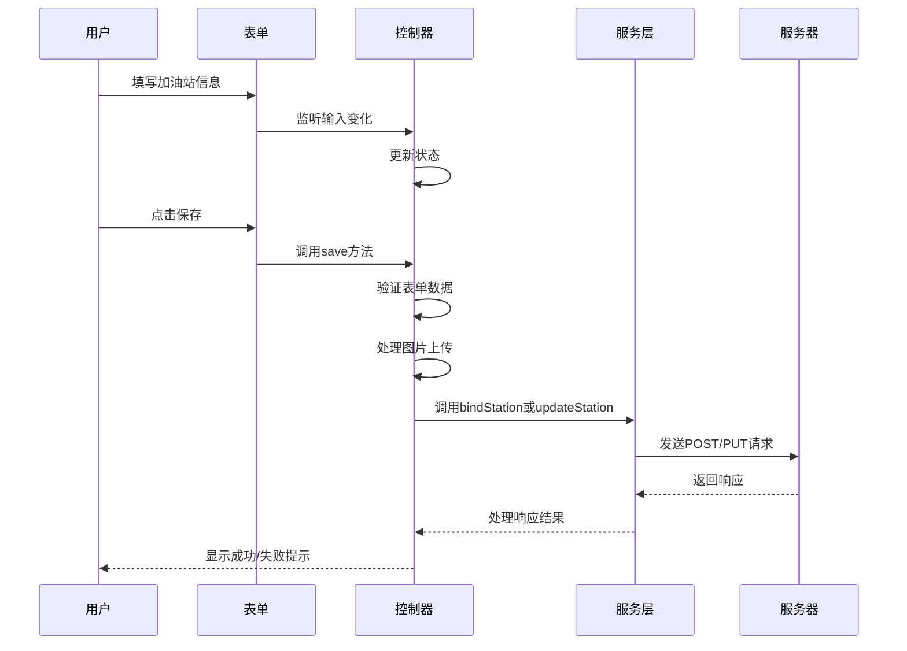
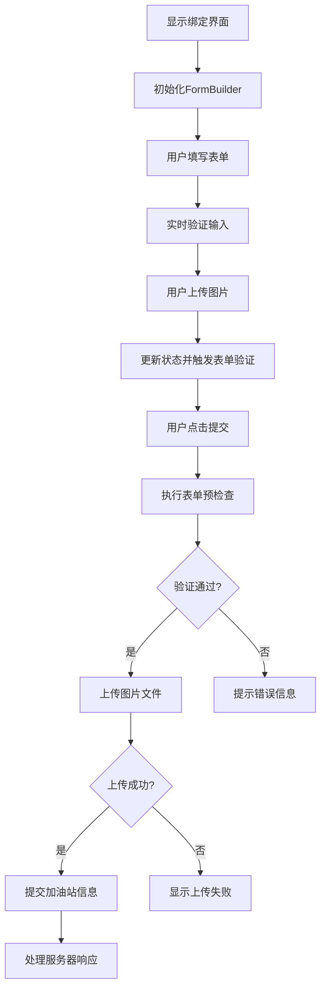
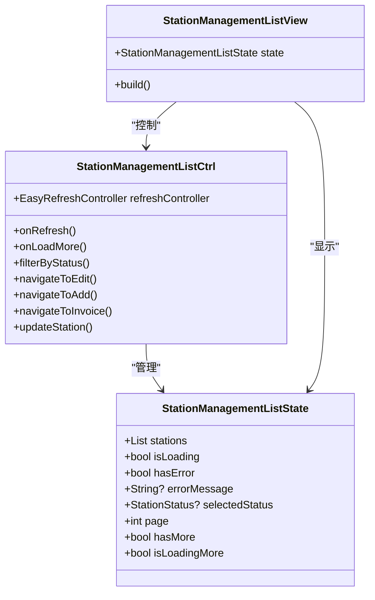

# 加油站管理模块

<cite>
**本文档引用的文件**   
- [station_list/controller.dart](file://lib/pages/station_list/controller.dart)
- [station_list/state.dart](file://lib/pages/station_list/state.dart)
- [station_list/view.dart](file://lib/pages/station_list/view.dart)
- [station_list/page.dart](file://lib/pages/station_list/page.dart)
- [station_edit/controller.dart](file://lib/pages/station_edit/controller.dart)
- [station_edit/state.dart](file://lib/pages/station_edit/state.dart)
- [station_edit/widgets/station_edit_form.dart](file://lib/pages/station_edit/widgets/station_edit_form.dart)
- [bind_station/controller.dart](file://lib/pages/bind_station/controller.dart)
- [bind_station/state.dart](file://lib/pages/bind_station/state.dart)
- [bind_station/widgets/bind_station_screen.dart](file://lib/pages/bind_station/widgets/bind_station_screen.dart)
- [station_management_list/controller.dart](file://lib/pages/station_management_list/controller.dart)
- [station_management_list/state.dart](file://lib/pages/station_management_list/state.dart)
- [station_management_list/view.dart](file://lib/pages/station_management_list/view.dart)
- [global/service/station_service.dart](file://lib/global/service/station_service.dart)
- [global/model/station_res_type.dart](file://lib/global/model/station_res_type.dart)
- [global/enum/common.dart](file://lib/global/enum/common.dart)
</cite>

## 目录
1. [列表展示功能](#列表展示功能)
2. [信息编辑功能](#信息编辑功能)
3. [绑定操作功能](#绑定操作功能)
4. [管理列表功能](#管理列表功能)
5. [服务接口调用](#服务接口调用)
6. [状态管理机制](#状态管理机制)
7. [常见问题解决方案](#常见问题解决方案)
8. [扩展建议](#扩展建议)

## 列表展示功能

加油站列表展示功能通过 `station_list` 模块实现，采用分页加载和搜索过滤机制。该功能基于 BLoC 模式进行状态管理，通过 `StationListCtrl` 控制器处理数据加载逻辑。

分页加载通过 `EasyRefreshController` 实现下拉刷新和上拉加载更多功能。每次加载请求会根据当前页码和页面大小（固定为10条）向服务器请求数据。控制器维护了当前页码、是否还有更多数据等状态信息，并在加载成功后更新状态。

搜索过滤功能虽然在当前实现中未直接体现，但可以通过扩展 `getStationStatus` 接口的查询参数来实现。当前接口支持通过状态过滤加油站，为后续添加搜索功能提供了基础。

**图表来源**
- [station_list/controller.dart](file://lib/pages/station_list/controller.dart#L13-L110)
- [station_list/state.dart](file://lib/pages/station_list/state.dart#L3-L44)

**章节来源**
- [station_list/controller.dart](file://lib/pages/station_list/controller.dart#L13-L110)
- [station_list/state.dart](file://lib/pages/station_list/state.dart#L3-L44)
- [station_list/view.dart](file://lib/pages/station_list/view.dart#L8-L25)

## 信息编辑功能

加油站信息编辑功能通过 `station_edit_form` 组件实现，提供了完整的表单验证规则和数据提交流程。该功能采用控制器-视图分离模式，确保业务逻辑与UI展示的解耦。

表单验证规则包括：
- 加油站名称不能为空且必须至少2个字符
- 必须选择省市区信息
- 详细地址不能为空
- 营业执照和成品油零售许可证为可选上传项

数据提交流程如下：用户点击保存按钮后，系统首先进行前端验证，验证通过后显示加载状态。对于新上传的图片文件，系统会先调用上传接口获取URL，然后将完整的加油站信息提交到服务器。如果编辑的是已激活状态的加油站，系统会弹出确认对话框，提示用户修改信息需要重新审核。

**图表来源**
- [station_edit/widgets/station_edit_form.dart](file://lib/pages/station_edit/widgets/station_edit_form.dart#L12-L331)
- [station_edit/controller.dart](file://lib/pages/station_edit/controller.dart#L18-L264)

**章节来源**
- [station_edit/widgets/station_edit_form.dart](file://lib/pages/station_edit/widgets/station_edit_form.dart#L12-L331)
- [station_edit/controller.dart](file://lib/pages/station_edit/controller.dart#L18-L264)
- [station_edit/state.dart](file://lib/pages/station_edit/state.dart#L3-L80)

## 绑定操作功能

绑定加油站操作通过 `bind_station_screen` 组件实现，采用了 FormBuilder 进行表单管理和验证。该界面主要用于企业入驻时绑定首个加油站的场景。

交互设计特点包括：
- 使用 FormBuilder 简化表单验证逻辑
- 实时同步表单状态到控制器
- 图片上传后自动触发表单字段更新
- 提交时进行完整的表单验证

状态同步机制基于 BLoC 模式，`BindStationCtrl` 控制器负责管理表单状态，包括加载状态、图片URL等。当用户上传图片时，除了更新控制器状态外，还会手动触发 FormBuilder 的字段变更，确保表单验证状态正确更新。

**图表来源**
- [bind_station/widgets/bind_station_screen.dart](file://lib/pages/bind_station/widgets/bind_station_screen.dart#L17-L280)
- [bind_station/controller.dart](file://lib/pages/bind_station/controller.dart#L14-L100)

**章节来源**
- [bind_station/widgets/bind_station_screen.dart](file://lib/pages/bind_station/widgets/bind_station_screen.dart#L17-L280)
- [bind_station/controller.dart](file://lib/pages/bind_station/controller.dart#L14-L100)
- [bind_station/state.dart](file://lib/pages/bind_station/state.dart#L1-L24)

## 管理列表功能

加油站管理列表通过 `station_management_list` 模块实现，相比普通列表增加了筛选和管理功能。该功能的UI优化策略主要体现在以下几个方面：

1. **筛选功能优化**：提供状态筛选选项，用户可以按加油站状态（待审核、已激活、已拒绝、已禁用）进行过滤
2. **操作便捷性**：每个加油站项都提供编辑和发票管理快捷操作
3. **状态可视化**：不同状态的加油站使用不同的视觉标识，便于快速识别
4. **响应式设计**：适配不同屏幕尺寸，确保在各种设备上都有良好的用户体验

管理列表同样采用分页加载机制，但增加了筛选状态的持久化。当用户选择某个筛选条件后，系统会记住该选择并在刷新时保持相同的筛选状态。

**图表来源**
- [station_management_list/controller.dart](file://lib/pages/station_management_list/controller.dart#L13-L144)
- [station_management_list/state.dart](file://lib/pages/station_management_list/state.dart#L4-L51)

**章节来源**
- [station_management_list/controller.dart](file://lib/pages/station_management_list/controller.dart#L13-L144)
- [station_management_list/state.dart](file://lib/pages/station_management_list/state.dart#L4-L51)
- [station_management_list/view.dart](file://lib/pages/station_management_list/view.dart#L8-L20)

## 服务接口调用

`station_service` 提供了完整的 RESTful 接口调用方式，基于 Retrofit 模式封装了对加油站管理相关的 API 调用。

### GET 请求
- **获取加油站列表**：`GET /stations`
  - 参数：page（页码）、pageSize（每页数量）、statuses（状态列表）
  - 响应：GetStationResponse 对象，包含分页信息和加油站列表
- **获取加油站详情**：`GET /stations/{id}`
  - 参数：id（加油站ID）
  - 响应：StationDetailResponse 对象，包含加油站详细信息

### POST 请求
- **新增加油站**：`POST /stations`
  - 请求体：BindStationRequest 对象
  - 参数结构：包含加油站名称、省市区信息、详细地址、证件图片URL等
- **编辑加油站**：`PUT /stations/{id}`
  - 路径参数：id（加油站ID）
  - 请求体：BindStationRequest 对象
  - 响应处理：成功时返回空响应，失败时抛出异常

接口调用采用异步模式，通过 Future 处理响应。错误处理机制包括网络异常、服务器错误等，所有异常都会被捕获并转换为用户友好的错误提示。

**章节来源**
- [global/service/station_service.dart](file://lib/global/service/station_service.dart#L8-L48)
- [global/model/station_res_type.dart](file://lib/global/model/station_res_type.dart#L6-L164)

## 状态管理机制

本模块采用 BLoC（Business Logic Component）模式进行状态管理，通过控制器（Ctrl）和状态（State）的分离实现清晰的架构。

Controller 负责：
- 处理用户交互事件
- 调用服务层接口
- 管理页面状态变更
- 发出新的状态对象

State 负责：
- 存储页面当前状态
- 提供不可变的状态对象
- 支持状态复制和更新

状态更新流程：当用户触发某个操作时，Controller 会创建一个新的 State 对象，通过 emit 方法发出。BlocBuilder 组件监听状态变化并重新构建UI。这种机制确保了状态的一致性和可预测性。

**章节来源**
- [station_list/controller.dart](file://lib/pages/station_list/controller.dart#L13-L110)
- [station_edit/controller.dart](file://lib/pages/station_edit/controller.dart#L18-L264)
- [bind_station/controller.dart](file://lib/pages/bind_station/controller.dart#L14-L100)

## 常见问题解决方案

### 列表刷新异常
**问题**：列表刷新后数据未更新或显示异常
**解决方案**：
1. 检查网络连接状态
2. 确认 `onRefresh` 方法正确调用了数据加载
3. 验证服务器响应数据格式是否符合预期
4. 检查状态更新逻辑，确保 emit 了正确的状态对象

### 编辑数据不同步
**问题**：编辑后返回列表页，数据未及时更新
**解决方案**：
1. 在导航返回时传递刷新标志：`BaseRouter.pop(result: {'refresh': true})`
2. 在列表页监听返回结果并触发刷新
3. 确保 `updateStation` 方法正确更新了状态中的加油站列表

### 图片上传失败
**问题**：营业执照或许可证图片上传失败
**解决方案**：
1. 检查图片文件大小是否超出限制
2. 验证网络连接是否稳定
3. 确认上传接口是否正常工作
4. 实现上传重试机制

**章节来源**
- [station_list/controller.dart](file://lib/pages/station_list/controller.dart#L24-L36)
- [station_edit/controller.dart](file://lib/pages/station_edit/controller.dart#L126-L264)
- [station_management_list/controller.dart](file://lib/pages/station_management_list/controller.dart#L25-L36)

## 扩展建议

### 新增筛选条件
可以在管理列表中增加更多筛选条件，如：
- 按创建时间范围筛选
- 按加油站名称关键字搜索
- 按地理位置筛选

实现方式：扩展 `getStationStatus` 接口，添加相应的查询参数，并在控制器中管理这些筛选状态。

### 批量操作功能
建议增加批量操作功能，如：
- 批量启用/禁用加油站
- 批量导出加油站数据
- 批量发送通知

实现方式：在管理列表顶部增加选择模式，用户可以选择多个加油站，然后执行批量操作。需要在状态中维护选中的加油站列表。

### 数据导出功能
增加数据导出功能，支持将加油站列表导出为 Excel 或 CSV 文件，便于线下分析和存档。

**章节来源**
- [station_management_list/controller.dart](file://lib/pages/station_management_list/controller.dart#L90-L102)
- [global/service/station_service.dart](file://lib/global/service/station_service.dart#L16-L20)