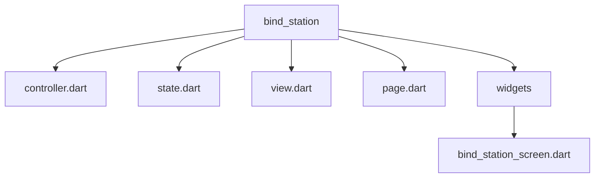
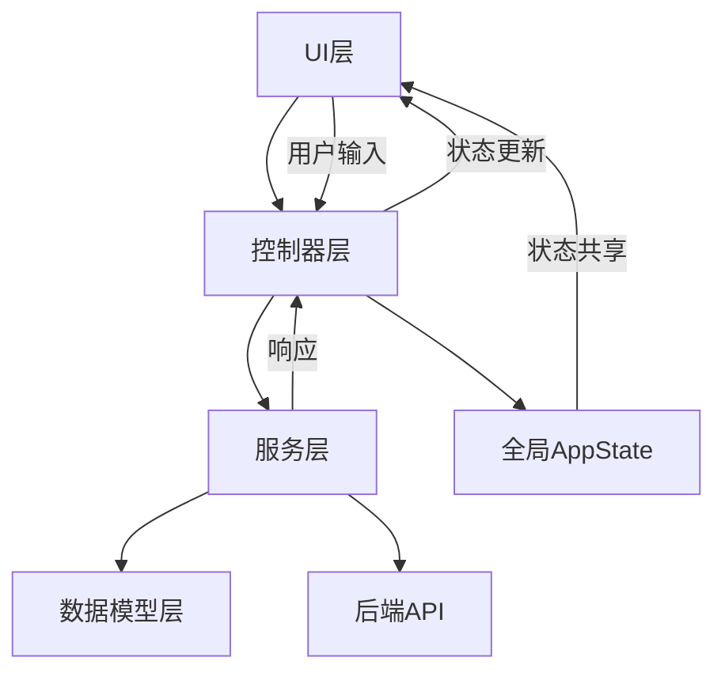
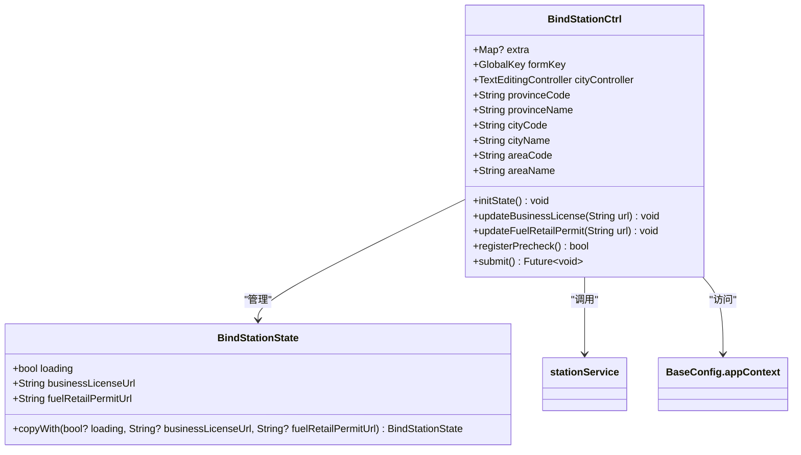
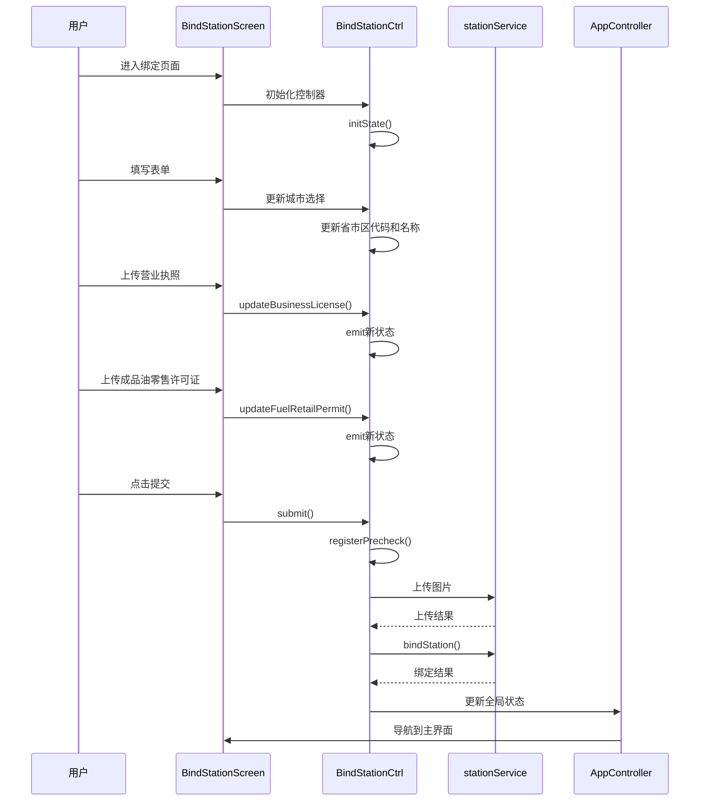
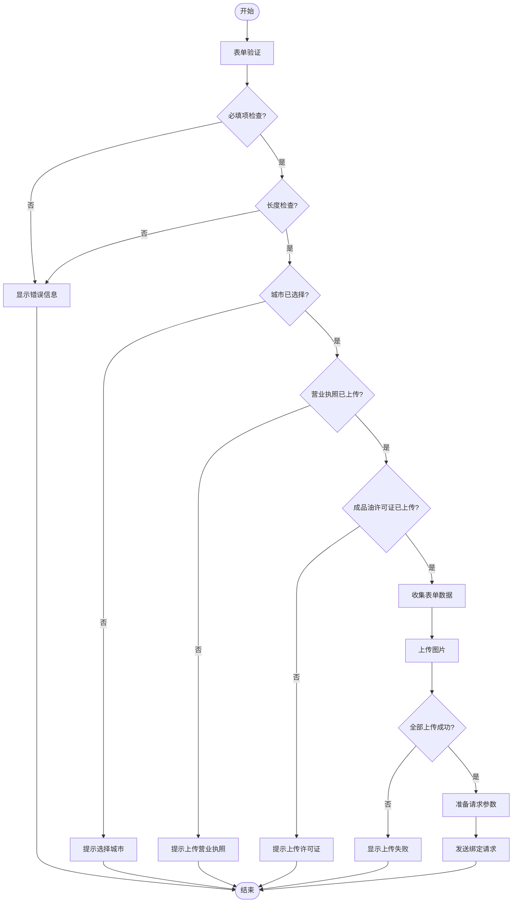
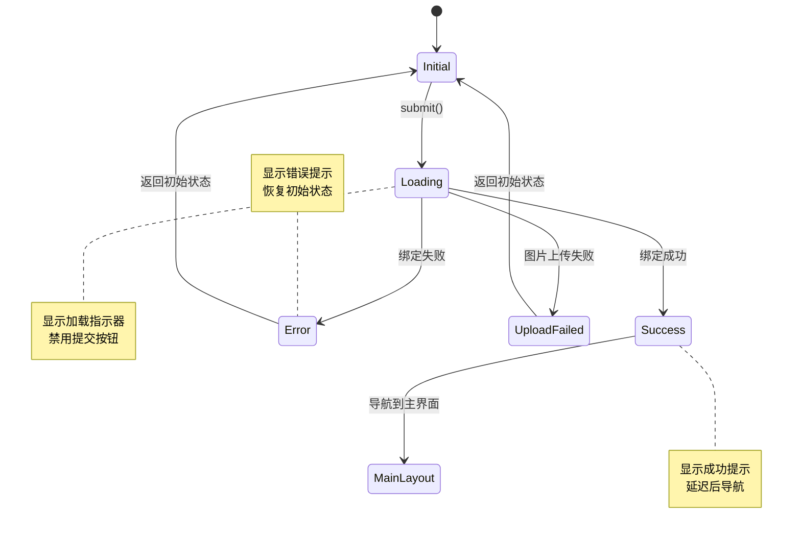
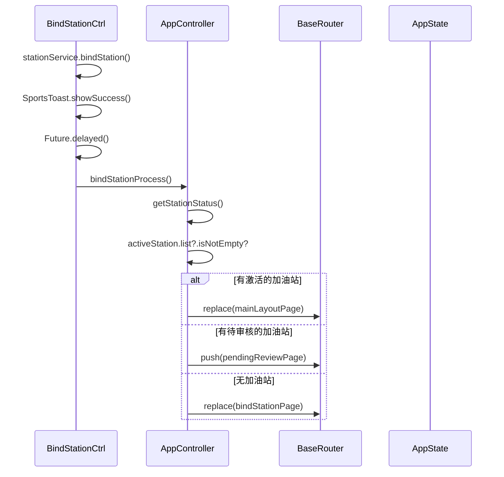
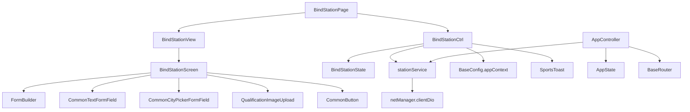

# 加油站绑定操作

<cite>
**本文档引用文件**  
- [bind_station_screen.dart](file://lib/pages/bind_station/widgets/bind_station_screen.dart)
- [controller.dart](file://lib/pages/bind_station/controller.dart)
- [state.dart](file://lib/pages/bind_station/state.dart)
- [page.dart](file://lib/pages/bind_station/page.dart)
- [station_service.dart](file://lib/global/service/station_service.dart)
- [app_controller.dart](file://lib/global/app_controller.dart)
- [station_req_type.dart](file://lib/global/model/station_req_type.dart)
- [station_res_type.dart](file://lib/global/model/station_res_type.dart)
- [app_state.dart](file://lib/global/app_state.dart)
- [router.dart](file://lib/router/router.dart)
- [routes.dart](file://lib/router/routes.dart)
</cite>

## 目录
1. [简介](#简介)
2. [项目结构](#项目结构)
3. [核心组件](#核心组件)
4. [架构概述](#架构概述)
5. [详细组件分析](#详细组件分析)
6. [依赖分析](#依赖分析)
7. [性能考虑](#性能考虑)
8. [故障排除指南](#故障排除指南)
9. [结论](#结论)

## 简介
本文档全面记录了`bind_station`模块的交互设计与状态同步机制，重点描述了`bind_station_screen`的用户引导流程。详细说明了绑定过程中表单数据的收集与验证逻辑，分析了Controller如何协调`stationService`的POST接口完成绑定操作。解释了页面状态（如初始状态、加载中、成功/失败反馈）的转换机制，描述了成功后如何更新全局AppState并导航至主界面。提供了代码示例展示错误处理（如重复绑定、网络异常）和用户体验优化（如按钮防重复点击）。针对绑定后状态未更新、导航失败等问题提供了解决方案，并建议增强功能如支持扫码绑定或批量导入。

## 项目结构
`bind_station`模块采用标准的Flutter页面结构，包含controller、state、view和page四个核心文件，以及一个widgets目录存放UI组件。该模块通过BLoC模式管理状态，使用FormBuilder进行表单管理，并通过DIO进行网络请求。

**Diagram sources**
- [controller.dart](file://lib/pages/bind_station/controller.dart)
- [state.dart](file://lib/pages/bind_station/state.dart)
- [view.dart](file://lib/pages/bind_station/view.dart)
- [page.dart](file://lib/pages/bind_station/page.dart)
- [bind_station_screen.dart](file://lib/pages/bind_station/widgets/bind_station_screen.dart)

**Section sources**
- [controller.dart](file://lib/pages/bind_station/controller.dart)
- [state.dart](file://lib/pages/bind_station/state.dart)
- [view.dart](file://lib/pages/bind_station/view.dart)
- [page.dart](file://lib/pages/bind_station/page.dart)

## 核心组件
`bind_station`模块的核心组件包括`BindStationCtrl`控制器、`BindStationState`状态类、`BindStationScreen`视图组件和`BindStationPage`页面入口。这些组件通过BLoC模式协同工作，实现了加油站绑定功能的完整流程。

**Section sources**
- [controller.dart](file://lib/pages/bind_station/controller.dart)
- [state.dart](file://lib/pages/bind_station/state.dart)
- [bind_station_screen.dart](file://lib/pages/bind_station/widgets/bind_station_screen.dart)
- [page.dart](file://lib/pages/bind_station/page.dart)

## 架构概述
`bind_station`模块采用分层架构设计，包括UI层、控制器层、服务层和数据模型层。UI层负责用户交互和界面展示，控制器层管理状态和业务逻辑，服务层处理网络请求，数据模型层定义数据结构。

**Diagram sources**
- [controller.dart](file://lib/pages/bind_station/controller.dart)
- [state.dart](file://lib/pages/bind_station/state.dart)
- [bind_station_screen.dart](file://lib/pages/bind_station/widgets/bind_station_screen.dart)
- [station_service.dart](file://lib/global/service/station_service.dart)
- [app_state.dart](file://lib/global/app_state.dart)

## 详细组件分析

### 绑定控制器分析
`BindStationCtrl`是`bind_station`模块的核心控制器，继承自`Cubit<BindStationState>`，负责管理绑定流程的状态和业务逻辑。

**Diagram sources**
- [controller.dart](file://lib/pages/bind_station/controller.dart#L14-L98)
- [state.dart](file://lib/pages/bind_station/state.dart#L1-L23)

#### 用户引导流程
`bind_station_screen`的用户引导流程从用户进入绑定页面开始，通过清晰的表单布局引导用户完成信息填写。页面顶部有返回按钮和标题，中间是分组的表单区域，底部是提交按钮。

**Diagram sources**
- [bind_station_screen.dart](file://lib/pages/bind_station/widgets/bind_station_screen.dart#L17-L280)
- [controller.dart](file://lib/pages/bind_station/controller.dart#L14-L98)
- [station_service.dart](file://lib/global/service/station_service.dart#L26-L28)
- [app_controller.dart](file://lib/global/app_controller.dart#L73-L98)

#### 表单数据收集与验证
表单数据的收集与验证通过`flutter_form_builder`库实现。表单包含加油站名称、所在区域、详细地址、营业执照和成品油零售许可证等字段。

**Diagram sources**
- [controller.dart](file://lib/pages/bind_station/controller.dart#L48-L52)
- [bind_station_screen.dart](file://lib/pages/bind_station/widgets/bind_station_screen.dart#L77-L167)
- [station_req_type.dart](file://lib/global/model/station_req_type.dart#L20-L82)

### 状态同步机制
页面状态的转换机制通过`BindStationState`类管理，包含`loading`标志位来控制加载状态的显示。

**Diagram sources**
- [state.dart](file://lib/pages/bind_station/state.dart#L1-L23)
- [controller.dart](file://lib/pages/bind_station/controller.dart#L57-L97)

#### 全局状态更新与导航
绑定成功后，通过`AppController`更新全局AppState并导航至主界面。

**Diagram sources**
- [controller.dart](file://lib/pages/bind_station/controller.dart#L94-L95)
- [app_controller.dart](file://lib/global/app_controller.dart#L73-L98)
- [router.dart](file://lib/router/router.dart#L127-L135)

## 依赖分析
`bind_station`模块依赖多个核心组件和服务，形成了清晰的依赖关系图。

**Diagram sources**
- [page.dart](file://lib/pages/bind_station/page.dart)
- [controller.dart](file://lib/pages/bind_station/controller.dart)
- [bind_station_screen.dart](file://lib/pages/bind_station/widgets/bind_station_screen.dart)
- [station_service.dart](file://lib/global/service/station_service.dart)
- [app_controller.dart](file://lib/global/app_controller.dart)

**Section sources**
- [page.dart](file://lib/pages/bind_station/page.dart)
- [controller.dart](file://lib/pages/bind_station/controller.dart)
- [bind_station_screen.dart](file://lib/pages/bind_station/widgets/bind_station_screen.dart)
- [station_service.dart](file://lib/global/service/station_service.dart)
- [app_controller.dart](file://lib/global/app_controller.dart)

## 性能考虑
`bind_station`模块在性能方面主要考虑了图片上传的并发处理和UI响应的优化。通过`Future.wait`并发上传多张图片，减少了总的上传时间。使用`loading`状态标志位防止用户重复提交，提升了用户体验。

## 故障排除指南
针对常见的绑定问题，提供以下解决方案：

1. **绑定后状态未更新**：检查`AppController`的`bindStationProcess`方法是否正确调用了`getStationStatus`并更新了`selectedStation`。
2. **导航失败**：确保`BaseRouter`已正确初始化，并检查路由路径是否正确。
3. **图片上传失败**：检查网络连接，确认上传接口是否正常工作。
4. **表单验证不通过**：确保所有必填字段都已填写，特别是城市选择和图片上传。
5. **重复绑定**：后端应返回相应的错误码，前端应捕获并显示友好的错误信息。

**Section sources**
- [app_controller.dart](file://lib/global/app_controller.dart#L73-L98)
- [router.dart](file://lib/router/router.dart)
- [api_exception.dart](file://lib/net/api_exception.dart)

## 结论
`bind_station`模块通过清晰的分层架构和状态管理机制，实现了加油站绑定的完整流程。模块采用BLoC模式管理状态，确保了UI与业务逻辑的分离。表单验证和图片上传处理完善，用户体验良好。通过`AppController`统一管理全局状态和导航，保证了应用状态的一致性。建议未来可以增加扫码绑定和批量导入功能，进一步提升用户体验。