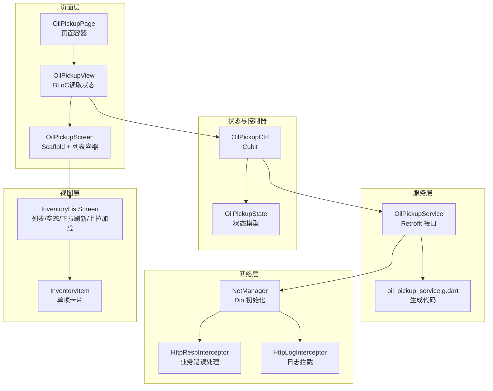
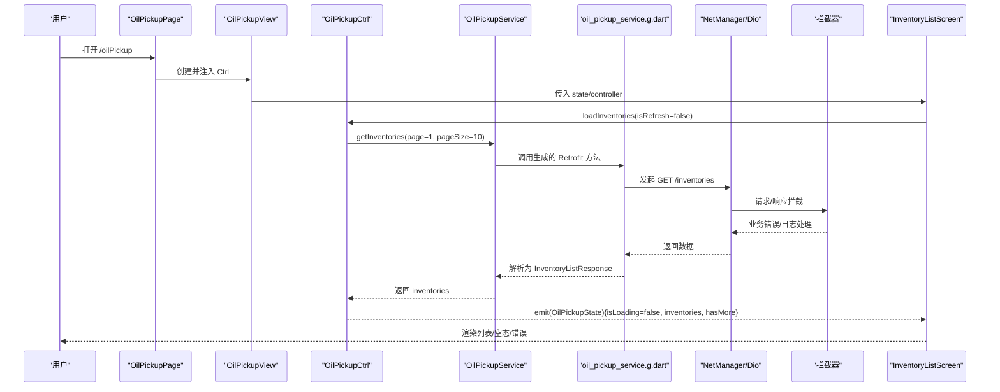
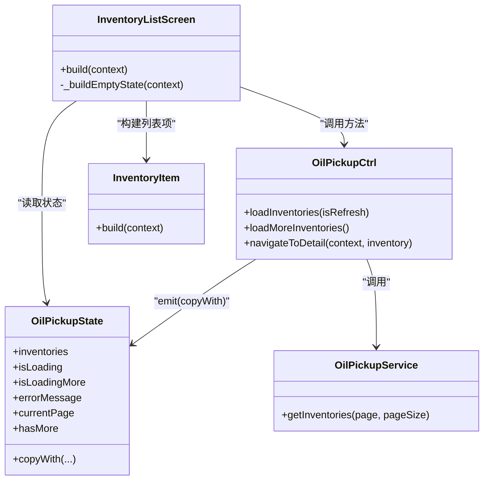

# 库存列表展示

<cite>
**本文引用的文件**
- [controller.dart](file://lib/pages/oil_pickup/controller.dart)
- [state.dart](file://lib/pages/oil_pickup/state.dart)
- [oil_pickup_service.dart](file://lib/pages/oil_pickup/service/oil_pickup_service.dart)
- [oil_pickup_service.g.dart](file://lib/pages/oil_pickup/service/oil_pickup_service.g.dart)
- [inventory_list_screen.dart](file://lib/pages/oil_pickup/widgets/inventory_list_screen.dart)
- [inventory_item.dart](file://lib/pages/oil_pickup/widgets/inventory_item.dart)
- [oil_pickup_screen.dart](file://lib/pages/oil_pickup/widgets/oil_pickup_screen.dart)
- [page.dart](file://lib/pages/oil_pickup/page.dart)
- [view.dart](file://lib/pages/oil_pickup/view.dart)
- [routes.dart](file://lib/router/routes.dart)
- [net_manager.dart](file://lib/net/net_manager.dart)
- [http_resp_interceptor.dart](file://lib/net/http_resp_interceptor.dart)
- [http_log_interceptor.dart](file://lib/net/http_log_interceptor.dart)
- [withdraw_data.dart](file://lib/pages/oil_pickup/model/withdraw_data.dart)
</cite>

## 目录
1. [简介](#简介)
2. [项目结构](#项目结构)
3. [核心组件](#核心组件)
4. [架构总览](#架构总览)
5. [组件详解](#组件详解)
6. [依赖关系分析](#依赖关系分析)
7. [性能与优化](#性能与优化)
8. [故障排查指南](#故障排查指南)
9. [结论](#结论)

## 简介
本节聚焦于 oil_pickup 页面的“库存列表”功能，围绕 OilPickupCtrl 控制器如何通过 oilPickupService 的 GET /inventories 接口拉取用户可用库存数据展开，系统性说明分页加载机制（page/pageSize 参数处理）、错误状态管理、空状态 UI 渲染逻辑，以及基于 Bloc 模式的状态流转过程。同时结合 inventory_list_screen.dart 展示列表项渲染优化策略，并给出网络异常处理、重试机制与性能优化建议。

## 项目结构
oil_pickup 页面采用“页面层 + 控制器 + 状态 + 服务 + 视图”的分层组织：
- 页面层负责路由注册与页面容器
- 控制器（Cubit/OilPickupCtrl）负责发起网络请求、更新状态、触发导航
- 状态（OilPickupState）承载列表数据、加载状态、分页信息与错误消息
- 服务（OilPickupService）封装 Retrofit 接口，统一调用 /inventories
- 视图层（InventoryListScreen、InventoryItem）负责 UI 渲染与交互

图表来源
- [page.dart](file://lib/pages/oil_pickup/page.dart#L1-L29)
- [view.dart](file://lib/pages/oil_pickup/view.dart#L1-L19)
- [oil_pickup_screen.dart](file://lib/pages/oil_pickup/widgets/oil_pickup_screen.dart#L1-L39)
- [controller.dart](file://lib/pages/oil_pickup/controller.dart#L1-L89)
- [state.dart](file://lib/pages/oil_pickup/state.dart#L1-L38)
- [oil_pickup_service.dart](file://lib/pages/oil_pickup/service/oil_pickup_service.dart#L1-L50)
- [oil_pickup_service.g.dart](file://lib/pages/oil_pickup/service/oil_pickup_service.g.dart#L1-L18)
- [net_manager.dart](file://lib/net/net_manager.dart#L1-L88)
- [http_resp_interceptor.dart](file://lib/net/http_resp_interceptor.dart#L1-L210)
- [http_log_interceptor.dart](file://lib/net/http_log_interceptor.dart#L1-L60)
- [inventory_list_screen.dart](file://lib/pages/oil_pickup/widgets/inventory_list_screen.dart#L1-L139)
- [inventory_item.dart](file://lib/pages/oil_pickup/widgets/inventory_item.dart#L1-L364)

章节来源
- [page.dart](file://lib/pages/oil_pickup/page.dart#L1-L29)
- [view.dart](file://lib/pages/oil_pickup/view.dart#L1-L19)
- [oil_pickup_screen.dart](file://lib/pages/oil_pickup/widgets/oil_pickup_screen.dart#L1-L39)
- [controller.dart](file://lib/pages/oil_pickup/controller.dart#L1-L89)
- [state.dart](file://lib/pages/oil_pickup/state.dart#L1-L38)
- [oil_pickup_service.dart](file://lib/pages/oil_pickup/service/oil_pickup_service.dart#L1-L50)
- [oil_pickup_service.g.dart](file://lib/pages/oil_pickup/service/oil_pickup_service.g.dart#L1-L18)
- [net_manager.dart](file://lib/net/net_manager.dart#L1-L88)
- [http_resp_interceptor.dart](file://lib/net/http_resp_interceptor.dart#L1-L210)
- [http_log_interceptor.dart](file://lib/net/http_log_interceptor.dart#L1-L60)
- [inventory_list_screen.dart](file://lib/pages/oil_pickup/widgets/inventory_list_screen.dart#L1-L139)
- [inventory_item.dart](file://lib/pages/oil_pickup/widgets/inventory_item.dart#L1-L364)

## 核心组件
- OilPickupCtrl：负责首次加载与分页加载，维护 isLoading/isLoadingMore/hasMore/currentPage 等状态，并在异常时设置 errorMessage。
- OilPickupState：不可变状态模型，包含 inventories、isLoading、isLoadingMore、errorMessage、currentPage、hasMore。
- OilPickupService：声明 GET /inventories 接口，使用 Retrofit 生成网络客户端。
- InventoryListScreen：根据状态渲染加载中、错误、空态或列表；集成下拉刷新与上拉加载。
- InventoryItem：单项卡片渲染，包含油品类型识别、库存状态高亮、点击进入详情。
- NetManager + 拦截器：统一初始化 Dio、注入日志与业务错误拦截器。

章节来源
- [controller.dart](file://lib/pages/oil_pickup/controller.dart#L1-L89)
- [state.dart](file://lib/pages/oil_pickup/state.dart#L1-L38)
- [oil_pickup_service.dart](file://lib/pages/oil_pickup/service/oil_pickup_service.dart#L1-L50)
- [inventory_list_screen.dart](file://lib/pages/oil_pickup/widgets/inventory_list_screen.dart#L1-L139)
- [inventory_item.dart](file://lib/pages/oil_pickup/widgets/inventory_item.dart#L1-L364)
- [net_manager.dart](file://lib/net/net_manager.dart#L1-L88)
- [http_resp_interceptor.dart](file://lib/net/http_resp_interceptor.dart#L1-L210)
- [http_log_interceptor.dart](file://lib/net/http_log_interceptor.dart#L1-L60)

## 架构总览
OilPickupCtrl 作为状态源，通过 BlocProvider 注入到页面，OilPickupView 读取状态并传给 OilPickupScreen，后者承载 InventoryListScreen。InventoryListScreen 内部根据 OilPickupState 的 isLoading/hasMore/inventories 等字段决定 UI 分支，并通过 EasyRefresh 控制下拉刷新与上拉加载。网络请求由 oilPickupService 调用 Retrofit 生成的客户端，经 NetManager 初始化的 Dio 实例执行，拦截器负责日志与业务错误处理。

图表来源
- [page.dart](file://lib/pages/oil_pickup/page.dart#L1-L29)
- [view.dart](file://lib/pages/oil_pickup/view.dart#L1-L19)
- [oil_pickup_screen.dart](file://lib/pages/oil_pickup/widgets/oil_pickup_screen.dart#L1-L39)
- [controller.dart](file://lib/pages/oil_pickup/controller.dart#L1-L89)
- [oil_pickup_service.dart](file://lib/pages/oil_pickup/service/oil_pickup_service.dart#L1-L50)
- [oil_pickup_service.g.dart](file://lib/pages/oil_pickup/service/oil_pickup_service.g.dart#L1-L18)
- [net_manager.dart](file://lib/net/net_manager.dart#L1-L88)
- [http_resp_interceptor.dart](file://lib/net/http_resp_interceptor.dart#L1-L210)
- [http_log_interceptor.dart](file://lib/net/http_log_interceptor.dart#L1-L60)
- [inventory_list_screen.dart](file://lib/pages/oil_pickup/widgets/inventory_list_screen.dart#L1-L139)

## 组件详解

### 1) 控制器：OilPickupCtrl
- 初始化即触发首次加载，设置 isLoading=true 并清空 inventories（非刷新场景）。
- 调用 oilPickupService.getInventories(page=1, pageSize=10)，根据返回长度判断 hasMore。
- 异常时记录日志并设置 errorMessage，同时关闭 isLoading。
- 分页加载 loadMoreInventories：仅当 hasMore 且未处于 isLoadingMore 时继续；计算 nextPage = currentPage + 1，拼接新列表并更新 hasMore。
- 错误处理策略：分页加载失败时不暴露错误提示，仅停止加载，避免频繁弹窗。

章节来源
- [controller.dart](file://lib/pages/oil_pickup/controller.dart#L1-L89)

### 2) 状态：OilPickupState
- 字段：inventories、isLoading、isLoadingMore、errorMessage、currentPage、hasMore。
- 提供 copyWith 以不可变方式更新状态，保证 BLoC 的可预测性与调试友好性。

章节来源
- [state.dart](file://lib/pages/oil_pickup/state.dart#L1-L38)

### 3) 服务：OilPickupService 与 Retrofit
- 声明 GET /inventories 接口，使用 @Query 注解传递 page/pageSize。
- 通过工厂构造函数创建实例，依赖 NetManager 中的 Dio 客户端。
- 生成文件 oil_pickup_service.g.dart 提供 Retrofit 实现。

章节来源
- [oil_pickup_service.dart](file://lib/pages/oil_pickup/service/oil_pickup_service.dart#L1-L50)
- [oil_pickup_service.g.dart](file://lib/pages/oil_pickup/service/oil_pickup_service.g.dart#L1-L18)

### 4) 视图：InventoryListScreen
- 空态分支：
  - 全局加载中：isLoading 且 inventories 为空时显示加载指示器。
  - 错误分支：有 errorMessage 且 inventories 为空时显示错误文案与“重试”按钮。
  - 列表为空：显示空态图片与文案，并提供下拉刷新入口。
- 列表分支：使用 ListView.builder 渲染 inventories，每个条目为 InventoryItem。
- 分页与刷新：
  - 下拉刷新：调用 loadInventories(isRefresh=true)，完成后 finishRefresh。
  - 上拉加载：调用 loadMoreInventories；若 hasMore=false，则 finishLoad(IndicatorResult.noMore)。
- EasyRefreshController 控制刷新/加载完成状态，避免重复触发。

章节来源
- [inventory_list_screen.dart](file://lib/pages/oil_pickup/widgets/inventory_list_screen.dart#L1-L139)

### 5) 列表项：InventoryItem
- 从 InventoryModel 解析 depotName、fuelType、availableTon 等字段。
- 识别油品类型：通过 _parseFuelType 解析 code 与 name，并根据 number 部分判断是否为柴油/汽油。
- 库存状态：availableTon<=0 标记缺货；缺货态下禁用“去提油”按钮并调整配色。
- UI：卡片式布局，左侧油品徽章（按油品类型着色），中间显示吨位，右侧为操作按钮。

章节来源
- [inventory_item.dart](file://lib/pages/oil_pickup/widgets/inventory_item.dart#L1-L364)
- [withdraw_data.dart](file://lib/pages/oil_pickup/model/withdraw_data.dart#L194-L249)

### 6) 页面与路由
- OilPickupPage 通过 BlocProvider 创建 OilPickupCtrl，并用 BlocBuilder 渲染 OilPickupView。
- OilPickupView 读取上下文中的 Ctrl 并传给 OilPickupScreen。
- 路由 AppPage.oilPickupPage 对应 /oilPickup，AppPage.oilPickupDetailPage 对应 /oilPickupDetail。

章节来源
- [page.dart](file://lib/pages/oil_pickup/page.dart#L1-L29)
- [view.dart](file://lib/pages/oil_pickup/view.dart#L1-L19)
- [oil_pickup_screen.dart](file://lib/pages/oil_pickup/widgets/oil_pickup_screen.dart#L1-L39)
- [routes.dart](file://lib/router/routes.dart#L80-L110)

### 7) 网络层与拦截器
- NetManager 初始化 Dio，设置超时、基础选项与拦截器链。
- HttpRespInterceptor：对业务错误进行统一处理，必要时触发 token 刷新与重试。
- HttpLogInterceptor：输出请求/响应日志，便于调试。

章节来源
- [net_manager.dart](file://lib/net/net_manager.dart#L1-L88)
- [http_resp_interceptor.dart](file://lib/net/http_resp_interceptor.dart#L1-L210)
- [http_log_interceptor.dart](file://lib/net/http_log_interceptor.dart#L1-L60)

## 依赖关系分析
- 控制器依赖服务：OilPickupCtrl -> oilPickupService.getInventories
- 服务依赖生成代码与网络：OilPickupService -> oil_pickup_service.g.dart -> NetManager/Dio
- 视图依赖控制器与状态：InventoryListScreen -> OilPickupCtrl/OilPickupState
- 状态不可变：OilPickupState.copyWith 保障状态更新安全
- 路由与页面：GoRouter 将 /oilPickup 映射到 OilPickupPage

图表来源
- [controller.dart](file://lib/pages/oil_pickup/controller.dart#L1-L89)
- [state.dart](file://lib/pages/oil_pickup/state.dart#L1-L38)
- [oil_pickup_service.dart](file://lib/pages/oil_pickup/service/oil_pickup_service.dart#L1-L50)
- [inventory_list_screen.dart](file://lib/pages/oil_pickup/widgets/inventory_list_screen.dart#L1-L139)
- [inventory_item.dart](file://lib/pages/oil_pickup/widgets/inventory_item.dart#L1-L364)

章节来源
- [controller.dart](file://lib/pages/oil_pickup/controller.dart#L1-L89)
- [state.dart](file://lib/pages/oil_pickup/state.dart#L1-L38)
- [oil_pickup_service.dart](file://lib/pages/oil_pickup/service/oil_pickup_service.dart#L1-L50)
- [inventory_list_screen.dart](file://lib/pages/oil_pickup/widgets/inventory_list_screen.dart#L1-L139)
- [inventory_item.dart](file://lib/pages/oil_pickup/widgets/inventory_item.dart#L1-L364)

## 性能与优化
- 列表渲染优化
  - 使用 ListView.builder，按需构建可见项，避免一次性渲染全部项。
  - 列表项内部使用无状态组件（InventoryItem），减少重建成本。
- 分页策略
  - 固定 pageSize=10，通过 hasMore 控制上拉加载开关，避免无限滚动导致内存压力。
  - 刷新时可选择清空旧数据或保留，具体取决于 isRefresh 参数。
- 网络层优化
  - NetManager 统一超时与拦截器，便于集中治理。
  - 拦截器链中包含日志与业务错误处理，有助于快速定位问题。
- UI 体验
  - 空态与错误态明确区分，避免用户困惑。
  - EasyRefresh 提供流畅的下拉刷新与上拉加载反馈。

章节来源
- [inventory_list_screen.dart](file://lib/pages/oil_pickup/widgets/inventory_list_screen.dart#L84-L113)
- [controller.dart](file://lib/pages/oil_pickup/controller.dart#L17-L89)
- [net_manager.dart](file://lib/net/net_manager.dart#L1-L88)
- [http_resp_interceptor.dart](file://lib/net/http_resp_interceptor.dart#L1-L210)
- [http_log_interceptor.dart](file://lib/net/http_log_interceptor.dart#L1-L60)

## 故障排查指南
- 网络异常与重试
  - 拦截器会捕获业务错误并弹出 Toast，必要时触发 token 刷新与重试。
  - 若多次重试仍失败，检查 NetManager 初始化与代理配置。
- 错误状态管理
  - 首次加载失败：OilPickupCtrl 设置 errorMessage 并关闭 isLoading；UI 显示错误与“重试”按钮。
  - 分页加载失败：不显示错误，仅停止 isLoadingMore，避免频繁提示。
- 分页边界
  - 当返回列表长度小于 pageSize 时，hasMore=false，上拉加载不再触发。
  - 切换 hasMore 与 currentPage 时，需确保逻辑一致，避免重复加载或遗漏。
- 列表空态
  - inventories 为空且非加载中时，显示空态图片与文案；下拉刷新可恢复。
- 路由与导航
  - 从库存项点击进入详情时，使用 BaseRouter.push 传递 inventory；返回后可选择刷新列表。

章节来源
- [http_resp_interceptor.dart](file://lib/net/http_resp_interceptor.dart#L1-L210)
- [controller.dart](file://lib/pages/oil_pickup/controller.dart#L17-L89)
- [inventory_list_screen.dart](file://lib/pages/oil_pickup/widgets/inventory_list_screen.dart#L45-L113)
- [routes.dart](file://lib/router/routes.dart#L80-L110)

## 结论
oil_pickup 页面的库存列表功能以 BLoC 为核心，OilPickupCtrl 通过 oilPickupService 的 GET /inventories 接口实现分页加载，OilPickupState 管理数据与状态，InventoryListScreen 负责 UI 分支与交互，InventoryItem 提供高效的单项渲染。配合 NetManager 与拦截器，系统具备良好的错误处理与可观测性。建议在后续迭代中进一步完善空态文案与引导、增强分页边界校验、以及对列表项进行更细粒度的缓存与懒加载策略。