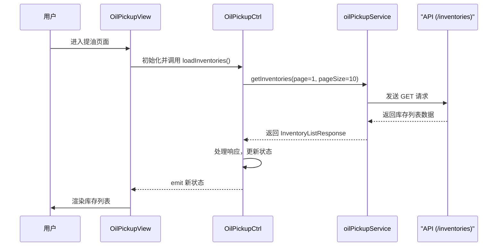
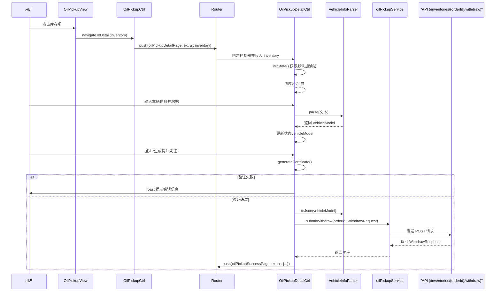
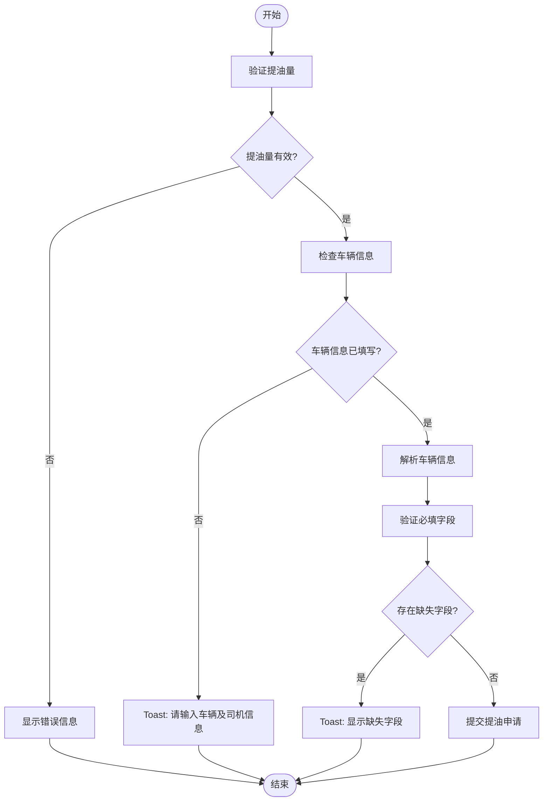
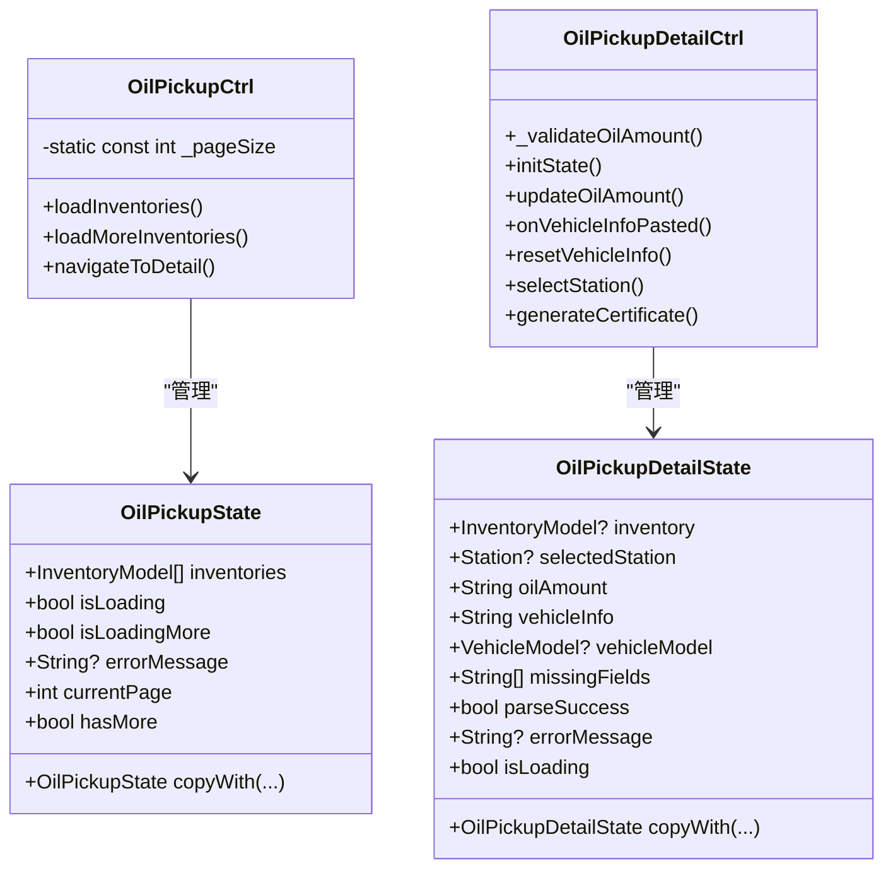

# 提油操作

<cite>
**本文档引用的文件**  
- [oil_pickup_service.dart](file://lib/pages/oil_pickup/service/oil_pickup_service.dart#L1-L50)
- [controller.dart](file://lib/pages/oil_pickup/controller.dart#L1-L89)
- [state.dart](file://lib/pages/oil_pickup/state.dart#L1-L38)
- [inventory_list_screen.dart](file://lib/pages/oil_pickup/widgets/inventory_list_screen.dart#L1-L139)
- [oil_pickup_detail/controller.dart](file://lib/pages/oil_pickup_detail/controller.dart#L1-L207)
- [oil_pickup_detail/state.dart](file://lib/pages/oil_pickup_detail/state.dart#L1-L56)
- [oil_pickup_detail/widgets/oil_pickup_detail_screen.dart](file://lib/pages/oil_pickup_detail/widgets/oil_pickup_detail_screen.dart#L1-L313)
- [vehicle_info_parser.dart](file://lib/utils/vehicle_info_parser.dart#L1-L203)
- [withdraw_data.dart](file://lib/pages/oil_pickup/model/withdraw_data.dart#L1-L250)
- [routes.dart](file://lib/router/routes.dart#L1-L260)
- [vehicle_model.dart](file://lib/models/vehicle_model.dart#L1-L118)
</cite>

## 目录
1. [提油操作流程概述](#提油操作流程概述)
2. [第一阶段：库存列表展示](#第一阶段库存列表展示)
3. [第二阶段：提油详情操作](#第二阶段提油详情操作)
4. [提油表单验证与状态同步](#提油表单验证与状态同步)
5. [Bloc模式下的状态流转](#bloc模式下的状态流转)
6. [用户体验优化建议](#用户体验优化建议)

## 提油操作流程概述

提油操作分为两个主要阶段：第一阶段是库存列表的展示与加载，用户在此阶段浏览可用的库存油信息；第二阶段是提油详情的操作，用户选择特定库存后填写提油申请并提交。整个流程通过清晰的状态管理和网络请求机制确保数据的一致性和用户交互的流畅性。

## 第一阶段：库存列表展示

在`oil_pickup`页面中，系统通过`OilPickupCtrl`控制器调用`oilPickupService.getInventories`方法，向`GET /inventories`接口发起请求以获取库存数据。该过程实现了分页加载机制，初始加载第一页数据，每页包含10条记录。当用户滚动到底部时，触发`loadMoreInventories`方法，继续加载下一页内容，直至无更多数据。

若请求过程中发生错误（如网络异常），系统会捕获异常并在UI上显示“加载失败，请重试”的提示信息，并提供重试按钮供用户重新加载数据。此外，当库存列表为空时，页面会渲染一个空状态视图，提示用户“您还没有库存油哦~”，提升用户体验。

**图表来源**  
- [controller.dart](file://lib/pages/oil_pickup/controller.dart#L17-L75)
- [oil_pickup_service.dart](file://lib/pages/oil_pickup/service/oil_pickup_service.dart#L34-L40)
- [inventory_list_screen.dart](file://lib/pages/oil_pickup/widgets/inventory_list_screen.dart#L47-L82)

**本节来源**  
- [controller.dart](file://lib/pages/oil_pickup/controller.dart#L17-L75)
- [state.dart](file://lib/pages/oil_pickup/state.dart#L3-L38)
- [inventory_list_screen.dart](file://lib/pages/oil_pickup/widgets/inventory_list_screen.dart#L47-L139)

## 第二阶段：提油详情操作

当用户点击某个库存项时，`OilPickupCtrl.navigateToDetail`方法被调用，通过路由导航至`oilPickupDetailPage`，并将选中的`InventoryModel`作为参数传递。在提油详情页面，`OilPickupDetailCtrl`接收该参数并初始化状态。

页面加载时，系统尝试从全局控制器`appController`中获取已选加油站信息；若未选择，则自动加载第一个可用加油站作为默认值。用户需填写提油量、车辆及司机信息，并选择提油加油站。车辆信息可通过粘贴文本由`vehicle_info_parser`解析为结构化数据，最终转换为JSON字符串。

提交提油申请时，系统调用`POST /inventories/{orderId}/withdraw`接口，将提油吨数、加油站ID和格式化后的车辆信息（原始文本|||JSON）一并发送。请求成功后跳转至提油成功页面，失败则弹出Toast提示“提交失败，请重试”。

**图表来源**  
- [controller.dart](file://lib/pages/oil_pickup/controller.dart#L77-L87)
- [oil_pickup_detail/controller.dart](file://lib/pages/oil_pickup_detail/controller.dart#L103-L205)
- [vehicle_info_parser.dart](file://lib/utils/vehicle_info_parser.dart#L45-L124)
- [routes.dart](file://lib/router/routes.dart#L207-L212)
- [withdraw_data.dart](file://lib/pages/oil_pickup/model/withdraw_data.dart#L146-L162)

**本节来源**  
- [oil_pickup_detail/controller.dart](file://lib/pages/oil_pickup_detail/controller.dart#L16-L207)
- [oil_pickup_detail/widgets/oil_pickup_detail_screen.dart](file://lib/pages/oil_pickup_detail/widgets/oil_pickup_detail_screen.dart#L45-L60)
- [vehicle_info_parser.dart](file://lib/utils/vehicle_info_parser.dart#L45-L203)

## 提油表单验证与状态同步

提油表单包含提油量和车辆信息两大核心字段。提油量的验证规则包括：必须为数字、大于0、且不超过库存可用吨位。验证逻辑在`_validateOilAmount`方法中实现，并在用户输入时实时更新状态中的错误信息。

车辆信息通过`SmartParseCard`组件支持粘贴解析。用户粘贴文本后，`onVehicleInfoPasted`方法被调用，清空现有解析结果并触发重新解析。解析成功后，`vehicleModel`被更新，缺失字段列表`missingFields`也会相应调整。所有字段变更均通过`emit`更新`OilPickupDetailState`，实现UI与状态的同步。

提交时，系统首先进行字段验证，若存在必填项缺失（如驾驶员姓名、车牌号、提油吨位），则阻止提交并Toast提示。整个过程确保了数据完整性与用户操作的即时反馈。

**图表来源**  
- [oil_pickup_detail/controller.dart](file://lib/pages/oil_pickup_detail/controller.dart#L21-L41)
- [oil_pickup_detail/controller.dart](file://lib/pages/oil_pickup_detail/controller.dart#L118-L127)
- [vehicle_info_parser.dart](file://lib/utils/vehicle_info_parser.dart#L187-L201)

**本节来源**  
- [oil_pickup_detail/controller.dart](file://lib/pages/oil_pickup_detail/controller.dart#L21-L41)
- [oil_pickup_detail/state.dart](file://lib/pages/oil_pickup_detail/state.dart#L7-L28)
- [oil_pickup_detail/widgets/oil_pickup_detail_screen.dart](file://lib/pages/oil_pickup_detail/widgets/oil_pickup_detail_screen.dart#L219-L312)

## Bloc模式下的状态流转

本应用采用Bloc模式管理提油流程的状态。`OilPickupCtrl`和`OilPickupDetailCtrl`分别继承自`Cubit<OilPickupState>`和`Cubit<OilPickupDetailState>`，通过`emit`方法发出新状态，`BlocBuilder`监听状态变化并重建UI。

在库存列表页，状态包含`inventories`、`isLoading`、`errorMessage`等字段。加载时`isLoading`设为true，加载成功后更新`inventories`并设`isLoading`为false，失败则设置`errorMessage`。详情页状态则包含`oilAmount`、`vehicleInfo`、`vehicleModel`、`isLoading`等，每次用户输入或操作都会通过`copyWith`创建新状态并`emit`，确保不可变性和状态一致性。

这种模式使得状态变化可预测、可追溯，便于调试和维护。

**图表来源**  
- [state.dart](file://lib/pages/oil_pickup/state.dart#L3-L38)
- [controller.dart](file://lib/pages/oil_pickup/controller.dart#L10-L88)
- [oil_pickup_detail/state.dart](file://lib/pages/oil_pickup_detail/state.dart#L7-L56)
- [oil_pickup_detail/controller.dart](file://lib/pages/oil_pickup_detail/controller.dart#L15-L207)

**本节来源**  
- [state.dart](file://lib/pages/oil_pickup/state.dart#L3-L38)
- [controller.dart](file://lib/pages/oil_pickup/controller.dart#L10-L88)
- [oil_pickup_detail/state.dart](file://lib/pages/oil_pickup_detail/state.dart#L7-L56)
- [oil_pickup_detail/controller.dart](file://lib/pages/oil_pickup_detail/controller.dart#L15-L207)

## 用户体验优化建议

为提升用户体验，建议在以下方面进行优化：

1. **输入焦点管理**：在提油详情页，提油量输入框应自动获取焦点，减少用户点击操作。
2. **加载指示器**：在提交提油申请时，按钮应显示加载动画（`isLoading: true`），防止重复提交。
3. **网络异常处理**：增强网络异常的捕获与提示，区分不同错误类型（如超时、连接失败、服务器错误），提供更具指导性的恢复建议。
4. **本地缓存**：对库存列表进行本地缓存，提升首次加载速度，并在网络不可用时展示缓存数据。
5. **输入格式化**：对提油量输入进行格式化，自动保留两位小数，提升专业感。

这些优化措施将进一步提升应用的响应速度、稳定性和用户满意度。

**本节来源**  
- [oil_pickup_detail/widgets/oil_pickup_detail_screen.dart](file://lib/pages/oil_pickup_detail/widgets/oil_pickup_detail_screen.dart#L152)
- [oil_pickup_detail/controller.dart](file://lib/pages/oil_pickup_detail/controller.dart#L132-L133)
- [inventory_list_screen.dart](file://lib/pages/oil_pickup/widgets/inventory_list_screen.dart#L49-L52)