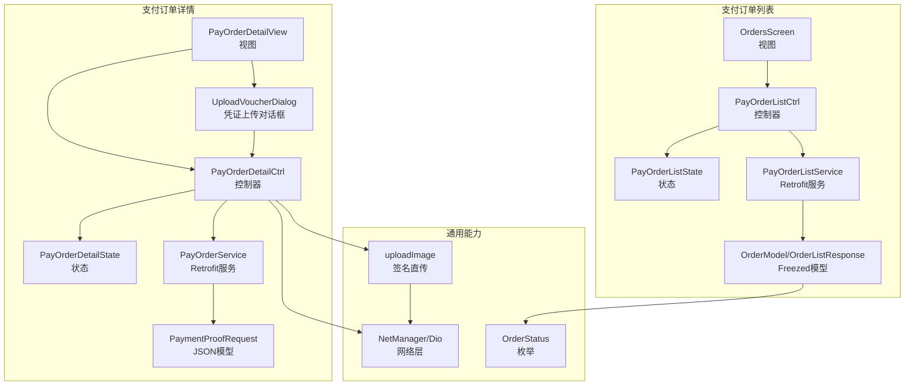
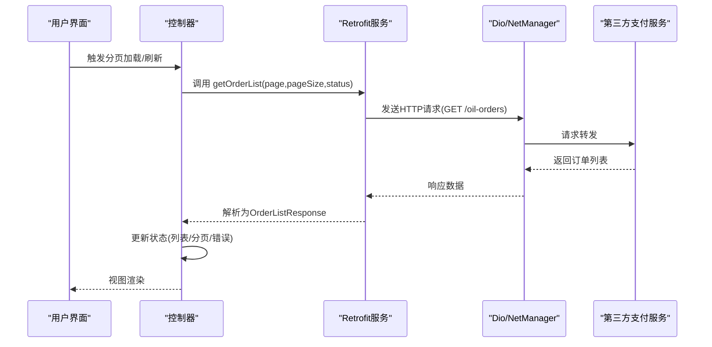
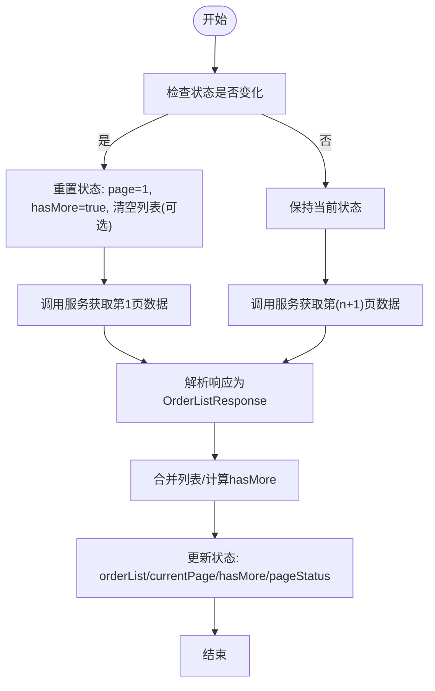
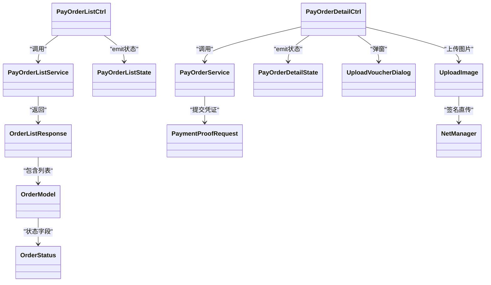

# 支付订单

<cite>
**本文引用的文件**
- [lib/pages/pay_order_list/controller.dart](file://lib/pages/pay_order_list/controller.dart)
- [lib/pages/pay_order_list/state.dart](file://lib/pages/pay_order_list/state.dart)
- [lib/pages/pay_order_list/service/pay_order_list.dart](file://lib/pages/pay_order_list/service/pay_order_list.dart)
- [lib/pages/pay_order_list/model/orders_data.dart](file://lib/pages/pay_order_list/model/orders_data.dart)
- [lib/pages/pay_order_list/widgets/orders_screen.dart](file://lib/pages/pay_order_list/widgets/orders_screen.dart)
- [lib/pages/pay_order_detail/controller.dart](file://lib/pages/pay_order_detail/controller.dart)
- [lib/pages/pay_order_detail/state.dart](file://lib/pages/pay_order_detail/state.dart)
- [lib/pages/pay_order_detail/service/pay_order_service.dart](file://lib/pages/pay_order_detail/service/pay_order_service.dart)
- [lib/pages/pay_order_detail/model/payment_proof_request.dart](file://lib/pages/pay_order_detail/model/payment_proof_request.dart)
- [lib/pages/pay_order_detail/widgets/upload_voucher_dialog.dart](file://lib/pages/pay_order_detail/widgets/upload_voucher_dialog.dart)
- [lib/pages/pay_order_detail/view.dart](file://lib/pages/pay_order_detail/view.dart)
- [lib/global/commom/upload.dart](file://lib/global/commom/upload.dart)
- [lib/global/enum/common.dart](file://lib/global/enum/common.dart)
- [lib/net/net_manager.dart](file://lib/net/net_manager.dart)
</cite>

## 目录
1. [简介](#简介)
2. [项目结构](#项目结构)
3. [核心组件](#核心组件)
4. [架构总览](#架构总览)
5. [详细组件分析](#详细组件分析)
6. [依赖关系分析](#依赖关系分析)
7. [性能考量](#性能考量)
8. [故障排查指南](#故障排查指南)
9. [结论](#结论)
10. [附录](#附录)

## 简介
本文件系统化阐述支付订单模块的工作流，覆盖以下关键能力：
- 支付订单列表的分页加载机制（pay_order_list）
- 订单详情的交互逻辑（pay_order_detail）
- 支付凭证上传功能的完整链路（含图片选择、Base64编码、上传签名、提交凭证）

文档将结合实际代码路径，说明各组件职责、数据流转、错误处理与状态更新，并给出安全建议与优化建议。

## 项目结构
支付订单模块由“列表页”和“详情页”两大部分组成，均采用 Flutter + Bloc 架构，配合 Retrofit/Dio 与 Freezed 不可变数据模型，形成清晰的分层与职责边界。



图表来源
- [lib/pages/pay_order_list/controller.dart](file://lib/pages/pay_order_list/controller.dart#L1-L179)
- [lib/pages/pay_order_list/state.dart](file://lib/pages/pay_order_list/state.dart#L1-L46)
- [lib/pages/pay_order_list/service/pay_order_list.dart](file://lib/pages/pay_order_list/service/pay_order_list.dart#L1-L31)
- [lib/pages/pay_order_list/model/orders_data.dart](file://lib/pages/pay_order_list/model/orders_data.dart#L1-L63)
- [lib/pages/pay_order_list/widgets/orders_screen.dart](file://lib/pages/pay_order_list/widgets/orders_screen.dart#L1-L618)
- [lib/pages/pay_order_detail/controller.dart](file://lib/pages/pay_order_detail/controller.dart#L1-L395)
- [lib/pages/pay_order_detail/state.dart](file://lib/pages/pay_order_detail/state.dart#L1-L69)
- [lib/pages/pay_order_detail/service/pay_order_service.dart](file://lib/pages/pay_order_detail/service/pay_order_service.dart#L1-L35)
- [lib/pages/pay_order_detail/model/payment_proof_request.dart](file://lib/pages/pay_order_detail/model/payment_proof_request.dart#L1-L20)
- [lib/pages/pay_order_detail/widgets/upload_voucher_dialog.dart](file://lib/pages/pay_order_detail/widgets/upload_voucher_dialog.dart#L1-L303)
- [lib/pages/pay_order_detail/view.dart](file://lib/pages/pay_order_detail/view.dart#L1-L703)
- [lib/global/commom/upload.dart](file://lib/global/commom/upload.dart#L1-L72)
- [lib/global/enum/common.dart](file://lib/global/enum/common.dart#L45-L63)
- [lib/net/net_manager.dart](file://lib/net/net_manager.dart#L1-L88)

章节来源
- [lib/pages/pay_order_list/controller.dart](file://lib/pages/pay_order_list/controller.dart#L1-L179)
- [lib/pages/pay_order_detail/controller.dart](file://lib/pages/pay_order_detail/controller.dart#L1-L395)

## 核心组件
- 列表控制器（PayOrderListCtrl）：负责分页加载、状态切换、取消订单等交互。
- 列表状态（PayOrderListState）：承载订单列表、分页参数、加载状态等。
- 列表服务（PayOrderListService）：定义 GET /oil-orders 接口，使用 Retrofit 注解生成客户端。
- 列表模型（OrderModel/OrderListResponse）：使用 Freezed 生成不可变数据结构，包含订单字段与状态映射。
- 列表视图（OrdersScreen）：Tab 切换不同状态订单，集成下拉刷新与上拉加载。
- 详情控制器（PayOrderDetailCtrl）：负责加载订单详情、凭证上传、保存凭证、取消订单。
- 详情状态（PayOrderDetailState）：承载订单详情、上传/保存状态、凭证 URL 列表等。
- 详情服务（PayOrderService）：定义 GET /oil-orders/{id} 与 POST /oil-orders/{id}/payment-proof。
- 上传对话框（UploadVoucherDialog）：提供图片选择、预览、删除、确认上传等交互。
- 上传工具（uploadImage）：封装签名直传流程，返回可访问的图片 URL。
- 网络层（NetManager/Dio）：统一初始化、拦截器与超时配置。
- 枚举（OrderStatus）：订单状态值与显示文本映射。

章节来源
- [lib/pages/pay_order_list/state.dart](file://lib/pages/pay_order_list/state.dart#L1-L46)
- [lib/pages/pay_order_list/service/pay_order_list.dart](file://lib/pages/pay_order_list/service/pay_order_list.dart#L1-L31)
- [lib/pages/pay_order_list/model/orders_data.dart](file://lib/pages/pay_order_list/model/orders_data.dart#L1-L63)
- [lib/pages/pay_order_list/widgets/orders_screen.dart](file://lib/pages/pay_order_list/widgets/orders_screen.dart#L1-L618)
- [lib/pages/pay_order_detail/state.dart](file://lib/pages/pay_order_detail/state.dart#L1-L69)
- [lib/pages/pay_order_detail/service/pay_order_service.dart](file://lib/pages/pay_order_detail/service/pay_order_service.dart#L1-L35)
- [lib/pages/pay_order_detail/widgets/upload_voucher_dialog.dart](file://lib/pages/pay_order_detail/widgets/upload_voucher_dialog.dart#L1-L303)
- [lib/global/commom/upload.dart](file://lib/global/commom/upload.dart#L1-L72)
- [lib/net/net_manager.dart](file://lib/net/net_manager.dart#L1-L88)
- [lib/global/enum/common.dart](file://lib/global/enum/common.dart#L45-L63)

## 架构总览
支付订单模块遵循“视图-控制器-状态-服务-网络”的分层架构，控制器通过服务调用 Retrofit 接口，服务依赖 Dio 与 NetManager；模型采用 Freezed 不可变结构，保证数据一致性；上传凭证通过签名直传减少应用服务器压力。



图表来源
- [lib/pages/pay_order_list/controller.dart](file://lib/pages/pay_order_list/controller.dart#L33-L109)
- [lib/pages/pay_order_list/service/pay_order_list.dart](file://lib/pages/pay_order_list/service/pay_order_list.dart#L14-L19)
- [lib/net/net_manager.dart](file://lib/net/net_manager.dart#L1-L88)

## 详细组件分析

### 支付订单列表（pay_order_list）
- 分页加载机制
  - 初始加载与刷新：控制器在 onRefresh 中根据状态筛选与页码重置，调用服务获取第一页数据，更新 hasMore、currentPage、pageStatus。
  - 上拉加载：onLoadMore 在 currentPage+1 时发起请求，合并旧列表与新记录，控制 footer 结果。
  - 状态防抖：若当前处于 loading 且非状态切换且列表非空，则直接返回，避免重复请求。
- 状态管理
  - 使用 PageStatus 表示 loading/error/empty/success 四种页面状态；hasMore 控制上拉提示；errorMessage 记录错误信息。
- 交互与导航
  - OrdersScreen 提供 Tab 切换不同状态订单；点击卡片跳转至详情页。
- Retrofit 接口
  - GET /oil-orders 查询订单列表，支持 status、page、pageSize 参数。
- Freezed 模型
  - OrderListResponse/list/total/page/pageSize 字段；OrderModel 包含订单基础信息与 paymentProofUrls 字段。



图表来源
- [lib/pages/pay_order_list/controller.dart](file://lib/pages/pay_order_list/controller.dart#L33-L109)
- [lib/pages/pay_order_list/service/pay_order_list.dart](file://lib/pages/pay_order_list/service/pay_order_list.dart#L14-L19)
- [lib/pages/pay_order_list/model/orders_data.dart](file://lib/pages/pay_order_list/model/orders_data.dart#L1-L63)

章节来源
- [lib/pages/pay_order_list/controller.dart](file://lib/pages/pay_order_list/controller.dart#L33-L109)
- [lib/pages/pay_order_list/state.dart](file://lib/pages/pay_order_list/state.dart#L1-L46)
- [lib/pages/pay_order_list/service/pay_order_list.dart](file://lib/pages/pay_order_list/service/pay_order_list.dart#L14-L19)
- [lib/pages/pay_order_list/model/orders_data.dart](file://lib/pages/pay_order_list/model/orders_data.dart#L1-L63)
- [lib/pages/pay_order_list/widgets/orders_screen.dart](file://lib/pages/pay_order_list/widgets/orders_screen.dart#L1-L618)

### 支付订单详情（pay_order_detail）
- 订单详情加载
  - loadOrderDetail 根据 order.id 或 orderId 获取订单详情，合并银行账户信息，初始化凭证 URL 列表与上传状态。
- 凭证上传流程
  - 选择图片：pickSingleImage 通过 ImagePicker 从相册选择图片，限制最多 5 张。
  - 删除图片：removeSelectedImage/removeUploadedProof 支持删除本地选择与已上传凭证。
  - 统一上传与保存：uploadAndSaveProof 顺序上传新图片，收集返回 URL，合并当前凭证列表，调用 savePaymentProof 提交凭证。
  - 保存凭证：savePaymentProof 构造 PaymentProofRequest，POST /oil-orders/{id}/payment-proof，成功后刷新详情。
- 交互与视图
  - PayOrderDetailView 根据订单状态渲染不同卡片与底部操作按钮；弹出 UploadVoucherDialog 展示凭证列表与上传操作。
- 错误处理
  - 控制器捕获异常，更新 errorMessage/isUploading/isSavingProof 状态，使用 Toast 提示用户。

```mermaid
sequenceDiagram
participant UI as "用户界面"
participant Ctrl as "PayOrderDetailCtrl"
participant Picker as "ImagePicker"
participant Up as "uploadImage"
participant Svc as "PayOrderService"
participant API as "第三方支付服务"
UI->>Ctrl : 点击“上传转账凭证”
Ctrl->>Ctrl : initUploadDialog()
Ctrl->>Picker : pickImage()
Picker-->>Ctrl : 返回本地图片路径
Ctrl->>Ctrl : 顺序上传图片(循环)
Ctrl->>Up : 上传单张图片(签名直传)
Up->>API : 上传到对象存储(签名直传)
API-->>Up : 返回可访问URL
Up-->>Ctrl : 返回URL列表
Ctrl->>Svc : savePaymentProof(id, PaymentProofRequest)
Svc->>Dio as "Dio/NetManager"
Dio->>API : POST /oil-orders/{id}/payment-proof
API-->>Dio : 成功
Dio-->>Svc : 成功
Svc-->>Ctrl : 成功
Ctrl->>Ctrl : 刷新订单详情
Ctrl-->>UI : 更新凭证列表/状态
```

图表来源
- [lib/pages/pay_order_detail/controller.dart](file://lib/pages/pay_order_detail/controller.dart#L91-L254)
- [lib/pages/pay_order_detail/controller.dart](file://lib/pages/pay_order_detail/controller.dart#L256-L307)
- [lib/pages/pay_order_detail/service/pay_order_service.dart](file://lib/pages/pay_order_detail/service/pay_order_service.dart#L14-L26)
- [lib/pages/pay_order_detail/model/payment_proof_request.dart](file://lib/pages/pay_order_detail/model/payment_proof_request.dart#L1-L20)
- [lib/global/commom/upload.dart](file://lib/global/commom/upload.dart#L1-L72)
- [lib/net/net_manager.dart](file://lib/net/net_manager.dart#L1-L88)

章节来源
- [lib/pages/pay_order_detail/controller.dart](file://lib/pages/pay_order_detail/controller.dart#L91-L307)
- [lib/pages/pay_order_detail/state.dart](file://lib/pages/pay_order_detail/state.dart#L1-L69)
- [lib/pages/pay_order_detail/service/pay_order_service.dart](file://lib/pages/pay_order_detail/service/pay_order_service.dart#L14-L26)
- [lib/pages/pay_order_detail/model/payment_proof_request.dart](file://lib/pages/pay_order_detail/model/payment_proof_request.dart#L1-L20)
- [lib/pages/pay_order_detail/widgets/upload_voucher_dialog.dart](file://lib/pages/pay_order_detail/widgets/upload_voucher_dialog.dart#L1-L303)
- [lib/pages/pay_order_detail/view.dart](file://lib/pages/pay_order_detail/view.dart#L540-L703)

### 支付凭证上传对话框（UploadVoucherDialog）
- 功能要点
  - 展示已上传凭证与新选择图片，支持预览与删除。
  - 限制最多 5 张图片，提供继续添加按钮。
  - 通过回调与父级控制器联动，实现选择、删除、确认上传。
- 交互细节
  - 图片网格按“已上传凭证 + 新选择图片”顺序排列，点击可查看大图。
  - 确认按钮根据是否正在上传/保存禁用或显示“上传中”。

章节来源
- [lib/pages/pay_order_detail/widgets/upload_voucher_dialog.dart](file://lib/pages/pay_order_detail/widgets/upload_voucher_dialog.dart#L1-L303)
- [lib/pages/pay_order_detail/view.dart](file://lib/pages/pay_order_detail/view.dart#L601-L692)

### 数据模型与状态
- 订单列表模型（Freezed）
  - OrderListResponse：list/total/page/pageSize 字段。
  - OrderModel：包含订单基础信息、状态（OrderStatus）、支付凭证 URL 列表等。
- 订单详情状态
  - 包含 isLoading/isUploading/isSavingProof、selectedImagePaths/uploadedImageUrls/currentProofUrls 等字段，支持弹窗编辑与保存。
- 订单状态枚举
  - PendingPayment/PaymentUploaded/Completed/Cancelled 显示名称与值映射。

章节来源
- [lib/pages/pay_order_list/model/orders_data.dart](file://lib/pages/pay_order_list/model/orders_data.dart#L1-L63)
- [lib/pages/pay_order_detail/state.dart](file://lib/pages/pay_order_detail/state.dart#L1-L69)
- [lib/global/enum/common.dart](file://lib/global/enum/common.dart#L45-L63)

## 依赖关系分析
- 控制器依赖
  - 列表控制器依赖 PayOrderListService 与 PayOrderListState；详情控制器依赖 PayOrderService、PayOrderDetailState、UploadVoucherDialog。
- 服务依赖
  - Retrofit 服务依赖 Dio 与 NetManager；上传工具依赖 commonService 获取上传签名。
- 模型依赖
  - Freezed 模型与枚举共同构成数据契约，避免手写序列化样板代码。
- 视图依赖
  - OrdersScreen 与 PayOrderDetailView 通过 BlocBuilder 监听状态变化，驱动 UI 更新。



图表来源
- [lib/pages/pay_order_list/controller.dart](file://lib/pages/pay_order_list/controller.dart#L1-L179)
- [lib/pages/pay_order_list/state.dart](file://lib/pages/pay_order_list/state.dart#L1-L46)
- [lib/pages/pay_order_list/service/pay_order_list.dart](file://lib/pages/pay_order_list/service/pay_order_list.dart#L1-L31)
- [lib/pages/pay_order_detail/controller.dart](file://lib/pages/pay_order_detail/controller.dart#L1-L395)
- [lib/pages/pay_order_detail/state.dart](file://lib/pages/pay_order_detail/state.dart#L1-L69)
- [lib/pages/pay_order_detail/service/pay_order_service.dart](file://lib/pages/pay_order_detail/service/pay_order_service.dart#L1-L35)
- [lib/pages/pay_order_detail/widgets/upload_voucher_dialog.dart](file://lib/pages/pay_order_detail/widgets/upload_voucher_dialog.dart#L1-L303)
- [lib/global/commom/upload.dart](file://lib/global/commom/upload.dart#L1-L72)
- [lib/global/enum/common.dart](file://lib/global/enum/common.dart#L45-L63)
- [lib/pages/pay_order_list/model/orders_data.dart](file://lib/pages/pay_order_list/model/orders_data.dart#L1-L63)
- [lib/pages/pay_order_detail/model/payment_proof_request.dart](file://lib/pages/pay_order_detail/model/payment_proof_request.dart#L1-L20)

## 性能考量
- 列表分页
  - 采用固定页大小与 hasMore 控制，避免一次性加载过多数据；在状态切换时清空列表，防止错乱。
- 上传策略
  - 顺序上传图片，逐张失败不影响整体流程；上传完成后批量合并凭证 URL，减少多次请求。
- 网络层
  - 统一超时与重试配置，日志与响应拦截器便于定位问题。
- UI 渲染
  - 使用 GridView 展示凭证缩略图，懒加载占位与错误占位，提升滚动体验。

章节来源
- [lib/pages/pay_order_list/controller.dart](file://lib/pages/pay_order_list/controller.dart#L64-L109)
- [lib/pages/pay_order_detail/controller.dart](file://lib/pages/pay_order_detail/controller.dart#L186-L254)
- [lib/net/net_manager.dart](file://lib/net/net_manager.dart#L1-L88)

## 故障排查指南
- 列表加载失败
  - 检查 onRefresh/onLoadMore 的状态判断与错误分支；确认 pageStatus/errorMessage 是否被正确设置。
  - 章节来源
    - [lib/pages/pay_order_list/controller.dart](file://lib/pages/pay_order_list/controller.dart#L92-L109)
- 详情加载失败
  - 检查订单 ID 是否为空；确认 getOrderDetail 返回的 OrderModel 字段是否完整。
  - 章节来源
    - [lib/pages/pay_order_detail/controller.dart](file://lib/pages/pay_order_detail/controller.dart#L40-L89)
- 凭证上传失败
  - 检查 uploadImage 返回值与签名直传 host/path 是否为空；确认上传状态 isUploading/isSavingProof 是否被复位。
  - 章节来源
    - [lib/global/commom/upload.dart](file://lib/global/commom/upload.dart#L1-L72)
    - [lib/pages/pay_order_detail/controller.dart](file://lib/pages/pay_order_detail/controller.dart#L186-L254)
- 保存凭证失败
  - 检查 savePaymentProof 的请求体与后端返回；确认 isSavingProof 状态复位与异常抛出。
  - 章节来源
    - [lib/pages/pay_order_detail/controller.dart](file://lib/pages/pay_order_detail/controller.dart#L256-L307)
    - [lib/pages/pay_order_detail/service/pay_order_service.dart](file://lib/pages/pay_order_detail/service/pay_order_service.dart#L20-L26)

## 结论
支付订单模块通过清晰的分层设计与不可变数据模型，实现了稳定可靠的订单列表与详情交互。凭证上传采用签名直传策略，兼顾安全性与性能。建议在后续迭代中进一步完善错误提示与本地缓存清理策略，持续优化用户体验。

## 附录
- 安全性建议
  - 凭证加密传输：建议在上传前对图片进行端到端加密，或在传输层启用更强的 TLS 配置。
  - 本地缓存清理：上传成功后及时清理本地临时图片路径，避免占用存储空间。
  - 权限控制：确保上传凭证仅在订单处于可支付状态下开放，防止越权操作。
- 最佳实践
  - 对网络请求增加重试与退避策略，提升弱网环境下的成功率。
  - 在上传过程中提供更细粒度的进度反馈（如单张图片上传进度），增强用户感知。
  - 对订单状态变更进行幂等处理，避免重复提交导致的状态不一致。