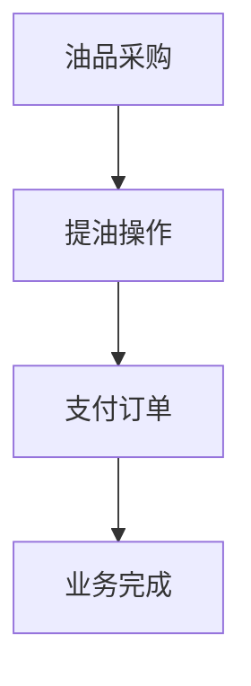
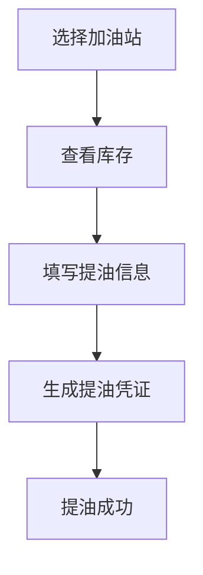
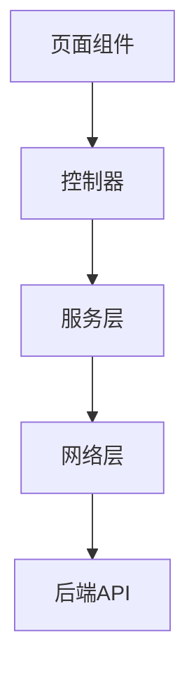

# 油品业务模块

<cite>
**本文档引用文件**  
- [oil_order_req_type.dart](file://lib/pages/main_oil_pay/model/oil_order_req_type.dart)
- [oil_order_res.type.dart](file://lib/pages/main_oil_pay/model/oil_order_res.type.dart)
- [oil_order_service.dart](file://lib/pages/main_oil_pay/service/oil_order_service.dart)
- [oil_pickup_screen.dart](file://lib/pages/oil_pickup/widgets/oil_pickup_screen.dart)
- [inventory_list_screen.dart](file://lib/pages/oil_pickup/widgets/inventory_list_screen.dart)
- [inventory_item.dart](file://lib/pages/oil_pickup/widgets/inventory_item.dart)
- [oil_pickup_controller.dart](file://lib/pages/oil_pickup/controller.dart)
- [oil_pickup_state.dart](file://lib/pages/oil_pickup/state.dart)
- [withdraw_data.dart](file://lib/pages/oil_pickup/model/withdraw_data.dart)
- [oil_pickup_service.dart](file://lib/pages/oil_pickup/service/oil_pickup_service.dart)
- [oil_pickup_detail_screen.dart](file://lib/pages/oil_pickup_detail/widgets/oil_pickup_detail_screen.dart)
- [smart_parse_card.dart](file://lib/pages/oil_pickup_detail/widgets/smart_parse_card.dart)
- [oil_pickup_detail_controller.dart](file://lib/pages/oil_pickup_detail/controller.dart)
- [oil_pickup_success_screen.dart](file://lib/pages/oil_pickup_success/widgets/oil_pickup_success_screen.dart)
- [save_share_sheet.dart](file://lib/pages/oil_pickup_success/widgets/save_share_sheet.dart)
- [pay_order_service.dart](file://lib/pages/pay_order_detail/service/pay_order_service.dart)
</cite>

## 目录
1. [油品业务工作流概述](#油品业务工作流概述)
2. [油品订单数据模型与序列化机制](#油品订单数据模型与序列化机制)
3. [油品采购流程](#油品采购流程)
4. [提油操作流程](#提油操作流程)
5. [支付订单流程](#支付订单流程)
6. [提油页面状态管理与库存展示](#提油页面状态管理与库存展示)
7. [提油详情页智能解析功能](#提油详情页智能解析功能)
8. [提油成功页面凭证保存与分享](#提油成功页面凭证保存与分享)
9. [服务调用链路与性能优化建议](#服务调用链路与性能优化建议)

## 油品业务工作流概述

油品业务模块涵盖了油品采购、提油操作和支付订单三大核心环节。整个工作流从用户选择油品并创建采购订单开始，经过提油申请和凭证生成，最终完成支付订单的闭环流程。系统通过清晰的页面导航和状态管理，确保用户能够顺畅地完成每个步骤。

**油品业务工作流图示**



**Diagram sources**
- [oil_order_service.dart](file://lib/pages/main_oil_pay/service/oil_order_service.dart)
- [oil_pickup_service.dart](file://lib/pages/oil_pickup/service/oil_pickup_service.dart)
- [pay_order_service.dart](file://lib/pages/pay_order_detail/service/pay_order_service.dart)

## 油品订单数据模型与序列化机制

### 油品订单请求模型

`OilOrderRequest` 类定义了创建油品订单所需的请求参数，包括油库ID、油品类型、购买吨数和备注信息。该模型通过 `toJson()` 方法实现序列化，将对象转换为JSON格式的请求体。

```dart
class OilOrderRequest {
  final int depotId;
  final String fuelType;
  final String purchaseTon;
  final String? remark;

  Map<String, dynamic> toJson() => {
        'depotId': depotId,
        'fuelType': fuelType,
        'purchaseTon': purchaseTon,
        if (remark != null && remark!.isNotEmpty) 'remark': remark,
      };
}
```

**Section sources**
- [oil_order_req_type.dart](file://lib/pages/main_oil_pay/model/oil_order_req_type.dart#L1-L28)

### 油品订单响应模型

`GetOilStoreResponse` 类定义了获取油库列表的响应结构，包含分页信息和油库列表。`Depot` 类表示单个油库的详细信息，包括名称、地理位置和油品列表。`Fuel` 类描述油品类型和价格。

```dart
@JsonSerializable()
class GetOilStoreResponse {
  final int? page;
  final int? pageSize;
  final int? total;
  final List<Depot>? list;
}

@JsonSerializable()
class Depot {
  final int? depotId;
  final String? depotName;
  final String? provinceName;
  final String? cityName;
  final String? areaName;
  final String? addressDetail;
  final List<Fuel>? fuels;
}

@JsonSerializable()
class Fuel {
  final String? fuelType;
  final double? priceCny;
}
```

**Section sources**
- [oil_order_res.type.dart](file://lib/pages/main_oil_pay/model/oil_order_res.type.dart#L5-L81)

### 序列化机制

系统使用 `json_annotation` 和 `json_serializable` 包实现数据模型的序列化和反序列化。通过 `@JsonSerializable()` 注解标记类，并生成相应的 `fromJson` 和 `toJson` 方法。这种机制确保了数据在客户端和服务器之间的正确转换。

**Section sources**
- [oil_order_res.type.dart](file://lib/pages/main_oil_pay/model/oil_order_res.type.dart#L1-L82)

## 油品采购流程

油品采购流程通过 `OilOrderService` 接口与后端服务进行交互。该服务使用 `retrofit` 库定义RESTful API，支持获取油库列表和创建油品订单。

### API调用方式

`OilOrderService` 定义了两个主要的API端点：

1. **获取油库列表**：通过 `@GET('/oil-depots')` 注解定义，支持分页查询。
2. **创建油品订单**：通过 `@POST('/oil-orders')` 注解定义，接收 `OilOrderRequest` 对象作为请求体。

```dart
@RestApi()
abstract class OilOrderService {
  @GET('/oil-depots')
  Future<GetOilStoreResponse> getOilStoreList(
      {required int page, required int pageSize});

  @POST('/oil-orders')
  Future<void> createOilOrder(@Body() OilOrderRequest request);
}
```

**Section sources**
- [oil_order_service.dart](file://lib/pages/main_oil_pay/service/oil_order_service.dart#L9-L21)

### 服务实例获取

通过 `oilOrderService` 全局变量获取 `OilOrderService` 实例，确保网络管理器已初始化。这种单例模式简化了服务的调用，避免了重复创建网络客户端。

```dart
OilOrderService get oilOrderService =>
    OilOrderService(netManager.clientDio ?? Dio());
```

**Section sources**
- [oil_order_service.dart](file://lib/pages/main_oil_pay/service/oil_order_service.dart#L24-L25)

## 提油操作流程

提油操作流程从用户选择加油站开始，经过库存查询、提油申请，最终生成提油凭证。整个流程通过清晰的页面导航和状态管理，确保用户能够顺利完成提油操作。

### 用户交互路径

1. **选择加油站**：用户在提油页面选择目标加油站。
2. **查看库存**：系统查询并展示该加油站的可用库存。
3. **填写提油信息**：用户输入提油量和车辆及司机信息。
4. **生成提油凭证**：系统生成提油凭证并跳转到成功页面。

**提油操作流程图示**



**Diagram sources**
- [oil_pickup_controller.dart](file://lib/pages/oil_pickup/controller.dart#L10-L88)
- [oil_pickup_detail_controller.dart](file://lib/pages/oil_pickup_detail/controller.dart#L15-L206)

## 提油页面状态管理与库存展示

### 状态管理逻辑

`OilPickupState` 类定义了提油页面的状态，包括库存列表、加载状态、错误信息、当前页码和是否有更多数据。`OilPickupCtrl` 控制器负责管理状态的更新，通过 `emit` 方法触发状态变化。

```dart
class OilPickupState {
  final List<InventoryModel> inventories;
  final bool isLoading;
  final bool isLoadingMore;
  final String? errorMessage;
  final int currentPage;
  final bool hasMore;
}

class OilPickupCtrl extends Cubit<OilPickupState> {
  Future<void> loadInventories({bool isRefresh = false}) async {
    emit(state.copyWith(isLoading: true, errorMessage: null));
    try {
      final response = await oilPickupService.getInventories(page: 1, pageSize: 10);
      final list = response.list ?? [];
      final hasMore = list.length >= 10;
      emit(state.copyWith(isLoading: false, inventories: list, hasMore: hasMore));
    } catch (e) {
      emit(state.copyWith(isLoading: false, errorMessage: '加载失败，请重试'));
    }
  }
}
```

**Section sources**
- [oil_pickup_state.dart](file://lib/pages/oil_pickup/state.dart#L3-L37)
- [oil_pickup_controller.dart](file://lib/pages/oil_pickup/controller.dart#L10-L44)

### 库存数据展示

`InventoryListScreen` 组件负责展示库存数据，支持下拉刷新和上拉加载更多。`InventoryItem` 组件用于展示单个库存项的详细信息，包括油库名称、油品类型和可用库存。

```dart
class InventoryListScreen extends StatefulWidget {
  final OilPickupState state;
  final OilPickupCtrl controller;

  @override
  Widget build(BuildContext context) {
    return PullOrRefreshEasy(
      onRefresh: () async {
        await widget.controller.loadInventories(isRefresh: true);
        _refreshController.finishRefresh();
      },
      onLoading: () async {
        await widget.controller.loadMoreInventories();
        _refreshController.finishLoad();
      },
      child: ListView.builder(
        itemCount: widget.state.inventories.length,
        itemBuilder: (context, index) {
          final inventory = widget.state.inventories[index];
          return InventoryItem(
            inventory: inventory,
            onTap: () => widget.controller.navigateToDetail(context, inventory),
          );
        },
      ),
    );
  }
}
```

**Section sources**
- [inventory_list_screen.dart](file://lib/pages/oil_pickup/widgets/inventory_list_screen.dart#L13-L138)
- [inventory_item.dart](file://lib/pages/oil_pickup/widgets/inventory_item.dart#L8-L363)

## 提油详情页智能解析功能

### 智能解析功能实现

`SmartParseCard` 组件提供了智能解析功能，允许用户粘贴车辆及司机信息，并自动解析关键字段。用户可以通过点击"复制模板"按钮获取信息填写模板，或通过"点击粘贴"按钮从剪贴板导入信息。

```dart
class SmartParseCard extends StatefulWidget {
  final Function(String) onParse;

  @override
  State<SmartParseCard> createState() => _SmartParseCardState();
}

class _SmartParseCardState extends State<SmartParseCard> {
  final TextEditingController _controller = TextEditingController();

  @override
  Widget build(BuildContext context) {
    return Container(
      child: Column(
        children: [
          // 复制模板和点击粘贴按钮
          // 文本输入框
          TextField(
            controller: _controller,
            onChanged: (text) {
              widget.onParse(text);
            },
          ),
        ],
      ),
    );
  }
}
```

**Section sources**
- [smart_parse_card.dart](file://lib/pages/oil_pickup_detail/widgets/smart_parse_card.dart#L8-L270)

### 解析逻辑

`OilPickupDetailCtrl` 控制器中的 `onVehicleInfoPasted` 方法处理粘贴的文本，更新状态并触发解析。解析结果用于生成提油凭证，确保信息的准确性和完整性。

```dart
void onVehicleInfoPasted(String text) {
  emit(state.copyWith(
    vehicleInfo: text.trim(),
    vehicleModel: null,
    missingFields: const [],
    parseSuccess: false,
    errorMessage: null,
  ));
}
```

**Section sources**
- [oil_pickup_detail_controller.dart](file://lib/pages/oil_pickup_detail/controller.dart#L68-L75)

## 提油成功页面凭证保存与分享

### 凭证保存机制

`OilPickupSuccessScreen` 组件通过 `RepaintBoundary` 和 `RenderRepaintBoundary` 实现提油凭证的图片生成。用户点击"保存凭证"按钮后，系统将凭证卡片渲染为PNG图片，并提供保存到相册或指定目录的选项。

```dart
Future<void> _saveCertificateImage() async {
  final RenderRepaintBoundary? boundary = _cardKey.currentContext?.findRenderObject() as RenderRepaintBoundary?;
  final ui.Image image = await boundary.toImage(pixelRatio: 3);
  final ByteData? byteData = await image.toByteData(format: ui.ImageByteFormat.png);
  final Uint8List pngBytes = byteData.buffer.asUint8List();
  // 保存图片到文件系统
}
```

**Section sources**
- [oil_pickup_success_screen.dart](file://lib/pages/oil_pickup_success/widgets/oil_pickup_success_screen.dart#L182-L233)

### 分享机制

系统集成 `share_plus` 插件，支持将提油凭证图片分享到其他应用。用户可以选择分享到微信、QQ等社交平台，方便与相关人员共享提油信息。

```dart
onShare: () async {
  Navigator.of(context).pop();
  await SharePlus.instance.share(
    ShareParams(
      files: [XFile(filePath)],
      text: '提油凭证图片',
    ),
  );
}
```

**Section sources**
- [oil_pickup_success_screen.dart](file://lib/pages/oil_pickup_success/widgets/oil_pickup_success_screen.dart#L252-L260)

## 服务调用链路与性能优化建议

### 服务调用链路

油品业务模块的服务调用链路清晰，从页面组件到控制器，再到服务层和网络层。每个环节职责明确，便于维护和扩展。

**服务调用链路图示**



**Diagram sources**
- [oil_pickup_controller.dart](file://lib/pages/oil_pickup/controller.dart#L10-L88)
- [oil_pickup_service.dart](file://lib/pages/oil_pickup/service/oil_pickup_service.dart#L8-L50)

### 性能优化建议

#### 数据缓存策略

1. **内存缓存**：在 `OilPickupCtrl` 中缓存库存列表，避免重复请求。
2. **本地存储**：使用 `shared_preferences` 或 `hive` 存储用户偏好设置和常用数据。
3. **网络缓存**：配置 `Dio` 拦截器，实现HTTP缓存，减少网络请求。

```dart
// 示例：内存缓存
class OilPickupCtrl extends Cubit<OilPickupState> {
  final Map<String, List<InventoryModel>> _cache = {};

  Future<void> loadInventories({bool isRefresh = false}) async {
    final cacheKey = 'inventories_page_${state.currentPage}';
    if (!isRefresh && _cache.containsKey(cacheKey)) {
      emit(state.copyWith(inventories: _cache[cacheKey]!, isLoading: false));
      return;
    }
    // 网络请求逻辑
  }
}
```

**Section sources**
- [oil_pickup_controller.dart](file://lib/pages/oil_pickup/controller.dart#L17-L44)

#### 加载状态管理

1. **骨架屏**：在数据加载期间显示骨架屏，提升用户体验。
2. **分页加载**：使用分页查询，避免一次性加载大量数据。
3. **错误处理**：提供清晰的错误提示和重试机制，增强应用的健壮性。

```dart
// 示例：加载状态管理
if (widget.state.isLoading && widget.state.inventories.isEmpty) {
  return Center(child: CircularProgressIndicator());
}

if (widget.state.errorMessage != null && widget.state.inventories.isEmpty) {
  return Center(
    child: Column(
      children: [
        CommonText(text: widget.state.errorMessage!),
        TextButton(onPressed: () => widget.controller.loadInventories(isRefresh: true), child: Text('重试')),
      ],
    ),
  );
}
```

**Section sources**
- [inventory_list_screen.dart](file://lib/pages/oil_pickup/widgets/inventory_list_screen.dart#L47-L70)