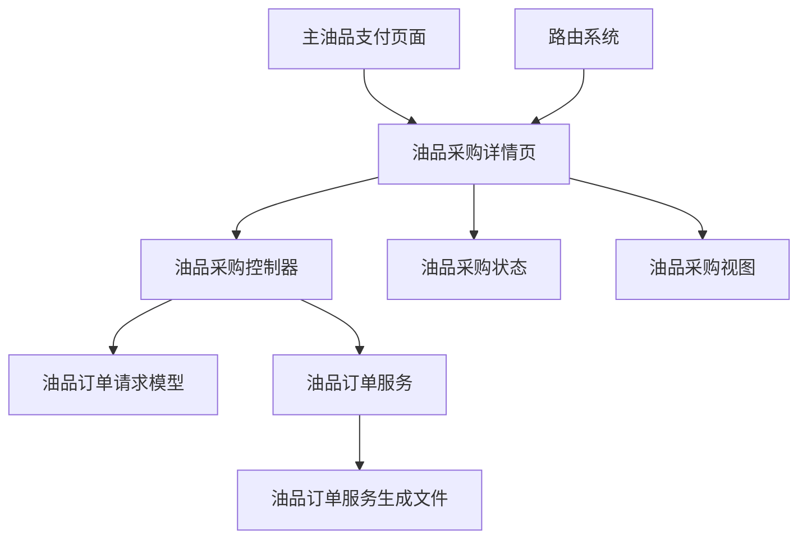
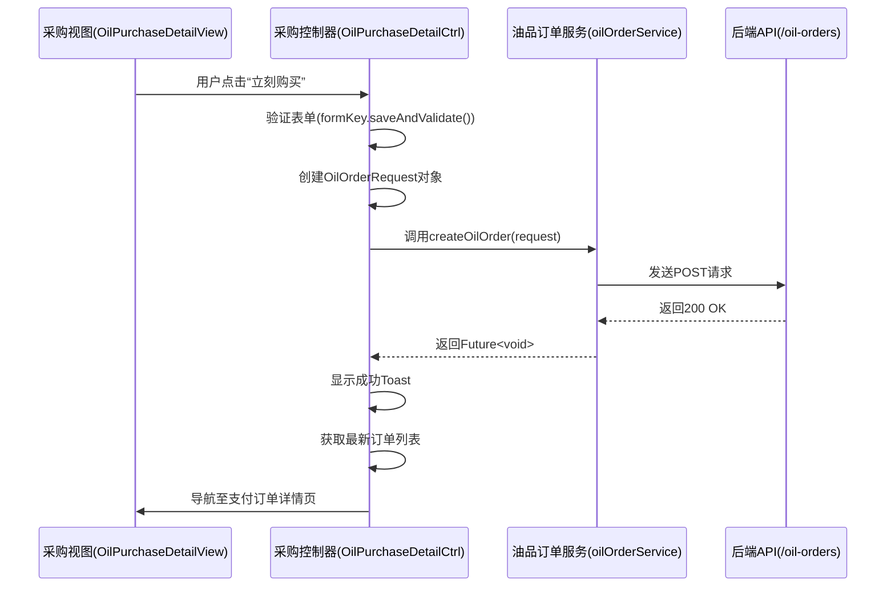
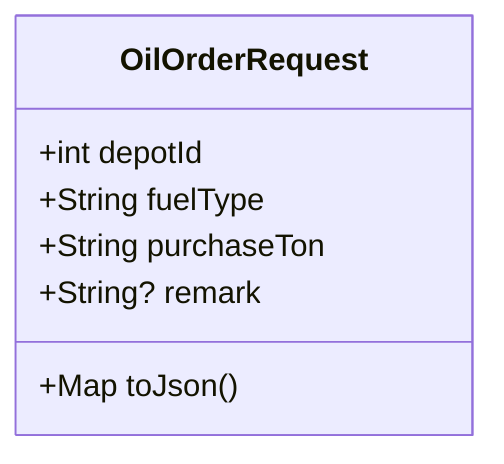
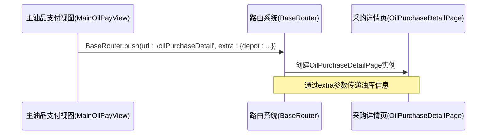
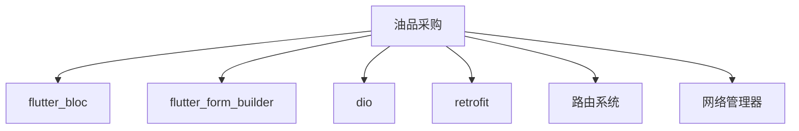

# 油品采购

<cite>
**本文档引用的文件**  
- [oil_purchase_detail/page.dart](file://lib/pages/main_oil_pay/oil_purchase_detail/page.dart)
- [oil_purchase_detail/controller.dart](file://lib/pages/main_oil_pay/oil_purchase_detail/controller.dart)
- [oil_purchase_detail/state.dart](file://lib/pages/main_oil_pay/oil_purchase_detail/state.dart)
- [oil_purchase_detail/view.dart](file://lib/pages/main_oil_pay/oil_purchase_detail/view.dart)
- [model/oil_order_req_type.dart](file://lib/pages/main_oil_pay/model/oil_order_req_type.dart)
- [service/oil_order_service.dart](file://lib/pages/main_oil_pay/service/oil_order_service.dart)
- [routes.dart](file://lib/router/routes.dart)
- [router.dart](file://lib/router/router.dart)
- [main_oil_pay/view.dart](file://lib/pages/main_oil_pay/view.dart)
- [main_oil_pay/controller.dart](file://lib/pages/main_oil_pay/controller.dart)
- [model/oil_order_res.type.dart](file://lib/pages/main_oil_pay/model/oil_order_res.type.dart)
- [service/oil_order_service.g.dart](file://lib/pages/main_oil_pay/service/oil_order_service.g.dart)
</cite>

## 目录
1. [引言](#引言)
2. [项目结构](#项目结构)
3. [核心组件](#核心组件)
4. [架构概览](#架构概览)
5. [详细组件分析](#详细组件分析)
6. [依赖分析](#依赖分析)
7. [性能考虑](#性能考虑)
8. [故障排除指南](#故障排除指南)
9. [结论](#结论)

## 引言
本文档深入阐述油品采购功能的完整实现流程，涵盖从主油品支付页面进入采购详情页的路由跳转逻辑，解析 `oil_order_req_type` 中请求参数的定义及序列化机制，详细说明 `oil_order_service` 中生成的 API 调用方式，特别是 `POST /oil-orders` 接口的请求结构、认证头处理和响应解析。文档还将描述采购表单（`oil_purchase_detail`）中的字段验证规则、用户输入处理和提交状态管理，结合代码示例展示 Flutter FormBuilder 的集成使用。最后，解释采购成功后的状态更新机制及页面导航逻辑，并提供性能优化建议如表单防抖、加载状态反馈和错误重试机制。

## 项目结构
油品采购功能主要位于 `lib/pages/main_oil_pay/` 目录下，采用典型的 Flutter 页面结构，包含 `page.dart`、`controller.dart`、`state.dart` 和 `view.dart` 四个核心文件。该功能通过路由系统与主应用集成，其数据模型和网络服务分别定义在 `model` 和 `service` 子目录中。

**图示来源**
- [oil_purchase_detail/page.dart](file://lib/pages/main_oil_pay/oil_purchase_detail/page.dart#L10-L51)
- [oil_purchase_detail/controller.dart](file://lib/pages/main_oil_pay/oil_purchase_detail/controller.dart#L14-L91)
- [oil_purchase_detail/state.dart](file://lib/pages/main_oil_pay/oil_purchase_detail/state.dart#L3-L34)
- [oil_purchase_detail/view.dart](file://lib/pages/main_oil_pay/oil_purchase_detail/view.dart#L19-L295)
- [model/oil_order_req_type.dart](file://lib/pages/main_oil_pay/model/oil_order_req_type.dart#L2-L29)
- [service/oil_order_service.dart](file://lib/pages/main_oil_pay/service/oil_order_service.dart#L10-L26)
- [service/oil_order_service.g.dart](file://lib/pages/main_oil_pay/service/oil_order_service.g.dart#L11-L97)
- [routes.dart](file://lib/router/routes.dart#L97-L102)

**本节来源**
- [oil_purchase_detail/page.dart](file://lib/pages/main_oil_pay/oil_purchase_detail/page.dart)
- [oil_purchase_detail/controller.dart](file://lib/pages/main_oil_pay/oil_purchase_detail/controller.dart)
- [oil_purchase_detail/state.dart](file://lib/pages/main_oil_pay/oil_purchase_detail/state.dart)
- [oil_purchase_detail/view.dart](file://lib/pages/main_oil_pay/oil_purchase_detail/view.dart)
- [model/oil_order_req_type.dart](file://lib/pages/main_oil_pay/model/oil_order_req_type.dart)
- [service/oil_order_service.dart](file://lib/pages/main_oil_pay/service/oil_order_service.dart)
- [routes.dart](file://lib/router/routes.dart)

## 核心组件
油品采购功能的核心组件包括采购详情页（`OilPurchaseDetailPage`）、采购控制器（`OilPurchaseDetailCtrl`）、采购状态（`OilPurchaseDetailState`）以及采购视图（`OilPurchaseDetailView`）。这些组件共同协作，实现了从用户界面展示、状态管理到网络请求的完整闭环。

**本节来源**
- [oil_purchase_detail/page.dart](file://lib/pages/main_oil_pay/oil_purchase_detail/page.dart#L10-L51)
- [oil_purchase_detail/controller.dart](file://lib/pages/main_oil_pay/oil_purchase_detail/controller.dart#L14-L91)
- [oil_purchase_detail/state.dart](file://lib/pages/main_oil_pay/oil_purchase_detail/state.dart#L3-L34)
- [oil_purchase_detail/view.dart](file://lib/pages/main_oil_pay/oil_purchase_detail/view.dart#L19-L295)

## 架构概览
油品采购功能采用 BLoC（Business Logic Component）模式进行状态管理，结合 Flutter 的路由系统和 Dio 网络库，构建了一个清晰、可维护的架构。用户操作通过视图（View）触发，由控制器（Controller）处理业务逻辑并更新状态（State），状态的变更再驱动视图的重新渲染。网络请求通过 Retrofit 风格的 `oil_order_service` 抽象，实现了接口定义与实现的分离。

**图示来源**
- [oil_purchase_detail/controller.dart](file://lib/pages/main_oil_pay/oil_purchase_detail/controller.dart#L41-L89)
- [service/oil_order_service.dart](file://lib/pages/main_oil_pay/service/oil_order_service.dart#L20-L21)
- [service/oil_order_service.g.dart](file://lib/pages/main_oil_pay/service/oil_order_service.g.dart#L51-L68)
- [router.dart](file://lib/router/router.dart#L137-L148)

## 详细组件分析

### 油品采购详情页分析
油品采购详情页是用户进行采购操作的入口，它负责接收来自上一个页面的参数（油库信息），初始化状态，并构建整个采购界面。

#### 油品采购详情页
`OilPurchaseDetailPage` 继承自 `BasePage`，其核心职责是接收 `extra` 参数（包含油库信息 `depot`），并将其传递给内部的 `_OilPurchaseDetailPage` 状态类。该页面在 `initState` 中设置了系统状态栏的样式。

**本节来源**
- [oil_purchase_detail/page.dart](file://lib/pages/main_oil_pay/oil_purchase_detail/page.dart#L10-L51)

### 油品采购控制器分析
`OilPurchaseDetailCtrl` 是油品采购功能的业务逻辑中心，它继承自 `Cubit`，负责管理采购过程中的所有状态变化和异步操作。

#### 油品采购控制器
控制器的核心方法是 `submitPurchase`。该方法首先通过 `FormBuilder` 的 `saveAndValidate()` 方法验证表单。验证通过后，它会从表单中提取数据，并结合当前状态（如选中的油品）创建一个 `OilOrderRequest` 对象。随后，它调用 `oilOrderService.createOilOrder()` 发起网络请求。在请求过程中，控制器通过 `emit` 方法更新 `isLoading` 状态，以控制 UI 上的加载指示器。请求成功后，会显示成功提示，并尝试导航到新创建订单的详情页。

**本节来源**
- [oil_purchase_detail/controller.dart](file://lib/pages/main_oil_pay/oil_purchase_detail/controller.dart#L14-L91)

### 油品采购状态分析
`OilPurchaseDetailState` 类定义了采购页面所需的所有状态数据。

#### 油品采购状态
该状态类包含油库信息（`depot`）、选中的油品（`selectedFuel`）、用户输入的购买量（`purchaseQuantity`）、备注（`remark`）以及一个表示是否正在加载的布尔值（`isLoading`）。它提供了一个 `copyWith` 方法，用于在 BLoC 模式下高效地创建新的状态实例。

**本节来源**
- [oil_purchase_detail/state.dart](file://lib/pages/main_oil_pay/oil_purchase_detail/state.dart#L3-L34)

### 油品采购视图分析
`OilPurchaseDetailView` 负责构建用户界面，并响应用户交互。

#### 油品采购视图
该视图使用 `FormBuilder` 构建了一个包含油品选择、购买量输入和备注输入的表单。油品选择通过点击 `_FuelItem` 组件实现，该组件会调用控制器的 `selectFuel` 方法。购买量和备注输入框使用了 `CommonTextFormField`，并内置了验证逻辑（如购买量必须为正整数）。提交按钮的 `onPressed` 回调会调用控制器的 `submitPurchase` 方法。视图通过 `BlocBuilder` 监听控制器状态的变化，当 `isLoading` 为 `true` 时，按钮会显示加载动画。

**本节来源**
- [oil_purchase_detail/view.dart](file://lib/pages/main_oil_pay/oil_purchase_detail/view.dart#L19-L295)

### 油品订单请求模型分析
`OilOrderRequest` 类定义了创建油品订单所需的请求参数。

#### 油品订单请求模型
该模型包含四个字段：`depotId`（油库ID）、`fuelType`（油品类型）、`purchaseTon`（购买吨数）和可选的 `remark`（备注）。其 `toJson()` 方法将对象序列化为 JSON，其中 `remark` 字段仅在非空时才包含在 JSON 中，这通过 `if (remark != null && remark!.isNotEmpty)` 实现。

**图示来源**
- [model/oil_order_req_type.dart](file://lib/pages/main_oil_pay/model/oil_order_req_type.dart#L2-L29)

**本节来源**
- [model/oil_order_req_type.dart](file://lib/pages/main_oil_pay/model/oil_order_req_type.dart#L2-L29)

### 油品订单服务分析
`OilOrderService` 是一个使用 `retrofit` 库生成的抽象类，用于定义与后端 API 的交互契约。

#### 油品订单服务
该服务定义了两个方法：`getOilStoreList` 用于获取油库列表（GET 请求），`createOilOrder` 用于创建油品订单（POST 请求）。`createOilOrder` 方法使用 `@POST('/oil-orders')` 注解，并通过 `@Body()` 注解将 `OilOrderRequest` 对象作为请求体发送。实际的网络请求逻辑由生成的 `_OilOrderService` 类实现，它使用 `Dio` 库发送 HTTP 请求，并将 `OilOrderRequest` 对象通过 `toJson()` 方法序列化后放入请求体中。

**本节来源**
- [service/oil_order_service.dart](file://lib/pages/main_oil_pay/service/oil_order_service.dart#L10-L26)
- [service/oil_order_service.g.dart](file://lib/pages/main_oil_pay/service/oil_order_service.g.dart#L51-L68)

### 主油品支付页面分析
主油品支付页面是进入采购详情页的入口。

#### 主油品支付页面
该页面通过 `ListView.builder` 展示油库列表。当用户点击某个油库项（`DepotsItemWidget`）时，会触发 `onTap` 回调。该回调使用 `BaseRouter.push` 方法，将路由导航至 `AppPage.oilPurchaseDetailPage.path`，并携带一个包含当前油库信息（`depot`）的 `extra` 参数。这实现了从主页面到采购详情页的路由跳转。

**图示来源**
- [main_oil_pay/view.dart](file://lib/pages/main_oil_pay/view.dart#L75-L79)
- [routes.dart](file://lib/router/routes.dart#L198-L202)
- [oil_purchase_detail/page.dart](file://lib/pages/main_oil_pay/oil_purchase_detail/page.dart#L11-L13)

**本节来源**
- [main_oil_pay/view.dart](file://lib/pages/main_oil_pay/view.dart#L75-L79)
- [routes.dart](file://lib/router/routes.dart#L97-L102)

## 依赖分析
油品采购功能依赖于多个核心模块。它依赖于 `flutter_bloc` 进行状态管理，依赖于 `flutter_form_builder` 构建和验证表单，依赖于 `dio` 和 `retrofit` 进行网络通信。此外，它还依赖于项目内部的路由系统（`router.dart`）进行页面导航，以及全局的 `net_manager` 提供的网络客户端实例。

**图示来源**
- [oil_purchase_detail/controller.dart](file://lib/pages/main_oil_pay/oil_purchase_detail/controller.dart#L2-L3)
- [oil_purchase_detail/view.dart](file://lib/pages/main_oil_pay/oil_purchase_detail/view.dart#L3-L4)
- [service/oil_order_service.dart](file://lib/pages/main_oil_pay/service/oil_order_service.dart#L1-L2)
- [router.dart](file://lib/router/router.dart#L1-L3)
- [service/oil_order_service.dart](file://lib/pages/main_oil_pay/service/oil_order_service.dart#L24-L25)

**本节来源**
- [oil_purchase_detail/controller.dart](file://lib/pages/main_oil_pay/oil_purchase_detail/controller.dart)
- [oil_purchase_detail/view.dart](file://lib/pages/main_oil_pay/oil_purchase_detail/view.dart)
- [service/oil_order_service.dart](file://lib/pages/main_oil_pay/service/oil_order_service.dart)
- [router.dart](file://lib/router/router.dart)

## 性能考虑
为了提升用户体验，油品采购功能在设计时考虑了以下性能优化点：
1.  **加载状态反馈**：在提交采购请求时，通过 `isLoading` 状态控制按钮的加载动画，向用户提供即时的视觉反馈，避免用户重复点击。
2.  **错误处理与重试**：网络请求的错误由全局的拦截器统一处理，避免了在业务代码中重复编写错误提示逻辑。对于订单列表的获取失败，有降级方案（直接跳转到订单列表页），保证了流程的连续性。
3.  **状态管理效率**：使用 BLoC 模式和 `copyWith` 方法，确保了状态更新的不可变性和高效性，避免了不必要的 UI 重建。
4.  **表单验证**：利用 `FormBuilder` 内置的验证机制，在提交前进行本地验证，减少了无效的网络请求。

## 故障排除指南
-   **问题：点击“立刻购买”无反应**
    -   **检查**：确认表单是否通过验证。购买量是否为空、非数字或小于等于0。
-   **问题：提交后无成功提示，也未跳转**
    -   **检查**：查看网络请求是否成功。如果请求失败，错误信息应由全局拦截器捕获并提示。如果请求成功但跳转失败，检查 `payOrderListService.getOrderList` 是否能正常返回数据。
-   **问题：无法从主页面进入采购详情页**
    -   **检查**：确认 `DepotsItemWidget` 的 `onTap` 回调是否正确执行，以及 `BaseRouter.push` 的路由路径和参数是否正确。

**本节来源**
- [oil_purchase_detail/controller.dart](file://lib/pages/main_oil_pay/oil_purchase_detail/controller.dart#L43-L45)
- [oil_purchase_detail/controller.dart](file://lib/pages/main_oil_pay/oil_purchase_detail/controller.dart#L85-L88)
- [oil_purchase_detail/controller.dart](file://lib/pages/main_oil_pay/oil_purchase_detail/controller.dart#L65-L84)
- [main_oil_pay/view.dart](file://lib/pages/main_oil_pay/view.dart#L75-L79)

## 结论
油品采购功能通过清晰的分层架构和现代化的开发模式（BLoC + FormBuilder + Retrofit），实现了稳定、可维护的业务逻辑。从主页面的路由跳转，到采购表单的构建与验证，再到通过 `oil_order_service` 发起 `POST /oil-orders` 请求，整个流程设计合理。通过 `extra` 参数在页面间传递数据，利用状态管理控制加载和错误反馈，确保了良好的用户体验。该功能的实现为后续的扩展和维护提供了坚实的基础。