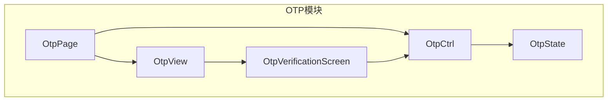
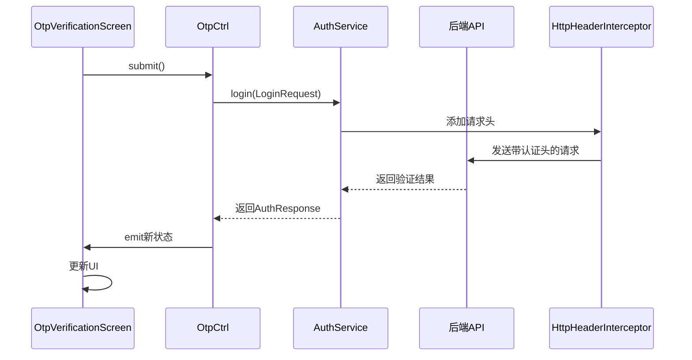
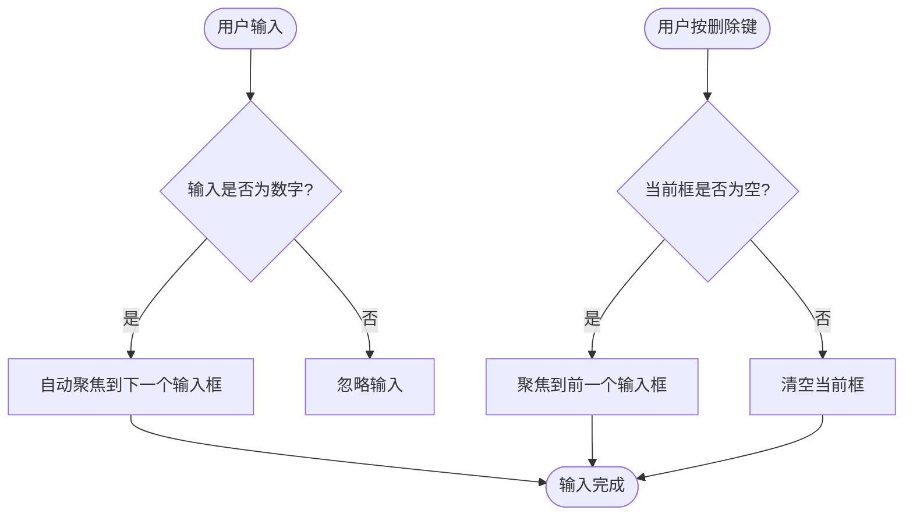
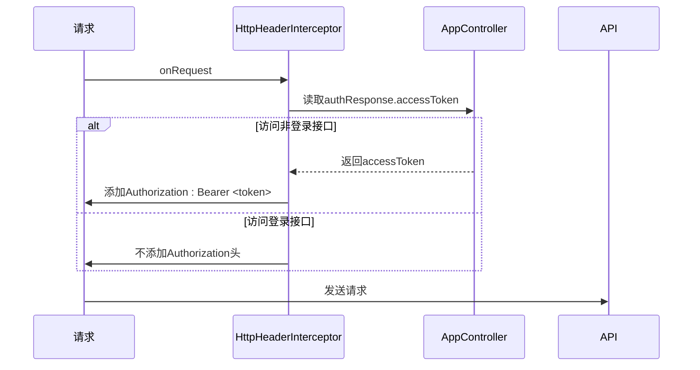
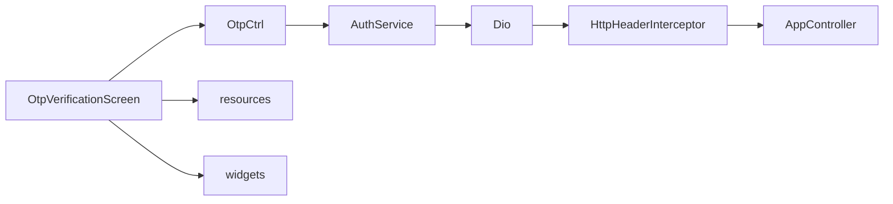

# OTP验证

<cite>
**本文档引用文件**  
- [otp_verification_screen.dart](file://lib/pages/otp/widgets/otp_verification_screen.dart)
- [controller.dart](file://lib/pages/otp/controller.dart)
- [state.dart](file://lib/pages/otp/state.dart)
- [page.dart](file://lib/pages/otp/page.dart)
- [common_digit_textformfield.dart](file://lib/widgets/base/textfield/common_digit_textformfield.dart)
- [auth_service.dart](file://lib/global/service/auth_service.dart)
- [app_controller.dart](file://lib/global/app_controller.dart)
- [http_header_interceptor.dart](file://lib/net/http_header_interceptor.dart)
- [net_manager.dart](file://lib/net/net_manager.dart)
</cite>

## 目录
1. [项目结构](#项目结构)
2. [核心组件](#核心组件)
3. [架构概述](#架构概述)
4. [详细组件分析](#详细组件分析)
5. [依赖分析](#依赖分析)
6. [性能考虑](#性能考虑)
7. [故障排除指南](#故障排除指南)
8. [结论](#结论)

## 项目结构

本项目采用Flutter框架构建，OTP验证功能位于`lib/pages/otp/`目录下，遵循清晰的分层架构。该功能模块包含控制器（controller）、页面（page）、视图（view）、状态（state）和UI组件（widgets）等标准文件，体现了典型的Flutter Bloc模式设计。

**图示来源**
- [page.dart](file://lib/pages/otp/page.dart)
- [controller.dart](file://lib/pages/otp/controller.dart)
- [state.dart](file://lib/pages/otp/state.dart)
- [view.dart](file://lib/pages/otp/view.dart)
- [otp_verification_screen.dart](file://lib/pages/otp/widgets/otp_verification_screen.dart)

**本节来源**
- [page.dart](file://lib/pages/otp/page.dart)
- [controller.dart](file://lib/pages/otp/controller.dart)

## 核心组件

OTP验证功能的核心组件包括`OtpVerificationScreen`（UI界面）、`OtpCtrl`（业务逻辑控制器）、`OtpState`（状态管理）和`AuthService`（后端服务调用）。这些组件协同工作，实现了从用户输入验证码到后端验证的完整流程。`OtpVerificationScreen`负责展示验证码输入界面和倒计时控件，`OtpCtrl`作为Bloc模式中的Cubit，管理验证码输入、倒计时、网络请求等状态变化，并与`AuthService`交互完成实际的后端验证。

**本节来源**
- [otp_verification_screen.dart](file://lib/pages/otp/widgets/otp_verification_screen.dart)
- [controller.dart](file://lib/pages/otp/controller.dart)
- [state.dart](file://lib/pages/otp/state.dart)
- [auth_service.dart](file://lib/global/service/auth_service.dart)

## 架构概述

OTP验证功能采用Flutter Bloc状态管理架构，实现了UI与业务逻辑的分离。用户在`OtpVerificationScreen`上进行操作，触发`OtpCtrl`中的事件（如提交验证码、重新发送）。`OtpCtrl`处理这些事件，更新`OtpState`，并通过`BlocBuilder`驱动UI重新构建。对于需要与服务器交互的操作，`OtpCtrl`会调用`AuthService`提供的API。整个流程由Dio网络库和拦截器链（如`HttpHeaderInterceptor`）保障通信的安全性和可靠性。

**图示来源**
- [otp_verification_screen.dart](file://lib/pages/otp/widgets/otp_verification_screen.dart)
- [controller.dart](file://lib/pages/otp/controller.dart)
- [auth_service.dart](file://lib/global/service/auth_service.dart)
- [http_header_interceptor.dart](file://lib/net/http_header_interceptor.dart)

## 详细组件分析

### OTP验证界面分析

`OtpVerificationScreen`是用户进行OTP验证的主界面，其UI设计注重用户体验和交互流畅性。

#### UI设计与交互逻辑
该界面包含一个4位验证码输入区域，由4个独立的`SingleDigitTextField`组成。每个输入框都具有自动聚焦功能：当用户在当前输入框输入一个数字后，焦点会自动移动到下一个输入框，极大地提升了输入效率。输入框的样式设计清晰，聚焦时边框颜色和背景色会发生变化，提供明确的视觉反馈。用户可以通过键盘的删除键进行删除操作，当删除当前输入框的内容时，焦点会自动移回前一个输入框，实现了流畅的反向导航。

**图示来源**
- [otp_verification_screen.dart](file://lib/pages/otp/widgets/otp_verification_screen.dart)
- [common_digit_textformfield.dart](file://lib/widgets/base/textfield/common_digit_textformfield.dart)

#### 控制器逻辑分析
`OtpCtrl`是OTP验证功能的核心控制器，它通过监听`codeController`数组中每个`TextEditingController`的变化来实现自动聚焦逻辑。在`initState`方法中，为每个控制器添加了监听器，当监听到某个输入框内容不为空时，立即请求下一个输入框的焦点。`submit`方法负责收集4个输入框的内容，拼接成完整的验证码，并根据`extra`参数中的`type`字段（如"register"、"password_change"或普通登录）决定调用`AuthService`中的哪个接口进行验证。

**本节来源**
- [otp_verification_screen.dart](file://lib/pages/otp/widgets/otp_verification_screen.dart)
- [controller.dart](file://lib/pages/otp/controller.dart)
- [common_digit_textformfield.dart](file://lib/widgets/base/textfield/common_digit_textformfield.dart)

### 验证流程与错误处理

#### 错误与过期处理
当用户输入的验证码错误或已过期时，后端API会返回相应的错误码。`AuthService`会抛出异常，该异常在`OtpCtrl`的`submit`方法中被捕获。捕获异常后，`OtpCtrl`会通过`emit`更新状态，将`loading`设置为`false`，从而停止加载动画。同时，Dio的`HttpRespInterceptor`会捕获到具体的错误信息，并通过`SportsToast`显示友好的错误提示给用户，例如“验证码错误”或“验证码已过期”。

#### 重新发送流程
页面底部的“重新发送”按钮受倒计时控制。当倒计时未结束时，按钮显示为“XXs后重新发送”且不可点击。倒计时由`OtpCtrl`中的`_countdownTimer`管理，初始时长为60秒。当倒计时结束后，按钮变为“重新发送”且可点击。用户点击后，`OtpCtrl`的`resendOtp`方法被调用，该方法会再次调用`sendOtp`并重新启动倒计时。

#### 导航逻辑
验证成功后，`AuthService`返回`AuthResponse`对象。`OtpCtrl`会将此响应传递给`AppController`的`loginSucessProcess`方法。该方法根据登录类型（注册或普通登录）执行不同的导航逻辑。如果是注册流程，会导航至`bindStationPage`；如果是普通登录，则会根据用户是否已绑定加油站，决定是跳转到`mainLayoutPage`还是`pendingReviewPage`。

**本节来源**
- [controller.dart](file://lib/pages/otp/controller.dart)
- [app_controller.dart](file://lib/global/app_controller.dart)
- [http_resp_interceptor.dart](file://lib/net/http_resp_interceptor.dart)

### 网络安全与拦截器

#### Dio拦截器与认证头
为了确保请求安全，项目使用了Dio拦截器机制。`HttpHeaderInterceptor`在每个请求发出前被调用。它会从`AppController`的全局状态中获取当前用户的`accessToken`，并将其添加到请求头的`Authorization`字段中，格式为`Bearer <token>`。这样，所有需要认证的API请求都会自动携带有效的认证信息。值得注意的是，登录接口（`/auth/login`）等不需要前置认证的接口会被特殊处理，不会添加此认证头，避免了循环依赖。

**图示来源**
- [http_header_interceptor.dart](file://lib/net/http_header_interceptor.dart)
- [app_controller.dart](file://lib/global/app_controller.dart)

**本节来源**
- [http_header_interceptor.dart](file://lib/net/http_header_interceptor.dart)
- [app_controller.dart](file://lib/global/app_controller.dart)
- [net_manager.dart](file://lib/net/net_manager.dart)

## 依赖分析

OTP验证功能依赖于多个核心模块。它直接依赖`AuthService`进行网络通信，而`AuthService`又依赖Dio库和`netManager`进行HTTP请求。`OtpCtrl`通过`Bloc`与`AppController`进行状态共享和导航控制。UI组件依赖于项目中的`resources`（如颜色、尺寸）和`widgets`（如按钮、文本框）库。这种依赖关系清晰，通过`Bloc`和`Service Locator`模式解耦，保证了模块的可维护性。

**图示来源**
- [controller.dart](file://lib/pages/otp/controller.dart)
- [auth_service.dart](file://lib/global/service/auth_service.dart)
- [http_header_interceptor.dart](file://lib/net/http_header_interceptor.dart)
- [app_controller.dart](file://lib/global/app_controller.dart)
- [otp_verification_screen.dart](file://lib/pages/otp/widgets/otp_verification_screen.dart)

**本节来源**
- [controller.dart](file://lib/pages/otp/controller.dart)
- [auth_service.dart](file://lib/global/service/auth_service.dart)
- [http_header_interceptor.dart](file://lib/net/http_header_interceptor.dart)
- [app_controller.dart](file://lib/global/app_controller.dart)

## 性能考虑

OTP验证功能在性能方面表现良好。UI更新通过`BlocBuilder`进行优化，仅在`OtpState`发生变化时才重建相关Widget，避免了不必要的重绘。网络请求使用了Dio的拦截器链，虽然增加了少量开销，但通过集中处理认证和日志，提高了代码效率和可维护性。倒计时使用`Timer.periodic`，每秒触发一次状态更新，频率适中，不会对性能造成显著影响。整体而言，该功能的性能开销主要在网络I/O上，这是不可避免的。

## 故障排除指南

- **问题：验证码输入框无法自动聚焦**
  - **检查点**：确认`OtpCtrl`的`initState`方法是否为每个`TextEditingController`正确添加了监听器。
  - **检查点**：检查`SingleDigitTextField`的`focusNode`是否正确传递。

- **问题：重新发送按钮无法点击**
  - **检查点**：确认`_countdownTimer`是否正常工作，`countdownSeconds`状态是否正确更新。
  - **检查点**：检查`resendOtp`方法中是否在发送请求前正确检查了倒计时状态。

- **问题：验证成功后未跳转**
  - **检查点**：确认`AuthService`返回的`AuthResponse`是否包含有效的`accessToken`。
  - **检查点**：检查`AppController`的`loginSucessProcess`方法是否被正确调用，以及导航逻辑是否符合预期。

- **问题：请求未携带认证头**
  - **检查点**：确认`HttpHeaderInterceptor`是否已成功添加到Dio的拦截器列表中。
  - **检查点**：检查`AppController`的全局状态中`authResponse`是否已正确设置。

**本节来源**
- [controller.dart](file://lib/pages/otp/controller.dart)
- [app_controller.dart](file://lib/global/app_controller.dart)
- [http_header_interceptor.dart](file://lib/net/http_header_interceptor.dart)

## 结论

本OTP验证功能实现了完整的验证码输入、验证和状态管理流程。通过采用Bloc模式，实现了清晰的代码分层和高效的状态管理。UI设计注重用户体验，自动聚焦和流畅的删除逻辑提升了输入效率。安全方面，通过Dio拦截器自动添加认证头，确保了通信安全。该功能模块化程度高，易于维护和扩展。建议在未来的开发中，可以增加对粘贴验证码的支持，并实现更精细的防暴力破解策略，如IP限制和设备指纹。