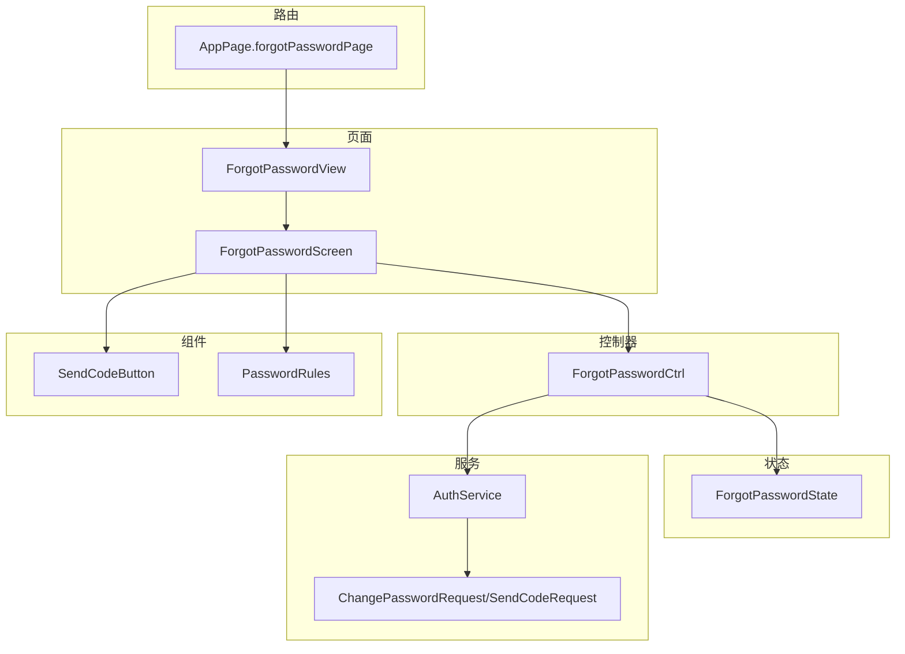
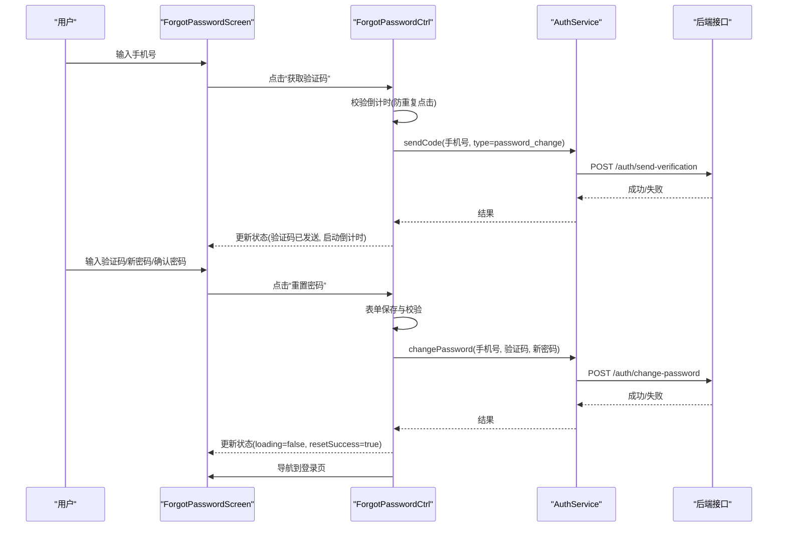
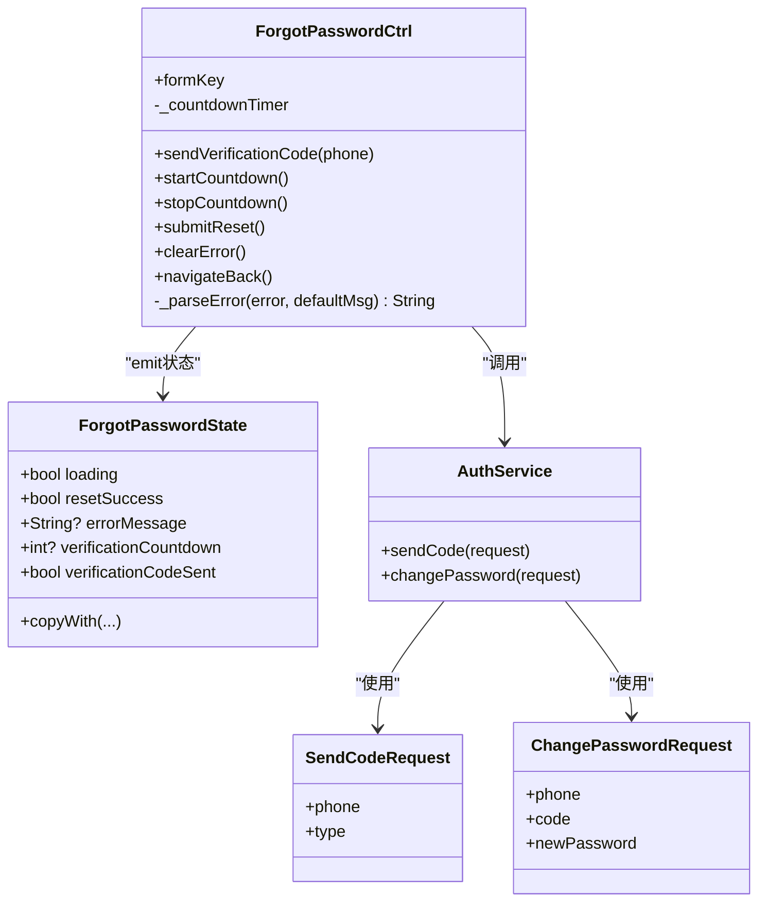
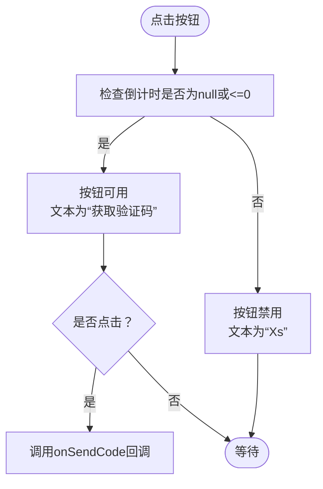
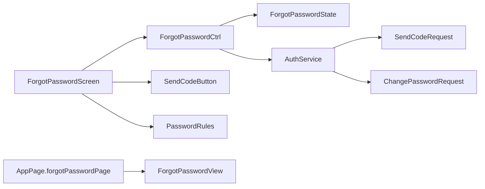

# 忘记密码

<cite>
**本文引用的文件**
- [controller.dart](file://lib/pages/forgot_password/controller.dart)
- [state.dart](file://lib/pages/forgot_password/state.dart)
- [view.dart](file://lib/pages/forgot_password/view.dart)
- [forgot_password_screen.dart](file://lib/pages/forgot_password/widgets/forgot_password_screen.dart)
- [send_code_button.dart](file://lib/pages/forgot_password/widgets/send_code_button.dart)
- [password_rules.dart](file://lib/pages/forgot_password/widgets/password_rules.dart)
- [auth_service.dart](file://lib/global/service/auth_service.dart)
- [auth_req_type.dart](file://lib/global/model/auth_req_type.dart)
- [phone_validator.dart](file://lib/utils/validators/phone_validator.dart)
- [routes.dart](file://lib/router/routes.dart)
- [error_recovery_test.dart](file://test/pages/forgot_password/error_recovery_test.dart)
- [countdown_integrity_test.dart](file://test/pages/forgot_password/countdown_integrity_test.dart)
- [form_validation_gate_test.dart](file://test/pages/forgot_password/form_validation_gate_test.dart)
- [send_code_button_state_test.dart](file://test/pages/forgot_password/send_code_button_state_test.dart)
- [verification_code_service_test.dart](file://test/pages/forgot_password/verification_code_service_test.dart)
</cite>

## 目录
1. [简介](#简介)
2. [项目结构](#项目结构)
3. [核心组件](#核心组件)
4. [架构总览](#架构总览)
5. [详细组件分析](#详细组件分析)
6. [依赖关系分析](#依赖关系分析)
7. [性能考量](#性能考量)
8. [故障排查指南](#故障排查指南)
9. [结论](#结论)
10. [附录](#附录)

## 简介
本文件围绕“忘记密码”功能，系统性梳理从输入手机号、发送验证码、倒计时控制、新密码设置与确认，到最终调用认证服务完成密码重置的完整流程。重点说明 ForgetPasswordController 如何管理手机号验证、验证码倒计时、新密码设置等状态；SendCodeButton 组件的防重复点击与倒计时逻辑；PasswordRules 组件的密码规则提示；以及表单提交后调用 AuthService 进行密码重置 API 的交互过程。同时提供常见问题排查指南与安全加固建议。

## 项目结构
忘记密码功能位于 pages/forgot_password 目录下，采用“视图-控制器-状态”的组织方式：
- 视图层：ForgotPasswordView 将状态映射到 ForgotPasswordScreen
- 控制器层：ForgotPasswordCtrl 继承 Cubit，负责业务状态与副作用（网络请求、倒计时）
- 状态层：ForgotPasswordState 描述页面状态（加载、错误、倒计时、验证码发送标记、重置成功）
- 组件层：ForgotPasswordScreen 负责表单构建与交互；SendCodeButton 提供倒计时按钮；PasswordRules 展示密码规则
- 服务层：AuthService 封装认证相关 API；ChangePasswordRequest/SendCodeRequest 定义请求模型
- 路由层：AppPage.forgotPasswordPage 定义页面路由

图表来源
- [view.dart](file://lib/pages/forgot_password/view.dart#L1-L16)
- [forgot_password_screen.dart](file://lib/pages/forgot_password/widgets/forgot_password_screen.dart#L1-L271)
- [controller.dart](file://lib/pages/forgot_password/controller.dart#L1-L203)
- [state.dart](file://lib/pages/forgot_password/state.dart#L1-L43)
- [send_code_button.dart](file://lib/pages/forgot_password/widgets/send_code_button.dart#L1-L63)
- [password_rules.dart](file://lib/pages/forgot_password/widgets/password_rules.dart#L1-L45)
- [auth_service.dart](file://lib/global/service/auth_service.dart#L1-L41)
- [auth_req_type.dart](file://lib/global/model/auth_req_type.dart#L1-L94)
- [routes.dart](file://lib/router/routes.dart#L120-L122)

章节来源
- [view.dart](file://lib/pages/forgot_password/view.dart#L1-L16)
- [forgot_password_screen.dart](file://lib/pages/forgot_password/widgets/forgot_password_screen.dart#L1-L271)
- [controller.dart](file://lib/pages/forgot_password/controller.dart#L1-L203)
- [state.dart](file://lib/pages/forgot_password/state.dart#L1-L43)
- [send_code_button.dart](file://lib/pages/forgot_password/widgets/send_code_button.dart#L1-L63)
- [password_rules.dart](file://lib/pages/forgot_password/widgets/password_rules.dart#L1-L45)
- [auth_service.dart](file://lib/global/service/auth_service.dart#L1-L41)
- [auth_req_type.dart](file://lib/global/model/auth_req_type.dart#L1-L94)
- [routes.dart](file://lib/router/routes.dart#L120-L122)

## 核心组件
- ForgotPasswordCtrl：负责发送验证码、启动/停止倒计时、提交密码重置、错误解析与导航
- ForgotPasswordState：描述页面状态字段（加载、错误、倒计时、验证码发送标记、重置成功）
- ForgotPasswordScreen：构建表单、绑定验证器、触发控制器方法、渲染按钮与规则
- SendCodeButton：根据倒计时禁用/启用按钮并显示剩余秒数
- PasswordRules：展示密码长度与字符要求
- AuthService：封装 /auth/send-verification 与 /auth/change-password 接口
- ChangePasswordRequest/SendCodeRequest：请求体模型

章节来源
- [controller.dart](file://lib/pages/forgot_password/controller.dart#L1-L203)
- [state.dart](file://lib/pages/forgot_password/state.dart#L1-L43)
- [forgot_password_screen.dart](file://lib/pages/forgot_password/widgets/forgot_password_screen.dart#L1-L271)
- [send_code_button.dart](file://lib/pages/forgot_password/widgets/send_code_button.dart#L1-L63)
- [password_rules.dart](file://lib/pages/forgot_password/widgets/password_rules.dart#L1-L45)
- [auth_service.dart](file://lib/global/service/auth_service.dart#L1-L41)
- [auth_req_type.dart](file://lib/global/model/auth_req_type.dart#L1-L94)

## 架构总览
忘记密码流程遵循“表单校验 -> 发送验证码 -> 倒计时 -> 输入新密码 -> 确认密码 -> 提交重置 -> 成功导航”的顺序。控制器通过状态驱动 UI 更新，服务层负责与后端交互。

图表来源
- [forgot_password_screen.dart](file://lib/pages/forgot_password/widgets/forgot_password_screen.dart#L243-L269)
- [controller.dart](file://lib/pages/forgot_password/controller.dart#L30-L128)
- [auth_service.dart](file://lib/global/service/auth_service.dart#L26-L37)
- [auth_req_type.dart](file://lib/global/model/auth_req_type.dart#L29-L94)
- [routes.dart](file://lib/router/routes.dart#L120-L122)

## 详细组件分析

### 忘记密码控制器（ForgetPasswordCtrl）
- 职责
  - 发送验证码：构造 SendCodeRequest(type=password_change)，调用 AuthService.sendCode，成功后置 verificationCodeSent 并启动倒计时
  - 倒计时管理：startCountdown 启动 60 秒倒计时，逐秒递减；倒计时结束时清空倒计时字段
  - 提交重置：保存并校验表单，构造 ChangePasswordRequest，调用 AuthService.changePassword，成功后置 resetSuccess 并替换导航至登录页
  - 错误处理：统一解析 DioException 与通用异常，映射为用户可理解的错误文案
  - 生命周期：关闭时取消倒计时定时器
- 关键状态
  - loading：提交过程中的加载态
  - errorMessage：错误信息
  - verificationCountdown：倒计时秒数
  - verificationCodeSent：验证码是否已发送
  - resetSuccess：重置是否成功

图表来源
- [controller.dart](file://lib/pages/forgot_password/controller.dart#L1-L203)
- [state.dart](file://lib/pages/forgot_password/state.dart#L1-L43)
- [auth_service.dart](file://lib/global/service/auth_service.dart#L1-L41)
- [auth_req_type.dart](file://lib/global/model/auth_req_type.dart#L29-L94)

章节来源
- [controller.dart](file://lib/pages/forgot_password/controller.dart#L1-L203)
- [state.dart](file://lib/pages/forgot_password/state.dart#L1-L43)

### 发送验证码按钮（SendCodeButton）
- 功能
  - 根据 countdown 字段决定按钮可用/禁用与文案（“获取验证码”或“Xs”）
  - 点击事件仅在可用时触发，避免重复点击
- 交互
  - 作为验证码输入框的后缀图标，与表单联动
  - 通过 BlocBuilder 订阅控制器状态，实时更新倒计时

图表来源
- [send_code_button.dart](file://lib/pages/forgot_password/widgets/send_code_button.dart#L1-L63)
- [forgot_password_screen.dart](file://lib/pages/forgot_password/widgets/forgot_password_screen.dart#L140-L170)

章节来源
- [send_code_button.dart](file://lib/pages/forgot_password/widgets/send_code_button.dart#L1-L63)
- [forgot_password_screen.dart](file://lib/pages/forgot_password/widgets/forgot_password_screen.dart#L140-L170)

### 密码规则提示（PasswordRules）
- 功能
  - 展示密码长度与字符要求（8-20位、包含字母和数字）
- 设计
  - 使用小圆点与文本组合，间距与字号统一

章节来源
- [password_rules.dart](file://lib/pages/forgot_password/widgets/password_rules.dart#L1-L45)

### 表单与校验
- 手机号输入
  - 限制最多11位数字，使用 PhoneValidator.validatePhone
- 验证码输入
  - 4位纯数字，使用内置校验器
- 新密码与确认密码
  - 长度 8-20 位，必须包含字母与数字，确认密码需与新密码一致
- 校验时机
  - 发送验证码前先保存并校验手机号
  - 提交重置前保存并校验全部字段

章节来源
- [forgot_password_screen.dart](file://lib/pages/forgot_password/widgets/forgot_password_screen.dart#L121-L230)
- [phone_validator.dart](file://lib/utils/validators/phone_validator.dart#L1-L35)

### API 交互（AuthService）
- 发送验证码
  - 请求体：SendCodeRequest(phone, type=password_change)
  - 接口：POST /auth/send-verification
- 修改密码
  - 请求体：ChangePasswordRequest(phone, code, newPassword)
  - 接口：POST /auth/change-password

章节来源
- [auth_service.dart](file://lib/global/service/auth_service.dart#L26-L37)
- [auth_req_type.dart](file://lib/global/model/auth_req_type.dart#L29-L94)

## 依赖关系分析
- 页面依赖
  - ForgotPasswordView 依赖 ForgotPasswordScreen
  - ForgotPasswordScreen 依赖控制器、按钮、规则组件、表单构建器
- 控制器依赖
  - ForgotPasswordCtrl 依赖 AuthService、路由工具、日志工具
- 服务依赖
  - AuthService 依赖网络管理器与 Retrofit 生成的客户端
- 数据模型依赖
  - ChangePasswordRequest/SendCodeRequest 用于序列化请求体

图表来源
- [forgot_password_screen.dart](file://lib/pages/forgot_password/widgets/forgot_password_screen.dart#L1-L271)
- [controller.dart](file://lib/pages/forgot_password/controller.dart#L1-L203)
- [state.dart](file://lib/pages/forgot_password/state.dart#L1-L43)
- [send_code_button.dart](file://lib/pages/forgot_password/widgets/send_code_button.dart#L1-L63)
- [password_rules.dart](file://lib/pages/forgot_password/widgets/password_rules.dart#L1-L45)
- [auth_service.dart](file://lib/global/service/auth_service.dart#L1-L41)
- [auth_req_type.dart](file://lib/global/model/auth_req_type.dart#L1-L94)
- [routes.dart](file://lib/router/routes.dart#L120-L122)

章节来源
- [forgot_password_screen.dart](file://lib/pages/forgot_password/widgets/forgot_password_screen.dart#L1-L271)
- [controller.dart](file://lib/pages/forgot_password/controller.dart#L1-L203)
- [auth_service.dart](file://lib/global/service/auth_service.dart#L1-L41)
- [routes.dart](file://lib/router/routes.dart#L120-L122)

## 性能考量
- 倒计时优化
  - 使用一次性周期定时器，每秒更新一次状态，避免频繁重建
  - 倒计时结束后立即释放定时器，防止内存泄漏
- 表单校验
  - 在发送验证码与提交重置前分别执行 saveAndValidate，减少无效网络请求
- UI 响应
  - 使用 BlocBuilder 精准订阅状态变化，避免不必要的重绘

章节来源
- [controller.dart](file://lib/pages/forgot_password/controller.dart#L56-L86)
- [forgot_password_screen.dart](file://lib/pages/forgot_password/widgets/forgot_password_screen.dart#L243-L269)

## 故障排查指南
- 验证码未收到
  - 检查手机号格式是否为11位数字且以1开头
  - 确认倒计时是否处于冷却中（按钮显示剩余秒数）
  - 查看错误信息是否提示“发送过于频繁”，适当等待后重试
- 验证码过期或错误
  - 重新获取验证码；确保输入4位纯数字
  - 若提示“验证码已过期”，重新获取并尽快使用
- 密码修改失败
  - 检查新密码长度与字符要求（8-20位、包含字母与数字）
  - 确认两次输入一致
  - 查看错误信息映射（如网络超时、账号锁定、手机号未注册等）
- 导航异常
  - 成功重置后应替换导航至登录页；若未跳转，检查路由配置与控制器导航逻辑

章节来源
- [phone_validator.dart](file://lib/utils/validators/phone_validator.dart#L1-L35)
- [forgot_password_screen.dart](file://lib/pages/forgot_password/widgets/forgot_password_screen.dart#L121-L230)
- [controller.dart](file://lib/pages/forgot_password/controller.dart#L148-L201)
- [routes.dart](file://lib/router/routes.dart#L120-L122)

## 结论
忘记密码功能通过清晰的状态机与组件化设计，实现了从手机号校验、验证码发送与倒计时、新密码设置与确认，到最终调用 AuthService 完成密码重置的完整闭环。控制器对错误进行统一解析，组件对用户体验进行细节优化（如倒计时按钮、规则提示）。建议在现有基础上增加二次安全验证（如图形验证码、短信二次确认）以进一步提升安全性。

## 附录
- 测试覆盖要点
  - 倒计时完整性与可重置性
  - 表单校验门禁（手机号、验证码、密码长度与复杂度、确认密码一致性）
  - 发送验证码按钮状态与点击防抖
  - 服务调用一致性（手机号格式、调用次数）

章节来源
- [countdown_integrity_test.dart](file://test/pages/forgot_password/countdown_integrity_test.dart)
- [form_validation_gate_test.dart](file://test/pages/forgot_password/form_validation_gate_test.dart)
- [send_code_button_state_test.dart](file://test/pages/forgot_password/send_code_button_state_test.dart)
- [verification_code_service_test.dart](file://test/pages/forgot_password/verification_code_service_test.dart)
- [error_recovery_test.dart](file://test/pages/forgot_password/error_recovery_test.dart)