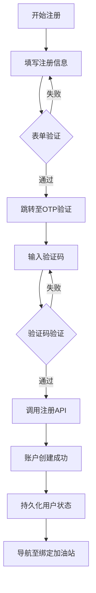
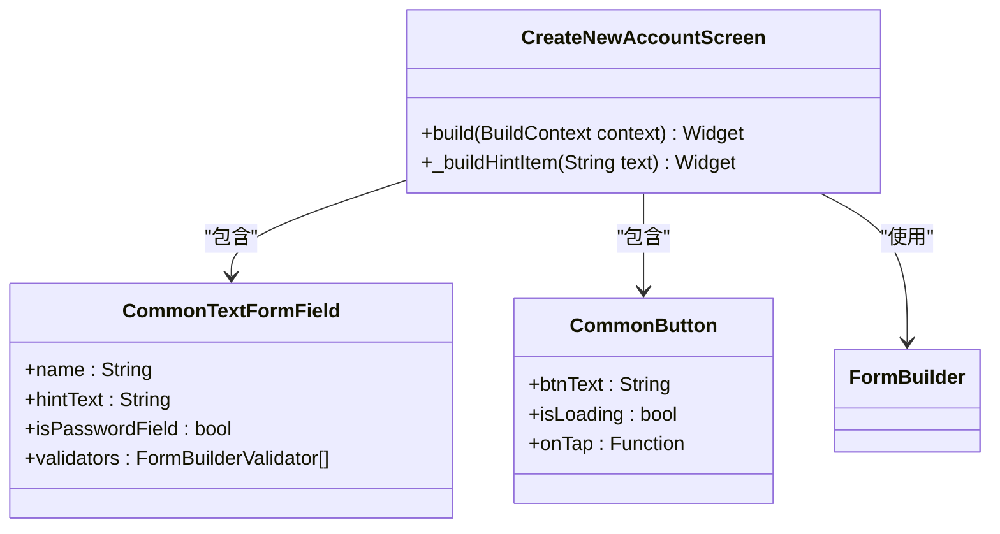
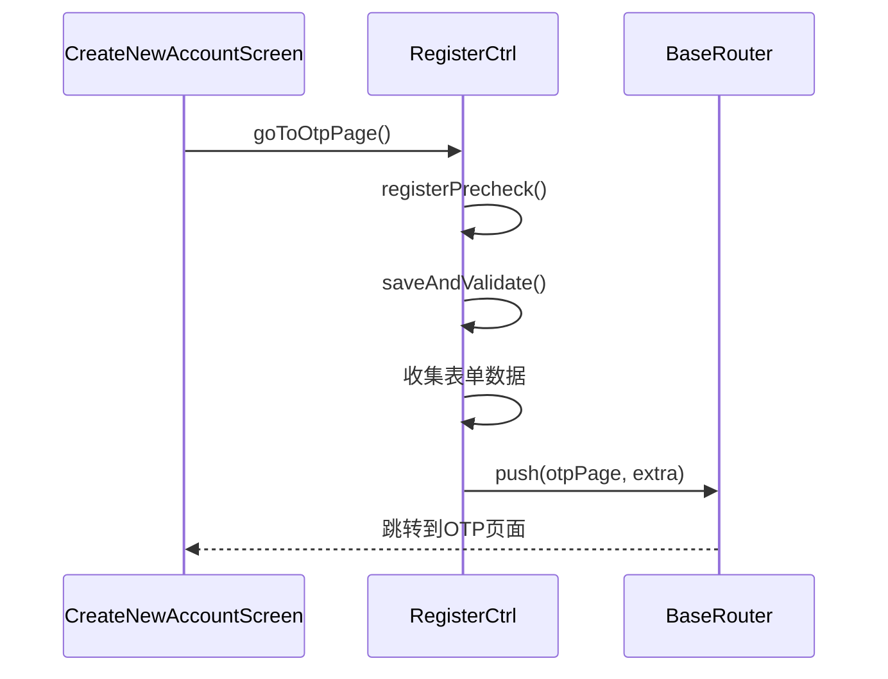
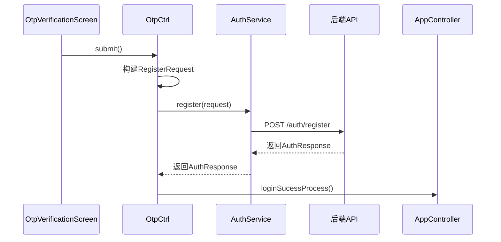
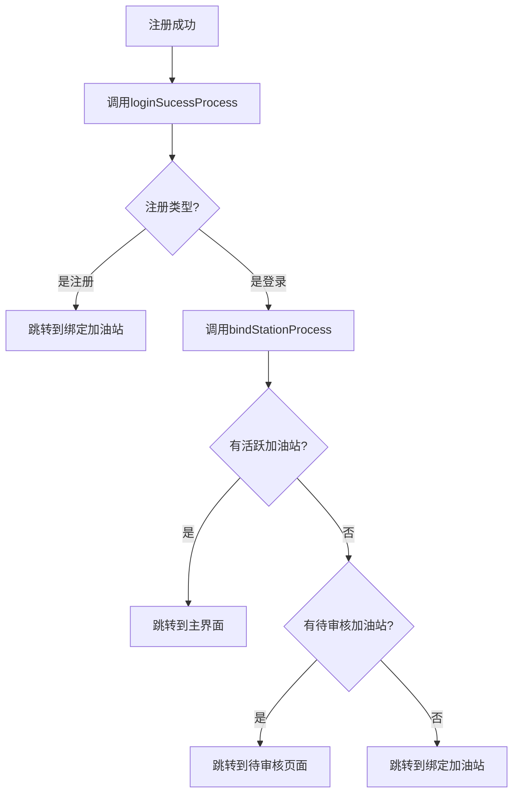
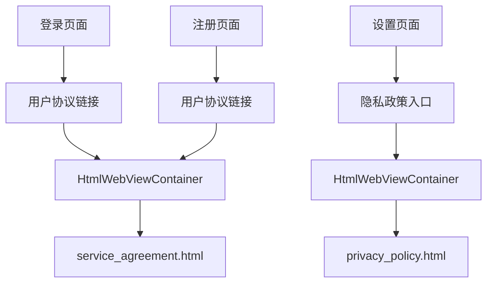

# 注册功能

<cite>
**本文档引用的文件**  
- [create_new_account_screen.dart](file://lib/pages/register/widgets/create_new_account_screen.dart)
- [controller.dart](file://lib/pages/register/controller.dart)
- [register.html](file://lib/pages/register/register.html)
- [otp_verification_screen.dart](file://lib/pages/otp/widgets/otp_verification_screen.dart)
- [phone_validator.dart](file://lib/utils/validators/phone_validator.dart)
- [verification_code_validator.dart](file://lib/utils/validators/verification_code_validator.dart)
- [routes.dart](file://lib/router/routes.dart)
- [auth_service.dart](file://lib/global/service/auth_service.dart)
- [state.dart](file://lib/pages/register/state.dart)
- [page.dart](file://lib/pages/register/page.dart)
- [otp_controller.dart](file://lib/pages/otp/controller.dart)
- [bind_station/page.dart](file://lib/pages/bind_station/page.dart)
- [app_controller.dart](file://lib/global/app_controller.dart)
- [service_agreement/view.dart](file://lib/pages/service_agreement/view.dart)
- [html.dart](file://lib/static/html.dart)
</cite>

## 目录
1. [介绍](#介绍)
2. [注册流程概览](#注册流程概览)
3. [创建账户页面UI分析](#创建账户页面ui分析)
4. [表单验证规则](#表单验证规则)
5. [注册控制器逻辑](#注册控制器逻辑)
6. [验证码发送与OTP验证](#验证码发送与otp验证)
7. [后端API调用与账户创建](#后端api调用与账户创建)
8. [注册成功后的状态持久化与导航](#注册成功后的状态持久化与导航)
9. [注册协议展示](#注册协议展示)
10. [常见问题与解决方案](#常见问题与解决方案)
11. [UI/UX优化建议](#uiux优化建议)

## 介绍
本文档详细描述了油品业务应用中注册功能的实现，重点分析新用户注册流程的UI与逻辑实现。文档涵盖了CreateNewAccountScreen的布局结构、表单字段验证规则、RegisterController如何协调验证码发送与后端API调用，以及注册成功后的账户状态持久化和导航逻辑。同时，文档还结合register.html静态资源说明了注册协议的展示方式，并提供了注册过程中常见问题的解决方案和UI/UX优化建议。

## 注册流程概览
新用户注册流程遵循一个清晰的多步骤流程：用户首先在`CreateNewAccountScreen`填写注册信息，包括姓名、手机号、密码等；表单验证通过后，点击"注册并登录"按钮跳转到OTP验证码验证页面；在OTP页面输入收到的验证码后，系统调用后端注册API完成账户创建；注册成功后，系统将用户身份信息持久化，并导航至绑定加油站页面。



**Diagram sources**
- [create_new_account_screen.dart](file://lib/pages/register/widgets/create_new_account_screen.dart#L189-L191)
- [controller.dart](file://lib/pages/register/controller.dart#L37-L55)
- [otp_verification_screen.dart](file://lib/pages/otp/widgets/otp_verification_screen.dart#L143-L147)
- [otp_controller.dart](file://lib/pages/otp/controller.dart#L123-L164)
- [app_controller.dart](file://lib/global/app_controller.dart#L63-L67)

## 创建账户页面UI分析
`CreateNewAccountScreen`是注册流程的入口页面，采用`Scaffold`作为基础布局，包含一个自定义的AppBar和一个可滚动的表单区域。页面顶部是应用Logo，下方是包含多个输入字段的表单。

表单使用`FormBuilder`组件构建，包含以下字段：
- **姓名输入框**：用于输入用户全名，带有用户图标前缀
- **手机号输入框**：用于输入11位中国手机号，带有电话图标前缀
- **密码输入框**：用于设置登录密码，带有锁图标前缀，支持密码可见性切换
- **确认密码输入框**：用于确认密码，带有锁图标前缀
- **推荐码输入框**：用于输入业务员推荐码，带有推荐图标前缀

页面底部有"注册并登录"按钮和"已有账户？立即登录"的导航链接。



**Diagram sources**
- [create_new_account_screen.dart](file://lib/pages/register/widgets/create_new_account_screen.dart#L18-L227)

**Section sources**
- [create_new_account_screen.dart](file://lib/pages/register/widgets/create_new_account_screen.dart#L1-L250)

## 表单验证规则
注册表单实现了严格的客户端验证规则，确保用户输入的数据符合要求。验证规则通过`FormBuilderValidators.compose`组合实现，每个字段都有相应的验证器。

### 手机号验证
手机号字段的验证规则如下：
- 必填验证：用户必须输入手机号
- 长度验证：必须是11位数字
- 格式验证：必须以数字1开头，且全为数字

这些规则在`phone_validator.dart`中定义，并在表单中引用：

```mermaid
flowchart TD
A[开始验证] --> B{输入为空?}
B --> |是| C[返回"请输入手机号"]
B --> |否| D{长度为11?}
D --> |否| E[返回"请输入有效的手机号"]
D --> |是| F{全为数字?}
F --> |否| G[返回"请输入有效的手机号"]
F --> |是| H{以1开头?}
H --> |否| I[返回"请输入有效的手机号"]
H --> |是| J[验证通过]
```

**Diagram sources**
- [phone_validator.dart](file://lib/utils/validators/phone_validator.dart#L4-L27)
- [create_new_account_screen.dart](file://lib/pages/register/widgets/create_new_account_screen.dart#L103-L113)

### 密码验证
密码字段的验证规则如下：
- 必填验证：用户必须输入密码
- 长度验证：密码长度必须在8-20位之间
- 复杂度要求：必须包含字母和数字

此外，确认密码字段还包含一个自定义验证器，用于检查两次输入的密码是否一致：

```mermaid
flowchart TD
A[开始密码验证] --> B{输入为空?}
B --> |是| C[返回"请输入密码"]
B --> |否| D{长度在8-20位?}
D --> |否| E[显示密码提示]
D --> |是| F{包含字母和数字?}
F --> |否| G[显示密码提示]
F --> |是| H[验证通过]
I[开始确认密码验证] --> J{输入为空?}
J --> |是| K[返回"请输入确认密码"]
J --> |否| L{与密码一致?}
L --> |否| M[返回"密码不一致"]
L --> |是| N[验证通过]
```

**Diagram sources**
- [create_new_account_screen.dart](file://lib/pages/register/widgets/create_new_account_screen.dart#L128-L155)
- [create_new_account_screen.dart](file://lib/pages/register/widgets/create_new_account_screen.dart#L146-L154)

**Section sources**
- [create_new_account_screen.dart](file://lib/pages/register/widgets/create_new_account_screen.dart#L117-L155)
- [phone_validator.dart](file://lib/utils/validators/phone_validator.dart#L1-L35)

## 注册控制器逻辑
`RegisterCtrl`是注册功能的核心控制器，负责协调注册流程的各个步骤。它继承自`Cubit`，使用BLoC模式管理注册状态。

### 状态管理
`RegisterState`类定义了注册过程中的状态：
- `loading`：表示是否正在处理注册请求
- `registerSuccess`：表示注册是否成功
- `errorMessage`：存储错误信息

### 注册预检查
`registerPrecheck`方法执行注册前的检查：
```dart
bool registerPrecheck() {
  if (state.loading) return false;
  return formKey.currentState?.saveAndValidate() ?? false;
}
```
该方法首先检查是否已经在加载状态，避免重复提交，然后调用表单的`saveAndValidate`方法执行所有验证规则。

### 跳转到OTP页面
`goToOtpPage`方法是注册流程的关键步骤，它在表单验证通过后执行：
```dart
goToOtpPage() async {
  if (!registerPrecheck()) return;
  
  final formData = formKey.currentState?.value ?? {};
  final phone = formData['phone'] ?? '';
  final name = formData['name'] ?? '';
  final password = formData['password'] ?? '';
  final referralCode = formData['referralCode'] ?? '';
  
  BaseRouter.push(url: AppPage.otpPage.path, extra: {
    'type': 'register',
    'phone': phone,
    'name': name,
    'password': password,
    'referralCode': referralCode,
  });
}
```
该方法收集表单数据，并通过路由参数将数据传递到OTP验证页面。



**Diagram sources**
- [controller.dart](file://lib/pages/register/controller.dart#L30-L55)
- [state.dart](file://lib/pages/register/state.dart#L1-L24)
- [page.dart](file://lib/pages/register/page.dart#L20-L34)

**Section sources**
- [controller.dart](file://lib/pages/register/controller.dart#L15-L81)
- [state.dart](file://lib/pages/register/state.dart#L1-L24)

## 验证码发送与OTP验证
注册流程的第二步是OTP（一次性密码）验证，确保手机号的真实性和用户控制权。

### OTP页面结构
`OtpVerificationScreen`页面显示一个4位数的验证码输入框，用户需要输入收到的验证码。页面还显示了倒计时功能，允许用户在60秒后重新发送验证码。

### 验证码发送
当用户进入OTP页面时，系统会自动调用`sendOtp`方法发送验证码：
```dart
sendOtp({required Map<String, dynamic> extra}) async {
  emit(state.copyWith(phone: extra['phone'] ?? '', loading: true));
  await authService.sendCode(
    SendCodeRequest(phone: extra['phone'] ?? '', type: extra['type'] ?? ''),
  );
  emit(state.copyWith(loading: false));
  startCountdown();
}
```
该方法调用`authService.sendCode`向后端发送验证码请求。

### 验证码重新发送
`resendOtp`方法处理验证码的重新发送，包含防重复提交逻辑：
```dart
Future<void> resendOtp({required Map<String, dynamic> extra}) async {
  if (state.countdownSeconds != null && state.countdownSeconds! > 0) {
    return; // 倒计时未结束，不允许重新发送
  }
  // 发送验证码并启动倒计时
}
```

### 验证码格式验证
验证码输入框有严格的格式验证规则，定义在`verification_code_validator.dart`中：
- 必填验证：用户必须输入验证码
- 长度验证：必须是4位数字
- 格式验证：只能包含数字

```mermaid
flowchart TD
A[开始验证码验证] --> B{输入为空?}
B --> |是| C[返回"请输入验证码"]
B --> |否| D{长度为4?}
D --> |小于4| E[返回"验证码长度不足"]
D --> |大于4| F[返回"验证码长度过长"]
D --> |等于4| G{全为数字?}
G --> |否| H[返回"验证码只能包含数字"]
G --> |是| I[验证通过]
```

**Diagram sources**
- [otp_verification_screen.dart](file://lib/pages/otp/widgets/otp_verification_screen.dart#L1-L215)
- [otp_controller.dart](file://lib/pages/otp/controller.dart#L47-L114)
- [verification_code_validator.dart](file://lib/utils/validators/verification_code_validator.dart#L1-L34)

**Section sources**
- [otp_verification_screen.dart](file://lib/pages/otp/widgets/otp_verification_screen.dart#L1-L215)
- [otp_controller.dart](file://lib/pages/otp/controller.dart#L1-L229)
- [verification_code_validator.dart](file://lib/utils/validators/verification_code_validator.dart#L1-L34)

## 后端API调用与账户创建
注册流程的最后一步是调用后端API完成账户创建。

### API接口定义
`AuthService`类定义了注册相关的API接口：
```dart
@RestApi()
abstract class AuthService {
  @POST('/auth/register')
  Future<AuthResponse> register(@Body() RegisterRequest request);
  
  @POST('/auth/send-verification')
  Future sendCode(@Body() SendCodeRequest request);
}
```
`register`接口接收`RegisterRequest`对象，包含用户注册所需的所有信息。

### 注册请求提交
在OTP页面，当用户输入验证码并提交时，`submit`方法被调用：
```dart
submit({required Map<String, dynamic> extra}) async {
  if (extra['type'] == "register") {
    final otpCode = codeController.map((e) => e.text).join('');
    final reqParams = RegisterRequest(
      name: extra['name'] ?? '',
      phone: extra['phone'] ?? '',
      code: otpCode,
      password: extra['password'] ?? '',
      referralCode: extra['referralCode'] ?? '',
    );
    
    final response = await authService.register(reqParams);
    BaseConfig.appContext
        ?.read<AppController>()
        .loginSucessProcess(response, type: AuthReqType.register);
  }
}
```
该方法构建`RegisterRequest`对象，调用`authService.register`接口，并在成功后处理登录成功流程。



**Diagram sources**
- [auth_service.dart](file://lib/global/service/auth_service.dart#L1-L41)
- [otp_controller.dart](file://lib/pages/otp/controller.dart#L123-L164)

**Section sources**
- [auth_service.dart](file://lib/global/service/auth_service.dart#L1-L41)
- [otp_controller.dart](file://lib/pages/otp/controller.dart#L122-L166)

## 注册成功后的状态持久化与导航
注册成功后，系统需要持久化用户状态并导航到适当的页面。

### 状态持久化
`AppController`负责管理应用的全局状态，包括用户身份信息：
```dart
loginSucessProcess(AuthResponse authResponse, {AuthReqType? type}) async {
  setAuthResponse(authResponse);
  if (type == AuthReqType.register) {
    BaseRouter.push(url: AppPage.bindStationPage.path);
    return;
  }
  bindStationProcess(isFromLogin: true);
}
```
`setAuthResponse`方法将用户的认证信息（如访问令牌、刷新令牌等）存储在应用状态中。

### 导航逻辑
注册成功后的导航逻辑遵循特定的业务流程：
1. 新用户注册 → 跳转到绑定加油站页面
2. 现有用户登录 → 检查加油站状态 → 导航到相应页面

`bindStationProcess`方法根据用户的加油站状态决定导航目标：
- 有活跃加油站 → 导航到主界面
- 有待审核加油站 → 导航到待审核页面
- 无加油站 → 导航到绑定加油站页面



**Diagram sources**
- [app_controller.dart](file://lib/global/app_controller.dart#L63-L98)
- [bind_station/page.dart](file://lib/pages/bind_station/page.dart#L1-L31)

**Section sources**
- [app_controller.dart](file://lib/global/app_controller.dart#L63-L98)
- [bind_station/page.dart](file://lib/pages/bind_station/page.dart#L1-L31)

## 注册协议展示
应用通过内嵌HTML的方式展示注册协议，确保用户在注册前了解相关条款。

### 协议资源管理
HTML静态资源通过`AssetsHtml`类集中管理：
```dart
class AssetsHtml {
  static const String SERVICE_AGREEMENT = 'assets/html/service_agreement.html';
  static const String PRIVACY_POLICY = 'assets/html/privacy_policy.html';
}
```
这些常量定义了用户协议和隐私政策的文件路径。

### 协议展示组件
`ServiceAgreementView`使用`HtmlWebViewContainer`组件展示用户协议：
```dart
class ServiceAgreementView extends StatelessWidget {
  @override
  Widget build(BuildContext context) {
    return const HtmlWebViewContainer(
      htmlAssetPath: AssetsHtml.SERVICE_AGREEMENT,
      title: '用户协议',
    );
  }
}
```
`HtmlWebViewContainer`是一个通用组件，用于在应用内展示HTML内容。

### 协议访问入口
用户可以在多个位置访问注册协议：
- 登录页面的"用户协议"链接
- 注册页面的"用户协议"链接
- 应用设置中的隐私政策入口



**Diagram sources**
- [service_agreement/view.dart](file://lib/pages/service_agreement/view.dart#L1-L18)
- [html.dart](file://lib/static/html.dart#L1-L10)
- [login/widgets/agreement_footer.dart](file://lib/pages/login/widgets/agreement_footer.dart#L69-L88)

**Section sources**
- [service_agreement/view.dart](file://lib/pages/service_agreement/view.dart#L1-L18)
- [html.dart](file://lib/static/html.dart#L1-L10)

## 常见问题与解决方案
### 验证码重复发送
**问题**：用户在倒计时未结束时尝试重新发送验证码。
**解决方案**：在`resendOtp`方法中添加倒计时检查，防止重复提交：
```dart
if (state.countdownSeconds != null && state.countdownSeconds! > 0) {
  return; // 倒计时未结束，不允许重新发送
}
```

### 密码不一致
**问题**：用户输入的密码和确认密码不一致。
**解决方案**：在确认密码字段添加自定义验证器，实时检查密码一致性：
```dart
validators: FormBuilderValidators.compose([
  (value) {
    final pw = formState?.fields['password']?.value;
    if (value != pw) {
      return '密码不一致';
    }
    return null;
  }
])
```

### 网络超时
**问题**：网络请求超时导致注册失败。
**解决方案**：在API调用中添加错误处理和重试机制：
```dart
try {
  final response = await authService.register(reqParams);
} catch (e) {
  emit(state.copyWith(loading: false));
  debugPrint('注册失败: $e');
  // 显示友好的错误提示
}
```

### 手机号格式错误
**问题**：用户输入非11位或非数字的手机号。
**解决方案**：在`PhoneValidator`中实现严格的格式验证：
```dart
static String? validatePhone(String? value) {
  if (value == null || value.isEmpty) return '请输入手机号';
  if (value.length != 11) return '请输入有效的手机号';
  if (!RegExp(r'^\d{11}$').hasMatch(value)) return '请输入有效的手机号';
  if (!value.startsWith('1')) return '请输入有效的手机号';
  return null;
}
```

**Section sources**
- [otp_controller.dart](file://lib/pages/otp/controller.dart#L59-L66)
- [create_new_account_screen.dart](file://lib/pages/register/widgets/create_new_account_screen.dart#L146-L154)
- [phone_validator.dart](file://lib/utils/validators/phone_validator.dart#L4-L27)

## UI/UX优化建议
### 提高注册转化率的建议
1. **简化表单**：考虑将推荐码字段设为可选，减少用户填写负担
2. **实时验证**：在用户输入时实时显示验证结果，而非提交后才提示
3. **密码强度指示器**：添加可视化的密码强度指示器，帮助用户创建安全密码
4. **社交登录**：提供微信、支付宝等社交登录选项，降低注册门槛
5. **进度指示**：在多步骤注册流程中添加进度指示器，让用户了解当前步骤

### 用户体验改进
1. **错误提示优化**：使用更友好的错误提示文案，避免技术术语
2. **键盘管理**：在输入完成后自动收起键盘，改善用户体验
3. **加载状态**：在按钮上显示加载状态，避免用户重复点击
4. **无障碍支持**：确保所有UI元素都有适当的无障碍标签
5. **国际化支持**：确保所有文本都支持多语言，包括错误提示

### 视觉设计建议
1. **一致性**：保持与应用其他页面的视觉风格一致
2. **对比度**：确保文本与背景有足够的对比度，提高可读性
3. **留白**：合理使用留白，避免界面过于拥挤
4. **品牌元素**：突出显示品牌Logo和色彩，增强品牌识别度
5. **响应式设计**：确保在不同屏幕尺寸上都有良好的显示效果

**Section sources**
- [create_new_account_screen.dart](file://lib/pages/register/widgets/create_new_account_screen.dart#L1-L250)
- [otp_verification_screen.dart](file://lib/pages/otp/widgets/otp_verification_screen.dart#L1-L215)