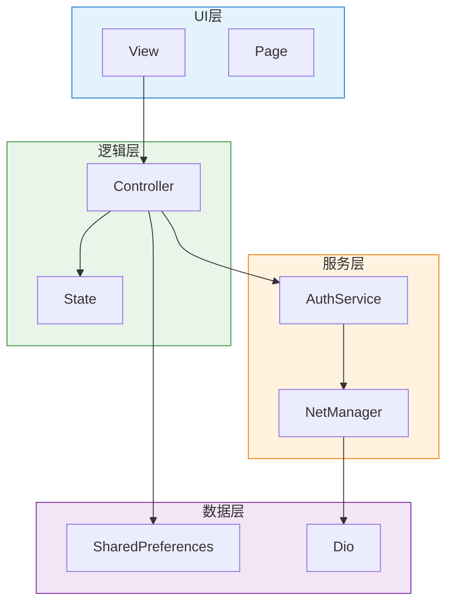
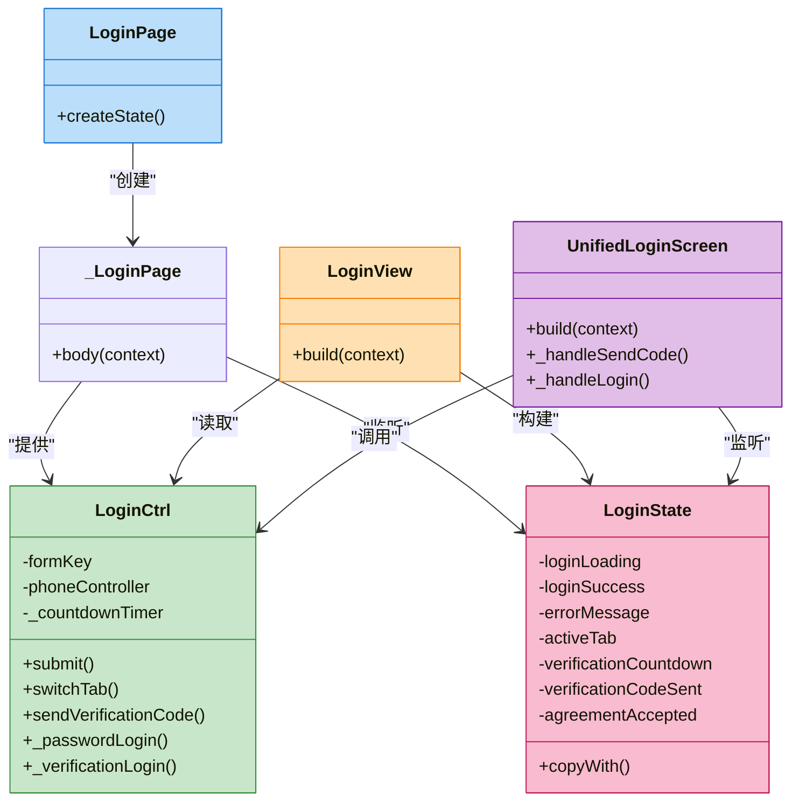
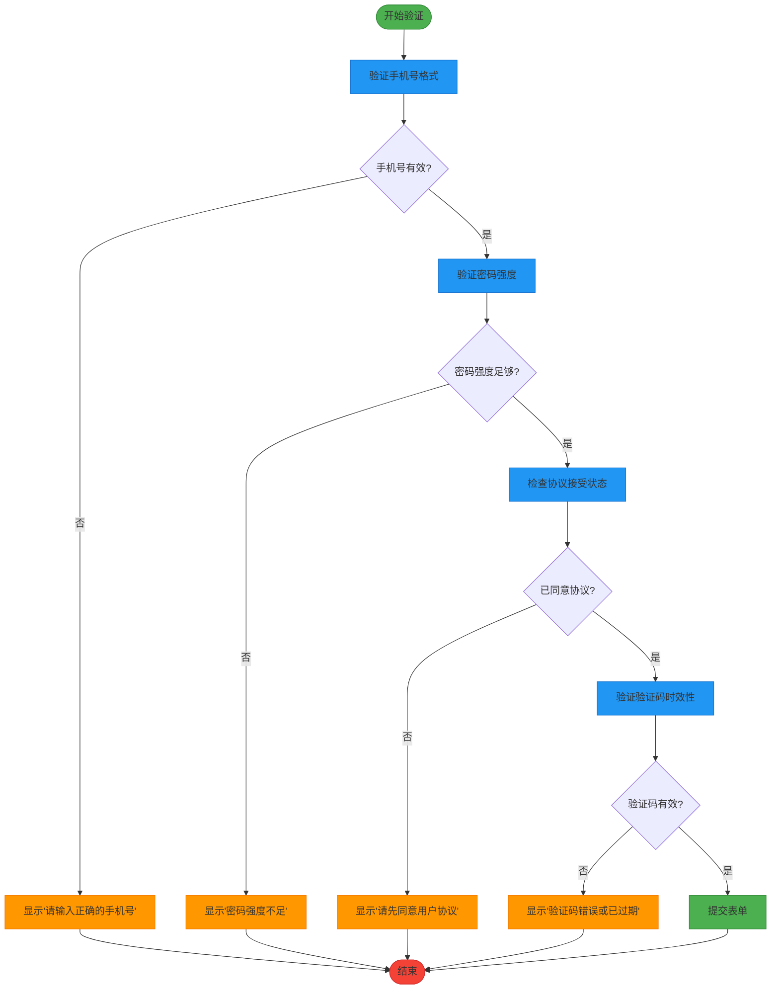
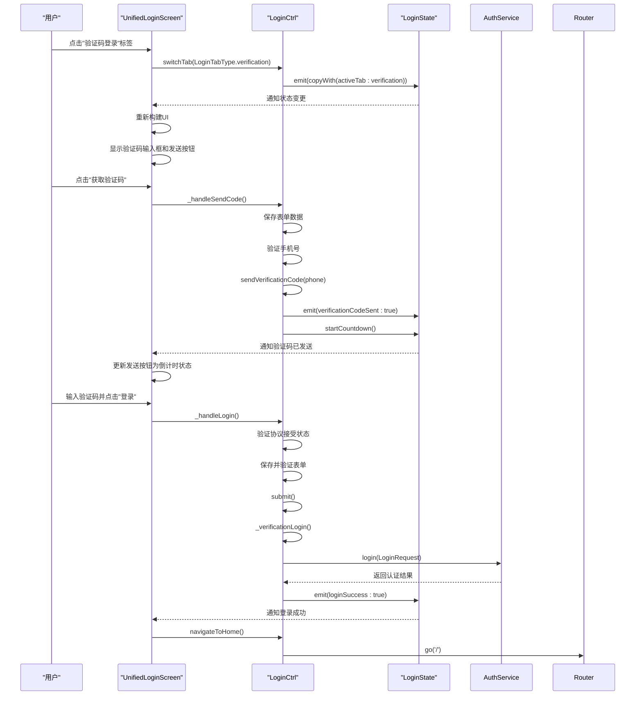
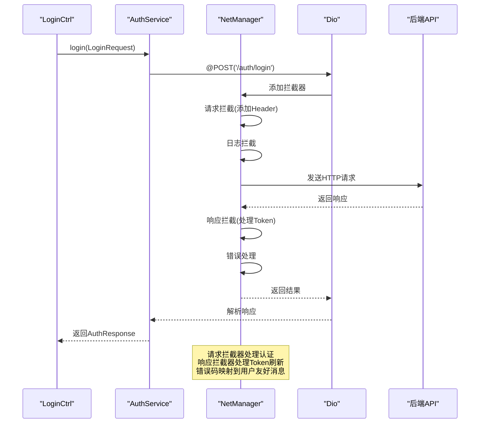
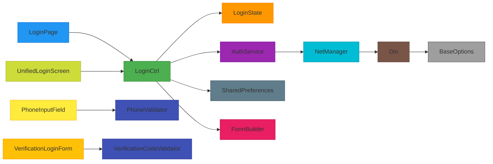

# 用户认证模块

<cite>
**本文档引用文件**  
- [login/page.dart](file://lib/pages/login/page.dart)
- [login/controller.dart](file://lib/pages/login/controller.dart)
- [login/state.dart](file://lib/pages/login/state.dart)
- [login/view.dart](file://lib/pages/login/view.dart)
- [login/widgets/unified_login_screen.dart](file://lib/pages/login/widgets/unified_login_screen.dart)
- [login/widgets/password_login_form.dart](file://lib/pages/login/widgets/password_login_form.dart)
- [login/widgets/verification_login_form.dart](file://lib/pages/login/widgets/verification_login_form.dart)
- [login/widgets/phone_input_field.dart](file://lib/pages/login/widgets/phone_input_field.dart)
- [login/widgets/tab_navigation.dart](file://lib/pages/login/widgets/tab_navigation.dart)
- [register/page.dart](file://lib/pages/register/page.dart)
- [forgot_password/page.dart](file://lib/pages/forgot_password/page.dart)
- [otp/page.dart](file://lib/pages/otp/page.dart)
- [global/service/auth_service.dart](file://lib/global/service/auth_service.dart)
- [net/dio_io.dart](file://lib/net/dio_io.dart)
- [global/model/auth_req_type.dart](file://lib/global/model/auth_req_type.dart)
- [utils/validators/phone_validator.dart](file://lib/utils/validators/phone_validator.dart)
- [utils/validators/verification_code_validator.dart](file://lib/utils/validators/verification_code_validator.dart)
</cite>

## 目录
1. [项目结构](#项目结构)
2. [核心组件](#核心组件)
3. [架构概述](#架构概述)
4. [详细组件分析](#详细组件分析)
5. [依赖分析](#依赖分析)
6. [性能考虑](#性能考虑)
7. [故障排除指南](#故障排除指南)
8. [结论](#结论)

## 项目结构

用户认证模块采用清晰的分层架构，主要包含登录、注册、忘记密码和OTP验证四个功能模块。每个模块遵循MVVM设计模式，分离页面逻辑、控制器、状态管理和UI视图。

```mermaid
graph TD
subgraph "用户认证模块"
Login[登录模块]
Register[注册模块]
ForgotPassword[忘记密码]
OTP[OTP验证]
end
Login --> LoginPage["LoginPage (页面)"]
Login --> LoginCtrl["LoginCtrl (控制器)"]
Login --> LoginState["LoginState (状态)"]
Login --> LoginView["LoginView (视图)"]
Login --> UnifiedLoginScreen["UnifiedLoginScreen (统一登录界面)"]
Login --> TabNavigation["TabNavigation (标签导航)"]
Login --> PhoneInput["PhoneInputField (手机号输入)"]
Login --> PasswordForm["PasswordLoginForm (密码表单)"]
Login --> VerificationForm["VerificationLoginForm (验证码表单)"]
Register --> RegisterPage
Register --> RegisterCtrl
Register --> RegisterState
Register --> RegisterView
ForgotPassword --> ForgotPasswordPage
ForgotPassword --> ForgotPasswordCtrl
ForgotPassword --> ForgotPasswordState
ForgotPassword --> ForgotPasswordView
OTP --> OtpPage
OTP --> OtpCtrl
OTP --> OtpState
OTP --> OtpView
AuthService[AuthService] --> NetManager["netManager.clientDio"]
LoginCtrl --> AuthService
RegisterCtrl --> AuthService
ForgotPasswordCtrl --> AuthService
OtpCtrl --> AuthService
PhoneValidator[PhoneValidator] --> PhoneInput
CodeValidator[VerificationCodeValidator] --> VerificationForm
style Login fill:#4CAF50,stroke:#388E3C
style Register fill:#2196F3,stroke:#1976D2
style ForgotPassword fill:#FF9800,stroke:#F57C00
style OTP fill:#9C27B0,stroke:#7B1FA2
```

**图示来源**  
- [login/page.dart](file://lib/pages/login/page.dart#L1-L28)
- [login/controller.dart](file://lib/pages/login/controller.dart#L1-L354)
- [login/state.dart](file://lib/pages/login/state.dart#L1-L63)
- [login/view.dart](file://lib/pages/login/view.dart#L1-L47)
- [login/widgets/unified_login_screen.dart](file://lib/pages/login/widgets/unified_login_screen.dart#L1-L174)

## 核心组件

用户认证模块的核心组件包括登录、注册、忘记密码和OTP验证四个功能模块，每个模块均采用MVVM架构模式。登录模块作为主要入口，实现了统一登录界面，支持账号密码登录和短信验证码登录两种方式。注册模块处理新用户创建流程，忘记密码模块提供密码重置功能，OTP模块负责一次性验证码的发送与验证。

认证服务（AuthService）作为统一的API交互层，通过Dio网络库与后端进行通信，封装了所有认证相关的HTTP请求。状态管理采用Bloc模式，通过Controller控制状态流转，State保存当前UI状态，View负责渲染界面并响应用户交互。

**本节来源**  
- [login/page.dart](file://lib/pages/login/page.dart#L1-L28)
- [register/page.dart](file://lib/pages/register/page.dart#L1-L37)
- [forgot_password/page.dart](file://lib/pages/forgot_password/page.dart#L1-L33)
- [otp/page.dart](file://lib/pages/otp/page.dart#L1-L36)

## 架构概述

系统采用分层架构设计，前端UI层与业务逻辑层分离，确保代码的可维护性和可测试性。MVVM模式将页面分为Page、Controller、State和View四个部分，实现关注点分离。

**图示来源**  
- [login/controller.dart](file://lib/pages/login/controller.dart#L1-L354)
- [global/service/auth_service.dart](file://lib/global/service/auth_service.dart#L1-L41)
- [net/dio_io.dart](file://lib/net/dio_io.dart#L1-L23)

## 详细组件分析

### 登录模块分析

登录模块采用MVVM架构，实现了统一的登录界面，支持密码登录和验证码登录两种方式。模块通过Bloc模式管理状态，确保UI与业务逻辑的分离。

#### MVVM结构职责划分

**图示来源**  
- [login/page.dart](file://lib/pages/login/page.dart#L1-L28)
- [login/controller.dart](file://lib/pages/login/controller.dart#L1-L354)
- [login/state.dart](file://lib/pages/login/state.dart#L1-L63)
- [login/view.dart](file://lib/pages/login/view.dart#L1-L47)

#### 登录表单验证逻辑

**图示来源**  
- [login/controller.dart](file://lib/pages/login/controller.dart#L49-L70)
- [login/widgets/phone_input_field.dart](file://lib/pages/login/widgets/phone_input_field.dart#L1-L40)
- [login/widgets/password_login_form.dart](file://lib/pages/login/widgets/password_login_form.dart#L1-L27)
- [login/widgets/verification_login_form.dart](file://lib/pages/login/widgets/verification_login_form.dart#L1-L78)
- [utils/validators/phone_validator.dart](file://lib/utils/validators/phone_validator.dart)
- [utils/validators/verification_code_validator.dart](file://lib/utils/validators/verification_code_validator.dart)

#### 统一登录界面实现机制

**图示来源**  
- [login/widgets/unified_login_screen.dart](file://lib/pages/login/widgets/unified_login_screen.dart#L1-L174)
- [login/controller.dart](file://lib/pages/login/controller.dart#L142-L176)
- [global/service/auth_service.dart](file://lib/global/service/auth_service.dart#L1-L41)

### AuthService与后端交互分析

AuthService作为认证模块的核心服务层，通过Retrofit注解与Dio网络库集成，实现了与后端API的高效交互。

**图示来源**  
- [global/service/auth_service.dart](file://lib/global/service/auth_service.dart#L1-L41)
- [net/dio_io.dart](file://lib/net/dio_io.dart#L1-L23)
- [login/controller.dart](file://lib/pages/login/controller.dart#L150-L154)

**本节来源**  
- [login/controller.dart](file://lib/pages/login/controller.dart#L1-L354)
- [global/service/auth_service.dart](file://lib/global/service/auth_service.dart#L1-L41)
- [net/dio_io.dart](file://lib/net/dio_io.dart#L1-L23)
- [login/widgets/unified_login_screen.dart](file://lib/pages/login/widgets/unified_login_screen.dart#L1-L174)

## 依赖分析

用户认证模块的依赖关系清晰，遵循单一职责原则和依赖倒置原则。核心依赖包括Dio网络库、Bloc状态管理、FormBuilder表单处理和SharedPreferences本地存储。

**图示来源**  
- [pubspec.yaml](file://pubspec.yaml)
- [login/controller.dart](file://lib/pages/login/controller.dart#L1-L354)
- [global/service/auth_service.dart](file://lib/global/service/auth_service.dart#L1-L41)

## 性能考虑

用户认证模块在性能方面进行了多项优化，确保快速响应和流畅用户体验。关键性能优化点包括：

1. **状态管理优化**：采用Bloc模式，仅在状态变更时通知UI重建，避免不必要的重绘
2. **网络请求优化**：使用Dio拦截器统一处理请求和响应，减少重复代码
3. **内存管理**：在Controller的close方法中正确释放Timer和Controller资源
4. **本地缓存**：使用SharedPreferences缓存最后登录手机号，提升用户体验
5. **异步处理**：所有网络请求均在异步任务中执行，避免阻塞UI线程

**本节来源**  
- [login/controller.dart](file://lib/pages/login/controller.dart#L36-L40)
- [login/controller.dart](file://lib/pages/login/controller.dart#L331-L340)
- [login/controller.dart](file://lib/pages/login/controller.dart#L52-L53)

## 故障排除指南

### 常见问题及解决方案

| 问题现象 | 可能原因 | 解决方案 |
|---------|--------|--------|
| 登录失败 | 网络连接问题 | 检查设备网络连接，确保网络畅通 |
| 登录失败 | 账号不存在 | 确认手机号正确，或先进行注册 |
| 登录失败 | 密码错误 | 确认密码正确，或使用忘记密码功能 |
| 验证码无法接收 | 发送过于频繁 | 等待60秒倒计时结束后重试 |
| 验证码无法接收 | 手机号格式错误 | 确认输入11位有效手机号 |
| 验证码无法接收 | 短信服务异常 | 检查服务状态，联系技术支持 |
| 登录按钮无响应 | 未同意用户协议 | 勾选用户服务协议和隐私政策 |
| 登录按钮无响应 | 表单验证失败 | 检查手机号、密码或验证码格式 |

### 安全性设计分析

用户认证模块采用了多项安全措施保障用户数据安全：

1. **Token持久化策略**：认证成功后，Token通过安全方式存储，避免明文存储
2. **会话管理**：实现Token刷新机制，定期更新访问令牌，降低安全风险
3. **输入验证**：在客户端和服务器端均进行输入验证，防止恶意输入
4. **HTTPS传输**：所有认证请求通过HTTPS加密传输，防止数据窃听
5. **错误信息处理**：返回用户友好的错误消息，避免泄露系统内部信息

**本节来源**  
- [login/controller.dart](file://lib/pages/login/controller.dart#L63-L139)
- [login/controller.dart](file://lib/pages/login/controller.dart#L234-L297)
- [global/service/auth_service.dart](file://lib/global/service/auth_service.dart#L1-L41)

## 结论

用户认证模块采用现代化的MVVM架构和Bloc状态管理模式，实现了登录、注册、忘记密码和OTP验证四大核心功能。模块设计清晰，职责分离明确，代码可维护性强。通过统一的AuthService服务层与后端进行API交互，确保了网络请求的一致性和可靠性。

安全性方面，模块实现了完整的Token管理和会话控制机制，结合客户端输入验证和服务器端安全防护，为用户提供安全可靠的认证体验。未来可进一步优化的方向包括增加生物识别登录支持、实现更智能的异常登录检测和增强多因素认证功能。