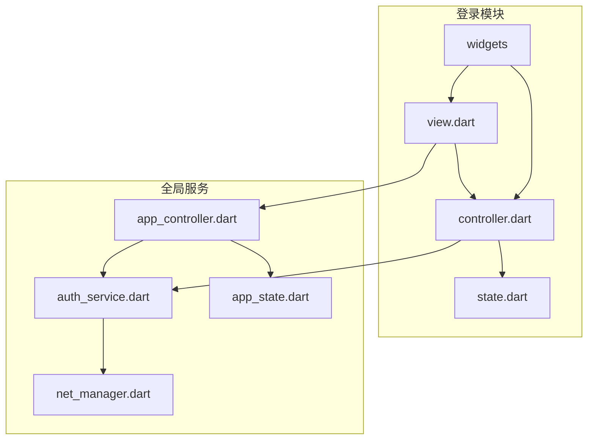
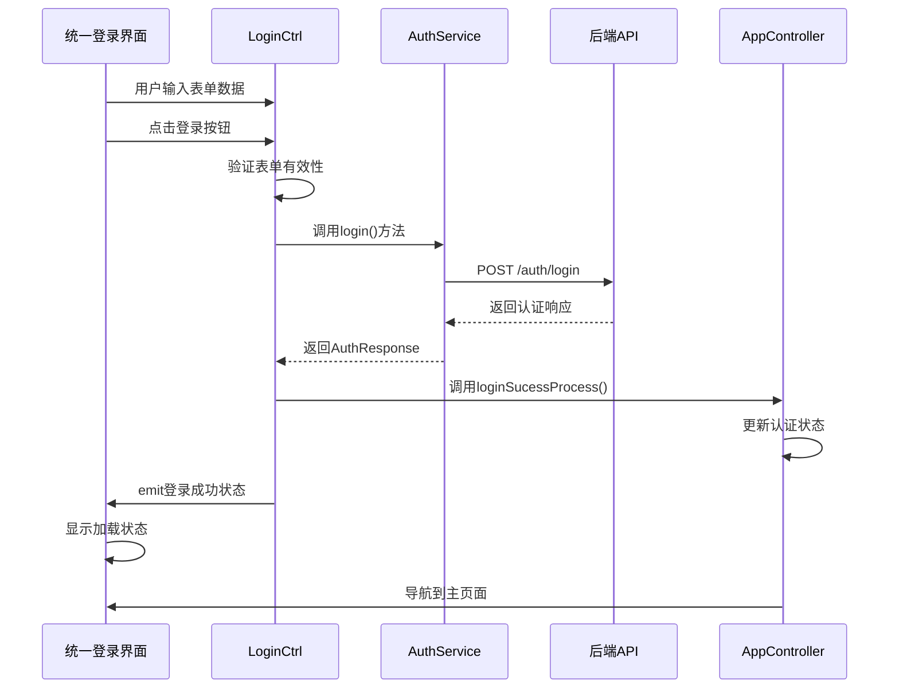
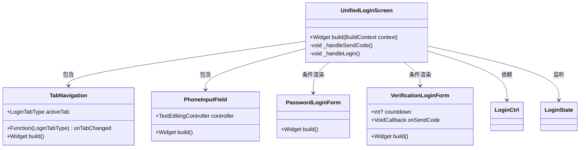
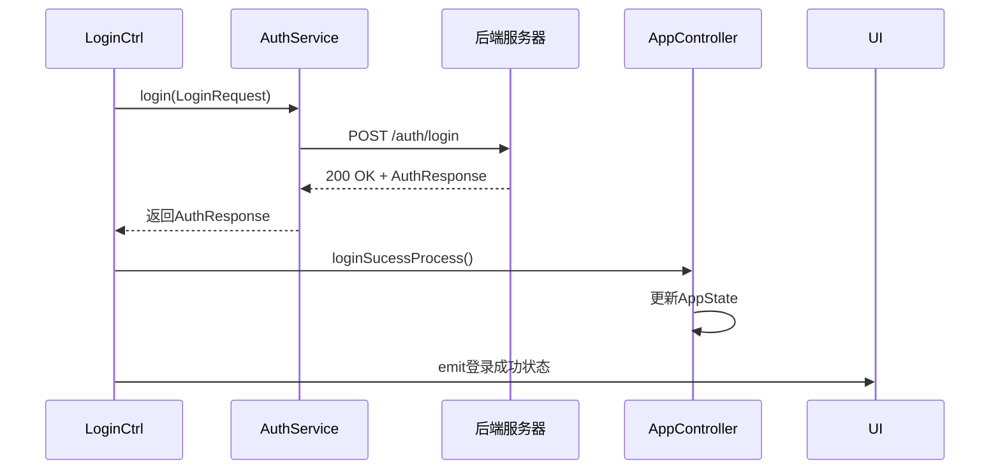
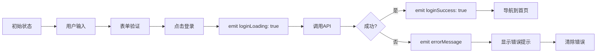
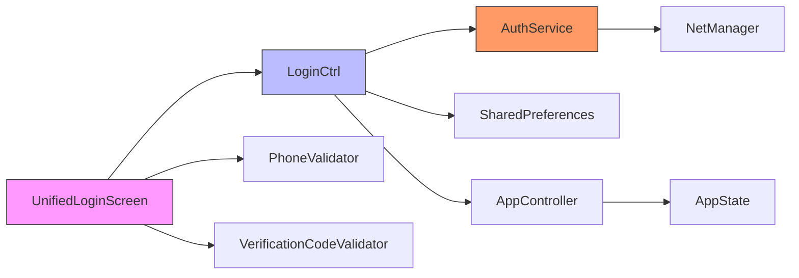
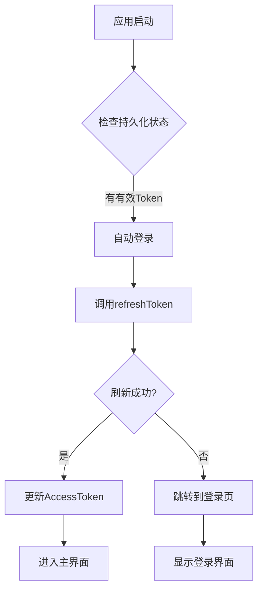

# 登录功能

<cite>
**本文档引用文件**  
- [unified_login_screen.dart](file://lib/pages/login/widgets/unified_login_screen.dart)
- [controller.dart](file://lib/pages/login/controller.dart)
- [state.dart](file://lib/pages/login/state.dart)
- [tab_navigation.dart](file://lib/pages/login/widgets/tab_navigation.dart)
- [password_login_form.dart](file://lib/pages/login/widgets/password_login_form.dart)
- [verification_login_form.dart](file://lib/pages/login/widgets/verification_login_form.dart)
- [phone_input_field.dart](file://lib/pages/login/widgets/phone_input_field.dart)
- [auth_service.dart](file://lib/global/service/auth_service.dart)
- [app_controller.dart](file://lib/global/app_controller.dart)
- [phone_validator.dart](file://lib/utils/validators/phone_validator.dart)
- [verification_code_validator.dart](file://lib/utils/validators/verification_code_validator.dart)
- [auth_req_type.dart](file://lib/global/model/auth_req_type.dart)
- [auth_rep_type.dart](file://lib/global/model/auth_rep_type.dart)
</cite>

## 目录
1. [简介](#简介)
2. [项目结构](#项目结构)
3. [核心组件](#核心组件)
4. [架构概述](#架构概述)
5. [详细组件分析](#详细组件分析)
6. [依赖分析](#依赖分析)
7. [性能考虑](#性能考虑)
8. [故障排除指南](#故障排除指南)
9. [结论](#结论)

## 简介
本文档详细描述了油品业务应用中的统一登录功能实现机制。重点分析了统一登录界面（UnifiedLoginScreen）的实现，包括Tab导航在密码登录与验证码登录之间的切换逻辑、表单验证规则、状态管理流程以及与后端服务的交互机制。文档还涵盖了登录失败处理、自动登录流程和Token刷新机制，为不同层次的开发者提供全面的技术指导。

## 项目结构
登录功能的实现遵循Flutter Clean Architecture分层设计，主要文件位于`lib/pages/login`目录下，采用Controller-View-State（CVS）模式组织代码。



**图示来源**  
- [controller.dart](file://lib/pages/login/controller.dart#L1-L354)
- [view.dart](file://lib/pages/login/view.dart#L1-L47)
- [auth_service.dart](file://lib/global/service/auth_service.dart#L1-L41)
- [app_controller.dart](file://lib/global/app_controller.dart#L1-L146)

**本节来源**  
- [lib/pages/login](file://lib/pages/login)

## 核心组件
登录功能的核心组件包括统一登录界面、登录控制器、登录状态管理、Tab导航组件、表单验证器和认证服务。这些组件通过Bloc模式进行状态管理，实现了UI与业务逻辑的分离。

**本节来源**  
- [unified_login_screen.dart](file://lib/pages/login/widgets/unified_login_screen.dart#L1-L174)
- [controller.dart](file://lib/pages/login/controller.dart#L1-L354)
- [state.dart](file://lib/pages/login/state.dart#L1-L63)

## 架构概述
登录功能采用分层架构设计，从UI层到服务层形成清晰的调用链路。UI组件通过Bloc监听状态变化，控制器处理业务逻辑并调用服务层接口，服务层负责与后端API通信。



**图示来源**  
- [unified_login_screen.dart](file://lib/pages/login/widgets/unified_login_screen.dart#L1-L174)
- [controller.dart](file://lib/pages/login/controller.dart#L49-L70)
- [auth_service.dart](file://lib/global/service/auth_service.dart#L15-L16)
- [app_controller.dart](file://lib/global/app_controller.dart#L63-L69)

## 详细组件分析

### 统一登录界面分析
统一登录界面是登录功能的UI入口，采用BlocListener监听登录状态变化，通过FormBuilder管理表单数据。

#### 组件结构


**图示来源**  
- [unified_login_screen.dart](file://lib/pages/login/widgets/unified_login_screen.dart#L18-L174)
- [tab_navigation.dart](file://lib/pages/login/widgets/tab_navigation.dart#L7-L74)
- [phone_input_field.dart](file://lib/pages/login/widgets/phone_input_field.dart#L9-L39)
- [password_login_form.dart](file://lib/pages/login/widgets/password_login_form.dart#L7-L27)
- [verification_login_form.dart](file://lib/pages/login/widgets/verification_login_form.dart#L11-L78)

**本节来源**  
- [unified_login_screen.dart](file://lib/pages/login/widgets/unified_login_screen.dart#L1-L174)

### Tab导航组件分析
Tab导航组件实现了密码登录与验证码登录之间的切换，并通过状态同步保持用户体验的一致性。

#### 切换机制
```mermaid
flowchart TD
A[用户点击Tab] --> B{调用onTabChanged}
B --> C[LoginCtrl.switchTab()]
C --> D[emit新状态]
D --> E[BlocBuilder重建UI]
E --> F{检查activeTab}
F --> |密码登录| G[显示PasswordLoginForm]
F --> |验证码登录| H[显示VerificationLoginForm]
G --> I[保持PhoneInputField不变]
H --> I
I --> J[完成切换动画]
```

**图示来源**  
- [tab_navigation.dart](file://lib/pages/login/widgets/tab_navigation.dart#L6-L74)
- [controller.dart](file://lib/pages/login/controller.dart#L208-L210)
- [unified_login_screen.dart](file://lib/pages/login/widgets/unified_login_screen.dart#L52-L83)

**本节来源**  
- [tab_navigation.dart](file://lib/pages/login/widgets/tab_navigation.dart#L1-L74)
- [controller.dart](file://lib/pages/login/controller.dart#L208-L210)

### 登录表单验证分析
登录表单验证包括手机号格式校验、密码强度规则和验证码输入时效性检查，确保用户输入数据的有效性。

#### 验证流程
```mermaid
flowchart TD
A[用户提交表单] --> B[FormBuilder.saveAndValidate()]
B --> C{验证通过?}
C --> |否| D[显示错误提示]
C --> |是| E[获取表单数据]
E --> F[手机号验证]
F --> G{有效?}
G --> |否| H[显示手机号错误]
G --> |是| I[检查登录方式]
I --> |密码登录| J[检查密码字段]
I --> |验证码登录| K[检查验证码字段]
J --> L[调用登录接口]
K --> L
```

**图示来源**  
- [phone_input_field.dart](file://lib/pages/login/widgets/phone_input_field.dart#L21-L37)
- [password_login_form.dart](file://lib/pages/login/widgets/password_login_form.dart#L12-L24)
- [verification_login_form.dart](file://lib/pages/login/widgets/verification_login_form.dart#L23-L38)
- [phone_validator.dart](file://lib/utils/validators/phone_validator.dart#L4-L27)
- [verification_code_validator.dart](file://lib/utils/validators/verification_code_validator.dart#L4-L26)

**本节来源**  
- [phone_validator.dart](file://lib/utils/validators/phone_validator.dart#L1-L35)
- [verification_code_validator.dart](file://lib/utils/validators/verification_code_validator.dart#L1-L34)
- [phone_input_field.dart](file://lib/pages/login/widgets/phone_input_field.dart#L1-L40)

### 认证服务分析
LoginController通过AuthService调用后端API进行身份验证，处理认证响应并更新应用状态。

#### 认证流程


**图示来源**  
- [controller.dart](file://lib/pages/login/controller.dart#L143-L175)
- [auth_service.dart](file://lib/global/service/auth_service.dart#L15-L16)
- [app_controller.dart](file://lib/global/app_controller.dart#L63-L69)

**本节来源**  
- [controller.dart](file://lib/pages/login/controller.dart#L49-L70)
- [auth_service.dart](file://lib/global/service/auth_service.dart#L1-L41)

### Bloc状态管理分析
登录功能采用Bloc模式管理状态，通过emit状态变更和监听机制实现UI的响应式更新。

#### 状态流


**图示来源**  
- [state.dart](file://lib/pages/login/state.dart#L7-L62)
- [controller.dart](file://lib/pages/login/controller.dart#L52-L68)
- [view.dart](file://lib/pages/login/view.dart#L32-L43)

**本节来源**  
- [state.dart](file://lib/pages/login/state.dart#L1-L63)
- [controller.dart](file://lib/pages/login/controller.dart#L15-L354)

## 依赖分析
登录功能涉及多个组件间的依赖关系，形成了清晰的调用链路和数据流。



**图示来源**  
- [unified_login_screen.dart](file://lib/pages/login/widgets/unified_login_screen.dart#L4-L5)
- [controller.dart](file://lib/pages/login/controller.dart#L6-L9)
- [auth_service.dart](file://lib/global/service/auth_service.dart#L3-L4)
- [app_controller.dart](file://lib/global/app_controller.dart#L9-L10)

**本节来源**  
- [controller.dart](file://lib/pages/login/controller.dart#L1-L354)
- [auth_service.dart](file://lib/global/service/auth_service.dart#L1-L41)
- [app_controller.dart](file://lib/global/app_controller.dart#L1-L146)

## 性能考虑
登录功能在性能方面进行了多项优化，包括状态管理效率、网络请求优化和内存管理。

- **状态管理优化**：使用Bloc的浅比较机制，避免不必要的UI重建
- **网络请求优化**：验证码发送后启用60秒倒计时，防止频繁请求
- **内存管理**：在控制器关闭时正确释放Timer和TextEditingController资源
- **缓存机制**：使用SharedPreferences缓存最后登录的手机号码
- **错误处理**：对网络异常进行友好提示，避免应用崩溃

## 故障排除指南

### 登录失败处理
系统针对不同类型的登录失败提供了具体的错误码处理策略：

**错误码映射表**

| 错误类型 | 错误码/异常 | 用户提示 | 处理策略 |
|---------|-----------|--------|--------|
| 账号不存在 | "not found", "不存在" | "账号不存在，请先注册" | 引导用户注册流程 |
| 密码错误 | "invalid", "incorrect", "密码错误" | "手机号或密码错误" | 允许重新输入 |
| 验证码错误 | "wrong code", "验证码错误" | "验证码错误或已过期" | 提供重新发送选项 |
| 网络超时 | connectionTimeout, receiveTimeout | "网络连接超时，请检查网络后重试" | 建议检查网络连接 |
| 服务器错误 | badResponse, server error | "服务器错误，请稍后重试" | 提示稍后重试 |
| 账号锁定 | locked, disabled, "锁定" | "账号已被锁定，请联系您的业务员" | 提供客服联系方式 |

**本节来源**  
- [controller.dart](file://lib/pages/login/controller.dart#L73-L139)
- [authentication_error_handling_test.dart](file://test/pages/login/authentication_error_handling_test.dart#L1-L44)

### 自动登录与Token刷新
系统实现了自动登录和Token刷新机制，提升用户体验：



**本节来源**  
- [app_controller.dart](file://lib/global/app_controller.dart#L34-L48)
- [auth_service.dart](file://lib/global/service/auth_service.dart#L18-L20)

## 结论
本文档全面分析了油品业务应用的登录功能实现机制。系统采用现代化的Flutter架构设计，通过Bloc模式实现了状态与UI的分离，确保了代码的可维护性和可测试性。统一登录界面提供了流畅的用户体验，支持密码登录和验证码登录两种方式，并通过完善的验证机制保证了数据质量。错误处理策略全面覆盖了各种异常情况，为用户提供了清晰的反馈。整体设计充分考虑了性能优化和安全性，为应用的稳定运行提供了保障。