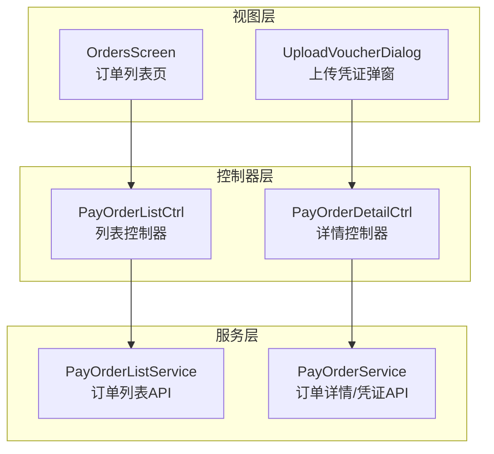
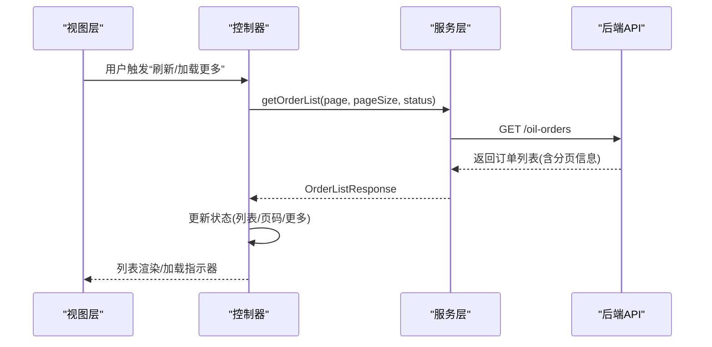
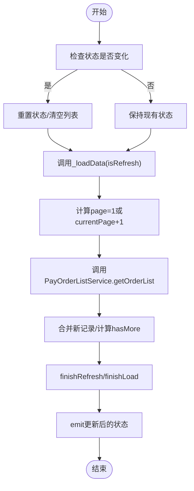
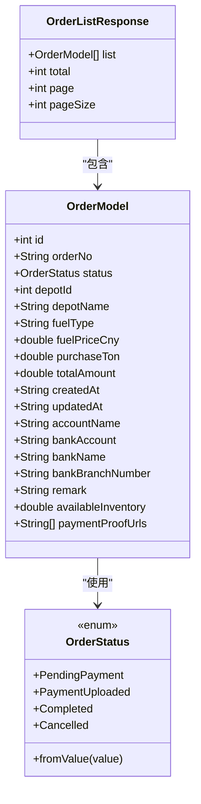
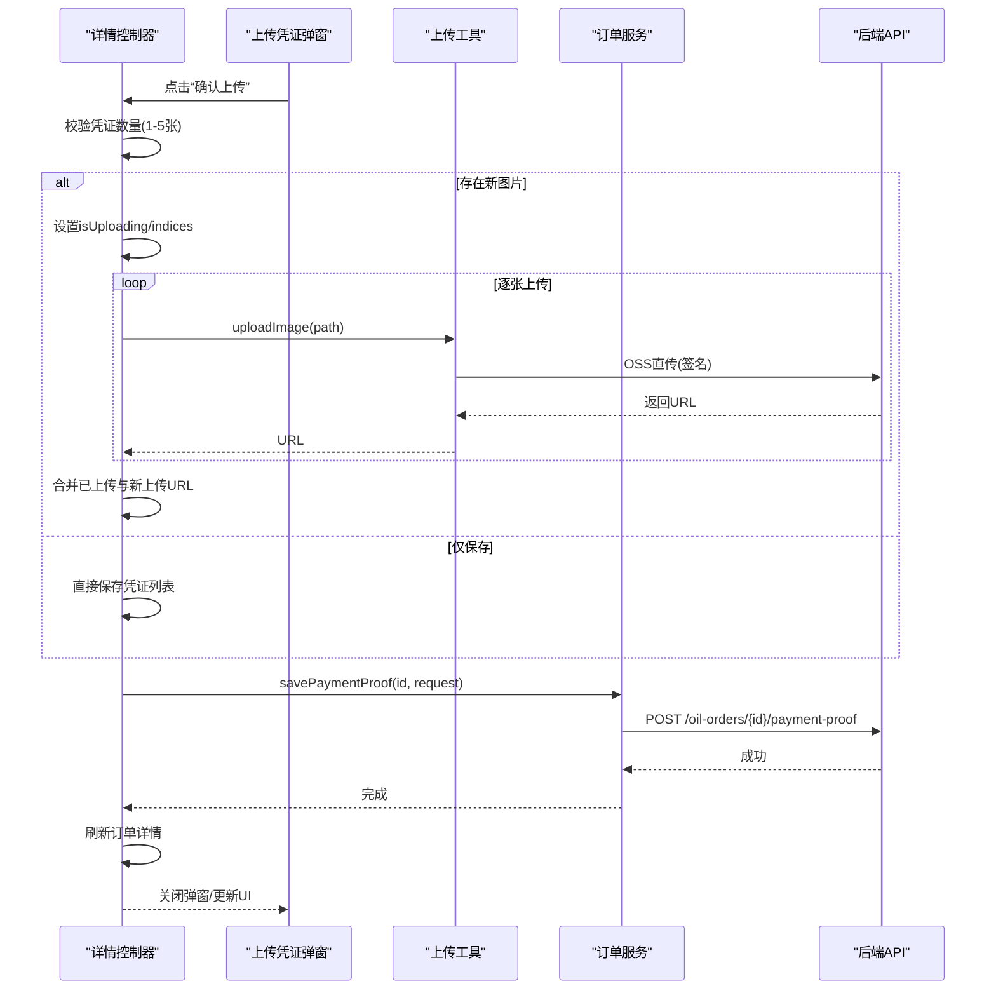
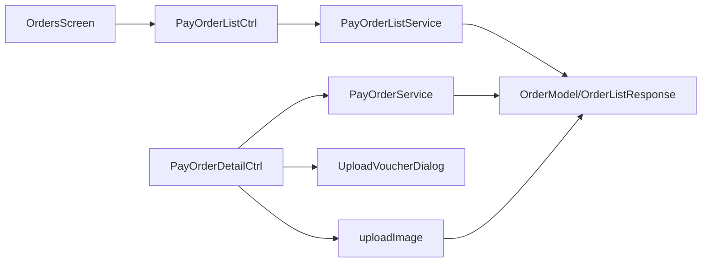

# 支付订单管理

<cite>
**本文引用的文件**
- [orders_data.dart](file://lib/pages/pay_order_list/model/orders_data.dart)
- [orders_data.freezed.dart](file://lib/pages/pay_order_list/model/orders_data.freezed.dart)
- [orders_data.g.dart](file://lib/pages/pay_order_list/model/orders_data.g.dart)
- [common.dart](file://lib/global/enum/common.dart)
- [pay_order_list.dart](file://lib/pages/pay_order_list/service/pay_order_list.dart)
- [controller.dart](file://lib/pages/pay_order_list/controller.dart)
- [state.dart](file://lib/pages/pay_order_list/state.dart)
- [orders_screen.dart](file://lib/pages/pay_order_list/widgets/orders_screen.dart)
- [pay_order_service.dart](file://lib/pages/pay_order_detail/service/pay_order_service.dart)
- [payment_proof_request.dart](file://lib/pages/pay_order_detail/model/payment_proof_request.dart)
- [upload_voucher_dialog.dart](file://lib/pages/pay_order_detail/widgets/upload_voucher_dialog.dart)
- [upload.dart](file://lib/global/commom/upload.dart)
- [pay_order_detail_controller.dart](file://lib/pages/pay_order_detail/controller.dart)
</cite>

## 目录
1. [引言](#引言)
2. [项目结构](#项目结构)
3. [核心组件](#核心组件)
4. [架构总览](#架构总览)
5. [详细组件分析](#详细组件分析)
6. [依赖关系分析](#依赖关系分析)
7. [性能考虑](#性能考虑)
8. [故障排查指南](#故障排查指南)
9. [结论](#结论)

## 引言
本文件系统性阐述支付订单管理子系统的完整实现流程，重点覆盖以下方面：
- pay_order_list 模块如何通过分页参数（page、pageSize）从后端拉取订单数据，并结合 PayOrderListService 的 getOrderList 调用过程进行解析；
- orders_data.dart 中 OrderModel 的字段结构，包括订单状态枚举（status）、金额、时间戳等关键属性及其业务含义；
- pay_order_detail 页面中“上传支付凭证”的功能实现：从 upload_voucher_dialog 组件的弹窗逻辑，到图片选择、压缩处理、上传进度显示及与 pay_order_service 的交互细节；
- 控制器（controller）如何协调视图与服务层的通信；
- 性能优化建议（懒加载、缓存策略）以提升列表渲染效率；
- 常见问题排查指南（订单状态未及时更新、凭证上传失败等）。

## 项目结构
支付订单管理子系统主要由三层构成：
- 视图层（Widgets）：负责用户交互与界面展示，如订单列表页、订单详情页、上传凭证弹窗等；
- 控制器层（Bloc/Cubit）：负责状态管理与业务编排，如列表刷新/加载更多、凭证上传与保存；
- 服务层（Retrofit/Dio）：负责与后端 API 交互，如获取订单列表、获取订单详情、保存支付凭证。

图表来源
- [orders_screen.dart](file://lib/pages/pay_order_list/widgets/orders_screen.dart#L1-L618)
- [controller.dart](file://lib/pages/pay_order_list/controller.dart#L1-L179)
- [pay_order_list.dart](file://lib/pages/pay_order_list/service/pay_order_list.dart#L1-L31)
- [pay_order_detail_controller.dart](file://lib/pages/pay_order_detail/controller.dart#L1-L395)
- [pay_order_service.dart](file://lib/pages/pay_order_detail/service/pay_order_service.dart#L1-L35)
- [upload_voucher_dialog.dart](file://lib/pages/pay_order_detail/widgets/upload_voucher_dialog.dart#L1-L303)

章节来源
- [orders_screen.dart](file://lib/pages/pay_order_list/widgets/orders_screen.dart#L1-L618)
- [controller.dart](file://lib/pages/pay_order_list/controller.dart#L1-L179)
- [pay_order_list.dart](file://lib/pages/pay_order_list/service/pay_order_list.dart#L1-L31)
- [pay_order_detail_controller.dart](file://lib/pages/pay_order_detail/controller.dart#L1-L395)
- [pay_order_service.dart](file://lib/pages/pay_order_detail/service/pay_order_service.dart#L1-L35)
- [upload_voucher_dialog.dart](file://lib/pages/pay_order_detail/widgets/upload_voucher_dialog.dart#L1-L303)

## 核心组件
- 订单模型与状态枚举
  - 订单模型：OrderModel，包含订单标识、编号、状态、油品类型、单价、购买量、总金额、创建/更新时间、银行账户信息、备注、可用库存、支付凭证URL列表等字段；
  - 订单状态枚举：OrderStatus，包含“待支付”、“已支付”、“已完成”、“已取消”，并提供从数值到枚举的转换；
  - 订单列表响应：OrderListResponse，包含列表、总数、当前页、页大小等分页信息。
- 列表服务与控制器
  - PayOrderListService：提供 getOrderList(status, page, pageSize) 接口；
  - PayOrderListCtrl：负责分页加载、刷新、错误处理、取消订单等；
  - PayOrderListState：封装列表状态、分页标志、错误信息等。
- 详情服务与控制器
  - PayOrderService：提供 getOrderDetail(id)、savePaymentProof(id, request)；
  - PayOrderDetailCtrl：负责加载订单详情、选择/删除图片、上传凭证、保存凭证、取消订单等；
  - PaymentProofRequest：保存凭证的请求体，包含凭证URL列表。
- 上传凭证弹窗
  - UploadVoucherDialog：负责图片网格展示、新增/删除、预览、最大数量限制、上传进度提示等；
  - 上传工具：upload.dart 中的 uploadImage 方法，基于签名直传 OSS。

章节来源
- [orders_data.dart](file://lib/pages/pay_order_list/model/orders_data.dart#L1-L63)
- [orders_data.freezed.dart](file://lib/pages/pay_order_list/model/orders_data.freezed.dart#L72-L593)
- [orders_data.g.dart](file://lib/pages/pay_order_list/model/orders_data.g.dart#L50-L77)
- [common.dart](file://lib/global/enum/common.dart#L45-L63)
- [pay_order_list.dart](file://lib/pages/pay_order_list/service/pay_order_list.dart#L1-L31)
- [controller.dart](file://lib/pages/pay_order_list/controller.dart#L1-L179)
- [state.dart](file://lib/pages/pay_order_list/state.dart#L1-L46)
- [pay_order_service.dart](file://lib/pages/pay_order_detail/service/pay_order_service.dart#L1-L35)
- [payment_proof_request.dart](file://lib/pages/pay_order_detail/model/payment_proof_request.dart#L1-L20)
- [upload_voucher_dialog.dart](file://lib/pages/pay_order_detail/widgets/upload_voucher_dialog.dart#L1-L303)
- [upload.dart](file://lib/global/commom/upload.dart#L1-L72)

## 架构总览
支付订单管理采用“视图-控制器-服务”分层架构，配合 Freezed 模型与 Retrofit 接口，实现清晰的数据流与职责分离。

图表来源
- [controller.dart](file://lib/pages/pay_order_list/controller.dart#L64-L109)
- [pay_order_list.dart](file://lib/pages/pay_order_list/service/pay_order_list.dart#L13-L20)

章节来源
- [controller.dart](file://lib/pages/pay_order_list/controller.dart#L64-L109)
- [pay_order_list.dart](file://lib/pages/pay_order_list/service/pay_order_list.dart#L13-L20)

## 详细组件分析

### 订单列表分页与数据获取
- 分页参数
  - page：当前页（首次加载置为1）；
  - pageSize：每页条数（固定为10）；
  - status：过滤条件（null 表示全部，对应不同状态值）。
- 控制器逻辑
  - onRefresh：重置状态、清空列表（当状态切换时）、调用 _loadData；
  - onLoadMore：在非刷新场景下追加数据；
  - _loadData：计算页码、调用服务、合并结果、更新 hasMore、pageStatus、refreshController 指示器；
  - 错误处理：区分刷新/加载更多场景，设置错误状态与消息。
- 视图层联动
  - OrdersScreen 使用 TabBar 切换状态，Tab 选择时调用 onRefresh(status)；
  - 使用 PullOrRefreshEasy 实现下拉刷新与上拉加载；
  - ListView.builder 渲染订单卡片，点击进入详情页。

图表来源
- [controller.dart](file://lib/pages/pay_order_list/controller.dart#L33-L109)
- [orders_screen.dart](file://lib/pages/pay_order_list/widgets/orders_screen.dart#L33-L52)

章节来源
- [controller.dart](file://lib/pages/pay_order_list/controller.dart#L33-L109)
- [orders_screen.dart](file://lib/pages/pay_order_list/widgets/orders_screen.dart#L33-L52)

### 订单模型与状态枚举
- OrderModel 字段要点
  - 标识与编号：id、orderNo；
  - 状态：status（OrderStatus），用于前端展示与业务流转；
  - 油品与数量：fuelType、purchaseTon；
  - 金额：totalAmount；
  - 时间戳：createdAt、updatedAt；
  - 银行信息：accountName、bankAccount、bankName、bankBranchNumber；
  - 备注与库存：remark、availableInventory；
  - 支付凭证URL列表：paymentProofUrls。
- 订单状态枚举
  - PendingPayment（待支付）、PaymentUploaded（已支付）、Completed（已完成）、Cancelled（已取消）；
  - 提供 fromValue(int) 转换，保证后端数值与前端枚举一致。
- JSON 序列化
  - 使用 @JsonSerializable 与 freezed 自动生成序列化/反序列化代码；
  - status 字段通过自定义转换函数映射。

图表来源
- [orders_data.dart](file://lib/pages/pay_order_list/model/orders_data.dart#L7-L63)
- [orders_data.freezed.dart](file://lib/pages/pay_order_list/model/orders_data.freezed.dart#L476-L593)
- [orders_data.g.dart](file://lib/pages/pay_order_list/model/orders_data.g.dart#L50-L77)
- [common.dart](file://lib/global/enum/common.dart#L45-L63)

章节来源
- [orders_data.dart](file://lib/pages/pay_order_list/model/orders_data.dart#L7-L63)
- [orders_data.freezed.dart](file://lib/pages/pay_order_list/model/orders_data.freezed.dart#L476-L593)
- [orders_data.g.dart](file://lib/pages/pay_order_list/model/orders_data.g.dart#L50-L77)
- [common.dart](file://lib/global/enum/common.dart#L45-L63)

### 上传支付凭证流程（pay_order_detail）
- 弹窗逻辑
  - UploadVoucherDialog：支持查看已上传与新选择的图片，删除、预览、最大数量限制；
  - 控制器通过 initUploadDialog 将订单中的凭证URL复制到 currentProofUrls，便于弹窗编辑。
- 图片选择与处理
  - pickSingleImage：从相册选择图片，限制最多5张；
  - 本地图片选择后，控制器维护 selectedImagePaths；
  - 上传前不进行压缩（根据实现，若需压缩可在上传前增加步骤）。
- 上传与保存
  - uploadAndSaveProof：顺序上传新图片，收集返回的URL，合并 currentProofUrls 与 uploadedUrls；
  - 保存凭证：调用 payOrderService.savePaymentProof，提交 PaymentProofRequest；
  - 成功后刷新订单详情，使状态与UI同步。
- 交互细节
  - 上传进度：通过 isUploading 与 uploadingImageIndices 控制 UI；
  - 错误处理：捕获单张图片上传异常，不影响整体流程；
  - 保存并发：_pendingSaveOperation 防止重复保存导致竞态。

图表来源
- [pay_order_detail_controller.dart](file://lib/pages/pay_order_detail/controller.dart#L164-L254)
- [pay_order_detail_controller.dart](file://lib/pages/pay_order_detail/controller.dart#L256-L307)
- [upload_voucher_dialog.dart](file://lib/pages/pay_order_detail/widgets/upload_voucher_dialog.dart#L1-L303)
- [upload.dart](file://lib/global/commom/upload.dart#L1-L72)
- [pay_order_service.dart](file://lib/pages/pay_order_detail/service/pay_order_service.dart#L14-L26)

章节来源
- [pay_order_detail_controller.dart](file://lib/pages/pay_order_detail/controller.dart#L164-L254)
- [pay_order_detail_controller.dart](file://lib/pages/pay_order_detail/controller.dart#L256-L307)
- [upload_voucher_dialog.dart](file://lib/pages/pay_order_detail/widgets/upload_voucher_dialog.dart#L1-L303)
- [upload.dart](file://lib/global/commom/upload.dart#L1-L72)
- [pay_order_service.dart](file://lib/pages/pay_order_detail/service/pay_order_service.dart#L14-L26)

### 控制器与服务层通信
- 列表控制器
  - 通过 payOrderListService.getOrderList(status, page, pageSize) 获取数据；
  - 使用 EasyRefreshController 控制刷新/加载指示器；
  - 通过 emit 更新状态，驱动视图渲染。
- 详情控制器
  - 通过 payOrderService.getOrderDetail(id) 获取详情；
  - 通过 payOrderService.savePaymentProof(id, request) 保存凭证；
  - 通过 payOrderListService.cancelOrder(id, reason) 取消订单。

章节来源
- [controller.dart](file://lib/pages/pay_order_list/controller.dart#L64-L109)
- [pay_order_list.dart](file://lib/pages/pay_order_list/service/pay_order_list.dart#L13-L20)
- [pay_order_detail_controller.dart](file://lib/pages/pay_order_detail/controller.dart#L40-L89)
- [pay_order_service.dart](file://lib/pages/pay_order_detail/service/pay_order_service.dart#L14-L26)

## 依赖关系分析
- 模型依赖
  - OrderModel 依赖 OrderStatus 枚举；
  - PaymentProofRequest 仅包含凭证URL列表；
  - Freezed 生成的序列化代码与 @JsonKey(fromJson) 转换。
- 控制器依赖
  - 列表控制器依赖 PayOrderListService 与 OrdersScreen；
  - 详情控制器依赖 PayOrderService、UploadVoucherDialog、upload.dart。
- 视图依赖
  - OrdersScreen 依赖 TabBar、PullOrRefreshEasy、ListView.builder；
  - UploadVoucherDialog 依赖 CachedNetworkImage、ImageViewer。

图表来源
- [orders_screen.dart](file://lib/pages/pay_order_list/widgets/orders_screen.dart#L1-L618)
- [controller.dart](file://lib/pages/pay_order_list/controller.dart#L1-L179)
- [pay_order_list.dart](file://lib/pages/pay_order_list/service/pay_order_list.dart#L1-L31)
- [pay_order_detail_controller.dart](file://lib/pages/pay_order_detail/controller.dart#L1-L395)
- [pay_order_service.dart](file://lib/pages/pay_order_detail/service/pay_order_service.dart#L1-L35)
- [upload_voucher_dialog.dart](file://lib/pages/pay_order_detail/widgets/upload_voucher_dialog.dart#L1-L303)
- [upload.dart](file://lib/global/commom/upload.dart#L1-L72)

章节来源
- [orders_screen.dart](file://lib/pages/pay_order_list/widgets/orders_screen.dart#L1-L618)
- [controller.dart](file://lib/pages/pay_order_list/controller.dart#L1-L179)
- [pay_order_list.dart](file://lib/pages/pay_order_list/service/pay_order_list.dart#L1-L31)
- [pay_order_detail_controller.dart](file://lib/pages/pay_order_detail/controller.dart#L1-L395)
- [pay_order_service.dart](file://lib/pages/pay_order_detail/service/pay_order_service.dart#L1-L35)
- [upload_voucher_dialog.dart](file://lib/pages/pay_order_detail/widgets/upload_voucher_dialog.dart#L1-L303)
- [upload.dart](file://lib/global/commom/upload.dart#L1-L72)

## 性能考虑
- 列表渲染优化
  - 使用 ListView.builder 按需渲染，避免一次性构建大量卡片；
  - 在 OrdersScreen 中按 Tab 切换时仅触发 onRefresh，减少不必要的重建；
  - 对于大图/网络图片，可结合缓存组件（如已使用的 CachedNetworkImage）降低重复加载开销。
- 上传性能
  - 当前实现逐张上传，若图片较多可考虑并发上传并设置最大并发数；
  - 上传前可增加压缩策略（如调整分辨率、质量），以减少带宽与存储成本；
  - 上传进度 UI 通过 uploadingImageIndices 展示，有助于提升用户体验。
- 状态与内存
  - 控制器内部使用 _pendingSaveOperation 防止重复保存；
  - 列表控制器在状态切换时清空列表，避免旧数据干扰；
  - 使用 Freezed 模型的 copyWith 语义化更新状态，减少不必要的对象重建。

[本节为通用性能建议，无需列出具体文件来源]

## 故障排查指南
- 订单状态未及时更新
  - 现象：上传凭证后状态仍为“待支付”；
  - 排查：确认保存凭证成功后是否调用了 loadOrderDetail 刷新详情；检查后端返回的状态是否与前端枚举一致；
  - 参考路径：[pay_order_detail_controller.dart](file://lib/pages/pay_order_detail/controller.dart#L285-L307)、[orders_data.dart](file://lib/pages/pay_order_list/model/orders_data.dart#L27-L63)。
- 凭证上传失败
  - 现象：弹窗提示上传失败或部分图片上传失败；
  - 排查：检查 OSS 直传签名是否成功、host/path 是否为空、状态码是否为200；查看日志输出；
  - 参考路径：[upload.dart](file://lib/global/commom/upload.dart#L1-L72)、[pay_order_detail_controller.dart](file://lib/pages/pay_order_detail/controller.dart#L184-L254)。
- 列表加载异常
  - 现象：下拉刷新/上拉加载失败，出现错误页；
  - 排查：检查 onRefresh/onLoadMore 的错误分支是否设置 pageStatus.error；确认网络请求是否抛出异常；
  - 参考路径：[controller.dart](file://lib/pages/pay_order_list/controller.dart#L92-L109)、[orders_screen.dart](file://lib/pages/pay_order_list/widgets/orders_screen.dart#L118-L147)。
- 取消订单无效
  - 现象：点击取消订单无反应；
  - 排查：确认 reasonOfCancellation 弹窗是否弹出、输入原因是否为空、调用 cancelOrder 是否成功；刷新列表验证状态变更；
  - 参考路径：[controller.dart](file://lib/pages/pay_order_list/controller.dart#L123-L177)、[pay_order_detail_controller.dart](file://lib/pages/pay_order_detail/controller.dart#L325-L330)。

章节来源
- [pay_order_detail_controller.dart](file://lib/pages/pay_order_detail/controller.dart#L184-L307)
- [upload.dart](file://lib/global/commom/upload.dart#L1-L72)
- [controller.dart](file://lib/pages/pay_order_list/controller.dart#L92-L109)
- [orders_screen.dart](file://lib/pages/pay_order_list/widgets/orders_screen.dart#L118-L147)
- [orders_data.dart](file://lib/pages/pay_order_list/model/orders_data.dart#L27-L63)

## 结论
支付订单管理子系统通过清晰的分层设计与模型驱动开发，实现了从列表分页到详情凭证上传的完整闭环。列表侧采用分页参数与状态切换控制，详情侧通过弹窗与上传工具实现凭证的增删改查与持久化。建议在后续迭代中进一步引入并发上传、图片压缩与更细粒度的错误提示，以持续提升性能与用户体验。