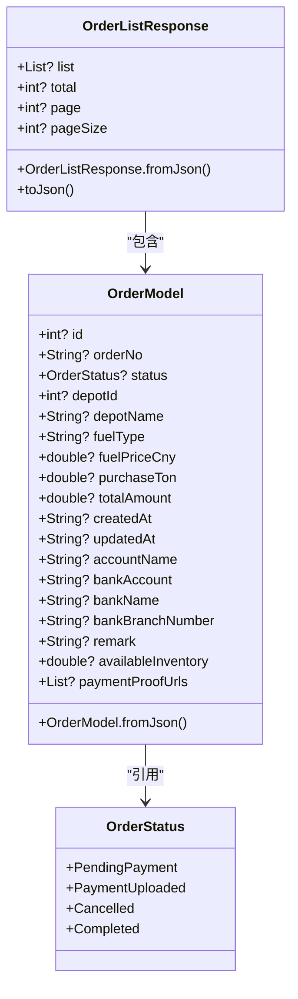
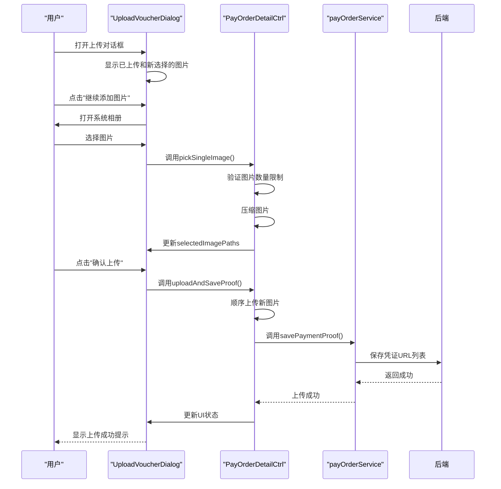
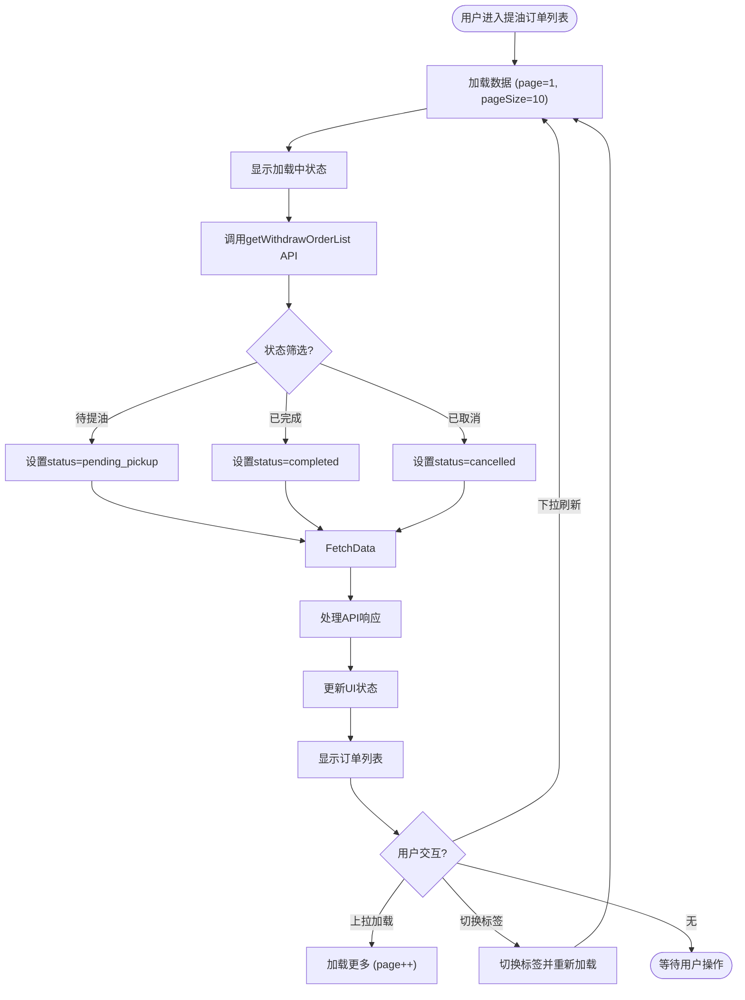
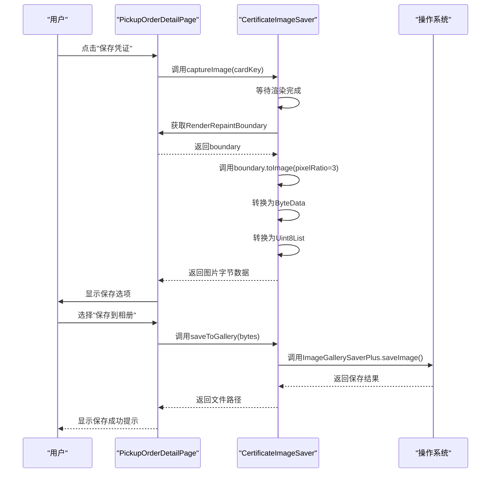

# 订单管理模块

<cite>
**本文档引用的文件**   
- [orders_data.dart](file://lib/pages/pay_order_list/model/orders_data.dart)
- [pay_order_list.dart](file://lib/pages/pay_order_list/service/pay_order_list.dart)
- [pay_order_list_controller.dart](file://lib/pages/pay_order_list/controller.dart)
- [upload_voucher_dialog.dart](file://lib/pages/pay_order_detail/widgets/upload_voucher_dialog.dart)
- [pay_order_detail_controller.dart](file://lib/pages/pay_order_detail/controller.dart)
- [pickup_order_list_controller.dart](file://lib/pages/pickup_order_list/controller.dart)
- [pickup_order_list_view.dart](file://lib/pages/pickup_order_list/view.dart)
- [certificate_image_saver.dart](file://lib/pages/pickup_order_detail/utils/certificate_image_saver.dart)
- [common.dart](file://lib/global/enum/common.dart)
- [upload.dart](file://lib/global/commom/upload.dart)
- [oil_pickup_service.dart](file://lib/pages/oil_pickup/service/oil_pickup_service.dart)
</cite>

## 目录
1. [引言](#引言)
2. [支付订单子系统](#支付订单子系统)
3. [提油订单子系统](#提油订单子系统)
4. [服务调用差异分析](#服务调用差异分析)
5. [性能优化建议](#性能优化建议)
6. [常见问题排查指南](#常见问题排查指南)
7. [结论](#结论)

## 引言
本系统文档详细描述了油品业务应用中的订单管理模块，该模块由两个核心子系统组成：支付订单和提油订单。支付订单子系统处理用户购买油品的支付流程，包括订单创建、支付凭证上传和状态管理。提油订单子系统则专注于用户提油请求的处理，包括提油凭证的生成、保存和分享。两个子系统通过不同的API接口与后端服务通信，实现了完整的油品交易生命周期管理。本文档将深入分析两个子系统的实现细节，包括数据模型、状态管理、用户界面交互和网络通信机制。

## 支付订单子系统

### 支付订单列表分页机制
支付订单列表通过分页机制加载订单数据，采用`EasyRefreshController`实现下拉刷新和上拉加载更多功能。系统默认每页加载10条订单记录，控制器在初始化时自动触发首次数据加载。当用户执行下拉刷新操作时，系统会重置当前页码为1并重新获取数据；当用户上拉加载更多时，系统会递增页码并获取下一页数据。数据加载过程中，系统会根据当前状态更新UI，显示加载中、加载失败或无更多数据的提示。分页逻辑在`PayOrderListCtrl`控制器中实现，通过调用`payOrderListService.getOrderList`服务方法获取订单列表数据。

**Section sources**
- [pay_order_list_controller.dart](file://lib/pages/pay_order_list/controller.dart#L15-L179)
- [pay_order_list.dart](file://lib/pages/pay_order_list/service/pay_order_list.dart#L1-L31)

### orders_data模型字段解析
`orders_data`模型定义了支付订单的核心数据结构，包含订单列表响应和订单模型两个主要类。`OrderListResponse`类包含订单列表、总记录数、当前页码和每页大小等分页信息。`OrderModel`类定义了单个订单的详细信息，包括订单ID、订单编号、订单状态、油站ID、油站名称、油品类型、油品单价、购买吨数、总金额、创建时间、更新时间、账户名称、银行账号、银行名称、银行支行号、备注、可用库存和支付凭证URL列表等字段。订单状态通过`OrderStatus`枚举类型表示，支持待支付、已支付、已取消和已完成四种状态。

**Diagram sources**
- [orders_data.dart](file://lib/pages/pay_order_list/model/orders_data.dart#L7-L62)

### 支付凭证上传实现细节
支付凭证上传功能通过`upload_voucher_dialog`组件实现，该组件提供了一个对话框界面，允许用户选择、预览和管理支付凭证图片。组件支持最多上传5张图片，格式限制为JPG和PNG。图片选择通过系统相册实现，选择的图片会先压缩至1920x1080分辨率并降低质量至85%以优化上传性能。上传过程中，系统会显示进度指示器，用户可以随时删除已选择或已上传的图片。已上传的凭证通过`CachedNetworkImage`组件进行缓存显示，新选择的本地图片通过`Image.file`组件直接显示。图片预览功能允许用户点击任意图片进入全屏查看模式。

**Diagram sources**
- [upload_voucher_dialog.dart](file://lib/pages/pay_order_detail/widgets/upload_voucher_dialog.dart#L7-L303)
- [pay_order_detail_controller.dart](file://lib/pages/pay_order_detail/controller.dart#L91-L254)

## 提油订单子系统

### 提油订单列表筛选逻辑
提油订单列表提供基于状态的筛选功能，用户可以通过顶部标签栏在"待提油"、"已完成"和"已取消"三个状态之间切换。筛选逻辑在`PickupOrderListCtrl`控制器中实现，通过`switchTab`方法更新当前标签索引并重新加载数据。每个标签对应不同的状态筛选条件：待提油对应`pending_pickup`，已完成对应`completed`，已取消对应`cancelled`。系统同样采用分页机制加载数据，每页10条记录，支持下拉刷新和上拉加载更多。状态标识通过不同的UI样式呈现，选中的标签会显示为主色调背景和白色文字，未选中的标签为灰色文字。

**Diagram sources**
- [pickup_order_list_controller.dart](file://lib/pages/pickup_order_list/controller.dart#L8-L131)
- [pickup_order_list_view.dart](file://lib/pages/pickup_order_list/view.dart#L1-L232)

### 提油凭证生成与保存流程
提油凭证的生成与保存通过`certificate_image_saver`工具类实现。该流程首先通过`captureImage`方法从`RepaintBoundary`获取凭证卡片的渲染图像，然后将图像转换为PNG格式的字节数据。保存功能提供三种选项：保存到相册、保存到用户选择的目录和分享。保存到相册使用`ImageGallerySaverPlus`插件实现，保存到目录使用`FilePicker`让用户选择目标路径。分享功能通过`SharePlus`插件实现，支持将凭证图片与其他应用共享。整个流程确保了凭证图片的高质量输出，像素比率为3，保证了在不同设备上的清晰显示。

**Diagram sources**
- [certificate_image_saver.dart](file://lib/pages/pickup_order_detail/utils/certificate_image_saver.dart#L1-L103)

## 服务调用差异分析
支付订单和提油订单子系统在服务调用上存在显著差异。支付订单服务采用`@RestApi`注解定义，通过`payOrderListService`实例调用，主要接口包括`getOrderList`和`cancelOrder`，使用标准的HTTP GET和POST方法。提油订单服务则通过`oilPickupService`实例调用，主要接口包括`getWithdrawOrderList`、`getWithdrawDetail`和`cancelWithdraw`，同样使用RESTful风格的API设计。两个子系统都使用Dio作为HTTP客户端，但提油订单服务的接口路径和参数命名更加语义化，如使用`withdraw`替代`order`，体现了业务领域的特定术语。错误处理方面，两个子系统都采用了类似的try-catch模式，但在用户反馈上有所不同：支付订单系统使用Toast提示，而提油订单系统在取消订单后会自动返回上一页。

**Section sources**
- [pay_order_list.dart](file://lib/pages/pay_order_list/service/pay_order_list.dart#L1-L31)
- [oil_pickup_service.dart](file://lib/pages/oil_pickup/service/oil_pickup_service.dart#L1-L50)

## 性能优化建议

### 列表项懒加载
建议在订单列表中实现列表项懒加载，仅在项目进入可视区域时才加载其内容。这可以通过`ListView.builder`的延迟构建特性实现，结合`VisibilityDetector`或`IntersectionObserver`来检测项目可见性。对于包含图片的订单项，应使用`cached_network_image`插件的缓存功能，避免重复下载相同的图片资源。同时，可以设置图片的占位符和错误占位符，提升用户体验。

### 图片缓存策略
建议采用多级图片缓存策略：内存缓存、磁盘缓存和网络缓存。内存缓存使用LRU（最近最少使用）算法，存储最近访问的图片；磁盘缓存将图片持久化存储在设备上，避免重复下载；网络缓存则利用HTTP协议的缓存头信息。对于支付凭证和提油凭证这类重要图片，建议设置较长的缓存有效期，并提供手动刷新选项。同时，应监控缓存大小，当达到阈值时自动清理最久未使用的图片。

**Section sources**
- [upload_voucher_dialog.dart](file://lib/pages/pay_order_detail/widgets/upload_voucher_dialog.dart#L106-L142)
- [certificate_image_saver.dart](file://lib/pages/pickup_order_detail/utils/certificate_image_saver.dart#L50-L57)

## 常见问题排查指南

### 订单状态更新延迟
当遇到订单状态更新延迟时，首先检查网络连接是否正常，然后验证API响应数据是否正确。如果后端返回的状态已更新但前端未显示，可能是状态同步机制存在问题。建议检查`loadOrderDetail`方法的调用时机，确保在相关操作后及时刷新订单详情。同时，检查`OrderStatus`枚举的`fromValue`方法是否能正确解析后端返回的状态值。

### 凭证上传失败
凭证上传失败可能由多种原因引起。首先检查图片大小和格式是否符合要求（JPG/PNG，不超过5张）。然后验证上传签名服务是否正常工作，检查`getUploadSignature`接口的响应是否包含有效的host和path。如果上传过程中断，检查网络连接稳定性。最后，确认OSS（对象存储服务）的凭证和权限配置是否正确，特别是`securityToken`的有效期。

**Section sources**
- [pay_order_detail_controller.dart](file://lib/pages/pay_order_detail/controller.dart#L247-L253)
- [upload.dart](file://lib/global/commom/upload.dart#L49-L72)

## 结论
订单管理模块的两个子系统——支付订单和提油订单——通过清晰的职责划分和一致的设计模式，实现了完整的油品交易管理功能。支付订单子系统侧重于财务交易的安全性和凭证管理，而提油订单子系统则关注提油流程的便捷性和凭证的可分享性。两个子系统都采用了现代化的Flutter架构模式，包括BLoC状态管理和响应式UI更新。通过实施建议的性能优化措施和遵循常见问题排查指南，可以进一步提升系统的稳定性和用户体验。